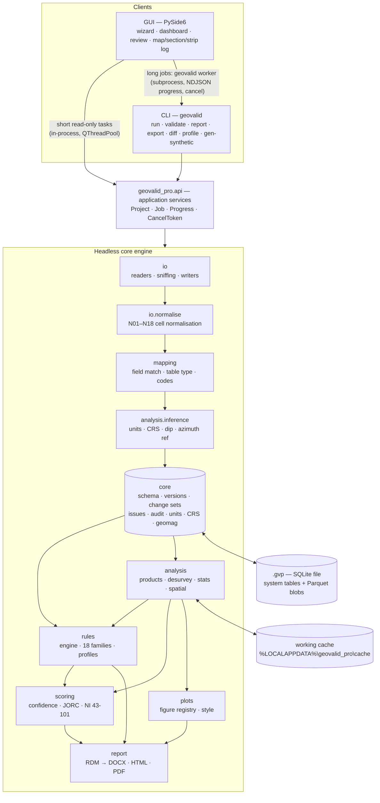

# GEOVALID PRO — 01 · Final Architecture
### معماری نهایی سامانه (Final Architecture)

| | |
|---|---|
| Document | `01_architecture.md`, design package item (1) of brief §18 |
| Status | **DRAFT v0.1 for client approval.** No code is written against it until it is approved. |
| Date | 2026-10-22 |
| Governs | Process and module structure; technology stack and licences; physical project container; rule-engine mechanics; derived-product cache; change-management mechanics; scoring engine; reporting pipeline; GUI; CLI; performance; security; packaging |
| Defers to | `02_data_schema.md` (tables, fields, enums, keys, normalisation steps N01–N18, fingerprint formula), `03_rule_catalogue.md` (rule logic, parameters, thresholds, numbering of new rules), `04_phase_plan.md` (schedule of modules and spikes), `05_traceability.md` (brief clause → design → test) |

Section numbers §0–§19 refer to the requirements brief. "02 §x" refers to the data schema. Rule IDs are the brief §17 IDs; a rule this document needs but the brief does not list is written `FAM-*` and is numbered in `03_rule_catalogue.md`.

---

## 0. Decisions at a glance

| # | Area | Decision | Relation to brief |
|---|---|---|---|
| A1 | Process model | One **headless engine** (`geovalid_pro` without `gui/`). The CLI calls it in-process. The GUI calls it in-process for short read-only tasks and through a **worker subprocess** (the same executable) for long jobs. | Refines §1.1 |
| A2 | Project file | `.gvp` = **one SQLite file** holding system and reference tables plus content-addressed **Parquet blobs**. A disposable local cache is used for fast columnar reads (02 §8). | Refines §1.1 "Parquet/SQLite project file" |
| A3 | Data engine | **pandas (≥ 2.2, Copy-on-Write) on pyarrow dtypes** is the only in-memory API that rules and analysis see. **DuckDB** is embedded for four named set-based operations. Polars is rejected. | Addition |
| A4 | PDF | The **same Jinja2 HTML** is rendered to PDF by **Qt WebEngine** (`QWebEnginePage.printToPdf`). WeasyPrint and ReportLab are rejected. | **Deviation** (§1.1 Reports) |
| A5 | GIS I/O | **pyogrio** (through geopandas 1.x) replaces fiona. **ezdxf** reads DXF instead of the GDAL DXF driver. rasterio and shapely 2 are kept. | **Deviation** (§1.1 Spatial) |
| A6 | MS Access | Tiered reader: **ACE ODBC (pyodbc)** → **pure-Python fallback (access-parser, vendored)** → guided CSV export. | Refines §2.1 |
| A7 | Proprietary formats | Surpac ASCII `.str`/`.dtm`: implemented. Datamine `.dm` and Micromine `.DAT`: **time-boxed spikes** against client sample files. CSV exports are the supported path until a spike passes. | Honest scoping of §2.1/§2.3 |
| A8 | Declination | Own **IGRF-14 / WMM2025** spherical-harmonic synthesis from bundled coefficient files, with project override. Grid convergence comes from pyproj. | Addition (§4.2) |
| A9 | Persian text | matplotlib: `arabic_reshaper` + `python-bidi` per wrapped line, Vazirmatn. DOCX: `w:bidi`/`w:rtl`/complex-script fonts with Vazirmatn **embedded**. HTML/PDF: native Chromium shaping. | As §1.1, made precise |
| A10 | Fonts | **Vazirmatn** (Persian) and **Inter** (Latin), both OFL-1.1, bundled and embedded in every output | Chooses Inter over Source Sans 3 |
| A11 | Collar method inference | **Weights-of-evidence scoring** with log-odds contributions that are shown and editable. No trained ML model. scikit-learn is kept only for Gaussian mixtures and robust covariance. | Refines §3.2 |
| A12 | Rule packaging | One sub-package per family, **one file per rule**, decorator registration. User rules are declarative (safe expressions). No user Python by default. | Reconciles §1.2 with §18 |
| A13 | GUI plotting | **pyqtgraph** for the interactive map, section and strip log. **matplotlib-Qt** for report-identical charts. Qt Charts and Qt Data Visualization are **banned** (GPL-only). | Refines §1.1 |
| A14 | Narrative | Deterministic **phrasebook engine** (YAML, fa/en) driven by computed findings and thresholds. **No LLM**: the report is produced fully offline. | Makes §14.1 implementable offline |
| A15 | Packaging | **PyInstaller one-dir + Inno Setup**. Nuitka is not used. The packaging pipeline runs **from Phase 1**, not first in Phase 5. | **Deviation in timing** (§18) |
| A16 | Offline | Enforced technically (socket guard, WebEngine request interceptor, PROJ/GDAL/DuckDB network off) and proven by a no-network CI job | Makes §1.1 testable |
| A17 | Determinism | Seeded statistics, stable sorts, content hashes. Identical inputs give identical issues, fingerprints and report numbers (02 §1.10). | Addition |
| A18 | Reports from working data | Final reports and **all exports** come from a `RELEASE` (02 §9). A **draft** report from the working version is allowed, watermarked on every page. | Clarifies 02 §9.5 |

---

## 1. Architectural overview

### 1.1 Principles
1. **Headless core.** All behaviour lives in the engine. The GUI and the CLI are thin clients of `geovalid_pro.api`. Nothing in the engine imports Qt widgets. Qt WebEngine is imported only by the PDF renderer.
2. **Data are immutable; edits are change sets.** The raw snapshot is frozen. Every edit is a change set with who, when, old, new and why (02 §1.2, §5.7).
3. **Rules are pure.** A rule is a function of (dataset version, derived products, parameters) → issues. It cannot write data, and this is enforced (§7.8).
4. **Every inference is a record with evidence**, and every one can be overridden (02 §1.9, brief §19).
5. **Columnar and vectorised.** Hot paths contain no per-row Python loops. Every algorithm is expressed as sort, group, shift, searchsorted or KD-tree operations.
6. **Offline by construction.** No code path opens a network connection.
7. **Bilingual by construction.** Every user-facing string has fa and en forms. RTL correctness is tested, not assumed.
8. **Reproducible.** Every number in a report can be regenerated from the source bytes, the decisions taken and the software version.

### 1.2 System overview



### 1.3 Data flow

```
 source files ──► IMPORT ──► NORMALISE ──► MAP ──────► VALIDATE ──► ANALYSE ──► SCORE ──► REVIEW / FIX ──┐
   (bytes)        V0 raw     N01–N18        Vb          issues        drv_*       DCI       change sets    │
                  snapshot   (cell text)    canonical   (fingerprint) products    JORC      (DRAFT→APPLIED)│
                                            base +                                                         │
                                            inferences          ▲ incremental re-run                       │
                                                                └──────────── Vw = Vb ⊕ CS₁…CSₙ ◄──────────┘
                                                                                   │ freeze (release gates §7.6)
                                                                                   ▼
                                                                     RELEASE Vr ──► EXPORT · REPORT · CLEANED DB
```

| Stage | Input → output | Module | Persisted in | Re-runs when |
|---|---|---|---|---|
| Import | bytes → `source_file`, `raw_<n>` (all text) | `io.readers`, `io.sniff` | `.gvp` blobs (V0) | A new file is added |
| Normalise | raw text → normalised text and typed candidates + `normalisation_log` | `io.normalise` | `.gvp` (logs); output is part of Vb | Never on its own. It is part of the Vb build |
| Map | raw + `field_mapping` + decided inferences → canonical base Vb | `mapping`, `analysis.inference`, `mapping.build` | `.gvp` blobs (Vb) | The mapping or an inference decision changes (change sets are then rebased, §7.5) |
| Validate | Vw + products + profile → `issue`, `issue_context` | `rules.engine` | `.gvp` (SQLite) + Parquet issue snapshot in cache | On request; incremental (§5.4.4) |
| Analyse | Vw → `drv_*` products | `analysis` | cache (L1/L2); copied into `.gvp` on release | Its input column hashes or parameters change |
| Score | issues + products → `drv_confidence` | `scoring` | cache; `.gvp` on release | After each validation run |
| Review/fix | issues → `issue_review`, `change_set`, `change` | `api.review`, `core.changes` | `.gvp` (SQLite, append-only) | User action |
| Release | Vw → frozen Vr + frozen products | `core.versions` | `.gvp` | User action, after release gates pass |
| Export/report | Vr → files | `io.writers`, `report` | Output folder + `blob` (kind `REPORT`) + `audit_log` | User action |

### 1.4 Process and thread model

| Process / thread | Runs | Why |
|---|---|---|
| **GUI process — Qt main thread** | Widgets, models and painting only. It never runs a computation that takes more than ~50 ms. | Keeps the UI responsive |
| GUI process — `TaskPool` (QThreadPool, ≤ 4 threads) | Short, read-only tasks of a few seconds at most: issue filtering, record context, a chart's data, a strip log | Avoids subprocess start-up cost for interactive work |
| **Worker subprocess** (`geovalid worker --job <job.json>`) | Import, Vb build, validation run, release, report, export, diff. **At most one writing job per project.** | **Isolation:** a crash in a native library (GDAL, ACE driver, Chromium) cannot take the GUI down with unsaved review work. **No GIL contention** with the UI. **Hard cancel** is possible. **Memory:** a peak of several GB is returned to the OS when the job ends, whereas CPython would keep it resident in a long-lived GUI process. The GUI also exercises **exactly the CLI code path**: one engine, one behaviour. |
| CLI process | Same engine, in-process. Creates a headless `QGuiApplication` (`QT_QPA_PLATFORM=offscreen`) only when a PDF is requested. | CI and batch use |
| Figure-render pool (`concurrent.futures.ProcessPoolExecutor`, ≤ 4 processes) | matplotlib rendering of report figures | matplotlib is not thread-safe. Figure rendering is the longest single step of report generation. |

Inside the engine, **rules run sequentially in a deterministic order** (§5.4). Parallel speed-up comes from vectorised NumPy/BLAS kernels and from chunked permutation tests. This keeps determinism and avoids relying on pandas thread-safety, which is not guaranteed.

The GUI and its worker communicate through:
1. **NDJSON on stdout/stdin** (progress, log lines, cancel request, result summary);
2. **the project file itself** (SQLite in WAL mode; the worker writes in short transactions of ≤ 50 000 rows);
3. a **Parquet issue snapshot** in the cache, so the GUI loads a 1 M-issue run in under a second instead of reading it row by row from SQLite.

---

## 2. Package and module tree

### 2.1 Tree with responsibilities

```
geovalid_pro/
├── __init__.py               version; re-exports api.Project
├── __main__.py               `python -m geovalid_pro` → cli.main
├── api/                      APPLICATION SERVICES: the only surface gui/ and cli/ may call
│   ├── project.py            Project.create/open/close; lock; migrate; release; verify
│   ├── jobs.py               Job, JobResult, ProgressEvent, CancelToken, NDJSON codec, job manifest
│   ├── importing.py          add sources, preview, propose/confirm mapping, decide inferences, build Vb
│   ├── validation.py         plan and run rules (full or incremental); rule-execution matrix
│   ├── review.py             issue queries, status changes, bulk actions, draft change sets, apply/revert
│   ├── analysis.py           on-demand analyses for GUI panels (chart data, statistics, sections)
│   ├── reporting.py          report build (fa/en/bi; DOCX/PDF/HTML), figure set, issue log
│   ├── exporting.py          software, GIS and cleaned-database exports (from a release)
│   └── diffing.py            version comparison (VER family)
├── core/                     DOMAIN MODEL AND PERSISTENCE (no Qt, no plotting)
│   ├── container/            .gvp store (SQLite, blob store, chunked blob I/O), cache, locks, backups, migrations
│   ├── schema/               table specifications generated from 02 (fields, Arrow types, enums), validators
│   ├── store.py              ProjectStore (02 §8): column-projected, filtered, read-only reads by version
│   ├── versions.py           DatasetVersion (V0/Vb/Vw/Vr), manifests, column hashes, recipe hash, freeze
│   ├── changes.py            ChangeSet/Change model; apply (optimistic), revert, rebase, conflicts
│   ├── issues.py             Issue model, fingerprint (02 §5.5), status carry-over, message rendering
│   ├── inference.py          Inference/Evidence records; decision workflow
│   ├── audit.py              hash-chained audit_log (02 §5.8); chain verification on open
│   ├── units.py              unit catalogue and conversions (02 §2.5)
│   ├── crs.py                pyproj wrappers: transform, operation choice, convergence, geoid, local grids
│   ├── geomag.py             IGRF-14 / WMM2025 synthesis → declination, field, inclination
│   ├── calendar.py           Jalali ↔ Gregorian (33-year arithmetic cycle), Excel serials (1900/1904)
│   ├── i18n.py               language modes, digit and separator localisation, bidi isolates, glossary
│   ├── query.py              DuckDB facade (offline-locked configuration) for set-based operations
│   ├── hashing.py, ids.py    streaming SHA-256; UUIDv7
│   ├── offline.py            network guard (socket patch; PROJ/GDAL/DuckDB/Qt environment)
│   ├── settings.py           application settings (platformdirs); reviewer identity
│   └── log.py                logging configuration, run-log capture, crash handler
├── io/                       READERS AND WRITERS (bytes ⇄ raw tables ⇄ files)
│   ├── sniff.py              file type, encoding (N01), delimiter, header rows (N17), Excel date system
│   ├── normalise/            N01–N18 pipeline (02 §6); writes normalisation_log
│   ├── readers/
│   │   ├── text.py           CSV/TXT/fixed-width
│   │   ├── excel.py          XLSX/XLSM/XLSB/XLS: calamine values + openpyxl/xlrd number formats + merged ranges
│   │   ├── dbf.py            DBF (code page from LDID/.cpg)
│   │   ├── access.py         MDB/ACCDB, tiered (§3.5)
│   │   ├── sql.py            SQLite (stdlib); SQL Server/PostgreSQL through user-installed ODBC (read-only)
│   │   ├── surpac.py         .str/.dtm ASCII (binary variants are detected and refused with a message)
│   │   ├── datamine.py       .dm (SPIKE S-05; feature-flagged until it passes)
│   │   ├── micromine.py      .DAT (SPIKE S-06; feature-flagged)
│   │   ├── presets.py        acQuire, MX Deposit, Leapfrog export conventions (mapping templates)
│   │   ├── vector.py         SHP, GPKG, GeoJSON, KML/KMZ, FileGDB (read) via pyogrio
│   │   ├── raster.py         GeoTIFF, ESRI ASCII, SRTM .hgt, ALOS/ASTER tiles via rasterio
│   │   ├── points.py         XYZ/CSV point clouds; LAS/LAZ (laspy + lazrs)
│   │   ├── dxf.py            3DFACE, MESH, POLYFACE, POLYLINE/LWPOLYLINE (+elevation), POINT via ezdxf
│   │   └── mesh.py           OBJ, STL, PLY via trimesh
│   └── writers/
│       ├── software.py       Leapfrog, Datamine, Micromine, Surpac, Vulcan, generic CSV sets (export profiles)
│       ├── gis.py            GPKG, SHP, KML/KMZ: collars, 3D traces, intervals, flags, inferred method
│       ├── issue_log.py      issue log XLSX (XlsxWriter, pivot sheets) + CSV
│       ├── cleaned_db.py     cleaned database (02 §9.6): CSV set + XLSX + SQLite, QC_FLAG/QC_COMMENT, change log
│       └── surpac_str.py     .str writer; datamine_dm.py only if S-05 passes
├── mapping/                  SCHEMA MAPPING AND CODE HARMONISATION
│   ├── headers.py            header keys (N13), synonym index (en/fa) from field_dictionary
│   ├── matcher.py            candidate scoring (rapidfuzz + content checks) + one-to-one assignment
│   ├── table_type.py         table-kind classifier (collar, survey, interval, point, assay, QA/QC, …)
│   ├── assay_headers.py      analyte/unit/method/repeat token parser (02 §4.8)
│   ├── codes.py              code dictionaries; synonym proposals (fuzzy + abbreviations + fa/en equivalents)
│   ├── templates.py          mapping templates keyed by source signature; system presets
│   └── build.py              V0 + mapping + inferences → canonical base Vb (deterministic)
├── analysis/                 DERIVED PRODUCTS AND ANALYTICS (pure functions; persistence only through products.py)
│   ├── products.py           @product registry, keys, L1/L2/L3 cache, invalidation, variants
│   ├── desurvey.py           MIN_CURV / BAL_TAN / TAN; exact arc interpolation; drv_trace, drv_trace_compare
│   ├── survey_metrics.py     dogleg, lift/drift, spikes, magnetic-interference correlation
│   ├── intervals.py          interval algebra (overlap, gap, coverage); drv_interval_master
│   ├── composite.py          BEST_FIT / FIXED / DOMAIN_WHOLE compositing → drv_composite
│   ├── assay_wide.py         preferred values (02 §4.9.3) → drv_assay_wide (DuckDB pivot)
│   ├── inference/            depth unit, analyte unit, % scale, MS unit, coordinate format, CRS, zone, X/Y swap,
│   │                         Z datum, dip convention, azimuth reference, table type, campaign, sample type,
│   │                         collar survey method (weights of evidence)
│   ├── stats/                weighted descriptive statistics, outliers, top-cut, correlation/CLR/PCA,
│   │                         hypothesis tests, declustering, distribution fitting (GMM)
│   ├── geochem.py            stoichiometry, oxide factors, AI/CCPI, molar ratios, user inequalities
│   ├── qaqc.py               CRM/blank/duplicate/umpire metrics, Westgard rules, HARD, Thompson–Howarth, RMA
│   ├── logging_stats.py      code inventories, Markov transitions, diversity, logger effect, contingency tables
│   ├── spatial/              KD-tree service, TIN/grid DEM, sampling, slope, Voronoi, point pattern
│   │                         (Clark–Evans, Ripley K/L, grid detection), local Moran's I, Getis–Ord Gi*,
│   │                         variogram preview, pierce points, trace proximity, polygon overlay, swaths
│   └── version_diff.py       VER diff engine (DuckDB full outer joins on natural keys)
├── rules/                    RULE ENGINE AND CATALOGUE
│   ├── base.py               Rule, RuleMeta, RuleParams, Messages, IssueFrame schema
│   ├── registry.py           @register, discovery, catalogue export (md/xlsx/yaml, en/fa)
│   ├── profile.py            YAML loading (ruamel), inheritance, validation (pydantic), provenance, hashing
│   ├── engine.py             planner (applicability, dependency DAG), executor, result cache, post-processing
│   ├── severity.py           bands, aggregate escalation, demotion, suppressions
│   ├── messages.py           en/fa template rendering; placeholder parity checks
│   ├── expressions.py        safe expression language (user rules, narrative conditions, escalations)
│   ├── fixes.py              FixProposal → fix_json → DRAFT change set
│   └── imports/ collar/ survey/ interval/ assay/ qaqc/ lithology/ geotech/ alteration/ mineralisation/
│       weathering/ density/ magsus/ structure/ sample/ cross/ spatial/ version/
│                             one package per family (IMP COL SUR INT ASY QAQ LIT GEO ALT MIN WTH DEN MAG STR
│                             SMP CRS SPA VER); one file per rule, e.g. interval/int_002_overlap.py
├── scoring/
│   ├── confidence.py         component scores; hole, table and project DCI; caps; sensitivity
│   ├── jorc.py               JORC Table 1 Section 1 items T1.01–T1.12; NI 43-101 Items 11–12
│   └── fitness.py            indicative fit-for-purpose decision table
├── plots/
│   ├── style.py              style guide (§15): palettes, rcParams, size classes, shared code-colour registry
│   ├── text.py               Persian shaping for matplotlib (wrap → reshape → bidi, per line); numerals
│   ├── furniture.py          scale bar, north arrow (grid north + convergence note), grid ticks, n / n excluded, source line
│   ├── registry.py           @figure registry: key, section, captions fa/en, size class, data dependencies
│   ├── figures/              one module per report chapter (collar, survey, interval, assay, qaqc, lithology, …)
│   ├── interactive/          plotly builders for the HTML dashboard
│   └── render.py             300-dpi PNG + SVG; process-pool rendering; figure cache by data hash
├── report/
│   ├── model.py              Report Document Model (RDM): Document, Section, Block types
│   ├── findings.py           Finding objects built from analysis and scoring results
│   ├── narrative/            phrasebook engine + phrasebooks/*.yaml (fa/en); plural and number rules
│   ├── sections/             one builder per §14.1 chapter and appendix
│   ├── numbering.py          section/figure/table numbering; cross-references
│   ├── docx_builder.py       python-docx on reference templates; bidi/rtl; SEQ/TOC fields; font embedding
│   ├── html_builder.py       Jinja2 → print HTML and dashboard HTML
│   ├── pdf.py                Qt WebEngine renderer; header/footer overlay; two-pass TOC; PDF outline
│   ├── lint.py               no placeholders; every figure referenced; every number traceable to a finding
│   └── templates/            Jinja2 templates; print.css, dashboard.css; DOCX reference templates
├── gui/
│   ├── app.py                bootstrap: offline guard, fonts, translators, layout direction, exception hook
│   ├── main_window.py        docks, actions, selection bus
│   ├── wizard/               project wizard pages (§16)
│   ├── dashboard/            counts by severity/table, custom-painted gauges, mini-maps
│   ├── review/               issue table, filter bar, record-in-context, bulk actions, change-set panel
│   ├── viewers/              map, section, strip log (pyqtgraph); charts (matplotlib-Qt); view3d (optional)
│   ├── models/               ArrowTableModel, IssueTableModel (no proxy models)
│   ├── workers/              TaskPool (QThreadPool/QRunnable), JobRunner (QProcess), progress UI
│   ├── settings/             profile editor (forms generated from JSON Schema), dictionaries, branding
│   └── resources/            .qrc icons (compiled at build)
├── cli/
│   ├── main.py               click group `geovalid`
│   ├── commands/             run, validate, report, export, diff, profile, gen-synthetic, project, worker
│   ├── exit_codes.py
│   └── output.py             human output, --json, --junit, NDJSON progress
├── synth/                    synthetic database generator, error injectors, ground-truth manifest
├── _vendor/                  vendored, patched third-party code (access-parser, Sibson interpolation)
├── i18n/
│   ├── ts/geovalid_fa.ts     Qt Linguist source (UI strings)
│   ├── qm/                   compiled translations (build artefact)
│   ├── glossary.yaml         fa/en glossary (report appendix, tooltips), seeded from 02 Appendix A
│   └── labels/               enum, table and field labels fa/en (seeded from field_dictionary)
└── resources/
    ├── fonts/                Vazirmatn and Inter (TTF + WOFF2) + OFL texts
    ├── geomag/               IGRF-14 coefficients, WMM2025.COF, reference test values
    ├── geoid/                EGM96 15′ and EGM2008 2.5′ grids clipped to Iran (+ buffer)
    ├── profiles/             base.yaml; deposit/*.yaml (9 deposit types); examples
    ├── dictionaries/         field synonyms; analyte and method catalogue; lithology/alteration seeds; CRM seeds
    ├── export_profiles/      leapfrog.yaml, datamine.yaml, micromine.yaml, surpac.yaml, vulcan.yaml, generic.yaml
    ├── report/               branding placeholders; DOCX reference templates (fa, en)
    ├── js/                   plotly.min.js (pinned); dashboard.js (vanilla, no framework)
    └── licences/             third-party notices (generated at build)

tests/                        (repository root; not shipped)
├── unit/                     per module
├── rules/                    one test module per rule; driven by the synth ground-truth manifest
├── property/                 hypothesis tests (interval algebra, desurvey invariants, fingerprints)
├── regression/               anonymised real database + golden outputs (issue counts, fingerprints, scores)
├── gui/                      pytest-qt
├── bench/                    pytest-benchmark on synthetic S/M/L datasets
└── packaging/                smoke tests on the installed build
```

### 2.2 Layering and dependency rules
The rules below are enforced in CI by `import-linter` contracts. A violation fails the build.

```
   gui ─┐
        ├─► api ─► report ─► plots ─► analysis ─► core
   cli ─┘     │      │                   ▲          ▲
              │      ├─► scoring ─► rules┘          │
              │      └─► rules                      │
              ├─► io, mapping ──────────────────────┘
              └─► synth ─► io, core
```

- `core` imports nothing from `geovalid_pro`.
- `analysis` never imports `rules`. Products are computed independently of who consumes them.
- `rules` never imports `report`, `plots` or Qt.
- `plots` never imports `rules` or `report`.
- Nothing imports `gui`. `cli` imports `api` only (plus `core` types).
- `report.pdf` is the only engine module that imports `PySide6`, and it imports only `QtCore`, `QtGui`, `QtWebEngineCore` and `QtPrintSupport`.
- Heavy optional modules (`pyvista`, `vtk`, `pyodbc`) are imported lazily inside the functions that need them, so a missing component degrades one feature and not the application.

---

## 3. Technology stack

### 3.1 Stack table
Version floors are the minimum supported versions. The build uses an exact, hash-pinned lock file (`uv.lock`), and every release records `dependency_lock_sha256` (02 §5.9). Licences are re-verified by an automated audit on every build (§3.10).

| Library | Floor | Purpose in GEOVALID PRO | Licence | Windows packaging notes |
|---|---|---|---|---|
| **Runtime and UI** | | | | |
| CPython | 3.12 (3.11+ supported) | Runtime | PSF-2.0 | Bundled from the python.org x64 build |
| PySide6 (Essentials + Addons), shiboken6 | 6.8 (LTS) | GUI; **Qt WebEngine (PDF)**; QtPdf (in-app PDF preview); QtSvg | **LGPL-3.0** | One-dir keeps the Qt DLLs replaceable (LGPL relinking). **GPL-only modules are excluded and import-banned** (§3.10). `QtWebEngineProcess.exe`, ICU data and `.pak` resources come through the PyInstaller hook. WebEngine locales are trimmed to `en-US` and `fa`. |
| pyqtgraph | 0.13.7 | Interactive map, section and strip log; issue overlays | MIT | Pure Python |
| pyvista, pyvistaqt, vtk | 0.44 / 0.11 / 9.3 | **Optional** 3D viewer (Phase 5) | MIT / MIT / BSD-3 | Separate installer component (~230 MB unpacked). Imported lazily. |
| **Data** | | | | |
| numpy | 2.0 | Arrays, vectorised kernels | BSD-3 | OpenBLAS DLL is inside the wheel |
| pandas | 2.2 (Copy-on-Write on; 3.x tested) | In-memory tables for rules and analysis | BSD-3 | — |
| pyarrow | 17 | Parquet I/O, Arrow memory, compute kernels, Arrow-backed strings | Apache-2.0 | Large (~100 MB). Unused Arrow DLLs (Flight, Substrait) are excluded after an import-graph check. |
| duckdb | 1.1 | Set-based operations: wide pivot, version diff, assay joins, issue aggregation (§3.4) | MIT | One extension module. **Extension auto-install and auto-load are disabled.** |
| scipy | 1.13 | KD-tree, Delaunay, Voronoi, interpolation, statistics, linear assignment | BSD-3 | Bundles OpenBLAS and libgfortran (GCC runtime exception) |
| statsmodels | 0.14.2 | ANOVA, regression diagnostics, robust statistics | BSD-3 | — |
| scikit-learn | 1.5 | **Only** `GaussianMixture` (log-population decomposition, unit-mix detection) and `MinCovDet` (robust multivariate outliers) | BSD-3 | ~40 MB; includes the OpenMP runtime |
| pydantic | 2.7 | Rule parameter schemas, profile validation, JSON Schema → GUI forms | MIT | Rust core |
| ruamel.yaml | 0.18 | Round-trip YAML profiles (comments preserved when the GUI edits a profile) | MIT | — |
| rapidfuzz | 3.9 | Fuzzy header and code matching | MIT | C++ extension |
| psutil | 5.9 | Memory-budget monitor; process control | BSD-3 | — |
| platformdirs | 4.2 | Per-user data, cache and log folders | MIT | — |
| **Input** | | | | |
| charset-normalizer | 3.3 | Encoding candidates for N01 (combined with the Persian heuristics of 02 §6.1) | MIT | chardet is rejected (LGPL, weaker on cp1256) |
| python-calamine | 0.2 | Fast cell values from XLSX/XLSM/XLSB/XLS/ODS (≈ 10× openpyxl) | MIT | Rust extension |
| openpyxl | 3.1 | XLSX number formats (decimals for 02 `precision_source = EXCEL_FORMAT`), the `date1904` flag | MIT | Uses defusedxml automatically when present |
| xlrd | 2.0 | Legacy XLS number formats (XF records) | BSD-3 | — |
| defusedxml | 0.7 | XML hardening (XLSX, KML, DOCX templates) | PSF-2.0 | — |
| dbfread | 2.0 | DBF, with code page from LDID/.cpg | MIT | Pure Python |
| pyodbc | 5.1 | Access through the ACE driver; SQL Server and PostgreSQL through user-installed ODBC drivers | MIT | **Drivers are not bundled.** The ACE x64 redistributable is an optional installer component (§14.3). |
| access-parser | pinned commit, **vendored** | Pure-Python read-only MDB/ACCDB fallback | Apache-2.0 | Vendored in `_vendor/` with our fixes and tests (§3.5) |
| laspy + lazrs | 2.5 / 0.6 | LAS/LAZ point clouds | BSD-2 / MIT | lazrs is chosen over the LASzip binding (LGPL) |
| ezdxf | 1.3 | DXF: 3DFACE, MESH, POLYFACE, 2D/3D polylines with elevation, points | MIT | Pure Python |
| trimesh | 4.4 | OBJ/STL/PLY meshes | MIT | Installed without optional extras |
| **GIS** | | | | |
| pyproj | 3.7 | CRS, transformations, grid convergence, geoid heights | MIT (PROJ: MIT) | Ships `proj.db`. **Network disabled.** Geoid grids are bundled in `resources/geoid`. |
| shapely | 2.0 | Vectorised predicates, STRtree, Voronoi polygons, overlays | BSD-3 (GEOS: **LGPL-2.1**) | GEOS is a separate DLL (relinkable) |
| geopandas | 1.0 | GeoDataFrame for spatial layers | BSD-3 | pyogrio is the default engine in 1.x |
| pyogrio | 0.9 | Vector I/O through GDAL | MIT (GDAL: MIT) | Vendored GDAL with delvewheel-mangled DLL names |
| rasterio | 1.4 | Raster I/O, windows, sampling, COG writing | BSD-3 (GDAL) | Its own vendored GDAL. Coexistence with pyogrio's GDAL is verified in S-12. |
| **Plots** | | | | |
| matplotlib | 3.9 | All static figures (report, GUI charts) | Matplotlib licence (PSF-style, BSD-compatible) | The font cache is pre-built at build time, so first start does not stall |
| mplstereonet | 0.6 | Stereonets, rose diagrams | MIT | Small; vendored if it goes unmaintained |
| matplotlib-scalebar | 0.8 | Map scale bars | BSD-2 | — |
| plotly | 5.24 (6.x tested) | Interactive figures in the HTML dashboard | MIT | `plotly.min.js` is embedded once per HTML file. **No CDN.** |
| arabic-reshaper | 3.0 | Persian contextual glyph shaping for matplotlib | MIT | — |
| python-bidi | 0.5 | Unicode bidi reordering for matplotlib | **LGPL-3.0** | Kept as a separate, replaceable module (one-dir) |
| **Reports** | | | | |
| Jinja2 | 3.1.4 | HTML templates (print and dashboard) | BSD-3 | — |
| python-docx (+ lxml) | 1.1 | DOCX builder | MIT (lxml: BSD-3) | — |
| XlsxWriter | 3.2 | Issue log and pivot sheets; cleaned-database XLSX | BSD-2 | `constant_memory` mode for large logs |
| pypdf | 5.0 | PDF post-processing: header/footer overlay, page "n / N", outline, TOC pass | BSD-3 | Pure Python |
| Qt WebEngine (in PySide6) | — | HTML → PDF (§3.2) | LGPL-3.0 | see PySide6 |
| Vazirmatn, Inter | 33.003 / 4.0 | Fonts | OFL-1.1 | Bundled as TTF and WOFF2 |
| **CLI, build, test** | | | | |
| click | 8.1 | CLI | BSD-3 | — |
| PyInstaller | 6.10 | Freezing (one-dir) | GPL-2.0 **with bootloader exception** | The exception means the frozen application's licence is unaffected |
| Inno Setup | 6.3 | Windows installer | Inno Setup licence (free, commercial use allowed) | Build machine only |
| uv | 0.4 | Lock file, reproducible environments | MIT / Apache-2.0 | Build machine only |
| pytest, pytest-qt, hypothesis, pytest-benchmark, ruff, mypy, import-linter, pip-licenses, cyclonedx-py | current | Tests, lint, types, layering, licence audit, SBOM | permissive | Development only; never shipped |
| *Test oracles only:* esda, ppigrf, jdatetime | current | Cross-checks for local Moran's I, IGRF and Jalali conversion | BSD / MIT / PSF | Development only |

### 3.2 Decision D1: PDF engine = Qt WebEngine `printToPdf`
**Requirement.** The PDF must have correct Persian shaping, RTL paragraphs, mixed fa/en lines and embedded fonts. It must be the same content as the HTML report, built offline and headless in CI, and packageable on Windows without native dependency trouble.

| Criterion | **Qt WebEngine** (chosen) | WeasyPrint | ReportLab | LibreOffice (DOCX→PDF) | Typst (runner-up) |
|---|---|---|---|---|---|
| Persian shaping and bidi | **Chromium/HarfBuzz/ICU: correct**, including mixed runs | Correct (Pango) | Weak. Experimental HarfBuzz shaping; poor justified bidi paragraphs | Correct | Correct (rustybuzz) |
| Same template as the HTML report | **Yes** | Yes | No (separate flowable layout) | No (DOCX only) | No (third template language) |
| Windows packaging | **Already in the bundle (Qt), zero extra** | Needs a Pango/GLib/HarfBuzz/fontconfig runtime (MSYS2/GTK DLLs), which is fragile under PyInstaller | Easy | ~300 MB external install; cannot be bundled sensibly | Easy (~30 MB wheel) |
| Headless/CI | Yes, with `QT_QPA_PLATFORM=offscreen` (verified in S-01) | Yes | Yes | Yes | Yes |
| Running headers, page "n / N", TOC page numbers | **Not native.** Solved by overlay + two-pass (below) | Native (CSS Paged Media) | Native | Native | Native |
| Vector figures | Yes (SVG in HTML) | Yes | Yes | EMF/PNG | Yes |
| Licence | LGPL-3.0 | BSD | BSD (open-source edition) | MPL-2.0 | Apache-2.0 |

**Decision.** Qt WebEngine. It is the only option that gives correct Persian with the *same* template at *zero* packaging cost, using the shaping engine Iranian users already see in Chrome. The weakness is paged-media furniture, which is solved in ~300 lines:

1. **Render.** The print HTML is written to a temporary file and loaded with `QWebEnginePage.load(QUrl.fromLocalFile(...))`. `setHtml()` is not used because it has a 2 MB limit. The renderer waits for `loadFinished`, then for `document.fonts.ready` through `runJavaScript`, then calls `printToPdf(path, QPageLayout(A4, portrait|landscape, margins))`, which signals `pdfPrintingFinished`.
2. **Two-pass TOC.** Every heading carries an invisible marker token. Pass 1 renders, and pypdf text extraction finds each marker's page. Pass 2 renders with TOC page numbers filled in. The TOC uses a fixed-width number column, so pass 2 cannot shift pagination. Internal anchor links remain clickable.
3. **Header/footer overlay.** A per-page overlay PDF is drawn with `QPdfWriter` + `QPainter`. Qt's text engine also shapes with HarfBuzz, so Persian is correct here too. The overlay carries the logo, report title, release ID, "صفحه ۷ از ۱۲۰" / "Page 7 of 120", and the DRAFT watermark when applicable. It is merged with `pypdf` (`page.merge_page`), and the PDF outline (bookmarks) is added from the pass-1 marker positions.
4. **Fonts.** `@font-face` points at bundled WOFF2 through `file://` URLs. Chromium subsets and embeds them.
5. **Offline.** A `QWebEngineUrlRequestInterceptor` allows only the `file:`, `data:` and `qrc:` schemes and blocks everything else. JavaScript is not needed for print HTML and is disabled in the print profile.
6. **Headless.** `QT_QPA_PLATFORM=offscreen` and `--disable-gpu`. On Linux containers run as root, `QTWEBENGINE_DISABLE_SANDBOX=1` is set. The required apt packages are listed in the CI image.

**Contingency.** Some PySide6 versions ship Chromium ≥ 131, which supports CSS `@page` margin boxes. If S-01 confirms margin boxes in the pinned version, step 3 becomes pure CSS and the overlay is retired. If S-01 fails on Persian or headless operation, the fallback is a Typst backend fed from the same Report Document Model (§9.2); only the template layer changes.

### 3.3 Decision D2: GIS I/O
- **pyogrio, not fiona.** pyogrio reads and writes whole layers to and from Arrow/NumPy in bulk, 5–20× faster than fiona's per-feature iteration. It is the default engine of geopandas 1.x and halves the number of GDAL-bearing wheels in the bundle. fiona is not shipped.
- **rasterio** is kept for rasters: windowed reads, nodata handling, COG writing and `sample()`. Collar sampling is done with our own vectorised bilinear interpolation (`scipy.ndimage.map_coordinates`, order 1, nodata-aware) on a window read, so that nodata and edge behaviour are explicit.
- **Two vendored GDALs** (pyogrio's and rasterio's) coexist because delvewheel mangles their DLL names. The cost is ~60–80 MB. S-12 verifies the drivers we rely on: GPKG, ESRI Shapefile, KML (+ `/vsizip/` for KMZ), GeoJSON, OpenFileGDB, GTiff, AAIGrid, SRTMHGT. It also verifies **Unicode (Persian) file paths**, which are common on client machines.
- **ezdxf instead of GDAL's DXF driver.** GDAL flattens DXF into a generic layer and loses 3DFACE/MESH topology and elevation semantics. ezdxf gives direct access to entity types, elevation and layers, which TIN building from contours and faces needs.
- **shapely 2** vectorised operations (`contains_xy`, `distance`, `STRtree.query`) handle collar-in-licence, distance to licence edge and map contact, and map-unit lookup for 5 000 collars in milliseconds. `shapely.voronoi_polygons` + `intersection` gives Voronoi areas clipped to the licence or project extent. SciPy's Voronoi is not used for areas because of its unbounded cells.
- **geopandas** is the container for spatial layers in the API and for GIS exports. Rules receive plain NumPy coordinates, not GeoDataFrames.
- **DEM building.** Contours and points → **Delaunay TIN** (default). Collars are sampled directly on the TIN by barycentric interpolation, with no gridding loss. Where a grid is needed (slope, hillshade, export), it is built by **natural-neighbour (Sibson)** interpolation, vendored from MetPy's BSD-3 algorithm. The proportion of **flat triangles** (all three vertices on one contour: terracing) and the leave-one-out RMSE (02 `interp_rmse_m`) are reported as surface-quality metrics.

### 3.4 Decision D3: pandas + pyarrow baseline; DuckDB for four named operations; no Polars
- **The single in-memory API is pandas** on Arrow-backed dtypes: `string[pyarrow]` for text, categoricals for codes, `float64` for depths and values (never downcast), and `int32`/`int64` surrogate keys for joins. The rule contract returns pandas (§5.2). Copy-on-Write semantics mean a rule cannot mutate a shared frame.
- At the target scale (1 M interval rows across tables, ~25 columns), a table is 150–250 MB in memory. pandas handles this comfortably when columns are projected and operations are vectorised.
- **DuckDB** (in-process, MIT, ~25 MB) is used **only** behind `core.query`, for:
  1. the long → wide assay pivot with preferred values (`drv_assay_wide`). 300 k samples × 60 analytes is 18 M long rows, and DuckDB does this out of core;
  2. **version diffs** (VER), which are full outer joins of two versions on natural keys at millions of rows;
  3. **assay-long joins** with sample, batch and CRM tables for QA/QC rules;
  4. **issue aggregation and filtering** for the dashboard, pivots and the review panel (over Arrow, zero-copy).

  DuckDB reads the hash-verified Parquet files in the cache directly and returns Arrow. Configuration: `autoinstall_known_extensions=false`, `autoload_known_extensions=false`, `memory_limit` = 25 % of RAM, `temp_directory` in the cache, `threads` = physical cores. The configuration is then locked (`lock_configuration=true`).
- **Polars is rejected.** It would be a third tabular API next to pandas and Arrow. The scientific stack (statsmodels, geopandas, matplotlib) expects pandas, and DuckDB already covers the out-of-core cases.
- **Numba is rejected.** It adds ~100 MB of LLVM, JIT warm-up at every start, and PyInstaller cache problems. No kernel in this design needs it.

### 3.5 Decision D4: MS Access (MDB/ACCDB): tiered reader
0. **Copy first.** The source is copied to a temporary local ASCII path, hashed, and opened read-only from there. This guarantees the original is never touched: ACE creates `.laccdb` lock files and can fail on read-only network shares and Persian folder names.
1. **Tier 1: ACE ODBC through pyodbc.** Used when `pyodbc.drivers()` lists `Microsoft Access Driver (*.mdb, *.accdb)`. Only drivers of the process bitness are listed, so a listed driver is x64.
   - Connection: `DBQ=<copy>;ReadOnly=1;Exclusive=0`.
   - Tables are read with chunked `SELECT *`. Saved queries are offered as optional sources.
   - Full fidelity for types, Unicode and encrypted databases (password prompt).
   - Access `Double` fields do not carry display decimals through ODBC (the `DecimalPlaces` field property is DAO-only). Collar decimals from Access are therefore recorded as `precision_source = FLOAT_REPR` and down-weighted in the collar-method inference (§6.10).
2. **Tier 2: access-parser (pure Python, vendored).** Used automatically when ACE is absent, or when Office 32-bit blocks the x64 ACE install. It reads Jet 3 (Access 97, code page from the database header, e.g. cp1256), Jet 4 and ACE.
   - Limitations: no encrypted databases, no attachment/OLE/multi-value fields. These limitations are irrelevant for drillhole tables.
   - Self-check: the parsed row count is compared with the row count in each table definition (TDEF). A mismatch is an `IMP-*` ERROR, and the table is still imported.
   - Slower (~3× tier 1) but adequate.
3. **Tier 3: guided CSV export.** The GUI shows step-by-step export instructions. CSV is always supported.

Which tier was used is recorded in `source_file` evidence and in the run metadata. S-04 validates tier 2 against tier 1 on the client's corpus, cell by cell.

### 3.6 Decision D5: Proprietary software formats: feasibility and plan

| Format | Public specification | Feasibility | Plan | Fallback |
|---|---|---|---|---|
| **Surpac `.str`** (ASCII) | De facto public: header line, axis line, records `string, Y, X, Z, D1…` (**Y before X**), segment end `0,0,0,0`, file end `0, 0.000, 0.000, 0.000, END` | High | Reader and writer implemented (collars, traces, contours, boundaries). Binary `.str` is detected and refused with a "save as text" message. | — |
| **Surpac `.dtm`** (ASCII) | De facto public: references its `.str` for points; triangle records with neighbours | High | Reader implemented (topography). The companion `.str` is required and checked. | DXF/OBJ export from Surpac |
| Surpac database | Usually Access, SQL Server or ODBC | — | Covered by §3.5 and `io.readers.sql` | CSV |
| **Datamine `.dm`** (binary; single and extended precision) | **None published.** Partial community descriptions exist (page-structured file, field table with 8-character names, A/N types, numeric absent value −1.0E+30, trace value +1.0E−30). | Medium. Reverse engineering, with risk of variants. | **Spike S-05 (4 days).** Corpus of ≥ 10 client files exported from Studio RM/EM, each with a CSV twin. Acceptance: 100 % cell equality, absent → NULL, trace → `BDL`. A pass enables `.dm` read (wireframe `_tr`/`_pt` pairs follow), and `.dm` write is a separate decision. | Datamine CSV export (always supported) |
| **Micromine `.DAT`** (binary) | **None published.** A header with field definitions (name, type, width, decimals) followed by fixed-length records is generally described. | Medium | **Spike S-06 (3 days)** with the same acceptance protocol | Micromine Text/CSV export |
| Leapfrog Geo | Native `.lfproj`/`.msh` are proprietary | Not attempted | CSV exports (collar, survey, intervals) through `presets.py`; meshes through OBJ/DXF/STL exports | — |
| acQuire, MX Deposit | Server or cloud data models vary by site and licence | Not attempted directly | Export **presets** (column templates) for their CSV/XLSX exports | — |
| Vulcan `.00t`, ISIS | Proprietary binary | Not attempted | DXF/OBJ for triangulations; CSV for ISIS exports | — |

### 3.7 Decision D6: Magnetic declination and grid convergence (offline)
- **Model.** Own implementation of the spherical-harmonic synthesis in `core/geomag.py` (~150 lines of NumPy):
  - inputs: the official **IGRF-14** coefficient file (DGRF 1900–2020, IGRF 2025, secular variation 2025–2030) and **WMM2025** (`WMM.COF`), both in `resources/geomag`;
  - method: geodetic → geocentric conversion (WGS 84), Schmidt semi-normalised associated Legendre recursion, then X, Y, Z → declination `D = atan2(Y, X)`, inclination and total field;
  - time handling: linear interpolation between epochs, and secular-variation extrapolation to 2030. A date beyond the model validity raises a WARNING.
- **Why our own implementation.** The available packages (ppigrf, pyIGRF, pygeomag) are small and sporadically maintained. Owning ~150 tested lines means IGRF-15 (expected around 2030) is a data-file swap, not a dependency upgrade. ppigrf is a test oracle. The test suite includes ~50 reference values from the BGS and NOAA calculators at Iranian locations, 1970–2029. Tolerance: 0.01° against the published model; this checks the code, not the model's accuracy.
- **Model accuracy is reported honestly.** Main-field models do not contain crustal anomalies, and near magnetite skarns or ultramafics local declination can differ by degrees. That is exactly what `SUR-013`/`SUR-014` look for, using the EMS-reported total field against IGRF (02 `mag_field_nt`).
- **Date used.** `survey_date`, falling back to the collar completion date, then the campaign start, then the project default. Every fallback is evidence on the `AZ_REFERENCE` inference.
- **Override.** `project.declination_override_deg` (02 §4.1) replaces the model for the whole project, and the report states it.
- **Grid convergence.** pyproj `Proj.get_factors(lon, lat).meridian_convergence`, computed **per collar**. A unit test checks the sign against the closed-form UTM expression `γ ≈ atan(tan(λ − λ₀)·sin φ)` (positive east of the central meridian in the northern hemisphere, as 02 §4.4 defines). Then `azimuth_true = az_mag + δ` and `azimuth_grid = azimuth_true − γ`. Desurvey always uses `azimuth_grid`.
- **Scale factor.** Downhole lengths are ground lengths and are not scaled to grid. The error is below 0.04 % of horizontal displacement in UTM. This is stated in the method notes.

### 3.8 Decision D7: Persian and RTL text, fonts, offline plotly

| Output | Mechanism |
|---|---|
| **matplotlib** (PNG/SVG) | `plots.text.fa()`: wrap the *logical* string to the target width first. Then, **per line**, apply `arabic_reshaper.reshape` (Persian configuration, ligatures on) and `bidi.get_display(base_dir="R")`. Reordering a multi-line string as one block scrambles line order, which is a classic bug. Strings without Arabic-script characters pass through untouched. Font family list: `["Vazirmatn", "Inter", "DejaVu Sans"]` for fa figures and `["Inter", "Vazirmatn", "DejaVu Sans"]` for en, using matplotlib's per-glyph font fallback. SVG uses `svg.fonttype = "path"`, so it renders identically everywhere. **S-02** verifies that Vazirmatn covers every presentation form the reshaper emits (U+FB50–FDFF, U+FE70–FEFF, including پ چ ژ گ). If upstream matplotlib adopts complex text layout, the reshaper step is removed behind the same `fa()` helper. |
| **DOCX** | Styles live in a Word-authored reference template (`resources/report/reference_fa.dotx`, `reference_en.dotx`), so the client can restyle without code changes. Per paragraph: `w:pPr/w:bidi`. Per run: `w:rPr/w:rtl`, `w:rFonts w:ascii="Inter" w:hAnsi="Inter" w:cs="Vazirmatn"`, `w:szCs`, `w:lang w:bidi="fa-IR"`, and `w:cs` where complex-script formatting must apply. Tables: `w:tblPr/w:bidiVisual`. Sections: `w:sectPr/w:bidi` + `w:rtlGutter`. Latin hole IDs, rule IDs and formulas are separate LTR runs. **Fonts are embedded** (obfuscated embedded-font parts as defined in ECMA-376 Part 1 for WordprocessingML fonts, permitted by OFL), so the report renders on PCs without Vazirmatn. Figures are inserted as 300-dpi PNG. Captions use `SEQ` fields and the TOC is a field, so Word can regenerate both (`w:updateFields` is set). **S-03** verifies the result in Word 2016/2019/365 and LibreOffice. |
| **HTML / PDF** | `<html lang="fa" dir="rtl">`. CSS uses logical properties (`margin-inline-start`, `text-align: start`). IDs sit in `<bdi>` or `<span dir="ltr">`. Fonts are `@font-face` WOFF2 subsets embedded as data URIs in the dashboard and as files for print. `font-variant-numeric: tabular-nums` aligns numeric columns. |
| **Digits and separators** | The i18n layer emits Persian digits (U+06F0–U+06F9), momayyez `٫` (U+066B), `٬` (U+066C) and `٪` (U+066A) in fa prose, tables and axis ticks. The font or CSS is never relied on for this. **Latin digits are kept** in hole and sample IDs, rule IDs, EPSG codes, chemical formulas and map/section coordinate ticks, so they can be transcribed unambiguously. This is a profile setting (`report.fa_digits`); the default is as stated. |
| **Bidi isolates in messages** | Interpolated IDs in fa messages are wrapped in U+2066 LRI … U+2069 PDI. Without this, `BH-01` inside a Persian sentence renders as `01-BH`. |
| **plotly (offline)** | `plotly.min.js` from the pinned package is embedded **once** per HTML file (`include_plotlyjs=False` per figure). There are no CDN or MathJax references and `displaylogo` is off. The browser shapes Persian in plotly's SVG text natively, so the reshaper is not used there. |
| **Qt UI** | `QFontDatabase.addApplicationFont` for both fonts. Vazirmatn is the application font in fa and Inter in en. `QLocale(QLocale.Persian, QLocale.Iran)` for UI number formatting. |
| **Fonts** | **Vazirmatn** (OFL-1.1): a complete Persian character set, Latin glyphs designed to match, and many weights. **Inter** (OFL-1.1) is chosen over Source Sans 3 for its tabular figures and screen legibility in dense tables. Both are bundled as TTF (matplotlib, Qt, DOCX embedding) and WOFF2 (HTML). The OFL texts ship in `resources/licences`. |

### 3.9 Decision D8: Tabular readers
- **CSV/TXT.** charset-normalizer candidates combined with the 02 N01 Persian and mojibake heuristics. The delimiter is chosen by field-count consistency over the first 500 lines for `, ; \t | space`, with `csv.Sniffer` as a tie-breaker. Every cell is read as text (`dtype=str`, `keep_default_na=False`) because the raw snapshot stores text (02 §1.3). Fixed-width files are detected by column alignment.
- **Excel.** python-calamine reads values for all formats. openpyxl in read-only mode samples cell number formats (decimals) and reads `workbookPr/@date1904`. Merged header ranges are read directly from the sheet XML `<mergeCells>` element; openpyxl's read-only mode does not expose them. Hole IDs are read from the formatted text, never the numeric value (02 N12). Hidden sheets and rows are imported and flagged.
- **DBF.** dbfread with the code page taken from LDID or `.cpg`, falling back to cp1256 for Persian content.
- **SQL (SQLite, SQL Server, PostgreSQL).** The user picks tables or views and the import runs as a read-only `SELECT`. Connection strings are stored without passwords.

### 3.10 Decision D9: Licence policy
- **Allowed:** MIT, BSD, Apache-2.0, PSF, ISC, Zlib, MPL-2.0 (file-level copyleft, unmodified), OFL-1.1 (fonts), and **LGPL (dynamically loaded, unmodified, replaceable)**.
- **Banned:** GPL (any version), AGPL, SSPL, and non-commercial licences.
- **Enforcement.** `pip-licenses` runs against an allow-list in CI and fails the build on any violation. A CycloneDX SBOM ships with every release. Third-party notices are generated into `resources/licences`.
- **LGPL obligations** (Qt/PySide6, shiboken6, GEOS, python-bidi):
  - the one-dir layout keeps each library a separate, replaceable file;
  - nothing is statically linked;
  - the licence texts and a pointer to the corresponding sources ship with the product;
  - the end-user licence agreement does not forbid reverse engineering for debugging the replaced libraries (LGPL-3 §4).
- **PyQt is rejected.** PyQt6 is GPL-3.0 or commercial; PySide6 is LGPL.
- **Qt modules that are GPL-only** in the open-source offering are excluded from the bundle and import-banned (ruff `banned-api` + import-linter): **Qt Charts, Qt Data Visualization, Qt Graphs, Qt Quick 3D, Qt Virtual Keyboard** (the list is re-checked against the Qt licensing page for the pinned version). Dashboard gauges are therefore custom-painted with `QPainter`, and all charts are pyqtgraph or matplotlib.

### 3.11 Decision D10: Rejected libraries (summary)

| Library | Reason |
|---|---|
| WeasyPrint | Pango/GTK runtime on Windows, fragile under PyInstaller (D1) |
| ReportLab | Weak Persian shaping; a second layout system (D1) |
| fiona | Superseded by pyogrio for bulk I/O; one GDAL copy fewer (D2) |
| Polars | A third tabular API (D3) |
| Numba | Size, JIT warm-up, freezing problems (D3) |
| PyQt6 | GPL-3.0 (D9) |
| chardet | LGPL; weaker cp1256 detection (D8) |
| simplekml | LGPL; KML/KMZ is written through GDAL instead |
| kaleido | Version 1.x needs an installed Chrome. Static figures come from matplotlib instead. |
| mdbtools | GPL utilities (D4) |
| Any LLM or online service | Offline requirement (§13.1); narrative is deterministic (§9.4) |

---

## 4. Project container and data access

### 4.1 The `.gvp` file
The container is the one fixed in 02 §8: **one SQLite 3 file** holding the system and reference tables as rows and every bulk table as **content-addressed Parquet blobs** (02 §5.11). The physical details governed here:

| Item | Setting | Reason |
|---|---|---|
| SQLite pragmas | `application_id` = `0x47565030` ("GVP0"); `user_version` = schema version; `page_size = 65536`; `journal_mode = WAL` while open; `synchronous = NORMAL` for routine writes and `FULL` around change-set apply, release and migration; `foreign_keys = ON`; `busy_timeout = 10000` | Large pages suit blob chunks. WAL allows the GUI to read while its worker writes. FULL durability where it matters. |
| Blob chunks | ≤ 64 MiB per `blob_chunk` row, streamed with `Connection.blobopen` | Stays far below SQLite's 1 GB value limit. Constant memory on write and extract. |
| Parquet | zstd level 3; dictionary encoding for codes and IDs; row groups of 128 k rows; stable sort by `(hole_id, from_m/depth_m, row_uid)` (assay: `(analyte_code, hole_id, from_m)`, 02 §1.4); Parquet statistics on; no wall-clock timestamps inside files | Byte-identical output for identical input (02 §1.10). Row-group pruning on hole and analyte. |
| Partitions (`table_manifest.part`) | `assay`: **one part per analyte**. Other tables: one part per ≤ 2 M rows. | A change set touching Cu rewrites only the Cu part. Per-analyte rules read one part. |
| Column hashes | SHA-256 per column (of its Arrow IPC buffer) stored in the Parquet key-value metadata `geovalid.column_sha256`, and loaded into memory on open | Column-precise invalidation of derived products and rule results (§5.4.4, §6.1) without extra system tables |
| Sources | Embedded up to `schema.storage.embed_max_mb` (02 §8); larger files are external and re-hashed on open | 02 §8 |
| Snapshots, "Save as" | `VACUUM INTO` | Consistent copy even while open |

### 4.2 Working cache (disposable)
- Location: `%LOCALAPPDATA%\geovalid_pro\cache\<project_uid>\` (Linux: `$XDG_CACHE_HOME/geovalid_pro/…`).
- **L2 files:** `<sha256>.parquet` blobs, extracted on first use and **verified by hash at extraction**. pyarrow reads them memory-mapped and DuckDB scans them directly.
- **Derived products and rule-result frames** are also written here (Parquet), keyed by product or result key (§5.4.4, §6.1).
- LRU eviction above a size cap (default 20 GB or 10 % of free disk, whichever is smaller). Deleting the cache loses nothing; it is rebuilt.
- The cache is never the source of truth. On release, the products used by exports and reports are copied into the `.gvp` (L3), so a release reproduces byte-identically even after a software upgrade.

### 4.3 Data access
All reads go through `ProjectStore.read_table(table, version_id, columns, filters)` (02 §8), which returns Arrow. `core.store` adds a pandas view with a fixed dtype policy:

| Data | In-memory dtype | Note |
|---|---|---|
| Depths, coordinates, values | `float64` | Never downcast. Depth comparisons use `schema.depth_eps_m`. |
| Surrogate keys (`row_uid`, `hole_uid`, `sample_uid`) | `int64` / `int32` | All joins use these |
| `hole_id`, `sample_id`, free text, `*_raw` | `string[pyarrow]` | Display and messages |
| Codes, enums | `category` (from Arrow dictionary) | Categories are sorted for determinism |
| Dates | `datetime64[ns]` (UTC) | — |

**Column projection is mandatory.** `ctx.table()` without `columns=` raises an error, which keeps memory proportional to what a rule actually uses.

### 4.4 Locking and concurrency
- **One writing application instance per project.** An OS file lock on `<name>.gvp.lock` (PID, user, host, start time) plus a `project_lock` row.
- A second instance, or a project on a read-only medium, opens **read-only** with a banner.
- A stale lock (dead PID on the same host) is offered for takeover. A lock from another host is never taken over silently.
- Inside the writing instance, the GUI and its worker subprocess interleave **short** write transactions under WAL (§1.4).
- **Network drives.** SQLite locking over SMB is unreliable. A project opened from a UNC path or a network-mapped drive (`GetDriveTypeW`) triggers a recommendation to work on a local copy. Read-only opening remains available.

---

## 5. Rule engine

### 5.1 Concepts

| Term | Meaning |
|---|---|
| **Rule** | A class with metadata (`RuleMeta`), a typed parameter model (`Params`), bilingual message templates and a vectorised `check()`. Optionally `propose_fix()`. |
| **RuleTask** | One rule bound to one table, with resolved parameters. A generic `INT-*` rule expands to one task per interval table in `table_registry` (02 §1.6), which is how "applied to EVERY interval table" is guaranteed. |
| **Product** | A derived, cached computation that rules declare in `requires` (desurvey, DEM sample, interval master, …), §6.1 |
| **IssueFrame** | The DataFrame a rule returns: one row per issue, fixed column contract (§5.3) |
| **Profile** | A resolved YAML validation profile (base → deposit type → project): enabled rules, parameters, bands, suppressions (§5.9) |
| **Rule-execution matrix** | Per run: every rule × table as `RAN`, `CACHED`, `DISABLED` (with reason), `NOT_APPLICABLE` (with the missing inputs) or `FAILED`. It is printed in the report appendix, so a clean report can never hide checks that were not run. |

### 5.2 Rule contract (signatures)

```python
# geovalid_pro/rules/base.py  — interface sketch, not an implementation
from dataclasses import dataclass
from enum import StrEnum
from typing import ClassVar, Literal, Protocol, Sequence, Any
import numpy as np, pandas as pd
from pydantic import BaseModel, ConfigDict

class Severity(StrEnum): CRITICAL = "CRITICAL"; ERROR = "ERROR"; WARNING = "WARNING"; INFO = "INFO"
class Family(StrEnum):   IMP="IMP"; COL="COL"; SUR="SUR"; INT="INT"; ASY="ASY"; QAQ="QAQ"; LIT="LIT"; GEO="GEO"; ALT="ALT"
                         MIN="MIN"; WTH="WTH"; DEN="DEN"; MAG="MAG"; STR="STR"; SMP="SMP"; CRS="CRS"; SPA="SPA"; VER="VER"
class Stage(StrEnum):    IMPORT="IMPORT"; TABLE="TABLE"; CROSS="CROSS"; SPATIAL="SPATIAL"; VERSION="VERSION"
class Scope(StrEnum):    # grain of one issue → fingerprint key form of 02 §5.5
    ROW="ROW"; MULTI_ROW="MULTI_ROW"; HOLE="HOLE"; SAMPLE="SAMPLE"; ASSAY="ASSAY"; BATCH="BATCH"; TABLE="TABLE"; PROJECT="PROJECT"

@dataclass(frozen=True)
class TableSel:
    kinds: tuple[str, ...] = ()            # table_registry.kind, e.g. ("INTERVAL", "EXT_INTERVAL")
    names: tuple[str, ...] = ()            # explicit tables, e.g. ("collar",)
    required_fields: tuple[str, ...] = ()  # task is NOT_APPLICABLE when any is absent or 100 % NULL

@dataclass(frozen=True)
class Ref:
    source: str; item: str; note: str = "" # Ref("Datamine Drillhole Importer", "Large dip curvature")

@dataclass(frozen=True)
class Bands:                               # dual (or triple) thresholds on the issue's `measure`
    direction: Literal["above", "below", "abs_above"]
    unit: str                              # "m", "deg/30m", "%"
    defaults: dict[Severity, float]        # {WARNING: 3.0, ERROR: 6.0}
    key: str | None = None                 # contextual bands, e.g. "drv_collar_method.inferred_method"

@dataclass(frozen=True)
class Messages:
    en: str; fa: str                       # str.format templates over the m_* columns
    fix_en: str | None = None; fix_fa: str | None = None
    version: int = 1                       # templates are versioned; old versions are kept

@dataclass(frozen=True)
class RuleMeta:
    rule_id: str                           # "INT-002"
    family: Family
    tables: TableSel
    title_en: str; title_fa: str
    description_en: str; description_fa: str
    severity: Severity                     # default severity (lowest band when banded)
    scope: Scope = Scope.ROW
    bands: Bands | None = None
    reference: tuple[Ref, ...] = ()        # software/standard mirrored (brief §1.3 'reference')
    jorc_items: tuple[str, ...] = ()       # "T1.01" … "T1.12"
    ni43101_items: tuple[str, ...] = ()    # "11", "12"
    requires: tuple[str, ...] = ()         # products, e.g. ("drv_trace", "drv_collar_spatial")
    stage: Stage = Stage.TABLE
    version: int = 1                       # bump on any logic change → invalidates cached results
    brief_ref: str = ""                    # "§5", used by 05_traceability

class RuleParams(BaseModel):               # subclass per rule; unknown keys are a profile error
    model_config = ConfigDict(extra="forbid", frozen=True)

def P(default: Any, *, unit: str | None = None, ge: float | None = None, le: float | None = None,
      en: str = "", fa: str = "", choices: Sequence[Any] | None = None) -> Any:
    """Parameter field: default + unit + range + bilingual label (pydantic Field + JSON-schema extras).
    The GUI generates its threshold editor from this schema; the report appendix prints it."""

class RuleContext(Protocol):
    run_id: str
    version_id: str                        # dataset version under validation (WORKING or RELEASE)
    table_name: str | None                 # current table of a multi-table task
    def table(self, name: str | None = None, *, columns: Sequence[str],
              where: Sequence[tuple] | None = None, active_only: bool = True) -> pd.DataFrame: ...
    def product(self, name: str, **variant: Any) -> Any: ...     # must be declared in meta.requires
    def dictionary(self, domain: str) -> "CodeDictionary": ...
    def registry(self) -> "TableRegistry": ...
    def setting(self, path: str) -> Any: ...                     # resolved profile value, e.g. "schema.depth_eps_m"
    def rng(self) -> np.random.Generator: ...                    # seeded: hash(run.random_seed, rule_id, table)
    cancel: "CancelToken"; progress: "ProgressSink"

class Rule:
    meta: ClassVar[RuleMeta]
    Params: ClassVar[type[RuleParams]] = RuleParams
    messages: ClassVar[Messages]

    def check(self, ctx: RuleContext, p: RuleParams) -> pd.DataFrame:
        """Vectorised. Returns an IssueFrame (§5.3). Must not mutate inputs or write anything."""
        raise NotImplementedError

    def propose_fix(self, issues: pd.DataFrame, ctx: RuleContext, p: RuleParams) -> pd.DataFrame | None:
        """Optional and vectorised over the rule's own issues. Returns a FixFrame aligned on issues.index:
        a list of proposed changes per issue (op, table, row_uid, natural_key, field, old, new, why).
        Stored as issue_context.fix_json; becomes a DRAFT change set only on reviewer action."""
        return None
```

`ctx` **records every (table, column) a task reads.** The record feeds the result-cache key (§5.4.4) and the traceability matrix ("which data did this rule look at").

### 5.3 IssueFrame contract (what `check()` returns)

| Column | Type | Required | Engine use |
|---|---|---|---|
| `table` | str | defaults to `ctx.table_name` | `issue.table` |
| `hole_id` | str | for hole-linked scopes | `issue.hole_id` |
| `from_m`, `to_m` | float | interval/point scopes (`to_m = from_m` for points) | `issue.from` / `issue.to` |
| `field` | str | optional | `issue.field` (the analyte code for assays) |
| `value` | str | optional | The offending value **in raw form**. Rules read `*_raw` twins for this. |
| `expected` | str | optional | `issue.expected`, e.g. `≤ 412.50 (collar EOH)` |
| `fp_key` | str | yes | The record key of 02 §5.5, built by helpers `keys.collar()`, `keys.interval()`, `keys.multi()`, … |
| `measure` | float | for banded rules | Severity banding (§5.6) |
| `m_<name>` | any | per template | Message placeholders |
| `row_uids`, `related_hole_ids` | list | optional | `issue_context` |
| `x`, `y`, `z` | float | optional | Map and section display (the engine fills these from collar or trace if absent) |
| `sample_id`, `analyte_code`, `method_id`, `batch_id` | str | optional | `issue_context` |
| `evidence` | dict | optional | `issue_context.evidence` (statistics behind the detection) |
| `severity`, `demotion_reason` | str | optional | Rule-internal demotion (e.g. "near map contact") |

The engine adds `issue_id`, `rule_id`, the final `severity`, `message_en`, `message_fa`, `suggested_fix`, `fingerprint`, `run_id` and the carried-over `status`/`reviewer`/`reason`/`timestamp`. It also writes `jorc_items` into `issue_context`. Messages are **rendered and stored** at detection (02 §5.5 `NOT NULL`), so the audit record keeps the wording that was shown even if templates improve later.

### 5.4 Registry, planning and execution

#### 5.4.1 Registration and discovery
- Each rule is one module, `rules/<family>/<fam>_<nnn>_<slug>.py`, holding one class decorated with `@register`. Family helpers live in `rules/<family>/_common.py`.
- At start-up the registry imports every module under `geovalid_pro.rules` (`pkgutil.walk_packages`). PyInstaller receives the list through a generated hidden-imports file, so discovery also works when frozen.
- Registration-time checks. A failing check breaks the build:
  - the ID matches `FAM-NNN` and the family matches its package;
  - no duplicate IDs;
  - `title_fa`/`title_en` and both messages are present, with **identical placeholder sets** in en and fa;
  - `Params` defaults lie inside their declared ranges;
  - every name in `requires` is a registered product;
  - `jorc_items` use the T1.xx codes;
  - `reference` is non-empty for every family except IMP.
- **A new rule is one new file plus the decorator** (§18). The rule catalogue (03 appendix, report appendix, XLSX) is **generated from the registry** (`geovalid profile catalogue`), so documentation cannot drift from code.

#### 5.4.2 Planning
```python
def plan(profile: "ResolvedProfile", store: "ProjectStore", registry: "Registry") -> "Plan":
    tasks, matrix = [], ExecutionMatrix()
    for rule in registry.sorted_by_id():                        # deterministic order
        cfg = profile.rule(rule.meta.rule_id)                   # enabled, params, bands, per_table, suppressions
        if not cfg.enabled:
            matrix.disabled(rule, cfg.reason); continue
        for table in store.registry().resolve(rule.meta.tables):    # generic INT-* → every interval table
            tcfg = cfg.for_table(table)
            if not tcfg.enabled:
                matrix.disabled(rule, table, tcfg.reason); continue
            if missing := rule.missing_inputs(table, store):
                matrix.not_applicable(rule, table, missing); continue
            tasks.append(RuleTask(rule, table, rule.Params(**tcfg.params), tcfg))
    products = product_registry.closure(p for t in tasks for p in t.rule.meta.requires)
    dag = graphlib.TopologicalSorter(dependency_edges(tasks, products))       # stdlib graphlib
    order = stable_layered_order(dag, key=lambda n: (n.stage_rank, n.sort_id))  # products just in time
    return Plan(order, refcounts=consumer_counts(tasks, products), matrix=matrix)
```

- **Order:** IMPORT → TABLE → CROSS → SPATIAL. Within a layer the order is by rule ID, then table.
- Products are built just in time, before their first consumer, and **released when their reference count reaches zero**. This keeps peak memory near the largest single product, not the sum of all products.
- Products can depend on products. For example, `drv_interval_master` needs `drv_trace` and `drv_assay_wide`. Cycles are rejected at registration.

#### 5.4.3 Execution and post-processing
```python
for node in plan.order:
    ctx.cancel.raise_if_cancelled()                        # cooperative checkpoints (also inside long rules)
    if node.is_product:
        products.ensure(node); continue
    key = result_cache.key(node)                           # §5.4.4
    frame = result_cache.get(key)
    if frame is None:
        frame = run_isolated(node)                         # exception → RuleFailure in matrix; run continues
        result_cache.put(key, frame)
    frame = post_process(frame, node)                      # see list below
    issue_sink.write(frame)                                # issue + issue_context, ≤ 50 k rows per transaction
    products.release_unused(node)
```

`post_process` steps, in order:
1. Validate the IssueFrame schema.
2. Severity: band, then escalate, then demote, then apply the profile override, then clamp (§5.6).
3. Profile suppressions: the issue is stored with status `ignored`, reviewer `profile:<profile_id>` and the profile's reason. **Suppressed issues are stored and listed, never dropped.**
4. Render `message_en`/`message_fa`/`suggested_fix` (§5.7).
5. Compute fingerprints (§5.8). Duplicate fingerprints from one task are merged, and `n_merged` goes into the evidence.
6. Status carry-over (02 §5.5).

The result cache stores the frame from **before** steps 2–6, so profile, review and template changes are always re-applied.

#### 5.4.4 Incremental re-run
The result-cache key of a task is:

`sha256(rule_id, rule.version, messages.version, params_json, table, {column_sha256 of every column read}, {product keys used}, engine_major)`

After a change set touching only `assay` Cu values:
- every collar, survey and lithology task is a cache hit;
- the assay tasks re-run on the Cu part only;
- products such as `drv_trace` stay valid.

Typical re-run after a review cycle is therefore well under a minute (target in §12.3). `--full` bypasses the cache, and a release run always runs in full so it is independent of cache state.

#### 5.4.5 Failure isolation
- A rule that raises is recorded as `FAILED` with its traceback in the run log. The run continues and finishes as `COMPLETED` with failures. The CLI then exits with code 6 (§11.3).
- The dashboard shows failed rules in red, and the report's rule-execution matrix lists them. A report from a run with failed rules carries a statement to that effect on the title page.
- **A release cannot be made from a run with failed rules.**

### 5.5 Vectorised implementation patterns

| Check family | Pattern | Rules (examples) |
|---|---|---|
| Overlap, containment, gaps | Stable sort `(hole_uid, from_m, to_m)`. **Running maximum** of `to_m` per hole: `run_max = g.to_m.cummax(); prev = run_max.groupby(hole).shift()`. Comparing with the previous row only would miss intervals contained in an earlier long interval. overlap = `prev − from_m > eps`; internal gap = `from_m − prev > eps`; top gap = first `from_m > tol`; bottom gap = `eoh_m − last run_max > tol`. | INT-002, INT-004, GEO run checks |
| Duplicates and conflicts | `duplicated(subset=key, keep=False)`, then `groupby(key).nunique()` over value columns to separate identical rows from conflicting ones | COL-001, SUR-002, INT-003, SMP-* |
| Orphans and membership | Exact `isin` on canonical `hole_id`. Suggestions come from a `hole_key` join (02 §1.7). | SUR-001, INT-006, COL-008/009 |
| EOH consistency | `groupby(hole).max()` per child table, merged on collar, compared with eps | COL-007, SUR-006, INT-005 |
| Near-duplicate points, spacing | `cKDTree.query_pairs(r, output_type="ndarray")` and `query(k=4)`. Pairs are classified as twin, wedge or re-drill vs true duplicate using `parent_hole_id`, `hole_type`, dates and **trace divergence at +50 m** from `drv_trace`. | COL-004, COL-015 |
| Point-in-interval, contact crossing | Composite key `k = hole_index·10⁵ + depth_m`, exact to < 1 µm at 10⁹ in float64. One global `np.searchsorted` over sorted contact boundaries replaces per-hole loops. Crossings per sample = boundaries in `(from_m + eps, to_m − eps)`. | INT-008, ASY-008, CRS-001 |
| Station-to-station change | `groupby(hole).shift()`; vectorised dogleg (02 §4.22 formula); azimuth difference wrapped to (−180°, 180°]; azimuth tests masked where both stations are steeper than −85° | SUR-010…012 |
| Spikes | Per hole, a single-station excursion that returns to trend: `Δ⁻ = a_i − a_{i−1}` and `Δ⁺ = a_{i+1} − a_i` both exceed the threshold with opposite signs, and the residual from a centred rolling median (window 5) exceeds the threshold. Correlated in CROSS stage with magnetite logging, Fe, magnetic susceptibility and EMS total-field anomaly. | SUR-013 |
| Sequences and transitions | Shifted code pairs per hole → `crosstab` → Markov transition probabilities. Forbidden pairs are found by a merge with the profile list. | LIT-003, WTH-001 |
| Copy-paste repetition | Row hash of the value columns (`pd.util.hash_pandas_object`) → sliding windows of k rows per hole (`numpy.lib.stride_tricks.sliding_window_view`) → polynomial window hash → windows seen in ≥ 2 holes → exact verification. **Low-information windows (all BDL, one constant code) are excluded**, otherwise barren intervals flood the result. | INT-009 |
| Ratio and inequality | Column arithmetic on `drv_assay_wide` with relative tolerance, skipping pairs where either value is BDL or ODL | ASY-006, user rules |
| Precision and terminal digits | Decimal counts from `*_decimals` or `n_decimals_raw`; last significant digit from the raw text; χ² against uniform per campaign, batch or lab | COL-010 evidence, ASY precision rules |
| Spatial outliers | k-NN weights from a KD-tree on composite midpoints, then vectorised local Moran's I with chunked conditional permutations and **Benjamini–Hochberg FDR**, so multiple testing does not flood SPA-001 with false positives | SPA-001 |

### 5.6 Severity: bands, escalation, demotion, override

Applied in this order:
1. **Bands.** Dual or triple thresholds on `measure`, e.g. `SUR-010 {WARNING: 3, ERROR: 6}` °/30 m and `COL-011 {WARNING: 2, ERROR: 5}` m with `direction: abs_above`. A measure below the lowest band produces no issue. **Contextual bands** select thresholds by a categorical key. Example: COL-011 thresholds by `drv_collar_method.inferred_method`, so handheld-GPS collars are judged against handheld tolerances (brief §3.3 "tunable per inferred method").
2. **Aggregate escalation** (profile). Conditions are evaluated after grouping, for example:
   - `count_per_hole >= 3 → ERROR` (repeated azimuth spikes in one hole);
   - `share_of_table >= 0.05 → CRITICAL` (a systemic problem rather than isolated errors).

   The engine computes `count_per_hole`, `count_per_table`, `share_of_table`, `count_project` and `share_of_holes`, and conditions use the safe expression language (§5.11).
3. **Demotion** by rule logic, with `demotion_reason`. Examples: a lithology–map mismatch within the contact buffer (LIT-004, brief §7.1); an azimuth change on a near-vertical interval (reported as INFO context instead of a WARNING).
4. **Profile override.** `severity: <fixed>` or `max_severity`.
5. **Clamp** to the enum.

When a severity rises above the severity at review, the issue is reopened (02 §5.5).

### 5.7 Messages (en/fa)
- Templates are `str.format` strings over the `m_*` columns, rendered by a custom `Formatter`. Placeholder type comes from the name suffix:
  - `*_m` → metres, 2 decimals;
  - `*_pct` → percent;
  - `*_deg` → degrees;
  - `*_id`, `*_code`, `hole_id`, `sample_id` → identifier.
- In fa, numbers are localised (Persian digits, `٫`, `٬`) and identifiers are wrapped in LRI/PDI isolates with Latin digits (§3.8).
- Example (INT-002):
  - en: `Interval {from_m}–{to_m} m overlaps the preceding interval (ending at {prev_to_m} m) by {overlap_m} m.`
  - fa: `بازه {from_m} تا {to_m} متر با بازه پیشین (پایان در {prev_to_m} متر) به اندازه {overlap_m} متر همپوشانی دارد.`
- `suggested_fix` comes from `fix_en`/`fix_fa`. Its machine form is `issue_context.fix_json`.
- Rendering is vectorised per template. 1 M issues × 2 languages take ~3 s.

### 5.8 Fingerprints and status persistence
- The formula, key forms and normalisation are **exactly 02 §5.5**: `sha256("gv1|rule_id|table|key|field|norm(value)")[:32]`. **Severity and thresholds are excluded.**
- Implementation: the canonical string is built as a vectorised pandas string column, then hashed with `hashlib` in a comprehension. Measured order of magnitude is ~1.5 µs per row, so 1 M issues take ~1.5 s.
- `fp_key` helpers format depths with exactly 3 decimals, so floating-point noise below 0.5 mm cannot change a fingerprint.
- Carry-over: at the start of the sink stage, the run's fingerprints are joined (DuckDB over Arrow) with the latest `issue_review` row per fingerprint. The four transitions of 02 §5.5 are then applied: carry `ignored` (reopen on escalation), carry `accepted` while its change set is DRAFT, `fixed` → `open` on regression, and absent → `fixed` by `system`.
- Bulk review writes one `issue_review` row per issue in a single transaction (02 §5.6).

### 5.9 Validation profiles

**Layers.**
- `resources/profiles/base.yaml`, then `deposit/<type>.yaml`. The nine types are `porphyry_cu`, `epithermal_au`, `vms`, `iocg_skarn_fe`, `pbzn_mvt_sedex`, `chromite`, `bauxite_laterite`, `industrial`, `coal` (02 `DEPOSIT_TYPE`).
- Then an optional company layer, then the project profile.
- Each layer names its parent in `extends: <profile>@<version>`. Inheritance is single, with depth ≤ 4; cycles are rejected.

**Merge semantics.**
- Mappings deep-merge.
- Lists **replace** the parent's list. A key suffixed `+` appends instead (`sentinels+: [-9998]`).
- `null` removes an override, reverting to the parent's value.

**Validation** (pydantic):
- every section has a model;
- each `rules.<ID>.params` block is validated against that rule's `Params` model;
- an unknown rule ID or parameter is a profile error (CLI exit 2);
- `enabled: false` without `reason` is accepted with a warning, and the rule is listed as "disabled without reason" in the appendix.

**Provenance.**
- The resolved profile keeps, for every leaf value, the file and line that set it (ruamel line info).
- `geovalid profile show --resolved --provenance` prints it.
- The report appendix lists **every threshold with its origin** (base / deposit / project), which satisfies §19 "all thresholds … reported in the appendix".

**Hashing.** `profile_sha256` is computed over the canonical JSON of the *resolved* profile, and the YAML text is embedded in the project (02 §5.10).

**Example** (keys of 02 §5.10 plus the `rules`, `suppressions`, `user_rules` and `scoring` sections defined here; parameter names are illustrative, and 03 is authoritative):
```yaml
profile: kz_west_2026            # project layer
version: 1.0.0
extends: porphyry_cu@1.2.0       # → base@1.0.0
title_en: "Kuh-Zar West — porphyry Cu-Au database audit (example)"
title_fa: "کوه‌زر غربی — ممیزی پایگاه داده مس-طلای پورفیری (نمونه)"

schema:
  depth_eps_m: 0.001
  storage: {embed_max_mb: 200}
assay:
  bdl_policy: half_dl
  sentinels+: [-9998]
  preferred_method:
    Cu: ["ALS:Cu-OG62", "ALS:ME-MS61"]
desurvey: {method: MIN_CURV, step_m: 5}

rules:
  COL-004:
    params: {near_duplicate_distance_m: 1.0, twin_max_distance_m: 10.0}
  COL-011:                                   # |ΔZ| collar − topography
    bands: {WARNING: 2.0, ERROR: 5.0}
    bands_by:
      key: drv_collar_method.inferred_method
      HANDHELD_GPS: {WARNING: 10.0, ERROR: 20.0}
  SUR-010:
    bands: {WARNING: 3.0, ERROR: 6.0}        # °/30 m
  SUR-012:
    params: {max_azimuth_change_deg: 10.0, suppress_steeper_than_dip_deg: -85.0}
  SUR-013:
    escalate:
      - {when: "count_per_hole >= 3", to: ERROR}
  INT-004:
    per_table:
      geotech_run: {params: {top_gap_tolerance_m: 3.0}}   # no core in the RC pre-collar
  INT-007:
    enabled: false
    reason: "Sampling is to geological boundaries; variable lengths are by design."
  LIT-003:
    params:
      forbidden_transitions: [[BEDROCK, OVERBURDEN], [FRESH, OXIDE]]

suppressions:                                 # stored as 'ignored', never hidden
  - rule: INT-004
    table: geotech_run
    holes: "TR-*"
    reason: "Trenches are not geotechnically logged."
    approved_by: "A.A"

user_rules:                                   # declarative only (§5.11); IDs 900–999 are reserved
  - id: ASY-901
    kind: inequality
    title_en: "Acid-soluble Cu exceeds total Cu"
    title_fa: "مس محلول در اسید بیشتر از مس کل"
    expr: "CuAS <= Cu * 1.05"
    skip_if: "is_bdl(CuAS) or is_bdl(Cu)"
    severity: WARNING
    jorc_items: [T1.06]

scoring:
  weights: {integrity: 0.30, coverage: 0.15, location: 0.15, survey: 0.15, qaqc: 0.15, recovery: 0.10}
  traffic_light: {green: 80, amber: 60}
```

### 5.10 Rule example (signature level)
```python
# geovalid_pro/rules/interval/int_002_overlap.py
from geovalid_pro.rules.base import (Rule, RuleMeta, RuleParams, Messages, TableSel, Ref,
                                     Family, Severity, Scope, P)
from geovalid_pro.rules.registry import register
from geovalid_pro.rules import keys

@register
class Int002Overlap(Rule):
    meta = RuleMeta(
        rule_id="INT-002", family=Family.INT, scope=Scope.MULTI_ROW,
        tables=TableSel(kinds=("INTERVAL", "EXT_INTERVAL"), required_fields=("hole_id", "from_m", "to_m")),
        title_en="Overlapping intervals", title_fa="همپوشانی بازه‌ها",
        description_en="Partial or full overlap of intervals within one hole, beyond the depth tolerance.",
        description_fa="همپوشانی جزئی یا کامل بازه‌ها در یک گمانه، بیش از رواداری عمقی.",
        severity=Severity.ERROR,
        reference=(Ref("Leapfrog Geo", "Overlapping intervals"),
                   Ref("Datamine Drillhole Importer", "Overlapping samples"),
                   Ref("Micromine", "Validate drillholes: overlaps")),
        jorc_items=("T1.04", "T1.01"), ni43101_items=("12",), brief_ref="§5")

    class Params(RuleParams):
        min_overlap_m: float = P(0.001, unit="m", ge=0.0, le=1.0,
                                 en="Minimum overlap reported", fa="حداقل همپوشانی گزارش‌شونده")

    messages = Messages(
        en="Interval {from_m}–{to_m} m overlaps the preceding interval (ending at {prev_to_m} m) by {overlap_m} m.",
        fa="بازه {from_m} تا {to_m} متر با بازه پیشین (پایان در {prev_to_m} متر) به اندازه {overlap_m} متر همپوشانی دارد.",
        fix_en="Correct the From/To of one of the two intervals; review the source log sheet.",
        fix_fa="مقدار «از/تا» یکی از دو بازه را اصلاح کنید؛ برگه توصیف اصلی را بازبینی کنید.")

    def check(self, ctx, p):
        df = ctx.table(columns=["row_uid", "hole_id", "hole_uid", "from_m", "to_m", "from_raw", "to_raw"])
        df = df.sort_values(["hole_uid", "from_m", "to_m", "row_uid"], kind="stable")
        g = df.groupby("hole_uid", sort=False)
        run_max = g["to_m"].cummax()
        prev_to = run_max.groupby(df["hole_uid"]).shift()      # deepest bottom of all earlier intervals
        overlap = prev_to - df["from_m"]
        hit = overlap > max(p.min_overlap_m, ctx.setting("schema.depth_eps_m"))
        # … pair each hit with the row that set prev_to (searchsorted on run_max) →
        # fp_key = keys.multi(interval_a, interval_b); row_uids = [a, b]; m_* placeholders; measure = overlap
        return issues_frame                                      # IssueFrame (§5.3)

    def propose_fix(self, issues, ctx, p):
        return None   # an overlap needs the source document; no automatic fix is proposed
```

### 5.11 Declarative user rules
The brief asks for user-defined inequality rules (§6.2) and forbidden sequences (§7). These are configured, not coded:
- **Kinds:**
  - `inequality` (wide-assay or table columns);
  - `range` (a field bounded by a categorical, e.g. density by lithology);
  - `required_if` (if a code is logged, a field is mandatory);
  - `pattern` (regex on IDs or codes);
  - `forbidden_sequence`.
- **IDs:** `FAM-901` to `FAM-999` are **reserved for project-defined rules** (a proposal to be confirmed in 03). They live in the profile, so they travel with it and are hashed into the run.
- **Expression language.** A whitelisted subset of the Python AST, evaluated vectorised over pandas Series:
  - allowed: column names, numeric literals, `+ − × ÷`, comparisons, `and/or/not`, and the functions `abs`, `log10`, `min`, `max`, `isnull`, `is_bdl`, `between`;
  - **refused:** attribute access, subscripts, lambdas, comprehensions and any other call.

  No `eval()`. The same evaluator serves escalation conditions (§5.6) and narrative conditions (§9.4).
- **Arbitrary Python rule packs** are disabled by default. An organisation may enable a rule-pack folder in settings, with each file pinned by SHA-256. This is an explicit, audited choice.

### 5.12 Quality gates per rule
A rule is merged only when all of the following hold:
1. A test module drives the synthetic generator with that rule's injector and shows **100 % recall** on the injected errors and **zero issues on the clean twin** dataset.
2. Boundary tests sit exactly at each threshold, both sides.
3. Property tests (hypothesis) cover interval-algebra rules.
4. The registration checks of §5.4.1 pass.
5. The runtime on synthetic dataset **M** is within the rule's budget (the sum over all rules must meet §12.3).
6. fa text is reviewed by a Persian-speaking geologist; the review is recorded in the catalogue.

---

## 6. Analysis layer

### 6.1 Derived-product framework
```python
# geovalid_pro/analysis/products.py — interface sketch
@product("drv_trace", version=3, persist=Persist.DISK,
         reads={"collar": ["hole_uid", "x", "y", "z", "azimuth_grid", "dip", "eoh_m", "collar_location"],
                "survey": ["hole_uid", "depth_m", "azimuth_grid", "dip", "is_accepted", "src_row"]},
         params=("desurvey.method", "desurvey.step_m", "desurvey.first_station_max_m"),
         requires=())
def build_trace(ctx: "ProductContext", *, method: str = "MIN_CURV", exclude_flagged_spikes: bool = False) -> "pa.Table": ...
```

- **Key:** `sha256(name, version, {column_sha256 of reads}, resolved params, variant kwargs, upstream product keys)`.
  - Column-level hashes (§4.1) make invalidation precise. Editing a collar comment does not invalidate the desurvey; editing a collar dip does.
- **Variants:** keyword arguments become part of the key. Examples:
  - `drv_trace(method="BAL_TAN")` for SUR-015;
  - `drv_trace(exclude_flagged_spikes=True)` is a **what-if** product that quantifies how far flagged spikes move the EOH position, **without changing any data**.
- **Cache levels:**
  - **L1:** in-memory LRU within the memory budget (§12.2);
  - **L2:** Parquet in the working cache;
  - **L3:** frozen into the `.gvp` on release.
- **Lifetime.** Products are reference-counted by the planner (§5.4.2) and evicted from L1 when no remaining task needs them.
- **Purity.** A product reads only through `ProductContext` (which records column access exactly like `RuleContext`). It writes nothing except its own return value.

### 6.2 Product catalogue

| Product (02 §4.22) | Built from | Key parameters | Main consumers | Persist |
|---|---|---|---|---|
| `drv_trace` | collar, survey | `desurvey.method`, `step_m`, first-station policy | SUR-010/015/016, COL-011 trace exits, pierce points, interval master, viewers, GIS exports | L2, L3 |
| `drv_trace_compare` | `drv_trace` × 3 methods | — | SUR-015 | L2, L3 |
| trace points (1 m resample) | `drv_trace` | `proximity_step_m` | SUR-016 | L1 only |
| `dem_surface` | DEM layer (raster, TIN, contours, points, mesh) | build method, resolution | collar sampling, trace-exit test, slope | L2 (COG / TIN Parquet) |
| `drv_collar_spatial` | collar, `dem_surface`, licence, geological map, KD-tree | layer IDs, sampling method, contact buffer | COL-005, COL-011…013, COL-015, LIT-004 | L2, L3 |
| `drv_collar_method` | collar, `drv_collar_spatial`, campaign, planned fields | evidence weights (profile) | COL-010, COL-011 contextual bands, T1.08 | L2, L3 (+ `inference` rows) |
| `drv_assay_wide` | assay, sample, lab_batch | `preferred_method`, `bdl_policy`, `repeat_policy` | ASY-*, CRS-*, GEO-004, interval master | L2, L3 |
| `drv_qaqc_crm`, `_blank`, `_pair`, `_batch` | sample, assay, crm_value, blank_value | `qaqc.*` | QAQ-*, T1.06 | L2, L3 |
| `drv_interval_master` | all interval tables, `drv_assay_wide`, `drv_trace`, hole_segment | field selection, overlap policy | CRS-*, SPA-*, contact analysis, swaths, strip logs | L2, L3 |
| `drv_composite` | `drv_interval_master` | method (BEST_FIT default), length, domain field, min coverage | SPA-001, twins, method bias, variogram preview | L2 |
| `drv_pierce_point` | `drv_trace`, surfaces | surface set | spacing at depth, cross-hole lithology consistency | L2 |
| `drv_hole_summary` | tables, issues | — | dashboard, inventory, scoring | L2, L3 |
| `drv_confidence` | issues, products | `scoring.*` | dashboard, report | L2, L3 |
| `kdtree:<point set>` | coordinate arrays | — | spatial rules and analyses | L1 only |

### 6.3 Desurvey engine
- **Methods:**
  - `MIN_CURV` (default; formulas in 02 §4.22);
  - `BAL_TAN` (ratio factor fixed at 1);
  - `TAN` (the upper-station direction is held over the course).
- **Vector form, used throughout.**
  - Tangent: `t = (sin I·sin A, sin I·cos A, −cos I)` in (E, N, up), with `I = 90° + dip` and `A = azimuth_grid`.
  - Dogleg: `β = arccos(clip(t₁·t₂, −1, 1))`.
  - Ratio factor: `RF = (2/β)·tan(β/2)`, using the series `1 + β²/12` for β < 10⁻⁴.
  - Course: `Δp = ΔMD/2·(t₁ + t₂)·RF`.
  - All holes are handled at once on concatenated station arrays. There is no per-hole loop.
- **Positions at arbitrary depth** (interval boundaries, sample midpoints) are computed **exactly on the arc**. For depth d in course [MD₁, MD₂], with `f = (d − MD₁)/ΔMD`:
  1. `t(f) = slerp(t₁, t₂, f)`;
  2. `p(d) = p₁ + (d − MD₁)/2·(t₁ + t(f))·RF(f·β)`.

  This avoids the chord error of linear interpolation between stations. Depths are located with one global `searchsorted` on the composite key (§5.5).
- **Station policy.** Every policy is recorded in the product metadata and in the method notes.
  - Only `is_accepted` stations are used.
  - Duplicate depths keep the first by `src_row`; SUR-002 reports them.
  - Collar orientation is used as station 0 when the first station is deeper than `first_station_max_m`; SUR-007 reports it.
  - The last direction is held to EOH.
  - A hole with no survey and no collar orientation gets `trace_status = ASSUMED_VERTICAL`. It is **never silent**: an issue is raised, and the hole is excluded from spacing-at-depth and proximity tests unless the profile includes it.
- **Method comparison.** The EOH position by all three methods goes into `drv_trace_compare.d_eoh_m` for SUR-015.
- **Invariants** (property tests):
  - a straight hole is reproduced exactly;
  - a constant-curvature arc is reproduced by MIN_CURV to 10⁻⁹ m;
  - along-hole length is preserved;
  - the BAL_TAN and TAN results converge to MIN_CURV as station spacing tends to 0.
- **Cost.** 5 000 holes × 20 stations: < 0.5 s. Interpolation at 2 M boundaries: ~1 s.

### 6.4 Azimuth reference handling
- `azimuth_true` and `azimuth_grid` are derived when Vb is built (02 §4.4), using `core.geomag` and `core.crs` (§3.7). A change of declination model or override is a project decision: it rebuilds Vb and **rebases** change sets (§7.5).
- The `AZ_REFERENCE` inference uses this evidence:
  - header tokens and instrument class;
  - per hole with mixed instruments (gyro + EMS), the median azimuth difference at overlapping depths compared with the model declination δ. A constant offset ≈ δ is the signature of one survey being uncorrected;
  - the offset between collar design azimuth and first station, per campaign.
- SUR-014 reports inconsistencies, with the measured offset and the model δ side by side.

### 6.5 Interval master (`drv_interval_master`)
1. **Boundaries.** The union of all from/to boundaries of the selected tables, plus 0 and EOH, per hole, snapped within `depth_eps_m` (`np.round(x/eps)·eps` on the composite key).
2. **Elementary intervals** are consecutive boundary pairs.
3. **Assignment.** For each table: `merge_asof(by="hole_uid", on="from_m", direction="backward")`, then a coverage check `to_m ≥ elem_to − eps`. Elementary intervals not covered get NULLs and `covered_<table> = false`.
4. **Overlaps** (INT-002 already reports them): the master takes the row with the smaller `from_m`, then `src_row`, and records `n_conflicts_<table>`. It never silently averages.
5. **Values are carried, not length-scaled** (02 §4.22). Assays come from `drv_assay_wide` through the sample interval. XYZ of the midpoint and both ends come from §6.3.
6. **Built in batches** of ~500 holes, written as row groups. Typical size: ~1.4 × the largest table's row count. Consumers read projected columns only.

### 6.6 Compositing (`drv_composite`)
- Methods (02 §4.22): `BEST_FIT` (default, equal lengths per domain run), `FIXED` and `DOMAIN_WHOLE`.
- Minimum coverage 50 %. The BDL policy follows the profile.
- **Unsampled intervals are missing, not zero**, unless `composite.unsampled_as_zero: true` is set explicitly. That setting is common for Au in unsampled barren gaps, and the report prints it.
- The composite-length recommendation is derived from the modal and median sample length and the proportion of samples longer than the candidate length (brief §11).

### 6.7 Statistics services (`analysis/stats`, `qaqc.py`, `geochem.py`, `logging_stats.py`)
Every service is a pure function returning a frozen dataclass. Each result carries `n`, `n_excluded` with reasons (`BDL`, `NS`, `outside domain`, …), the weighting used and the parameters. Figures, narrative and tables all read these same objects, so a number in the text equals the number in the figure.

| Service | Content |
|---|---|
| Descriptive | Weighted (length) and unweighted: n, n missing, n < DL, min, P5, P25, median, mean, P75, P95, P99, max, SD, CV, skewness, kurtosis, geometric mean. Weighted quantiles by cumulative-weight interpolation. |
| Distributions | Log-probability plotting positions (Hazen). **Gaussian-mixture decomposition** of log₁₀ values (k ≤ 4 by BIC) for population breaks and mixed-unit detection. ECDF, KDE (binned FFT KDE for n > 50 k). |
| Outliers and top-cut | Tukey fences on logs, MAD, log-probability breaks, MinCovDet for multivariate outliers. Top-cut by CV, decile analysis (Parrish), metal-at-risk (Parker, seeded simulation) and the cumulative metal curve. Always labelled **suggestion only**. |
| Correlation | Pearson on logs, Spearman, and **CLR** after multiplicative replacement of BDL values. Hierarchical clustering (average linkage on 1 − \|r\|). PCA by SVD of CLR data (biplot). |
| Tests | ANOVA (statsmodels), Kruskal–Wallis, KS, χ² + Cramér's V, Cohen's κ, Wilcoxon, paired t |
| QA/QC | Shewhart limits (±2SD/±3SD), Westgard rules (1₃ₛ, 2₂ₛ, R₄ₛ, 4₁ₛ, 10ₓ), bias %, mislabelled-CRM detection (nearest certified value), blank thresholds and carry-over, HARD / ranked HARD, MPD, Thompson–Howarth, RMA with bootstrap CI |
| Geochemistry | Oxide ↔ element factors (02 §4.8), Fe_total consistency, Cu–S stoichiometry, oxide totals, Ishikawa AI, CCPI, molar K/Al and Na/Al, ratio stability |
| Logging | Code inventories (count and metres), Shannon diversity, Markov transition matrices, logger-effect χ², contingency tables, contact analysis (grade vs signed distance from contact, hard/soft boundary test) |
| Spatial statistics | Declustering (cell-size sweep, declustered vs naive mean), swaths, variogram preview (pairs capped at 5 × 10⁷ by seeded subsample; labelled informative only) |

### 6.8 Spatial services (`analysis/spatial`)
- **KD-tree service.** `cKDTree` cached by point-set hash (L1): nearest neighbours 1–3, pair queries, k-NN weights.
- **DEM.**
  - Raster: windowed read and bilinear sampling (nodata-aware). TIN: barycentric sampling.
  - Slope and aspect by Horn's method on grids, or by triangle normals on TINs.
  - Surface metadata (source, resolution, vertical CRS, vintage, `interp_rmse_m`, share of flat triangles) goes to `spatial_layer` (02 §4.21).
- **Voronoi.** `shapely.voronoi_polygons`, clipped to the licence or the convex hull plus a buffer. Quadrat counts. Kernel density on a grid, clipped to the boundary.
- **Point pattern.**
  - Clark–Evans R with Donnelly edge correction.
  - Ripley's K/L with border correction inside the licence, with 99 seeded CSR envelopes.
  - **Grid detection:** NN-vector azimuth histogram (mod 180°) gives the dominant line directions. Spacing is the mode of NN distances along and across them. Drill fences come from clustering the collars' projections perpendicular to the dominant line direction.
- **Autocorrelation.** Local Moran's I and Getis–Ord Gi* on composite midpoints, with k-NN or distance-band weights (row-standardised), 999 conditional permutations and BH-FDR. Validated against `esda` as a test oracle.
- **Trace geometry.**
  - **Proximity:** KD-tree on 1 m trace points within r. Pairs from the same hole, and parent–daughter pairs above the kick-off depth (wedges legitimately share their upper trace), are excluded. Candidate pairs are refined by segment–segment distance.
  - **Exits above topography:** trace points with `z > z_topo + tol` below the collar zone.
  - **Pierce points** with horizontal planes, DEM-offset surfaces and mineralised-zone midpoints.
- **Overlay.** Collar in licence, distance to the licence edge, map unit and distance to the nearest map contact (shapely 2 vectorised).

### 6.9 Inference services and the evidence model
```python
@dataclass(frozen=True)
class Evidence:
    code: str                                  # "HDR_TOKEN", "MAGNITUDE_PRIOR", "PAIRED_RATIO", "TERMINAL_DIGIT" …
    text_en: str; text_fa: str                 # rendered for GUI cards and the report appendix
    observed: dict[str, float | int | str]     # the numbers the user sees (median, p99, ratio, χ², p …)
    log_odds: dict[str, float]                 # contribution to each alternative
    reliability: float = 1.0                   # e.g. precision_source FLOAT_REPR → 0.4
    group: str = "column"                      # "column" | "hole" | "campaign" | "project"

@dataclass
class InferenceResult:                         # persisted as one `inference` row (02 §5.3)
    kind: str; scope_table: str | None; scope_field: str | None; scope_key: str
    alternatives: list[tuple[str, float]]      # (value, posterior), sorted
    evidence: list[Evidence]
    status: str = "PROPOSED"                   # PROPOSED → CONFIRMED / OVERRIDDEN / REJECTED by a person

def combine(prior: dict[str, float], evidence: list[Evidence]) -> list[tuple[str, float]]:
    """s_k = ln π_k + Σ_e r_e · log_odds_e[k];  P_k = softmax(s)_k.  Transparent: every term is displayed."""
```

- **Decided once per column, table or campaign** (02 §6), never cell by cell.
- **Critical kinds** must be confirmed by a person before a release (gate §7.6): `DEPTH_UNIT`, `ANALYTE_UNIT`, `CRS`, `UTM_ZONE`, `XY_SWAP`, `Z_DATUM`, `DIP_CONVENTION`, `AZ_REFERENCE`. The other kinds may stand as PROPOSED, and the report counts them (02 §1.9).
- **Analyte unit evidence:**
  - header and unit-row tokens;
  - magnitude against analyte priors (crustal abundance and typical mineralised ranges per deposit type, in `resources/dictionaries/analyte_priors.yaml`);
  - the paired-column ratio, e.g. Cu_ICP [ppm] vs Cu_AAS: a median ratio ≈ 10 000 means % vs ppm;
  - DL signature (`<0.01`, granularity);
  - the method catalogue (e.g. ME-MS61 reports Cu in ppm);
  - Cu–S stoichiometric plausibility;
  - GMM bimodality of log values separated by ≈ 3 or 4 decades, which signals mixed units (ASY-004).
- Depth unit, coordinate format, zone, swap, dip convention and percentage scale use the evidence lists of 02 N09–N14.

### 6.10 Collar survey method: weights-of-evidence classifier
**Classes:**
- `SURVEY_GRADE` covers RTK_GNSS, DGPS and TOTAL_STATION of 02 `COLLAR_SURVEY_METHOD`, because numeric evidence cannot tell them apart;
- `HANDHELD_GPS`;
- `PLANNED`;
- `DIGITISED`;
- `UNKNOWN`.

**Scoring.** `combine()` (§6.9), with expert-set log-odds weights in the profile (`inference.collar_method.weights`).
- They are **not trained**. They are calibrated on synthetic data with known methods and on any client collars of documented method.
- `UNKNOWN` is returned when the top posterior is < 0.5 or fewer than two independent evidence groups contribute.

| # | Evidence (brief §3.2) | Computation | Default log-odds (illustrative) |
|---|---|---|---|
| E1 | Declared method | `collar.collar_survey_method` | +2.5 toward the declared class. A contradiction with E2–E10 is reported by COL-010 ("declared RTK, evidence indicates handheld"). |
| E2 | XY precision | `x_decimals`, `y_decimals` × reliability by `precision_source` (TEXT 1.0, EXCEL_FORMAT 0.8, FLOAT_REPR 0.4) | ≥ 2 decimals: SURVEY_GRADE +2.0, HANDHELD −1.5, PLANNED −2.0. 0 decimals: HANDHELD +1.0, PLANNED +1.0, DIGITISED +0.5, SURVEY_GRADE −2.0. |
| E3 | Z precision | `z_decimals` | as E2, half weight |
| E4 | Terminal digits (campaign group) | χ² of last digits against uniform; excess of 0/5 at p < 0.01 | HANDHELD +1.0, DIGITISED +1.0 |
| E5 | Grid regularity | X and Y both multiples of 25/50/100 m (checked against a random-coincidence expectation) | PLANNED +2.5 |
| E6 | Design orientation and EOH | Azimuth on a 0/45/90° set, dip exactly −45/−50/−60/−90, round EOH | PLANNED +1.0 |
| E7 | Equals planned coordinates | `x = planned_x` and `y = planned_y` exactly | PLANNED +3.0 |
| E8 | ΔZ behaviour | Robust scatter (MAD) of ΔZ **after removing the campaign median offset**. The offset itself (datum) is COL-012 and is not used as method evidence. | MAD ≤ 1 m: SURVEY_GRADE +1.5. MAD 3–10 m: HANDHELD +1.5. \|ΔZ\| < 0.2 m with MAD < 0.2 m (Z draped from DEM): DIGITISED +2.0. |
| E9 | Repeated identical Z | Share of collars sharing exact Z within a campaign | DIGITISED +1.0 (also reported by COL-013) |
| E10 | Re-survey / twin jitter | Horizontal difference between two coordinate sets of the same hole, or of twins with surveyed pads | < 0.1 m: SURVEY_GRADE +1.5. 2–10 m: HANDHELD +1.5. |
| E11 | Campaign pattern | Change-point in precision regime by campaign, contractor or date | Splits groups; no direct weight |

**Outputs:**
- `drv_collar_method` (inferred method, confidence %, evidence JSON with each term) and an `inference` row of kind `COLLAR_METHOD` (02);
- an **evidence waterfall** per collar in the GUI;
- a map coloured by method and a campaign summary table;
- a generated recommendation, for example: "Re-survey 37 collars of campaign PH1-2014 with DGPS before resource estimation (JORC T1.08)".

### 6.11 Version-comparison engine (VER)
- DuckDB full outer joins on natural keys per table (02 §1.7). Categories:
  - added or removed holes;
  - collars moved (distance, azimuth of the shift: a constant ≈ 175 m N–S shift flags ED50(ED77) vs WGS 84, 02 §6.5);
  - EOH changes; survey stations added, removed or changed;
  - intervals with a moved boundary, a split or a merge;
  - value changes (absolute and relative);
  - **code renames**, detected as a near-bijective mapping (≥ 95 % of shared intervals).
- "Database vs software export" reads the export back through its preset mapping template, then diffs.
- Outputs: VER issues, a summary and a detailed diff (XLSX) and a change map.

---

## 7. Change management

### 7.1 Layers
The layers are those of 02 §1.2: raw snapshot V0 (immutable) → canonical base Vb (deterministic) → working version Vw = Vb ⊕ applied change sets → release Vr (frozen). Two kinds of decision exist, and they never mix:
- **Representation decisions:** mapping, units, CRS, dip convention, declination, code synonyms. These are inference or mapping records. Changing one rebuilds Vb and rebases the change sets.
- **Value corrections:** a wrong EOH, a mistyped depth, a datum shift. These are change sets.

### 7.2 Change-set lifecycle
```
 issue → (reviewer: Accept fix / Edit value / Bulk) ──► DRAFT ──apply──► APPLIED ──revert──► REVERTED
                                                       │  ▲                │                   (via a new REVERT set)
                                     QUndoStack edits ─┘  │                └─► new WORKING version Vw'
                                     conflicts on apply ──┘ (stays DRAFT, conflict list shown)
```
- One DRAFT change set per review session by default. The reviewer may split it by theme (e.g. "Datum shift campaign 2014").
- The mandatory `reason` (02 `change_set.reason`) is requested at apply time, pre-filled from the rule's fix text.
- **Fix kinds compile to the 02 operations** (`SET`, `INSERT`, `VOID`, `UNVOID`, `RELINK_HOLE`):

| Fix kind | Compiles to | Typical source |
|---|---|---|
| Set value | `SET` | COL-007 (EOH to max child depth), manual edit |
| Void row | `VOID` | INT-003 exact duplicate |
| Merge consecutive identical intervals | `VOID` × n + `INSERT` (`derived_from`) | LIT-002 |
| Split interval at contact | `VOID` + `INSERT` × 2 | Reviewer-driven only |
| Add collar station | `INSERT` survey at depth 0 from collar orientation | SUR-007 |
| Datum shift / drape to topography | `SET z` × n (origin `DATUM_SHIFT`, parameters in `reason` and `new_value`) | COL-011/012 |
| Dip sign flip for one hole | `SET dip` × stations | SUR-005, when the per-hole inference is rejected |
| Relink orphan | `RELINK_HOLE` after `hole_alias` confirmation | SUR-001, INT-006 |

### 7.3 Applying a change set
1. **Base check.** If `base_version_id` ≠ current Vw, the set is rebased on Vw first (§7.5).
2. **Optimistic check** (02 E10). Every `SET`/`VOID` must find `old_value` equal to the current value. Any mismatch → the whole set is refused and listed.
3. **Copy-on-write.** Only the touched tables and parts (§4.1) are rewritten as new blobs. Blobs are written first: they are content-addressed, so an orphan after a crash is harmless and is garbage-collected. Then, in **one SQLite transaction** (`synchronous=FULL`): new `dataset_version` (WORKING, parent = previous Vw), manifests, `change_set.status = APPLIED`, and `audit_log` `CHANGE_SET_APPLIED`.
4. **Issues.** Linked issues stay `accepted` until the next run. Then the run either confirms them `fixed` or reopens them with "fix applied, issue persists" (02 §5.5).
5. An **incremental re-run** is offered immediately (§5.4.4).

### 7.4 Undo
- **Level 1 (draft):** a GUI `QUndoStack` over the DRAFT set's changes. Every edit is persisted to the draft immediately, so undo state survives a crash (§13.3).
- **Level 2 (applied):** **revert = a new `REVERT` change set** with the inverse changes (02 §5.7). History is never deleted, and Vw moves forward. "Restore Vw to version X" reverts the intervening sets in reverse order as one operation.

### 7.5 Rebase
Rebasing (02 §9) happens when a remapping, an inference change or a new client delivery produces a new Vb:
- each applied change is re-targeted by `natural_key`;
- outcomes are **reapplied**, **already fixed upstream** (no-op, recorded) or **conflict** (listed for review, never dropped);
- the rebase is itself a `REBASE` change set, so the audit trail shows it.

### 7.6 Releases and release gates
A `RELEASE` is created only when **all** of the following hold. Each failed gate is listed with a link to the cause.
1. The latest run on this Vw is **complete and full**: not incremental, no `FAILED` rules.
2. **No unconfirmed critical inference** (§6.9).
3. **No open or accepted CRITICAL issue**, unless each is `ignored` with a reason by a named reviewer. Waived criticals are printed in the executive summary.
4. The audit-log hash chain verifies (02 §5.8).
5. All external sources re-verify by SHA-256.
6. The profile is embedded and hashed.

On release:
- Vw is frozen (`is_frozen`);
- products used by reports and exports are copied into the container (L3);
- the `recipe_sha256` is computed and the label recorded.

Every export and final report cites `version_id`, `recipe_sha256`, `profile_sha256` and `run_id`. **Draft reports** (A18) may be produced from Vw, watermarked "DRAFT — working version, not a release" on every page. **Exports are never produced from Vw.**

### 7.7 Audit trail
- The `audit_log` (02 §5.8) receives every project event. The chain is verified on every open, and a break is CRITICAL.
- Identity is the OS login plus the display name from settings. There is **no authentication**, which the report's audit appendix states.
- The audit trail, change log (`change` ⨝ `change_set`) and review history export to XLSX/CSV with the cleaned database (02 §9.6).

### 7.8 "Never silently change data": guarantees and their enforcement

| # | Guarantee | Mechanism | Test |
|---|---|---|---|
| G1 | Source bytes are never modified | Sources are read from temporary copies or read-only handles. SHA-256 at import, re-verified on open and at release. Export paths that resolve to a source path are refused. | Hashes before and after a full workflow are equal |
| G2 | The raw snapshot and releases are immutable | Frozen versions are read-only in `ProjectStore` (02 E11) | A write attempt raises |
| G3 | The canonical base is a deterministic function of its recipe | Stable sorts, fixed row groups, no wall-clock values in data | A rebuild is byte-identical |
| G4 | Rules and products cannot change data | Contexts expose read-only, Copy-on-Write frames and have no write API. After each run the engine asserts that the version's manifest hashes are unchanged. | Mutation attempts in test rules are caught |
| G5 | Every data change is a change set with who/when/old/new/why/issue | 02 schema `NOT NULL` columns, CHECKs and the optimistic apply | Schema tests |
| G6 | No conclusion rests silently on an unconfirmed inference | PROPOSED inferences raise issues and are counted in the executive summary; release gate 2 | Report lint |
| G7 | History is append-only | SQLite triggers `RAISE(ABORT)` on `UPDATE`/`DELETE` of `change`, `issue_review` and `audit_log` (and of `change_set` rows once `APPLIED`, except the status transition to `REVERTED`) | Trigger tests |
| G8 | The cleaned database never overwrites the original | Exports go to a new, versioned folder named by `version_id` | Path tests |
| G9 | Suppressions and disabled rules are visible | Stored as `ignored` with reasons; listed in the rule-execution matrix and the appendix | Report lint |

---

## 8. Confidence scoring and JORC / NI 43-101 mapping

### 8.1 Hole-level components
Each component is a **base metric** (what the data are) multiplied by an **issue factor** (what is wrong with them). Issues are partitioned by family, so no issue is counted twice.

| Component c | Base metric `b` (0–100) | Issue families feeding `P` | Default weight ω |
|---|---|---|---|
| Location (L) | Expected value over the collar-method posterior: Σ P_k·v_k, with v = SURVEY_GRADE 100, HANDHELD_GPS 50, UNKNOWN 40, DIGITISED 30, PLANNED 10 | COL location rules (002, 004–006, 010–013) | 0.20 |
| Survey (S) | Instrument class (gyro/NS gyro 100, MEMS gyro 95, EMS multishot 85, single-shot/camera 75, acid tube 40, design-only 10) × spacing factor min(1, 30 m / median station spacing), floored at 0.5 | SUR | 0.15 |
| Integrity (I) | 100 | Other COL rules, INT, IMP, SMP, hole-level CRS | 0.20 |
| Logging (G) | Length-weighted coverage of the logging tables the profile marks as expected (lithology, alteration, mineralisation, weathering, structure) | LIT, ALT, MIN, WTH, STR, DEN, MAG | 0.15 |
| Assay and QA/QC (Q) | Share of the hole's assayed metres in batches passing CRM and blank checks. **No QA/QC → 0.** | ASY, QAQ | 0.20 |
| Recovery (R) | Median CR (core) or mass recovery (RC), mapped ≥ 95 % → 100, 85 % → 80, 70 % → 50, linear between | GEO | 0.10 |

```
P_c,h  = Σ_{i ∈ issues(c, h)}  w_sev(i) · s(i) / n(i)
           w_sev : CRITICAL 20 · ERROR 5 · WARNING 1 · INFO 0            (profile)
           s     : open 1 · accepted 1 · ignored 0 · fixed 0            (ignored needs a reason; counted separately)
           n     : 1 for collar/survey issues; max(1, L_h / 100 m) for interval-borne issues (density per 100 m)
C_c,h  = b_c,h · exp(−P_c,h / τ_c)          τ_c default 10  →  1 WARNING ≈ ×0.90, 1 ERROR ≈ ×0.61, 1 CRITICAL ≈ ×0.14
S_h    = Σ_c ω_c · C_c,h / Σ_c ω_c          over components that apply; an expected but absent component scores 0
Cap    : any open or accepted CRITICAL on the hole → S_h ≤ 40
```

### 8.2 Table and project aggregation
- **Table score:** `T_t = coverage_t · 100 · exp(−P_t / (τ · max(1, L_t / 1 km)))`. `P_t` sums the issues of table t; `L_t` is its logged length.
- **Project Data Confidence Index:** `DCI = Σ_h W_h·S_h / Σ_h W_h`.
  - `W_h` = hole length by default.
  - Alternatively `scoring.weighting: mineralised_metres` weights by metres inside logged mineralisation or above a profile cut-off. That focuses the index on the data that will drive an estimate.
- **Project caps.** An open project-level CRITICAL caps the DCI at 40, regardless of the average. Examples: QAQ-001 "no QA/QC", systemic COL-006 CRS error, broken audit chain.
- **Traffic lights:** green ≥ 80, amber 60–79, red < 60 (profile).
- **Storage:** `drv_confidence` (02 §4.22), with every component and term in `components` JSON.

### 8.3 JORC 2012 Table 1, Section 1: item assessment
```
item score = min(E_i, F_i)
  E_i : item-specific evidence scorecard (metrics below → 0–100 via profile breakpoints)
  F_i : 100 · exp(−P_i / τ_i),  P_i over issues whose rule lists item i in jorc_items, normalised per 10 holes
status: Supported ≥ 80 · Partially supported 60–79 · Not supported < 60 · Not assessable (no evidence in the database)
```

| Item | Evidence metrics `E_i` | Main rules |
|---|---|---|
| **T1.01** Sampling techniques | Sample-register completeness; `sample_method` coverage; sample-length statistics; share of samples crossing contacts | SMP-*, INT-007, INT-008 |
| **T1.02** Drilling techniques | `drilling_method`, `core_size`, `hole_segment` completeness; method mixing by domain; orientation-tool coverage (structure quality) | COL (method fields), CRS-002 |
| **T1.03** Drill sample recovery | CR/RQD coverage; recovery distribution; **recovery–grade test** result; RC mass recovery; wet-sample share | GEO-001…004, SMP-* |
| **T1.04** Logging | Logging coverage vs EOH; dictionary conformance; logger effect; quantitative vs qualitative fields | LIT-*, ALT-*, MIN-*, WTH-*, INT-* |
| **T1.05** Sub-sampling and preparation | Split type (half/quarter core, riffle/cone); duplicate precision **by stage** (field / coarse / pulp); sample mass vs theoretical | QAQ-004, SMP-* |
| **T1.06** Quality of assay data and laboratory tests | Insertion rates vs targets; CRM bias and failure rates; blank contamination; DL suitability; lab accreditation; method class vs commodity (total vs partial) | QAQ-*, ASY-001…005 |
| **T1.07** Verification of sampling and assaying | Twin-hole and umpire results; **adjustments to assay data**: the count and nature of applied change sets touching assay values (an explicit Table 1 criterion); primary-data documentation (source hashes, audit chain) | CRS twins, QAQ umpire, change log |
| **T1.08** Location of data points | Collar-method distribution and confidence; ΔZ statistics; declared CRS/datum consistency; survey instrument mix; topographic control (DEM source, resolution, RMSE, vintage) | COL-002…013, SUR-* |
| **T1.09** Data spacing and distribution | NN spacing, spacing at depth (pierce points), Clark–Evans, declustering effect, compositing applied, indicative spacing table (clearly labelled) | COL-015, SPA-* |
| **T1.10** Orientation of data vs structure | Hole azimuth/dip distribution vs the dominant structural or mineralisation trend (from structure data or the profile); angle-to-mineralisation statistics | STR-*, SUR-* |
| **T1.11** Sample security | Dispatch and custody coverage; seal and condition fields; LNR counts | SMP-* (chain of custody) |
| **T1.12** Audits or reviews | This run and its predecessors (history); user-recorded prior audits; VER comparisons. Mostly **Partially / Not assessable from the database**, and the report says so. | VER-* |

### 8.4 NI 43-101
- **Item 11** (Sample preparation, analyses and security) is assessed from T1.05, T1.06 and T1.11, with T1.01 as context.
- **Item 12** (Data verification) is assessed from T1.07 and T1.08, plus the tool's own verification log: what was checked, how many records, which rules were disabled, limitations.
- The report states that QP site verification, independent sampling and visual core checks are outside the tool's scope.

### 8.5 Indicative fit-for-purpose statement
A profile-editable decision table (illustrative defaults):

| Use | Conditions |
|---|---|
| Exploration targeting | DCI ≥ 50 and T1.08 not "Not supported" |
| Supports **Inferred** | DCI ≥ 65; T1.06 and T1.08 at least "Partially supported"; QA/QC exists; no open CRITICAL |
| Supports **Indicated** | DCI ≥ 80; T1.03, T1.05, T1.06, T1.07, T1.08 and T1.09 "Supported"; twin or umpire evidence present |

The statement is always printed with: "Indicative only. Not a Competent Person / Qualified Person opinion. Final acceptance of data for public reporting remains with the CP/QP" (brief §13, §19).

### 8.6 Transparency and sensitivity
- Every score in the dashboard drills down to its components, terms and issues.
- The report prints the weights, τ values and caps.
- **Weight sensitivity:** 1 000 seeded Dirichlet draws around the default weights (≈ ±25 %) plus τ × 0.5…1.5. The report gives the 5th–95th percentile, e.g. "DCI 71 (67–74)". A conclusion that flips within that range is flagged as weight-sensitive.

<!-- @@CONTINUE@@ -->
