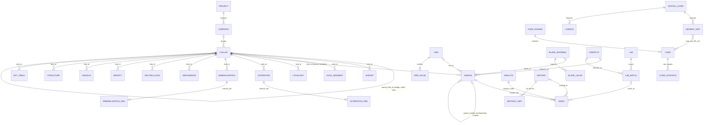
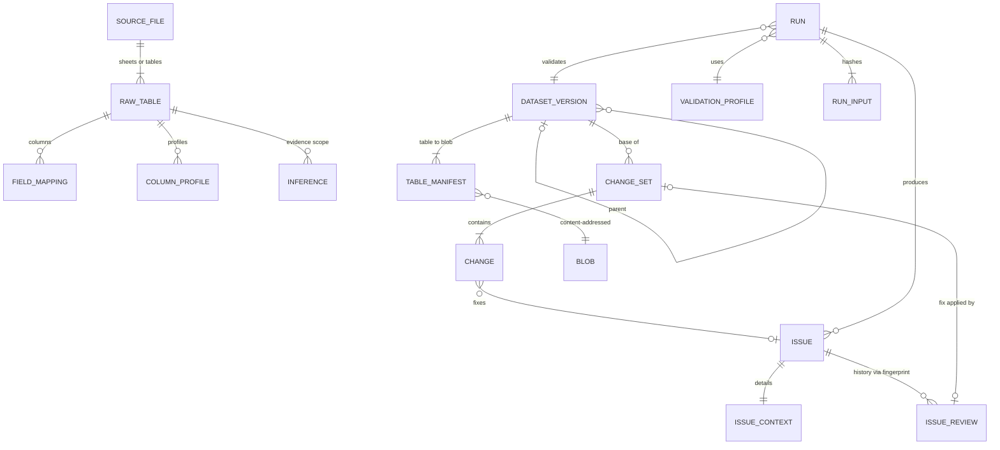

# GEOVALID PRO — 02 · Canonical Data Schema
### طرح‌واره داده‌های مرجع (Canonical Data Schema)

| | |
|---|---|
| Document | `02_data_schema.md`, design package item (2) of brief §18 |
| Status | **DRAFT v0.1 for client approval.** No code is written against it until it is approved. |
| Date | 2026-10-22 |
| Schema version | `1.0.0`, stored in `project.schema_version`. Migrations are forward-only and ship in `geovalid_pro.core.schema.migrations`. |
| Governs | Logical tables, fields, types, units, keys, the constraint policy (enforced vs reported), import normalisation, system tables |
| Defers to | `01_architecture.md` (modules, physical container internals, workers), `03_rule_catalogue.md` (rule logic, thresholds, numbering of new rules), `04_phase_plan.md`, `05_traceability.md` |

Rule IDs quoted here are the brief §17 IDs. Where this schema needs a rule that the brief does not list, it is written as `FAM-*` (e.g. `SMP-*`, `IMP-*`). The number is assigned in `03_rule_catalogue.md` and continues after the last brief ID in that family.

---

## 0. Notation

### 0.1 Types

| Token | Arrow (Parquet) type | SQLite type | Notes |
|---|---|---|---|
| `str` | `large_string` | `TEXT` | UTF-8, Unicode NFC (§6 N02) |
| `code<DOM>` | `dictionary<int16, string>` | `TEXT` | Must be a code of project dictionary `DOM` (§4.20) or NULL. The raw text is kept in `<field>_raw`. |
| `enum<NAME>` | `dictionary<int8, string>` | `TEXT` + `CHECK` | Fixed system enumeration, not user-editable (§4.20.4) |
| `i8 / i16 / i32 / i64` | `intN` | `INTEGER` | |
| `f64` | `float64` | `REAL` | Never rounded on storage. Display rounding happens only in reports. |
| `bool` | `bool` | `INTEGER` (0/1) | |
| `date` | `date32` | `TEXT` `YYYY-MM-DD` | Always Gregorian. The source calendar is recorded (§6 N08). |
| `ts` | `timestamp[us, tz=UTC]` | `TEXT` ISO-8601 `…Z` | |
| `json` | `string` (JSON) | `TEXT` (JSON1) | Used for evidence, parameters and small lists only. Never used for geological data. |
| `wkb` | `binary` (GeoParquet metadata) | `BLOB` | Geometry in the layer CRS |
| `uuid` | `string` | `TEXT` | UUIDv7 (RFC 9562, time-ordered) for `run_id`, `change_set_id`, `project_uid` |

### 0.2 Requirement column (`Req`)

| Code | Meaning |
|---|---|
| **R** | Required for the table to be analysable. If it is missing or NULL the row is **still imported** and a rule reports it. |
| **C** | Conditionally required. The condition is stated in the row. |
| **O** | Optional. |
| **D** | Derived or system-populated. It is never mapped from a source column and changes only through recomputation or a change set. |

No `R` ever blocks an import (§1.1, §7).

---

## 1. Design principles (decisions)

### 1.1 Never reject, always report
- The importer fails hard only when it cannot read a file (corrupt, encrypted or unsupported). Even that is logged as an `IMP-*` issue against `source_file`, and the rest of the project continues.
- **Every row of every readable table becomes a canonical row** with a `row_uid`. If a value cannot be parsed into its canonical type, the canonical column becomes NULL, the original text is kept and an issue is raised.
- Geological and business constraints are **rules, not database constraints**. Examples are a unique HoleID, From < To, a collar existing for every hole, value ranges and code membership. The only constraints enforced at import are system-integrity constraints (§7).

### 1.2 Data layers: raw snapshot → canonical base → working version (+ change sets) → release; derived alongside
```
 source files ──SHA-256──►  RAW SNAPSHOT  V0         immutable: original bytes + raw_<n> tables (every cell as text)
                               │  field_mapping + decided inferences (versioned, hashed)
                               ▼
                           CANONICAL BASE  Vb        deterministic f(V0, mapping, inferences); typed, normalised
                               │  change sets CS1…CSn (append-only; each change: who/when/old/new/why/issue)
                               ▼
                           WORKING VERSION  Vw       Vb ⊕ CS1…CSn; what rules run on; materialised on commit
                               │  freeze
                               ▼
                           RELEASE  Vr               read-only; the only target of exports and reports
 DERIVED (drv_*) ◄─────────────┘                     desurvey, interval master, composites, pierce points…
                                                     keyed by (dataset_version_id, params_sha256); rebuilt, never edited
```
With this model, every number in a report can be reproduced from the original bytes plus logged decisions. This covers brief §0 ("never silently change data") and §14 item 2 ("cleaned database never overwrites original").

### 1.3 Original values are always preserved alongside canonical values
- **Byte level.** Every source file is kept with its SHA-256 hash, either as an embedded blob or as an external reference that is re-verified on open (§8).
- **Cell level.** Each sheet or table read from a source becomes `raw_<n>`. It holds every cell as text exactly as decoded, plus `src_row` (the row number the user sees in Excel or a text editor). No normalisation is applied.
- **Field level.** Some fields change in representation or meaning during normalisation. Each of these carries an explicit `<field>_raw` text twin in the canonical table: `hole_id`, `sample_id`, `x`, `y`, `z`, `eoh_m`, every depth, `azimuth`, `dip`, the assay value, density, magnetic susceptibility, every coded field and every date. Any other field can be recovered through lineage: `row_uid → (src_table_id, src_row) + field_mapping.source_column`.
- *Why this split:* rules report on the twinned fields, so the issue `value` shows exactly what the client typed. Lineage covers everything else without doubling table size.

### 1.4 Assays are stored LONG; the wide table is a derived view
**Decision.** `assay` holds one row per **sample × analyte × method × determination** (primary, repeat, over-limit, re-check). `drv_assay_wide` has one row per sample and holds preferred, policy-applied values in canonical units. It is regenerated deterministically for statistics, the interval master table and exports. Justification:
1. Unit, detection limit, upper limit, method, digestion, lab, batch, certificate and value flag belong to each **determination**, not to a column. In wide format every element needs parallel metadata columns (`Cu_unit`, `Cu_DL`, `Cu_method`, …), which cannot be managed for 48–60-element ICP-MS packages.
2. Multiple methods, repeats and over-limit re-assays of one element on one sample are naturally separate rows. Choosing the preferred value then becomes a deterministic row filter (§4.9.3), not ad-hoc column logic.
3. Multi-element packages are often run on only a subset of samples. Long format is **sparse**: an empty wide cell is not materialised, so an absent row means "no result".
4. QA/QC comparisons are joins on `(analyte, method_class)` against `crm_value`. Duplicate pairs are joins on `parent_sample_id`.
5. An issue can point at exactly one determination (`sample_id + analyte + method + repeat_no`), so its fingerprint stays stable.
6. Columnar cost is small. The analyte, unit, method, flag, lab and batch columns are dictionary-encoded at about one byte per row. Rows are sorted by `(analyte_code, hole_id, from_m)` so each element occupies contiguous row groups. For example, 300 000 samples × 60 analytes is about 18 M rows, roughly 150–250 MB of zstd Parquet. A per-element working set is the size of the sample register (about 300 k rows).

### 1.5 Multi-valued logging uses an interval header plus observation rows
Alteration and mineralisation are logged in two ways. Some sources rank them (`ALT1/ALT1_INT/ALT2…`). Others use a type × intensity matrix (`SER=2, CHL=1, KSP=3`, `PY%`, `CPY%`). Both are normalised to **one interval row** (`alteration`, `mineralisation`) plus **N observation rows** (`alteration_obs`, `mineralisation_obs`). The generic interval rules (§5 of the brief, `INT-*`) see exactly one row per logged interval. Observation rules (`ALT-*`, `MIN-*`) see one row per type or mineral.

### 1.6 One canonical table per data family; a registry drives the generic rules
- Each family has one canonical table: collar, survey, sample, assay, lithology, alteration, mineralisation, weathering, geotech run, density, magnetic susceptibility, structure and hole segment.
- Several source files of the same family are **appended**, and each row keeps its `src_table_id`. If two sources cover the same hole and interval, `INT-003` reports a conflict. Nothing is merged silently.
- Unknown tables become `ext_<name>` (§4.19).
- `table_registry` (§5.1) lists every table with its kind (`INTERVAL`, `POINT`, …). The generic `INT-*` rules iterate over the registry, which is how "applied to EVERY interval table" is guaranteed.

### 1.7 Three kinds of key, each with one job
| Key kind | Example | Purpose |
|---|---|---|
| Natural key | `hole_id`, `(hole_id, depth_m)`, `sample_id` | Geological identity. This is **what rules test** and what users see. Never enforced. |
| Surrogate key | `row_uid`, `hole_uid`, `sample_uid` | Joins, change-set targets and lineage. Enforced and stable for the life of a row. |
| Fingerprint | `issue.fingerprint` | Identity of an *issue* across runs, so review status survives re-runs (§5.5) |

**Hole linkage is exact on the canonical `hole_id`.** There is no fuzzy auto-join. A near-match (`bh-01` in survey, `BH-01` in collar) produces an orphan issue (`SUR-001`/`INT-006`) whose `suggested_fix` proposes the alias. Only a **confirmed** `hole_alias` links the rows, and it is applied as a change set.

### 1.8 Canonical conventions (shared across the design package)
| Item | Convention |
|---|---|
| Lengths, depths | metres (`_m`) |
| Coordinates | Project CRS (`project.crs_epsg`, projected, metres). The source CRS and the source values are kept on every collar. |
| Angles | Decimal degrees. Azimuth 0 ≤ az < 360, clockwise. |
| Dip | −90 … +90, **negative = downward** (−90 = vertical down). The raw value and the detected source convention are stored on every row. |
| Azimuth reference | `MAG` / `TRUE` / `GRID` stored per row. `azimuth_true` and `azimuth_grid` are derived (§4.4). Desurvey **always uses `azimuth_grid`** because the project CRS is a grid. |
| Concentrations | Canonical unit per analyte from the analyte catalogue (§4.8): **ppm** (≡ g/t) for elements, **wt %** for oxides, LOI and the major elements Al, Ca, Fe, K, Mg, Na, S, Ti, C. Display units are set per validation profile. |
| Severity | `CRITICAL`, `ERROR`, `WARNING`, `INFO` |
| Rule ID | `FAM-NNN` (families IMP, COL, SUR, INT, ASY, QAQ, LIT, GEO, ALT, MIN, WTH, DEN, MAG, STR, SMP, CRS, SPA, VER) |

*Why ppm/% follows the major-element convention:* it matches how ALS (ME-MS61) and Bureau Veritas (MA200) report four-acid ICP packages. Most values therefore convert with a factor of 1, and `value_raw` ↔ `value_num` remains checkable by eye. A porphyry Cu profile still *displays* Cu in %.

### 1.9 Every inference is a record
Each inference is a row in `inference` (§5.3) with evidence, alternatives, confidence and the user's decision. This covers units, CRS and coordinate format, X/Y swap, dip convention, azimuth reference, depth unit, table type, code synonyms, sample type and collar survey method. If an inference is not yet confirmed, the canonical base is built with the top-ranked alternative **marked provisional**. An `IMP-*`/`ASY-001` WARNING is raised, and the report's executive summary states the count of unconfirmed inferences. A report can never rest silently on an unconfirmed inference (brief §19).

### 1.10 Determinism
Identical inputs give identical outputs: the same source bytes, mapping and inference decisions, change sets, profile and software version always produce **byte-identical canonical Parquet** (stable sort, fixed row-group size, no wall-clock values inside data files) and identical issue fingerprints. `run` records every hash (§5.9).

---

## 2. Conventions common to all canonical data tables

### 2.1 Row envelope
These columns are present on every canonical data table and are not repeated in the per-table specifications.

| Field | Type | Req | Constraint | Description |
|---|---|---|---|---|
| `row_uid` | i64 | D | **PK, ENFORCED**, unique project-wide, never reused | Surrogate row identity. Change sets target it. |
| `src_table_id` | i32 | D | **FK ENFORCED** → `raw_table` | Which raw table the row came from. `NULL` only for rows INSERTed by a change set. |
| `src_row` | i32 | D | ≥ 1 | Source row number as the user sees it (Excel row, text line) |
| `row_status` | enum<ROW_STATUS> | D | `ACTIVE`, `VOID` | `VOID` is a logical delete made through a change set. The row is physically retained. |
| `x_<name>` | str | O | — | Unmapped source columns, carried verbatim and profiled (§4.19). Exported. Can be mapped later. |

Hole-linked tables also carry:

| Field | Type | Req | Constraint | Description |
|---|---|---|---|---|
| `hole_id` | str | R | Reported: must exist in `collar` (`SUR-001`, `INT-006`) | Canonical hole ID after §6 N12 |
| `hole_id_raw` | str | D | — | Exactly as in the source |
| `hole_uid` | i32 | D | FK → `collar.hole_uid`; **NULL = orphan** | Join key, set only on exact canonical match or confirmed alias |

### 2.2 Interval and point semantics
- Interval tables carry `from_m`, `to_m`, `from_raw`, `to_raw` and `length_m` (D = `to_m − from_m`, which may be ≤ 0 and is then reported by `INT-001`). Intervals are **half-open `[from_m, to_m)`**.
- Point tables carry `depth_m` and `depth_raw`.
- All depth comparisons use the profile tolerance `schema.depth_eps_m` (default **0.001 m**). Two intervals are contiguous if |to_i − from_i+1| ≤ eps. An overlap must exceed eps before it is reported. The interval-master splitter snaps boundaries closer than eps.

### 2.3 Naming
- snake_case ASCII names. Tables are singular (`collar`, `lithology`). Observation children are `<parent>_obs`.
- Derived tables use the `drv_` prefix, unknown imported tables `ext_`, raw tables `raw_<n>`.
- Units are written as suffixes: `_m`, `_pct`, `_ppm`, `_kg`, `_g`, `_gcm3`, `_e3_si`, `_nt`, `_deg` (degree suffix only where needed to avoid ambiguity).
- Persian labels for tables, fields and codes live in `table_registry`, `field_dictionary` (§5.1) and `code` (§4.20). Physical names are never Persian.

### 2.4 Null, placeholder, zero and nil
| Source content | Canonical | Notes |
|---|---|---|
| Empty cell | NULL | Not provided |
| Placeholder text (`-`, `--`, `?`, `NA`, `N/A`, `null`, `none`, `نامشخص`, `؟`) | NULL | `_raw` keeps the text. Counts go to `normalisation_log` and an `IMP-*` INFO issue. |
| `0` in a numeric field | 0 | A value. Rules decide whether it is suspicious, e.g. zeros vs nulls (`ASY-002`) or Z = 0 (`COL-002`). |
| Explicit nil (`nil`, `none`, `absent`, `ندارد`, `0`) **in an intensity or abundance field** | 0 | Logged as **absent**. This is a geological observation. |
| Blank or `?` **in an intensity or abundance field** | NULL | **Not logged**. This is a logging gap, reported differently from "absent". |
| Negative numbers | Kept. Two exceptions: sentinels (−99, −999, −9999; §6 N07) and assay values, where profile policy applies (§4.9.2). | Negative Z is legitimate: underground collars and the Caspian coast are below sea level. |

### 2.5 Canonical units and accepted source units
| Quantity | Canonical | Accepted source units → conversion |
|---|---|---|
| Depth, length | m | ft × 0.3048 (exact); cm ÷ 100; mm ÷ 1000 |
| Coordinates | Project CRS, metres | Any EPSG CRS or a declared local grid, via pyproj (`always_xy=True`) |
| Angles | degrees | gon × 0.9; quadrant bearings `N45E`→45, `S30E`→150, `S30W`→210, `N30W`→330 |
| Concentration | ppm or wt % per analyte (§4.8) | ppb × 0.001 → ppm; ppm = g/t = mg/kg = µg/g; % × 10 000 → ppm; oz/t (troy/short ton) × 34.2857 → ppm; oz/long ton × 30.6122; kg/t (‰) × 1000 → ppm |
| Density | g/cm³ (≡ t/m³) | kg/m³ ÷ 1000 |
| Magnetic susceptibility | SI × 10⁻³ | SI × 10⁻⁵ ÷ 100; dimensionless SI × 1000; × 10⁻⁶ cgs × 4π/1000 (= × 0.012566) |
| Mass | kg (samples), g (density weighings) | lb × 0.45359237 |
| Percent | 0–100 | A fraction 0–1 is multiplied by 100 when the inference confirms it (§6 N14) |
| Magnetic field | nT | µT × 1000 |
| Dates | Gregorian `date` / UTC `ts` | Jalali (Solar Hijri), Excel serials, text formats (§6 N08) |

---

## 3. Entity-relationship overview

### 3.1 Geological data model


### 3.2 System model


### 3.3 Key summary
| Entity | Surrogate PK (ENFORCED) | Natural key: uniqueness REPORTED by | Main FKs (REPORTED unless stated) |
|---|---|---|---|
| `collar` | `row_uid`; `hole_uid` | `hole_id` (`COL-001`); `hole_key` (`COL-003`) | `campaign_id`, `parent_hole_id` → collar |
| `survey` | `row_uid` | `(hole_id, depth_m)` (`SUR-002`) | `hole_id` → collar (`SUR-001`) |
| any interval table | `row_uid` | no overlap per hole (`INT-002`); `(hole_id, from_m, to_m)` (`INT-003`) | `hole_id` → collar (`INT-006`) |
| any point table | `row_uid` | `(hole_id, depth_m, type)` (`STR-*`/`DEN-*`/`MAG-*`) | `hole_id` → collar (`INT-006`) |
| `sample` | `sample_uid` (= `row_uid`) | `sample_id` (`SMP-*`) | `parent_sample_id` → sample, `crm_id` → crm, `blank_id`, `dispatch_id`, `batch_id` (`SMP-*`/`QAQ-*`) |
| `assay` | `row_uid` | `(sample_id, analyte_code, method_id, determination_type, repeat_no)` (`ASY-*`) | `sample_id` → sample (`SMP-*`); `batch_id` → lab_batch; `analyte_code` → analyte (**ENFORCED**: unknown analytes are auto-added as `PROPOSED`) |
| `alteration_obs`, `mineralisation_obs` | `row_uid` | `(interval_uid, rank)` | `interval_uid` → parent (**ENFORCED**, created together) |
| `crm_value` | `(crm_id, analyte_code, method_class)` ENFORCED | — | `crm_id` → crm (ENFORCED: reference data is edited in-app) |
| `code` | `(domain_id, code)` ENFORCED | — | `domain_id` → code_domain (ENFORCED) |
| `issue` | `issue_id` ENFORCED | `(run_id, fingerprint)` ENFORCED | `run_id` → run (ENFORCED) |

---

## 4. Canonical tables

**Synonyms.** The synonym lists below seed `field_dictionary.synonyms` (§5.1), which the auto-mapper uses. Matching works on the *header key* (§6 N13: case-folded, separators removed, Arabic/Persian letter forms unified) and is then confirmed by **content checks**. Two cases show why the header alone is never enough:
- *Coordinates:* `طول` / `عرض` (literally longitude/latitude) label UTM easting/northing in Iranian databases as often as geographic coordinates. The header never decides the coordinate format; the values do (§6 N11).
- *Element names:* `روی` (Zn) and `سرب` (Pb) are also ordinary Persian words. An element header is accepted only when the column content is numeric or qualified-numeric.

**Storage.** The *Store* column says where each table lives: **P** = Parquet blob, versioned through manifests (§8); **S** = SQLite row table, edited in-app and audited row by row.

### 4.1 `project` — پروژه (S, single row)
| Field | Type | Unit | Req | Constraints / allowed | Description |
|---|---|---|---|---|---|
| `project_uid` | uuid | — | D | ENFORCED PK | Stable project identity, written into every export and report |
| `name_en`, `name_fa` | str | — | R / O | — | Project name |
| `commodities` | json | — | O | analyte codes, e.g. `["Cu","Mo","Au"]` | Drives the default element lists |
| `deposit_type` | enum<DEPOSIT_TYPE> | — | O | `PORPHYRY_CU`, `EPITHERMAL_AU`, `VMS`, `IOCG_SKARN_FE`, `PBZN_MVT_SEDEX`, `CHROMITE`, `BAUXITE_LATERITE`, `INDUSTRIAL`, `COAL`, `OTHER` | Selects the default validation profile (brief §1.3) |
| `country`, `province` | str | — | O | ISO 3166-1 α-2 (default `IR`); province free text (استان) | |
| `operator` | str | — | O | — | Company or licence holder |
| `crs_epsg` | i32 | — | R | Projected CRS with metre units, e.g. 32638–32641 | **Project CRS.** Every canonical `x, y` is in this CRS. |
| `vertical_crs_epsg` | i32 | — | O | e.g. 5773 EGM96 height, 3855 EGM2008 height, 5752 Bandar Abbas height | Vertical datum of canonical `z`. NULL = unknown, which `COL-012` uses as context. |
| `declination_model` | enum | — | R | `IGRF14` (default), `WMM2025`, `USER` | IGRF is the default because it also covers historical survey dates. WMM covers only its 5-year epoch. |
| `declination_override_deg` | f64 | deg | O | −30…+30, east positive | Replaces the model for the whole project when the client supplies one value |
| `default_depth_unit` | enum | — | O | `M`, `FT` | Prior for §6 N09 |
| `report_language` | enum | — | R | `fa`, `en`, `bi` | |
| `schema_version`, `software_version_created`, `created_at`, `created_by` | str/ts | — | D | — | Provenance |
| `branding` | json | — | O | logo blob ref, header/footer text | Arad/A.A placeholder (brief §14) |

**`local_grid` (S).** Used only when a source uses a mine grid. Canonical coordinates are **always in `project.crs_epsg`**; local-grid values are kept as source values and can be re-emitted on export.
- Fields: `grid_id` (PK), `name`, `method` (`HELMERT_2D` 4-parameter | `AFFINE_2D` 6-parameter | `TWO_POINT`), `params` (json), `control_points` (json; ≥ 2 for Helmert, ≥ 3 for affine), `z_offset_m`, `rmse_m` (D, from the control-point fit), `target_epsg`.

### 4.2 `campaign` — فاز حفاری (S)
| Field | Type | Unit | Req | Constraints / allowed | Description | Synonyms (en; fa) |
|---|---|---|---|---|---|---|
| `campaign_id` | str | — | R | ENFORCED PK (reference table) | Short code, e.g. `PH2-2021` | Campaign, Phase, Program(me), Stage, Season; فاز، فاز حفاری، مرحله، برنامه حفاری |
| `name_en`, `name_fa` | str | — | O | — | | |
| `date_start`, `date_end` | date | — | O | — | | |
| `operator`, `contractor_default`, `lab_default` | str | — | O | — | Defaults for collars that leave these blank | |
| `drilling_method_default` | enum<DRILL_METHOD> | — | O | see §4.3 | | |
| `source` | enum | — | D | `IMPORTED`, `INFERRED`, `USER` | `INFERRED` means proposed from hole-ID prefix and start-year clustering (`inference.kind = CAMPAIGN`) | |

A campaign is needed for temporal and precision patterns (brief §3.2-7, `COL-014`). If the client has no campaign field, one is proposed; the user never has to type it.

### 4.3 `collar` — دهانه گمانه (P)
| Field | Type | Unit | Req | Constraints / allowed | Description | Synonyms (en; fa) |
|---|---|---|---|---|---|---|
| `hole_id` | str | — | R | Unique, **REPORTED** `COL-001` | Canonical hole ID (§6 N12) | HoleID, Hole_ID, BHID, DHID, Hole, HoleName, Hole_No, Borehole, BH, Drillhole, Well, Name; شماره گمانه، نام گمانه، کد گمانه، گمانه، شماره حفاری، شماره چاه |
| `hole_id_raw` | str | — | D | — | As in the source | |
| `hole_key` | str | — | D | Unique, REPORTED `COL-003` | Normalised comparison key (§6 N12). Used for near-duplicates and orphan suggestions. **Not a join key.** | |
| `hole_uid` | i32 | — | D | ENFORCED unique | Surrogate used in joins | |
| `campaign_id` | str | — | O | FK → campaign (REPORTED) | | Campaign, Phase; فاز، مرحله |
| `prospect` | str | — | O | — | Prospect, target or zone | Prospect, Target, Area, Zone; کانسار، اندیس، محدوده، زون |
| `x` | f64 | m | R | Numeric, inside project extent (`COL-002`, `COL-005`, `COL-006`) | Easting in the project CRS | X, East, Easting, E, XCOLLAR, X_UTM, UTM_E, EASTING_M; X، طول، طول جغرافیایی، شرقی، مختصات X |
| `y` | f64 | m | R | as `x` | Northing in the project CRS | Y, North, Northing, N, YCOLLAR, UTM_N; Y، عرض، عرض جغرافیایی، شمالی، مختصات Y |
| `z` | f64 | m | R | Numeric (`COL-002`); ΔZ vs DEM (`COL-011`–`013`) | Collar elevation in `project.vertical_crs_epsg` | Z, RL, Elev, Elevation, ZCOLLAR, Height, Altitude, H; ارتفاع، تراز، رقوم ارتفاعی، ارتفاع دهانه |
| `eoh_m` | f64 | m | R | > 0 (`COL-002`); ≥ max depth of child tables (`COL-007`) | End-of-hole depth along the hole | EOH, Depth, MaxDepth, TD, TotalDepth, Hole_Depth, Length, FinalDepth; عمق، عمق نهایی، عمق کل، طول گمانه، متراژ |
| `x_raw`, `y_raw`, `z_raw`, `eoh_raw` | str | — | D | — | Original text | |
| `x_decimals`, `y_decimals`, `z_decimals` | i8 | — | D | 0–9 | Number of decimal places in the raw text, or from the Excel number format. **Input to collar survey-method inference** (brief §3.2-2). Float conversion loses trailing zeros, so the count is captured at import. | |
| `precision_source` | enum | — | D | `TEXT`, `EXCEL_FORMAT`, `FLOAT_REPR` | Reliability of the `*_decimals` values. `FLOAT_REPR` is the weakest and is down-weighted in the inference. | |
| `x_src`, `y_src`, `z_src` | f64 | src units | D | — | Numeric values in the source CRS, before transformation | |
| `src_crs_epsg` | i32 | — | C | Required unless `src_coord_format = LOCAL_GRID` | Source horizontal CRS **per collar**, because legacy campaigns can differ (e.g. 2059 vs 32639) | Datum, CRS, Projection, EPSG; سیستم مختصات، دیتوم |
| `src_coord_format` | enum<COORD_FORMAT> | — | D | `UTM`, `UTM_ZONED` (zone in value, e.g. `39S 536187 3950749`), `GEOG_DD`, `GEOG_DMS`, `GEOG_DDM`, `LOCAL_GRID`, `UNKNOWN` | Detected format (§6 N11) | |
| `src_utm_zone` | i8 | — | C | 38–41 for Iran | Required when `src_coord_format` is `UTM*` | Zone, UTM_Zone; زون، زون UTM |
| `xy_swapped_src` | bool | — | D | — | TRUE when the source had X/Y swapped and the swap inference was **confirmed**. Canonical `x, y` are always E, N. | |
| `local_grid_id` | str | — | C | FK → local_grid | Required when the source format is `LOCAL_GRID` | |
| `z_datum` | enum<Z_DATUM> | — | O | `ORTHO_EGM96`, `ORTHO_EGM2008`, `ORTHO_LOCAL` (levelling), `ELLIPSOIDAL_WGS84`, `MINE_DATUM`, `UNKNOWN` | Source vertical datum. Ellipsoidal heights are converted to the project vertical CRS using a bundled geoid grid. | Datum, Vertical_Datum, Height_Ref |
| `azimuth` | f64 | deg | O | 0 ≤ az < 360 | Collar (set-up) azimuth, referenced by `azimuth_ref` | Azimuth, AZ, AZI, Bearing, Collar_Az, Az_Design; آزیموت، جهت حفاری |
| `dip` | f64 | deg | O | −90…+90, negative down | Collar dip | Dip, Inclination, Incl, Angle; شیب، زاویه، زاویه حفاری |
| `azimuth_raw`, `dip_raw` | str | — | D | — | | |
| `azimuth_ref` | enum<AZ_REF> | — | O | `MAG`, `TRUE`, `GRID`, `UNKNOWN` | | Az_Ref, North_Ref |
| `azimuth_grid` | f64 | deg | D | — | Same formula as in §4.4 | |
| `planned_x`, `planned_y`, `planned_z`, `planned_azimuth`, `planned_dip`, `planned_eoh_m` | f64 | m / deg | O | — | Design values, if supplied. Used for the planned-vs-actual traces and the "planned coordinates" evidence (brief §3.2-4). | Plan_X, Design_E, Proposed_X, X_Plan…; مختصات طراحی، X طراحی، آزیموت طراحی، عمق طراحی |
| `hole_type` | enum<HOLE_TYPE> | — | O | `EXPLORATION`, `RESOURCE`, `TWIN`, `REDRILL`, `WEDGE`, `GEOTECH`, `METALLURGICAL`, `HYDRO`, `CONDEMNATION`, `GRADE_CONTROL`, `WATER_BORE`, `OTHER`, `UNKNOWN` | Purpose of the hole | Hole_Type, Purpose, Type; نوع گمانه، هدف حفاری |
| `parent_hole_id` | str | — | C | Required for `WEDGE`, `REDRILL`, `TWIN`; FK → collar (REPORTED) | Mother hole, or the reference hole of a twin. Lets `COL-004` separate wedges and twins from true duplicates. | Parent, Mother_Hole, Twin_Of; گمانه مادر |
| `drilling_method` | enum<DRILL_METHOD> | — | O | `DD`, `RC`, `RC_DD`, `AC`, `RAB`, `PERC`, `AUGER`, `SONIC`, `TRENCH`, `CHANNEL`, `OTHER`, `UNKNOWN` | Dominant method. `TRENCH`/`CHANNEL` are pseudo-holes. They are validated, but excluded from spacing and estimation-support analysis by default. | Method, Drill_Type, Hole_Method; روش حفاری، نوع حفاری (مغزه‌گیری = DD، چرخشی معکوس / RC، ضربه‌ای = PERC، ترانشه، کانال) |
| `precollar_depth_m` | f64 | m | C | Required for `RC_DD`; 0 < d < eoh | RC-to-DD changeover depth. Seeds `hole_segment` so method-bias analysis works per sample. | Precollar, PC_Depth; عمق پیش‌حفاری |
| `core_size` | code<CORE_SIZE> | — | O | `AQ`, `BQ`, `NQ`, `NQ2`, `NQ3`, `HQ`, `HQ3`, `PQ`, `PQ3`, `RC_<in>`, … | Size at the collar. Downhole reductions go in `hole_segment`. | Size, CoreSize, Diameter, Bit; قطر، قطر حفاری، سایز مغزه |
| `diameter_mm` | f64 | mm | O | > 0 | Nominal core or hole diameter (derived from `core_size` if absent) | |
| `rig_id`, `contractor`, `driller` | code<RIG>, code<CONTRACTOR>, code<PERSON> | — | O | — | | Rig, Rig_No; دستگاه حفاری، شماره دستگاه · Contractor; پیمانکار، شرکت حفاری · Driller; حفار، سرحفار |
| `date_started`, `date_completed` | date | — | O | `COL-014` | | Start_Date, Started, Spud; End_Date, Completed, Finish; تاریخ شروع، تاریخ پایان، تاریخ اتمام |
| `date_started_raw`, `date_completed_raw` | str | — | D | — | | |
| `date_calendar_src` | enum | — | D | `GREGORIAN`, `JALALI`, `EXCEL_SERIAL`, `MIXED` | Source calendar (§6 N08) | |
| `collar_survey_method` | enum<COLLAR_SURVEY_METHOD> | — | O | `RTK_GNSS`, `DGPS`, `TOTAL_STATION`, `HANDHELD_GPS`, `PLANNED`, `DIGITISED`, `UNKNOWN` | **Declared** method. The inferred method is in `drv_collar_method`. `COL-010` compares the two. | Survey_Method, Collar_Survey, Pickup_Method; روش برداشت، روش نقشه‌برداری (توتال استیشن، جی‌پی‌اس دستی، RTK) |
| `collar_survey_instrument`, `collar_surveyor` | str | — | O | — | e.g. "Leica GS18", "Garmin GPSMAP 66" | Instrument, Surveyor; دستگاه نقشه‌برداری، نقشه‌بردار |
| `collar_survey_date` | date | — | O | — | Coordinate pick-up date | |
| `collar_location` | enum | — | O | `SURFACE` (default), `UNDERGROUND` | Governs up-hole acceptance and the topography checks | |
| `hole_status` | enum<HOLE_STATUS> | — | O | `COMPLETED`, `ABANDONED`, `IN_PROGRESS`, `PLANNED`, `UNKNOWN` | `PLANNED` rows are imported but excluded from as-drilled analyses | Status; وضعیت |
| `licence_id` | str | — | O | — | Declared licence. Containment is derived in `drv_collar_spatial`. | Licence, Tenement, Permit; شماره پروانه |
| `logged_by`, `comments` | code<PERSON>, str | — | O | — | | Geologist; زمین‌شناس · Comments; توضیحات، ملاحظات |

### 4.4 `survey` — انحراف‌سنجی درون‌چاهی (P, point table)
| Field | Type | Unit | Req | Constraints / allowed | Description | Synonyms (en; fa) |
|---|---|---|---|---|---|---|
| `depth_m` | f64 | m | R | ≥ 0; unique per hole (`SUR-002`); ≤ EOH (`SUR-006`) | Station depth along the hole | Depth, At, Survey_Depth, SurvDepth, MD, Distance, Station; عمق، عمق برداشت، عمق قرائت |
| `depth_raw` | str | — | D | — | | |
| `azimuth` | f64 | deg | R | 0 ≤ az < 360 after N10. An out-of-range raw value is still reported by `SUR-004`. | Azimuth as measured, in reference `azimuth_ref` | Azimuth, AZ, AZI, Azim, Bearing, Az_Mag, Az_True, Az_Grid; آزیموت، امتداد |
| `azimuth_raw` | str | — | D | — | | |
| `azimuth_ref` | enum<AZ_REF> | — | C | `MAG`, `TRUE`, `GRID`, `UNKNOWN` | Precedence: header token (`Az_Mag`) → instrument (magnetic tool ⇒ MAG, north-seeking gyro ⇒ TRUE) → project default. Always an `inference` row. | Az_Ref, North_Ref, Azimuth_Type |
| `declination_deg` | f64 | deg | D | east positive | Applied when `MAG`. From `project.declination_model` at the collar position and `survey_date` (falling back to the collar date), or from the override. | |
| `convergence_deg` | f64 | deg | D | — | Grid (meridian) convergence γ at the collar in the project CRS. Positive east of the central meridian (northern hemisphere), as pyproj `get_factors().meridian_convergence`. | |
| `azimuth_true` | f64 | deg | D | — | `MAG`: az + δ; `TRUE`: az; `GRID`: az + γ | |
| `azimuth_grid` | f64 | deg | D | — | **`azimuth_grid = azimuth_true − γ`** (mod 360). Used by desurvey. | |
| `dip` | f64 | deg | R | −90…+90 (`SUR-003`) | Canonical dip, negative down | Dip, Inclination, Incl, Angle, Inc; شیب، زاویه |
| `dip_raw` | str | — | D | — | | |
| `dip_convention_src` | enum<DIP_CONVENTION> | — | D | `NEG_DOWN` (unchanged), `POS_DOWN` (sign inverted), `INC_FROM_VERTICAL` (dip = inc − 90), `UNKNOWN` | Convention used to convert **this row**. It is detected per project and per hole; a mix within a hole → `SUR-005`. `INC_FROM_VERTICAL` is suspected when a hole whose collar dip is near −90 has survey values of 0–30. | |
| `survey_type` | enum<SURVEY_TYPE> | — | O | `COLLAR_SETUP`, `SINGLE_SHOT`, `MULTI_SHOT`, `CONTINUOUS`, `PLANNED`, `OTHER` | `PLANNED` stations are design-only values (`SUR-009`) | Type, Survey_Type, Method; نوع برداشت |
| `instrument` | enum<SURVEY_INSTR> | — | O | `EMS_SINGLE_SHOT`, `EMS_MULTI_SHOT`, `GYRO`, `NS_GYRO`, `MEMS_GYRO`, `CAMERA_SHOT`, `ACID_TUBE` (dip only), `TROPARI`, `COMPASS_CLINO`, `DEVI_OTHER`, `UNKNOWN` | Instrument class | Instrument, Tool, Device, Survey_Tool; دستگاه، ابزار، دستگاه انحراف‌سنج |
| `instrument_model` | str | — | O | — | e.g. "Reflex EZ-TRAC", "Reflex SPRINT-IQ" | |
| `is_magnetic` | bool | — | D | — | TRUE for magnetic-azimuth instruments (EMS, camera shot, Tropari, compass). Drives `SUR-013`/`SUR-014` and the magnetic-interference correlation. | |
| `mag_field_nt`, `mag_dip_deg` | f64 | nT / deg | O | — | Total field and magnetic inclination reported by EMS tools. A departure from the IGRF expected field is **direct evidence of magnetic interference** (`SUR-013`). | MagField, B_Total, Mag_Total, MagDip |
| `survey_date` | date | — | O | — | Needed for declination | Date, Survey_Date; تاریخ برداشت |
| `surveyed_by` | str | — | O | — | Contractor or operator | |
| `is_accepted` | bool | — | O | default TRUE | Re-shots flagged as rejected in the source are retained but excluded from desurvey. They are counted in `SUR-*` context. | Accept, Valid, Use |
| `comments` | str | — | O | — | | |

### 4.5 Generic interval base, point base and `hole_segment`
**Interval base.** Inherited by `sample`, `lithology`, `alteration`, `mineralisation`, `weathering`, `geotech_run`, interval-form `density`/`magsus`, `hole_segment` and `ext_*` interval tables.

| Field | Type | Unit | Req | Constraints / allowed | Description | Synonyms (en; fa) |
|---|---|---|---|---|---|---|
| `from_m` | f64 | m | R | ≥ 0; < `to_m` (`INT-001`); ≤ EOH (`INT-005`) | Interval top | From, mFrom, Depth_From, FromDepth, From_m, Start, Top; از، از عمق، عمق از، ابتدا |
| `to_m` | f64 | m | R | > `from_m` | Interval bottom | To, mTo, Depth_To, ToDepth, To_m, End, Bottom; تا، تا عمق، عمق تا، انتها |
| `from_raw`, `to_raw` | str | — | D | — | | |
| `length_m` | f64 | m | D | — | `to_m − from_m` | Length, Interval, Len; طول، طول نمونه |
| `logged_by` | code<PERSON> | — | O | — | Logger. Used by the logger-bias tests (`LIT-005`). | Logger, Logged_By, Geologist, Geol; زمین‌شناس، توصیف‌کننده |
| `logged_date` | date | — | O | — | | Log_Date; تاریخ توصیف |
| `comments` | str | — | O | — | Free text, never parsed into codes | Comment, Remarks, Notes, Description; توضیحات، ملاحظات، شرح |

**Point base.** Inherited by `survey`, `structure` and point-form `density`/`magsus`.
- `depth_m` (f64, m, R, ≥ 0, ≤ EOH). Synonyms: Depth, At, Depth_m, Sample_Depth; عمق.
- `depth_raw` (str, D).

Density and magnetic-susceptibility rows may be **either** form, recorded in `geometry` (enum `POINT`/`INTERVAL`, D). An interval row also gets `depth_m` = midpoint (D). Interval rules (`INT-*`) run only on `INTERVAL` rows.

**`hole_segment` — بازه روش و قطر حفاری (P, interval).** Optional source table. If it is absent, it is derived from the collar as one segment `0–eoh`, or two segments RC `0–precollar` and DD `precollar–eoh`.
- Fields: `drilling_method` (enum<DRILL_METHOD>, R), `core_size` (code<CORE_SIZE>), `diameter_mm` (f64), `rig_id`, `bit_type` (str), `source` (enum `IMPORTED`/`DERIVED`).
- Synonyms: Size, Diameter, Reduction, Casing; قطر، تغییر قطر.
- *Why:* recovery, sample mass and grade bias depend on the method **at the sample's depth**, not on the hole's dominant method (`CRS-002`, `GEO-*`, `SMP-*`).

### 4.6 `sample` — ثبت نمونه (P, interval; register of every physical and QC sample)
| Field | Type | Unit | Req | Constraints / allowed | Description | Synonyms (en; fa) |
|---|---|---|---|---|---|---|
| `sample_uid` | i64 | — | D | = `row_uid` | | |
| `sample_id` | str | — | R | Unique project-wide (REPORTED `SMP-*`) | Sample or ticket number as written on the bag | SampleID, Sample_ID, Sample, SampNo, Sample_No, Sample_Number, Tag, Ticket; شماره نمونه، کد نمونه، شماره کیسه |
| `sample_id_raw` | str | — | D | — | | |
| `sample_id_synth` | bool | — | D | — | TRUE when the source had no sample number and the ID was synthesised as `{hole_id}\|{from_m:.3f}\|{to_m:.3f}`. This happens in legacy assay-only databases; the QA/QC rules then report the missing register. | |
| `hole_id`, `from_m`, `to_m` | str, f64, f64 | m | C | Required for `ORIGINAL`, `FIELD_DUP`, `COARSE_DUP` (a duplicate inherits its parent's interval when blank). NULL allowed for `CRM`, `BLANK`, `PULP_DUP`, `UMPIRE`, `LAB_*`. | Interval sampled. **`INT-*` rules run on `ORIGINAL` rows only**: duplicates legitimately overlap their parents. | as §4.5 |
| `sample_type` | enum<SAMPLE_TYPE> | — | R | `ORIGINAL`, `CRM`, `BLANK`, `FIELD_DUP`, `COARSE_DUP`, `PULP_DUP`, `UMPIRE`, **`LAB_CRM`, `LAB_BLANK`, `LAB_REPEAT`** (proposed addition), `UNKNOWN` | The `LAB_*` types hold the laboratory's internal QC. They are kept separate so they **never count toward company insertion rates** (`QAQ-001`), but they remain available for the lab-performance views. | Sample_Type, SampType, QC_Type, QAQC, Type, Std/Blk/Dup flag; نوع نمونه، استاندارد، بلانک (نمونه شاهد)، تکراری (داپلیکیت) |
| `sample_type_raw` | str | — | D | — | | |
| `sample_type_basis` | enum | — | D | `EXPLICIT`, `ID_PATTERN` (e.g. suffix `D`, prefix `STD`), `SEQUENCE_PATTERN` (every n-th number), `CRM_VALUE_MATCH`, `INFERRED` | How the type was established. Anything other than `EXPLICIT` is an `inference` row. | |
| `parent_sample_id` | str | — | C | Required for `*_DUP`, `UMPIRE`, `LAB_REPEAT`; FK → sample (REPORTED `QAQ-*`) | Original sample of the pair | Original, Parent, Orig_ID, Dup_Of; نمونه اصلی |
| `crm_id` | str | — | C | Required for `CRM`, `LAB_CRM`; FK → crm (REPORTED) | CRM inserted | Standard, Std_ID, STD, CRM, Std_Name; نام استاندارد، کد ماده مرجع |
| `crm_id_raw` | str | — | D | — | Resolved through `crm.synonyms` | |
| `blank_id` | str | — | C | Required for `BLANK`; FK → blank_material | | Blank_Type, Blank_ID; نوع بلانک |
| `seq_no` | i32 | — | O | — | Order within dispatch or batch. Needed for the carry-over test (`QAQ-003`) and the Westgard sequences (`QAQ-002`). | Seq, Sequence, Order; ردیف، ترتیب |
| `sample_method` | enum<SAMPLE_METHOD> | — | O | `HALF_CORE`, `QUARTER_CORE`, `WHOLE_CORE`, `RC_RIFFLE`, `RC_CONE`, `RC_ROTARY`, `RC_SPEAR`, `RC_GRAB`, `CHANNEL`, `CHIP`, `GRAB`, `PULP`, `OTHER` | JORC T1.01 / T1.05 | Sample_Method, Split; روش نمونه‌برداری (نیم‌مغزه، ربع‌مغزه، کانالی) |
| `sample_condition` | enum | — | O | `DRY`, `MOIST`, `WET`, `UNKNOWN` | RC sample moisture (JORC T1.03) | Condition, Wet_Dry; وضعیت نمونه (خشک، مرطوب، خیس) |
| `weight_field_kg` | f64 | kg | O | > 0 | Mass as collected | Weight, Wt, Mass, Wt_kg, Field_Wt; وزن، وزن نمونه |
| `weight_split_kg` | f64 | kg | O | > 0 | RC split or sub-sample mass sent to the lab | Split_Wt; وزن نمونه ارسالی |
| `weight_received_kg` | f64 | kg | O | > 0 | Received mass from the lab certificate (e.g. WEI-21) | Recvd_Wt, WEI-21, Lab_Wt; وزن دریافتی آزمایشگاه |
| `weight_theoretical_kg` | f64 | kg | D | — | `π·(d/2)²·length·ρ·split_fraction`. `d` comes from `hole_segment`, `ρ` from density or the lithology default, and `split_fraction` from the profile. | |
| `recovery_mass_pct` | f64 | % | D | — | `100·weight_field_kg / weight_theoretical_kg`. This is RC sample recovery (JORC T1.03, `GEO-004` context). | |
| `sampled_by`, `sample_date` | code<PERSON>, date | — | O | — | | Sampler; نمونه‌بردار · Sample_Date; تاریخ نمونه‌برداری |
| `dispatch_id` | str | — | O | FK → dispatch (REPORTED `SMP-*`) | | Dispatch, Despatch, Shipment, Submission, Consignment; شماره ارسال، محموله |
| `lab_id`, `batch_id` | str | — | O | FK → lab, lab_batch | Primary analytical batch. Each determination also carries its own batch (§4.9). | Lab, Batch, Job, Work_Order; آزمایشگاه، شماره بچ، شماره سفارش |
| `sample_status` | enum | — | O | `ACTIVE`, `VOID`, `LOST`, `NOT_SENT` | | Status |
| `comments` | str | — | O | — | | |

**`dispatch` — ارسال نمونه (S).** Sample security (JORC T1.11).
- Fields: `dispatch_id` (PK), `date_dispatched`, `dispatched_by`, `from_location`, `lab_id`, `n_samples_declared`, `courier`, `waybill_no`, `seal_numbers` (json), `date_received_lab`, `received_by`, `n_samples_received`, `condition_on_receipt` (`INTACT`/`DAMAGED`/`TAMPERED`/`UNKNOWN`), `discrepancy_note`, `document_file_id`.
- Synonyms: Dispatch No, Submission, Despatch Date; شماره ارسال، تاریخ ارسال، شماره پلمب.

**`custody_event` — زنجیره نگهداری (P, append-only).** Chain-of-custody log.
- Fields: `event_uid`, `entity_type` (`SAMPLE`/`DISPATCH`/`BATCH`), `entity_id`, `event_type` (`COLLECTED`, `BAGGED`, `STORED`, `DISPATCHED`, `RECEIVED`, `PREP_STARTED`, `ANALYSED`, `REPORTED`, `PULP_RETURNED`, `REJECT_RETURNED`, `ARCHIVED`, `DISCARDED`), `event_time` (ts), `person`, `location`, `seal_no`, `condition`, `document_file_id`, `note`.
- Gaps, out-of-order events and seal mismatches are reported by `SMP-*`.

### 4.7 `lab` and `lab_batch` — آزمایشگاه و بچ/گواهی (S)
**`lab`.**
- Fields: `lab_id` (PK, short code), `name_en`, `name_fa`, `city`, `country`, `accreditation_standard` (e.g. ISO/IEC 17025:2017), `accreditation_no`, `accreditation_expiry` (date), `role` (`PRIMARY`/`UMPIRE`/`PREP_ONLY`/`SITE_LAB`), `is_independent` (bool; relevant to JORC T1.06/T1.07), `notes`.
- Synonyms: Lab, Laboratory, Lab_Name; آزمایشگاه.

**`lab_batch`.**

| Field | Type | Req | Constraints / allowed | Description | Synonyms (en; fa) |
|---|---|---|---|---|---|
| `batch_id` | str | R | ENFORCED PK; default `{lab_id}:{lab_job_no}` | Internal batch key | |
| `lab_id` | str | R | FK → lab | | |
| `lab_job_no` | str | R | — | Lab's job or work-order number | Job, Job_No, Work_Order, WO; شماره سفارش |
| `certificate_no` | str | O | — | | Certificate, Cert_No, Report_No; شماره گواهی، شماره گزارش |
| `certificate_version` | i16 | O | ≥ 1 | Re-issue counter. A re-issued certificate with changed values is reported (`ASY-*`/`VER-*`). | Revision |
| `certificate_status` | enum | O | `PRELIMINARY`, `FINAL`, `REISSUED`, `SUPERSEDED` | Only `FINAL`/`REISSUED` values are preferred (§4.9.3) | |
| `dispatch_id` | str | O | FK → dispatch | | |
| `date_received`, `date_reported` | date | O | — | Turnaround time; DL-by-period analyses | تاریخ دریافت، تاریخ گزارش |
| `prep_codes`, `method_ids` | json | O | — | e.g. `["PREP-31"]`, `["ALS:ME-MS61","ALS:Au-AA26"]` | |
| `n_samples` | i32 | O | — | Declared count, compared with received rows | |
| `file_id` | i32 | O | FK → source_file | Certificate file (CSV/XLSX/PDF) and its SHA-256 | |

### 4.8 Analyte and method catalogues (S; shipped defaults + project additions)
**`analyte`.**

| Field | Type | Req | Constraints / allowed | Description |
|---|---|---|---|---|
| `analyte_code` | str | R | ENFORCED PK; chemical notation, case-exact | `Cu`, `Au`, `Fe2O3`, `LOI`, `CuAS` (acid-soluble), `CuCN` (cyanide-soluble), `S_SO4`, `Ctot`, `Corg` |
| `element` | str | O | element symbol | `Fe` for `Fe2O3`. NULL for `LOI`. |
| `kind` | enum | R | `ELEMENT`, `OXIDE`, `SPECIES`, `PHYSICAL` | `PHYSICAL` covers LOI, moisture and pH |
| `canonical_unit` | enum<UNIT> | R | `ppm`, `pct` | Rule in §1.8 |
| `display_unit_default` | enum<UNIT> | R | `ppm`, `ppb`, `pct`, `gpt` | Overridden per profile |
| `to_element_factor` | f64 | C | Required for `OXIDE` | Fe2O3→Fe 0.6994; FeO→Fe 0.7773; CuO→Cu 0.7989; Cr2O3→Cr 0.6842; P2O5→P 0.4364; TiO2→Ti 0.5993; MnO→Mn 0.7745; Al2O3→Al 0.5293; SiO2→Si 0.4674; CaO→Ca 0.7147; MgO→Mg 0.6030; K2O→K 0.8302; Na2O→Na 0.7419; U3O8→U 0.8480; MoO3→Mo 0.6666. Used by `ASY-003`/`ASY-006`. |
| `max_physical` | f64 | R | — | 1 000 000 ppm or 100 % (Fe2O3 ≤ 100 %, and so on). Upper bound for `ASY-003`. |
| `synonyms_en`, `synonyms_fa` | json | O | — | e.g. Cu: `["COPPER","CU_PCT"]`; fa: `["مس"]`. See the Persian list below. |
| `report_order` | i16 | O | — | Periodic-table order in reports |
| `status` | enum | D | `CATALOGUE`, `PROPOSED`, `USER` | Unknown header analytes are auto-added as `PROPOSED` and never rejected |

Persian analyte names seeded in the catalogue:

| Persian | Analyte | Persian | Analyte | Persian | Analyte |
|---|---|---|---|---|---|
| مس | Cu | طلا | Au | نقره | Ag |
| مولیبدن | Mo | سرب | Pb | روی | Zn |
| آهن | Fe | گوگرد | S | آرسنیک | As |
| آنتیموان | Sb | بیسموت | Bi | کبالت | Co |
| نیکل | Ni | کروم / اکسید کروم | Cr / Cr2O3 | منگنز | Mn |
| تیتانیوم | Ti | اورانیوم | U | فسفر | P |
| تنگستن | W | قلع | Sn | رنیوم | Re |
| سیلیس | SiO2 | آلومینا | Al2O3 | اکسید آهن | Fe2O3 |
| افت حرارتی (افت وزنی) | LOI | مس محلول در اسید | CuAS | | |

**`method`.**
- Fields:
  - `method_id`: PK, lab-scoped where known, e.g. `ALS:ME-MS61`, `ALS:Cu-OG62`, `GEN:FA50-AAS`.
  - `method_code_raw` and `lab_id` (NULL = generic).
  - `technique`: `FA_AAS`, `FA_GRAV`, `FA_ICP`, `AAS`, `ICP_OES`, `ICP_MS`, `XRF_FUSED`, `XRF_PRESSED`, `PXRF`, `LECO`, `GRAV`, `TITR`, `ISE`, `CN_LEACH`, `PHOTON`, `OTHER`.
  - `digestion`: `FOUR_ACID`, `AQUA_REGIA`, `TWO_ACID`, `FUSION_LIBO2`, `FUSION_NA2O2`, `FIRE_ASSAY`, `CYANIDE`, `H2SO4` (acid-soluble Cu), `NONE`, `OTHER`.
  - `method_class`: `TOTAL`, `NEAR_TOTAL`, `PARTIAL`. This key is matched to `crm_value.method_class`.
  - `charge_g`: fire-assay charge, 30 or 50 g.
  - `is_ore_grade` (bool): over-limit method.
  - `description`, `synonyms` (json).
- Synonyms: FA, FA30, FA50, AAS, ICP, ICP-OES, ICP-MS, XRF, 4A, AR, LECO, "fire assay"; جذب اتمی، فایر اسی، ذوب، فلورسانس اشعه ایکس، چهار اسید، تیزاب سلطانی.

**`method_limit`.**
- Fields: `method_id`, `analyte_code`, `lower_dl`, `upper_limit` (both in the canonical unit), `valid_from`, `valid_to`, `source` (`LAB_SCHEDULE`/`CERTIFICATE`/`INFERRED`).
- Detection limits that change over time are modelled through the validity dates (`ASY-*` DL-by-period).

**Assay header parsing (wide sources).**
- The header is tokenised on `_ - . space ( ) [ ] /`.
- Each token is classified against the analyte, unit, method, digestion, lab and repeat dictionaries, in any order. Examples:
  - `Cu_ppm_ME-MS61` → Cu / ppm / ME-MS61
  - `AU_GPT` → Au / g/t
  - `Au_FA50_ppb` → Au / FA50 / ppb
  - `CU%` → Cu / %
  - `Au_rpt` and `Au_2` → Au, determination `REPEAT`
  - `Cu_AS` → `CuAS` (compound analyte, matched first)
- A unit row or method row below the header (merged header rows, N17) overrides the tokens.
- The compound-analyte table is matched **before** single elements. This resolves the classic ambiguity of `AS` (arsenic vs acid-soluble) and of `S` (sulphur vs a suffix).
- Every parsed header is one `field_mapping` row with `analyte_code`, `unit_src` and `method_id` filled in.

### 4.9 `assay` — نتایج آنالیز / عیار (P, long)
Grain: **one row per sample × analyte × method × determination.**

| Field | Type | Unit | Req | Constraints / allowed | Description | Synonyms (en; fa) |
|---|---|---|---|---|---|---|
| `sample_uid` | i64 | — | D | FK → sample; NULL if the `sample_id` is not in the register (REPORTED `SMP-*`) | | |
| `sample_id` | str | — | R | — | | as §4.6 |
| `hole_id`, `from_m`, `to_m`, `sample_type` | — | m | D | Denormalised from `sample` at materialisation | If the assay file carries its own from/to, those values go into `sample`, and a disagreement between files is reported by `CRS-*`. | |
| `analyte_code` | str | — | R | FK → analyte (ENFORCED via auto-add) | | Element, Analyte, Elem; عنصر |
| `analyte_raw` | str | — | D | — | Original header token or cell | |
| `method_id` | str | — | C | FK → method; NULL → `ASY-*` (method unknown) | From header token, certificate, unit/method row or profile default | Method, Technique; روش آنالیز |
| `method_raw` | str | — | D | — | | |
| `technique`, `digestion`, `method_class` | enum | — | D | Denormalised from `method` | For filtering, partial vs total digestion comparisons (e.g. AR vs 4A) and CRM matching | Digestion, Dig; هضم (چهار اسید، تیزاب سلطانی) |
| `lab_id`, `batch_id` | str | — | O | FK → lab, lab_batch | Batch of **this determination**: repeats and over-limits often come from a later batch | Lab, Batch, Job, Certificate; آزمایشگاه، شماره بچ، شماره گواهی |
| `determination_type` | enum<DET_TYPE> | — | R | `PRIMARY` (default), `REPEAT` (lab repeat on the same pulp), `OVERLIMIT` (ore-grade re-analysis), `RECHECK` (client-requested re-assay at the same lab) | An umpire assay is a **sample** (`UMPIRE`), not a determination type | |
| `repeat_no` | i8 | — | D | 0 for `PRIMARY`; 1…n | | |
| `value_raw` | str | — | R | — | Exactly as received: `<0.01`, `1,25`, `۰٫۴۵`, `-0.005`, `NS`, `#N/A` | Value, Result, Grade, Assay; عیار، مقدار، نتیجه |
| `value_src_num` | f64 | src unit | D | — | Numeric magnitude in the source unit (value or bound), before conversion | |
| `unit_raw` | str | — | C | — | From header, unit row or row field | Unit, Units, UOM; واحد (درصد، گرم در تن، پی‌پی‌ام، پی‌پی‌بی) |
| `unit_src` | enum<UNIT> | — | D | `ppb`, `ppm`, `gpt`, `mgkg`, `pct`, `ozt`, `ozlt`, `kgt` | Parsed source unit | |
| `unit_inference_id` | i64 | — | C | FK → inference | Set when the unit came from magnitude inference (`ASY-001`) | |
| `unit` | enum<UNIT> | — | D | `ppm`, `pct` | Canonical unit from the catalogue | |
| `value_num` | f64 | `unit` | D | NULL unless `value_flag = VAL` | Measured value in the canonical unit. **Never substituted.** | |
| `value_flag` | enum<VALUE_FLAG> | — | D | `VAL`, `BDL`, `ODL`, `NS`, `IS`, `LNR`, `NA`, `SNT`, `TXT`, `NULL` | §4.9.1 | |
| `value_bound` | f64 | `unit` | D | Set for `BDL`/`ODL` | Parsed bound, e.g. `<0.01 %` → 100 ppm | |
| `dl_value`, `ul_value` | f64 | `unit` | D/O | — | Detection limit and upper limit for **this** determination. Precedence: certificate > `method_limit` at the analysis date > inferred (smallest `<x` bound, or the modal negative code). | DL, LLD, Det_Lim, UL; حد تشخیص، حد بالا |
| `dl_source`, `ul_source` | enum | — | D | `CERT`, `METHOD`, `INFERRED`, `NONE` | | |
| `n_decimals_raw` | i8 | — | D | — | Decimal places in `value_raw`. Used for the precision and rounding-by-batch tests (brief §6.2). | |
| `analysed_date`, `reported_date` | date | — | O | — | | تاریخ آنالیز |
| `method_priority` | i16 | — | D | — | Rank in the profile's preferred-method list for this analyte (1 = best). NULL if the method is not listed. | |
| `is_preferred` | bool | — | D | Exactly one TRUE per `(sample_uid, analyte_code)` when any candidate exists | Result of §4.9.3. The profile hash that produced it is recorded in `table_manifest.params_sha256`. | |
| `src_col` | str | — | D | — | Source header (wide sources), for lineage | |
| `lab_comment` | str | — | O | — | | |

#### 4.9.1 Value flags
| Flag | Meaning | Typical raw values | `value_num` | `value_bound` | Default treatment in statistics |
|---|---|---|---|---|---|
| `VAL` | Valid number | `0.45`, `۰٫۴۵`, `1,25` (decimal comma) | number | — | Used as is |
| `BDL` | Below detection | `<0.01`, `< 0.01`, `<DL`, `BDL`, `ND`, `n.d.`, `-0.01` (negative-DL code, §4.9.2), `کمتر از حد تشخیص` | NULL | DL | ½ × bound (profile `bdl_policy`: `half_dl` \| `dl` \| `zero` \| `null`) |
| `ODL` | Above upper limit | `>10`, `>UL`, `OL`, `OR`, `>100` | NULL | UL | Replaced by the `OVERLIMIT` determination if one exists. Otherwise the bound is used and `ASY-005` is raised. |
| `NS` | Not sampled / no sample | `NS`, `N/S`, `no sample`, `نمونه‌برداری نشده` | NULL | — | Excluded, counted |
| `IS` | Insufficient sample | `IS`, `I.S.`, `insufficient`, `نمونه ناکافی` | NULL | — | Excluded, counted |
| `LNR` | Listed, not received / lost | `LNR`, `NR`, `lost`, `missing`, `مفقود` | NULL | — | Excluded, counted (JORC T1.11) |
| `NA` | Not analysed / not requested | `NA`, `N/A`, `n.a.`, `-`, `آنالیز نشده` | NULL | — | Excluded |
| `SNT` | Numeric sentinel | `-99`, `-999`, `-9999`, profile list | NULL | — | Excluded; `ASY-002` |
| `TXT` | Unparseable text | `#N/A`, `#VALUE!`, `see note`, `1.2.3` | NULL | — | Excluded; `ASY-002`/`IMP-*` |
| `NULL` | Explicit empty value in a **long** source | `""` | NULL | — | Excluded |

Empty cells in **wide** sources are not materialised: an absent row means "no result". `ASY-008` (missing assays in mineralised intervals) and the completeness heat-map detect these by absence.

#### 4.9.2 Negative values (profile `assay.negative_values`, default `dl_code_else_keep`)
1. `-99`, `-999`, `-9999`, plus any profile sentinel → `SNT`.
2. `-x` → `BDL` with bound `x` if `x` matches a known DL for the analyte and method within 1e-9 relative. It is also `BDL` if all negative values in the source column take ≤ 3 distinct magnitudes, which is the signature of DL codes. The inference is recorded.
3. Any other negative value stays `VAL` (a negative number). `ASY-003` reports it as an impossible real grade.

#### 4.9.3 Preferred-value algorithm (per `sample_uid × analyte_code`)
```python
def select_preferred(dets: list[Assay], priority: dict[str, int]) -> Assay | None:
    # batch_status / cert_version are joined from lab_batch (certificate_status / certificate_version)
    cands = [d for d in dets if d.value_flag in {"VAL", "BDL", "ODL"}
             and d.batch_status in {"FINAL", "REISSUED", None}]
    over = [d for d in cands if d.determination_type == "OVERLIMIT" and d.value_flag == "VAL"]
    prim = [d for d in cands if d.determination_type == "PRIMARY"]
    if over and any(p.value_flag == "ODL" or (p.ul_value and p.value_num and p.value_num >= p.ul_value) for p in prim):
        return min(over, key=lambda d: (priority.get(d.method_id, 999), -d.cert_version, d.row_uid))
    if prim:
        return min(prim, key=lambda d: (priority.get(d.method_id, 999), -d.cert_version, d.row_uid))
    return None   # REPEAT/RECHECK are never preferred; profile repeat_policy=mean is applied only in drv_assay_wide
```
`priority` comes from the profile, e.g. `Cu: [ALS:Cu-OG62, ALS:ME-MS61, ALS:ME-ICP61]`. An unlisted method ranks below every listed one. A preferred `ODL` without an over-limit raises `ASY-005`.

#### 4.9.4 `drv_assay_wide` — the derived wide view
- **Grain:** one row per `sample_uid`, restricted by default to `ORIGINAL`.
- **Sample columns:** `sample_id`, `hole_id`, `from_m`, `to_m`, `length_m`, `sample_type`, `batch_id`, `lab_id`.
- **Per-analyte columns:**
  - `<analyte>_<unit>` (lower-case, e.g. `cu_ppm`, `au_ppm`, `fe2o3_pct`, `cuas_ppm`) holds `value_est`.
  - `<analyte>_flag` holds the preferred determination's flag.
  - `<analyte>_method` is optional.
- **`value_est` by flag:**
  - `VAL` → `value_num`
  - `BDL` → `bdl_policy(value_bound)`
  - `ODL` without over-limit → `value_bound`
  - every other flag → NULL
- **Units:** values stay in canonical units. Display and export units are applied by the writers, and export column names follow the export profile (e.g. Leapfrog `Cu_pct`).
- **Freshness:** the view is materialised per `(dataset_version_id, profile_sha256)`.

### 4.10 QA/QC reference data — مواد مرجع و کنترل کیفیت
**`crm` (S).**
- Fields:
  - `crm_id`: PK, canonical name, e.g. `OREAS 503d`.
  - `crm_key` (D): normalised, e.g. `oreas503d`.
  - `supplier`: OREAS, Geostats, CDN, AMIS, in-house, …
  - `matrix`: e.g. "porphyry Cu-Au-Mo".
  - `lot_no`, `certificate_file_id`, `certificate_date`, `expiry_date`.
  - `is_in_house` (bool): in-house standards have weaker certification and are flagged in the report.
  - `status` (`ACTIVE`/`RETIRED`).
  - `synonyms` (json): e.g. `["503d","OREAS503D","STD-503D","ST3"]`, the raw labels resolved by §6 N13.
- Synonyms: Standard, STD, CRM, Std_ID, Reference_Material; استاندارد، ماده مرجع، نمونه استاندارد.

**`crm_value` (S).** PK `(crm_id, analyte_code, method_class)`.

| Field | Type | Unit | Req | Constraints / allowed | Description |
|---|---|---|---|---|---|
| `crm_id` | str | — | R | FK → crm (ENFORCED) | |
| `analyte_code` | str | — | R | FK → analyte | |
| `method_class` | str | — | R | e.g. `FOUR_ACID`, `AQUA_REGIA`, `FIRE_ASSAY`, `FUSION_XRF`, `PEROXIDE_FUSION`, `LECO` | Matched to the determination through `method.digestion` / `method.method_class` |
| `unit` | enum<UNIT> | — | R | canonical | |
| `certified_value` | f64 | `unit` | R | > 0 | |
| `sd_1` | f64 | `unit` | R | > 0 | One standard deviation. Control limits are `certified ± k·sd_1`, with k = 2 / 3 from the profile. |
| `sd_kind` | enum | — | R | `BETWEEN_LAB`, `WITHIN_LAB`, `PROVISIONAL` | Kind of SD on the certificate |
| `ci95_low`, `ci95_high`, `ti95_low`, `ti95_high` | f64 | `unit` | O | — | Confidence and tolerance intervals |
| `n_labs` | i16 | — | O | — | Round-robin participants |
| `is_certified` | bool | — | R | — | FALSE = indicative value. These are charted but never used to fail a batch. |
| `source_ref` | str | — | O | — | Certificate table or page |

**`blank_material` (S)** and **`blank_value` (S).**
- `blank_material` fields: `blank_id` (PK), `name`, `kind` (`COARSE`, `PULP`), `source_description` (e.g. "barren quartz, X quarry"), `is_certified`, `crm_id` (optional; certified blanks such as OREAS 22-series are also listed in `crm`).
- `blank_value` fields: `blank_id`, `analyte_code`, `expected_value`, `max_acceptable` (absolute) **or** `max_x_dl` (multiple of DL; profile default per brief §6.4).

**Derived QA/QC views (P, materialised per run).**
- `drv_qaqc_crm`
  - Fields: `assay_uid`, `sample_id`, `crm_id`, `analyte_code`, `method_class`, `lab_id`, `batch_id`, `analysed_date`, `seq_no`, `value_num`, `certified_value`, `sd_1`.
  - Computed: `z = (value − certified)/sd_1`, `bias_pct = 100·(value − certified)/certified`, `status` (`PASS`, `WARN` beyond 2 SD, `FAIL` beyond 3 SD), `westgard` (json: `1_3s`, `2_2s`, `R_4s`, `4_1s`, `10_x`).
  - `mislabel_candidate`: the CRM for which |z| < 2 while |z| > 3 against the CRM declared on the sample.
- `drv_qaqc_blank`
  - Fields: `sample_id`, `blank_id`, `analyte_code`, `value_num`, `dl_value`, `ratio_to_dl`, `status`.
  - Carry-over context: `prev_sample_id` and `prev_value` (by `seq_no` within the batch).
- `drv_qaqc_pair`
  - Fields: `pair_type` (`FIELD_DUP`, `COARSE_DUP`, `PULP_DUP`, `LAB_REPEAT`, `UMPIRE`), `orig_sample_id`, `dup_sample_id`, `orig_assay_uid`, `dup_assay_uid`, `hole_id`, `from_m`, `to_m`, `analyte_code`, `method_id_a`, `method_id_b`, `lab_id_a`, `lab_id_b`, `a`, `b`, `mean = (a+b)/2`.
  - Computed: **`hard_pct = 100·|a − b| / (a + b)`**, `hrd_pct = 100·(b − a)/(a + b)` (signed).
  - `censored` (either value not `VAL`) and `valid_for_precision` (both `VAL` and mean ≥ `qaqc.dup_min_mean_x_dl` × DL, default 10). Pairs close to the DL would otherwise dominate the HARD failure rate.
  - `LAB_REPEAT` pairs are built from `REPEAT` determinations on the same sample. Pairs of the other types come from `parent_sample_id`.
- `drv_qaqc_batch`
  - Fields: `batch_id`, `n_samples`, `n_crm`, `n_blank`, `n_dup_<type>`, insertion rates (%), `n_crm_fail`, `n_blank_fail`, `status` (`PASS`/`FAIL`/`REVIEW`).
  - Feeds `QAQ-001`…`004` and the re-assay list.

### 4.11 `lithology` — سنگ‌شناسی (P, interval)
| Field | Type | Unit | Req | Constraints / allowed | Description | Synonyms (en; fa) |
|---|---|---|---|---|---|---|
| `lith_code` | code<LITH> | — | R | In dictionary (`LIT-001`) | Primary lithology (harmonised) | Lith, Lithology, Lith1, Lith_Code, Rock, Rock_Type, RockCode, Geology, Geol, Unit; سنگ‌شناسی، لیتولوژی، نوع سنگ، سنگ، واحد سنگی |
| `lith_code_raw` | str | — | D | — | | |
| `lith_code_2`, `lith_code_2_raw` | code<LITH>, str | — | O | — | Secondary or minor lithology | Lith2, Minor_Lith, Sec_Lith; سنگ‌شناسی فرعی |
| `lith_2_pct` | f64 | % | O | 0–100 | Proportion of the secondary lithology | |
| `strat_unit` | code<STRAT> | — | O | — | Formation or member | Formation, Fm, Strat, Member; سازند، واحد چینه‌ای |
| `grain_size` | code<GRAIN> | — | O | — | | Grain, GS; اندازه دانه |
| `texture` | code<TEXTURE> | — | O | — | | Texture; بافت |
| `colour` | str | — | O | — | | Colour, Color; رنگ |
| `contact_top_type` | enum<CONTACT> | — | O | `SHARP`, `GRADATIONAL`, `FAULTED`, `BRECCIATED`, `BROKEN_CORE`, `NOT_OBSERVED` | Nature of the upper contact. Supports the hard/soft boundary analysis (brief §11). | Contact, Contact_Type; نوع همبری |
| `contact_top_alpha` | f64 | deg | O | 0–90 | Core-axis angle of the upper contact | Contact_Alpha |
| `description` | str | — | O | — | | Description; شرح، توصیف |

Dictionary attributes (`group`, `is_cover`, `mineralisation_class`, `sequence_rank`, `colour_hex`) are looked up from `code` (§4.20), never copied into rows.

### 4.12 `alteration` + `alteration_obs` — دگرسانی (P)
`alteration` uses the interval base plus `alt_scheme` (str, O: id of the logging scheme or dictionary version).

**`alteration_obs`** (at least one row per interval):

| Field | Type | Unit | Req | Constraints / allowed | Description | Synonyms (en; fa) |
|---|---|---|---|---|---|---|
| `interval_uid` | i64 | — | R | FK → alteration.row_uid (ENFORCED) | | |
| `rank` | i8 | — | R | ≥ 1; unique per interval | 1 = primary (dominant), 2 = secondary, … Taken from column order (ALT1, ALT2, ALT3). For type × intensity matrices it follows descending intensity, with ties broken by column order. | Alt1/Alt2/Alt3, Alt_Prim, Alt_Sec; دگرسانی اصلی، دگرسانی فرعی |
| `alt_type` | code<ALT_TYPE> | — | R | In dictionary (`ALT-001`) | Assemblage or facies: `POTASSIC`, `PHYLLIC` (QSP), `ARGILLIC`, `ADV_ARGILLIC`, `PROPYLITIC`, `SILICIC`, `CARBONATE`, `SKARN_PRO`, `SKARN_RETRO`, `SODIC_CALCIC`, `ALBITIC`, `CHLORITIC`, `HEMATITIC`, `LIMONITIC`, `GREISEN`, … (extendable) | Alt, Alteration, Alt_Type, AltCode; دگرسانی، آلتراسیون، نوع دگرسانی (پتاسیک، فیلیک، آرژیلیک، آرژیلیک پیشرفته، پروپیلیتیک، سیلیسی) |
| `alt_type_raw` | str | — | D | — | | |
| `alt_mineral` | code<ALT_MINERAL> | — | O | — | Key mineral when logging is mineral-by-mineral: sericite, K-feldspar, biotite, chlorite, epidote, kaolinite, alunite, pyrophyllite, actinolite, garnet, magnetite, … | سریسیت، فلدسپار پتاسیم، بیوتیت، کلریت، اپیدوت، کائولینیت، آلونیت |
| `intensity_raw` | str | — | O | — | As logged: `2`, `mod`, `M`, `متوسط`, `pervasive` | Int, Intensity, Alt_Int, Alt1_Int; شدت، شدت دگرسانی |
| `intensity_ord` | i8 | — | D | 0–4; NULL = not logged | Canonical ordinal: 0 none, 1 weak, 2 moderate, 3 strong, 4 intense (texture-destructive). Obtained through `intensity_scale`. | ضعیف، متوسط، شدید، بسیار شدید |
| `intensity_scale_id` | str | — | D | — | Recognised raw scale (`NUM_0_3`, `NUM_0_4`, `NUM_1_5`, `WMS`, `WMSI`, `PCT`). A table that mixes scales → `ALT-001`. | |
| `style` | code<ALT_STYLE> | — | O | `PERVASIVE`, `SELECTIVE`, `VEIN_HALO`, `FRACTURE_CONTROLLED`, `PATCHY`, `SPOTTY`, `BANDED` | Morphology. "Pervasive" written in an intensity field becomes `intensity_ord = 4` **and** `style = PERVASIVE`. This is a dictionary mapping the user can override. | Style, Alt_Style; شکل رخداد (فراگیر، انتخابی، هاله رگه‌ای، کنترل‌شده با شکستگی) |
| `pct` | f64 | % | O | 0–100 | Volumetric estimate, if logged | Alt_Pct; درصد |

### 4.13 `mineralisation` + `mineralisation_obs` — کانی‌زایی (P)
| Field | Type | Unit | Req | Constraints / allowed | Description | Synonyms (en; fa) |
|---|---|---|---|---|---|---|
| `interval_uid`, `rank` | i64, i8 | — | R | as §4.12 | | |
| `obs_kind` | enum | — | R | `MINERAL`, `VEIN`, `TOTAL_SULPHIDE` | Kind of observation | |
| `mineral` | code<MIN_MINERAL> | — | C | Required for `MINERAL` | `PY`, `CPY`, `BN`, `CC`, `CV`, `MO`, `GN`, `SP`, `ASPY`, `PO`, `MT`, `HEM`, `SPEC`, `GOE`, `JAR`, `MAL`, `AZ`, `CUP`, `NCU`, `VG`, `STIB`, `TN`, … The dictionary group gives the class (`SULPHIDE`, `OXIDE`, `CARBONATE`, `NATIVE`, `GANGUE`). | Min, Mineral, Min1, Sulph, Ore_Min; کانی‌زایی، کانه‌زایی، کانی، کانه (پیریت، کالکوپیریت، بورنیت، کالکوسیت، کوولیت، مولیبدنیت، گالن، اسفالریت، مگنتیت، هماتیت، گوتیت، مالاکیت، طلای آزاد) |
| `mineral_raw` | str | — | D | — | | |
| `style` | code<MIN_STYLE> | — | O | `DISSEMINATED`, `VEINLET`, `VEIN`, `STOCKWORK`, `MASSIVE`, `SEMI_MASSIVE`, `BRECCIA_INFILL`, `FRACTURE_COATING`, `BLEBBY`, `BANDED` | | Style, Min_Style; افشان، رگچه‌ای، رگه‌ای، استوک‌ورک، توده‌ای، نیمه‌توده‌ای، پرکننده برش |
| `pct` | f64 | % | O | 0–100 | Visual abundance | Min_Pct, %, Abund, Sulph_pct; درصد، فراوانی |
| `pct_raw` | str | — | D | — | | |
| `pct_qual` | enum | — | D | `EXACT`, `TRACE`, `RANGE`, `LT`, `GT` | How `pct_raw` was turned into a number: `tr`, `trace` or `اثر` → `min.trace_pct` (default 0.1); `1-2` → midpoint; `<1` → half the bound | |
| `vein_type` | code<VEIN_TYPE> | — | C | Required for `VEIN` | e.g. porphyry `A`, `B`, `D`, `M`, `EB`, `QTZ_CARB`, `CBM` | Vein_Type; نوع رگه |
| `vein_pct` | f64 | % | C | 0–100 | Vein volume % | Vein%, Qtz_Vein_Pct; درصد رگه |
| `veins_per_m` | f64 | 1/m | O | ≥ 0 | Vein density | Veins_m; تعداد رگه در متر |

The derived `logged_sulphide_pct` per interval (sum of `SULPHIDE`-class `pct`, or the `TOTAL_SULPHIDE` row) is what `ALT-002`/`MIN-*` compare against the S assay.

### 4.14 `weathering` — هوازدگی / اکسیداسیون (P, interval)
| Field | Type | Unit | Req | Constraints / allowed | Description | Synonyms (en; fa) |
|---|---|---|---|---|---|---|
| `weathering_grade` | code<WTH_GRADE> | — | C | At least one of grade and oxidation state is present | ISRM `W1` fresh … `W6` residual soil. `sequence_rank` 1–6 drives `WTH-001`. | Weath, Weathering, WTH, Weath_Grade; هوازدگی، درجه هوازدگی (تازه، کمی هوازده، نسبتاً هوازده، شدیداً هوازده، کاملاً هوازده، خاک برجا) |
| `weathering_grade_raw` | str | — | D | — | | |
| `oxidation_state` | code<OX_STATE> | — | C | as above | Supergene profile: `LEACHED`, `OXIDE`, `MIXED` (transition), `SUPERGENE` (enrichment), `PRIMARY` (hypogene). The expected downhole order is set by `sequence_rank`. | Ox, Oxidation, Ox_State, Redox, Ox_Zone; اکسیداسیون، زون اکسیدی، زون شسته، زون غنی‌شده، زون انتقالی، زون اولیه (هیپوژن) |
| `oxidation_state_raw` | str | — | D | — | | |
| `limonite_type` | code<LIMONITE> | — | O | `JAROSITE`, `GOETHITE`, `HEMATITE`, `MIXED` | Leached-cap interpretation (hematite-dominant "live" vs jarosite-dominant "barren" cap) | Limonite; لیمونیت |
| `ox_pct` | f64 | % | O | 0–100 | Percentage oxidised, for schemes that log it | |

Per-hole surfaces derived into `drv_hole_summary`: **BOCO** (base of complete oxidation) and **TOFR** (top of fresh rock), together with their pierce points. These are the inputs to the base-of-oxidation map (brief §9).

### 4.15 `geotech_run` — بازیافت مغزه و RQD (P, interval = drill run)
| Field | Type | Unit | Req | Constraints / allowed | Description | Synonyms (en; fa) |
|---|---|---|---|---|---|---|
| `run_length_m` | f64 | m | O | > 0 | Recorded run length. If absent it equals `length_m`; a disagreement → `GEO-003`. | Run, Run_Length, RunLen, Drilled; طول ران، طول مانور |
| `recovered_length_m` | f64 | m | C | ≥ 0 | Core recovered in the run | Rec, Recovered, Rec_m, Core_Rec_m, TCR_m; طول مغزه بازیافتی |
| `rqd_length_m` | f64 | m | C | ≥ 0 | Sum of intact pieces ≥ 0.10 m measured along the core centreline (Deere / ISRM) | RQD_m, RQD_Length, Sum_10cm, L10; مجموع قطعات بزرگ‌تر از ۱۰ سانتی‌متر |
| `solid_core_length_m` | f64 | m | O | ≥ 0 | SCR basis | SCR_m |
| `fracture_count` | i32 | — | O | ≥ 0 | Natural fractures, excluding mechanical breaks | Fract, Fractures, Nat_Fract, FF_Count; تعداد شکستگی |
| `mech_break_count` | i32 | — | O | ≥ 0 | | Mech_Breaks |
| `cr_pct_rec`, `rqd_pct_rec` | f64 | % | O | — | **Recorded** CR% and RQD% | CR, Rec%, Recovery, Core_Rec, TCR; RQD, RQD%; درصد بازیافت، بازیافت مغزه، مغزه‌دهی؛ RQD |
| `cr_pct` | f64 | % | D | `GEO-001` | `100·recovered_length_m / run_length_m` | |
| `rqd_pct` | f64 | % | D | `GEO-002` (RQD ≤ CR ≤ 100 + tolerance) | `100·rqd_length_m / run_length_m` | |
| `ff_per_m` | f64 | 1/m | D | — | `fracture_count / recovered_length_m` | |
| `cr_pct_used`, `rqd_pct_used` | f64 | % | D | — | Recomputed value when raw lengths exist, otherwise recorded. These feed every analysis. | |
| `cr_basis`, `rqd_basis` | enum | — | D | `RECOMPUTED`, `RECORDED` | Recomputed vs recorded mismatch → `GEO-003` | |
| `pct_scale_src` | enum | — | D | `PCT_0_100`, `FRACTION_0_1` | §6 N14 | |
| `strength_grade` | code<ISRM_STRENGTH> | — | O | `R0`–`R6` | Field strength | Hardness, UCS_Est; سختی، مقاومت |
| `interval_basis` | enum | — | O | `RUN` (default), `SAMPLE`, `OTHER` | Some databases log CR on sample intervals. The basis is kept so run-length checks are applied only to `RUN` rows. | |

### 4.16 `density` — چگالی (P, point or interval)
| Field | Type | Unit | Req | Constraints / allowed | Description | Synonyms (en; fa) |
|---|---|---|---|---|---|---|
| `sample_id` | str | — | O | FK → sample | Set when density was measured on an assay sample | |
| `density_gcm3` | f64 | g/cm³ | R | Plausible range per lithology (`DEN-001`) | Value used: recorded if present, otherwise `density_calc_gcm3` | Density, SG, BD, Bulk_Density, Dens, Specific_Gravity, DBD; چگالی، وزن مخصوص، دانسیته، جرم حجمی، وزن مخصوص ظاهری |
| `density_raw` | str | — | D | — | | |
| `density_unit_src` | enum | — | D | `GCM3`, `TM3`, `KGM3` | | |
| `density_kind` | enum<DENSITY_KIND> | — | R | `DRY_BULK`, `WET_BULK`, `GRAIN_SG`, `UNKNOWN` | **Only `DRY_BULK` supports tonnage.** `GRAIN_SG` (pycnometer) over-states in-situ density and is reported if used as bulk density. | Type, Basis; چگالی توده‌ای خشک، چگالی تر، چگالی ذره‌ای |
| `method` | enum<DENSITY_METHOD> | — | O | `WATER_IMMERSION`, `WAX_COATED`, `FILM_COATED`, `CALLIPER`, `PYCNOMETER`, `GAMMA_GAMMA`, `OTHER` | | Method, SG_Method; روش (ارشمیدس، پوشش پارافین، پیکنومتر، گاما-گاما) |
| `is_coated` | bool | — | O | — | | Coated, Waxed |
| `mass_air_g` | f64 | g | O | > 0 | Dry, uncoated mass in air (Ma) | Dry_Wt, M_Air; وزن خشک در هوا |
| `mass_water_g` | f64 | g | O | — | Uncoated mass in water (Mw) | Wet_Wt, M_Water; وزن در آب |
| `mass_coated_air_g`, `mass_coated_water_g` | f64 | g | O | — | Mc and Mcw | |
| `coating_density_gcm3` | f64 | g/cm³ | O | default 0.90 (paraffin) | ρc | |
| `length_mm`, `diameter_mm` | f64 | mm | O | — | Calliper method | |
| `water_temp_c` | f64 | °C | O | — | Correction for water density ρw(T) | |
| `drying_temp_c` | f64 | °C | O | — | 105 °C standard; 60 °C for clay- or hydrate-rich material | |
| `moisture_pct` | f64 | % | O | — | | Moisture; رطوبت |
| `density_calc_gcm3` | f64 | g/cm³ | D | — | Uncoated: `Ma/(Ma − Mw)·ρw`. Coated: `Ma / ((Mc − Mcw)/ρw − (Mc − Ma)/ρc)`. Calliper: `Ma / (π·(d/2)²·L)`. | |
| `measured_by`, `lab_id`, `measure_date` | — | — | O | — | | |

### 4.17 `magsus` — پذیرفتاری مغناطیسی (P, point or interval)
| Field | Type | Unit | Req | Constraints / allowed | Description | Synonyms (en; fa) |
|---|---|---|---|---|---|---|
| `ms_e3_si` | f64 | SI × 10⁻³ | R | ≥ 0 (small negative values are possible for diamagnetic rock and are reported, not removed) | Canonical volume susceptibility | MagSus, MS, Mag_Sus, K, Kappa, Susc, MS_SI; پذیرفتاری مغناطیسی، خودپذیری مغناطیسی، سوسپتیبیلیتی |
| `ms_raw` | str | — | D | — | | |
| `ms_unit_src` | enum<MS_UNIT> | — | C | `SI_E3`, `SI_E5`, `SI`, `CGS_E6` | Converted by §2.5. If not declared it is inferred (an inter-population factor of 100 indicates mixed ×10⁻³ / ×10⁻⁵ units → `MAG-*`). | Unit; واحد |
| `n_readings`, `reading_stat` | i16, enum | — | O | `SINGLE`, `MEAN`, `MEDIAN`, `MAX` | | |
| `instrument` | str | — | O | e.g. KT-10, KT-20, SM-30 | | Instrument; دستگاه |
| `core_diameter_corrected` | bool | — | O | — | Whether the instrument's core-size correction was applied | |

### 4.18 `structure` — ساختار (P, point)
| Field | Type | Unit | Req | Constraints / allowed | Description | Synonyms (en; fa) |
|---|---|---|---|---|---|---|
| `struct_type` | code<STRUCT_TYPE> | — | R | `FAULT`, `SHEAR`, `JOINT`, `FRACTURE`, `VEIN`, `BEDDING`, `FOLIATION`, `CLEAVAGE`, `SCHISTOSITY`, `CONTACT`, `DYKE_MARGIN`, `BRECCIA`, `LINEATION`, `FOLD_AXIS`, `OTHER` | | Struct, Structure, Str_Type, Feature, Type; نوع ساختار (گسل، زون برشی، درزه، شکستگی، رگه، لایه‌بندی، برگوارگی، کلیواژ، شیستوزیته، همبری) |
| `struct_type_raw` | str | — | D | — | | |
| `alpha_deg` | f64 | deg | C | 0–90 (`STR-*`); required for oriented-core planes | Angle between the plane and the core axis | Alpha, A, Alpha_Angle, CA; زاویه آلفا |
| `beta_deg` | f64 | deg | C | 0 ≤ β < 360 | Angle measured clockwise, looking down-hole, from the reference line to the down-hole apex of the ellipse | Beta, B; زاویه بتا |
| `gamma_deg` | f64 | deg | O | 0 ≤ γ < 360 | Pitch of a lineation within the plane | Gamma, G; زاویه گاما |
| `ref_line` | enum | — | C | `BOH` (default), `TOH`; required with β | Orientation reference line | Ref_Line; خط مرجع (پایین / بالای مغزه) |
| `orientation_quality` | code<ORI_QUALITY> | — | C | e.g. `1_CONFIDENT`, `2_PROBABLE`, `3_POOR`, `0_NOT_ORIENTED` (client codes mapped) | Quality of the orientation line. β is unusable when it is `0`/`3` (`STR-*`). | Ori_Conf, OL_Quality, Orientation_Quality; کیفیت جهت‌یابی مغزه |
| `orientation_tool` | enum | — | O | `ACT`, `SPEAR`, `EZY_MARK`, `BALL_MARK`, `ATV`, `OTV`, `NONE` | | |
| `dip_rec_deg`, `dip_dir_rec_deg` | f64 | deg | O | dip 0–90; dir 0–<360 | Recorded true orientation (televiewer, or computed by the client) | Dip, Dip_Dir, DipDir, DDir; شیب، جهت شیب |
| `dip_dir_ref` | enum<AZ_REF> | — | C | Required with `dip_dir_rec_deg` | | |
| `dip_deg`, `dip_dir_deg` | f64 | deg | D | — | Computed from α/β and the desurveyed hole orientation at `depth_m` (grid north). If no α/β exists, it is the recorded value converted to grid. Computed vs recorded mismatch → `STR-*`. | |
| `trend_deg`, `plunge_deg` | f64 | deg | D | — | For linear features (γ) | |
| `width_m` | f64 | m | O | ≥ 0 | Apparent width along the hole | Width, Thickness; ضخامت |
| `true_width_m` | f64 | m | D | — | `width_m · sin(alpha)` (planar features) | |
| `infill`, `roughness`, `aperture_mm` | code / str / f64 | — | O | — | Fill and surface description | Infill, Fill; پرشدگی |

Interface sketch for the orientation conversion:
```python
def alpha_beta_to_plane(alpha: float, beta: float, hole_azimuth_grid: float, hole_dip: float,
                        ref_line: Literal["BOH", "TOH"] = "BOH") -> tuple[float, float]:
    """Return (dip, dip_direction) in the grid frame from oriented-core angles.
    hole_dip uses the internal convention (negative down). Implements the standard alpha-beta rotation."""
```
Fault zones logged as intervals are imported into `ext_structure_zone` (generic interval) with `struct_type`.

### 4.19 Unknown tables — `ext_<name>` (P)
1. **Classification.** A source table that the table-type detector cannot assign with confidence ≥ 0.8 is imported as `ext_<sanitised sheet name>` and registered in `table_registry` with one of these kinds:
   - `EXT_INTERVAL`: has hole + from + to
   - `EXT_POINT`: hole + depth
   - `EXT_SPATIAL`: x + y, e.g. surface samples and trenches without hole geometry
   - `EXT_REFERENCE`: no hole and no coordinates, e.g. a legend list. Offered as a candidate code dictionary.
2. **Envelope.** The table gets the appropriate envelope (§2.1, §4.5).
3. **Column typing.** Every other column is typed by profiling and recorded in `column_profile`:
   - numeric if ≥ 95 % of non-empty cells parse after N04/N05
   - categorical if the distinct count is ≤ 50, or ≤ 5 % of rows
   - otherwise free text
4. **Rules.** `EXT_INTERVAL` tables receive every `INT-*` rule. All `ext_` tables receive the profiling report (brief §10).
5. **Promotion.** The user can later promote an `ext_` table to a canonical family by confirming a mapping. Its `row_uid`s and issues carry over.

### 4.20 Code dictionaries — فرهنگ کدها (S)
**4.20.1 `code_domain`.**
- Fields: `domain_id` (PK, e.g. `LITH`, `ALT_TYPE`, `ALT_STYLE`, `ALT_MINERAL`, `MIN_MINERAL`, `MIN_STYLE`, `VEIN_TYPE`, `WTH_GRADE`, `OX_STATE`, `LIMONITE`, `STRUCT_TYPE`, `ORI_QUALITY`, `STRAT`, `GRAIN`, `TEXTURE`, `CORE_SIZE`, `RIG`, `CONTRACTOR`, `PERSON`, `ISRM_STRENGTH`, `MAP_UNIT`), `name_en`, `name_fa`, `kind` (`PROJECT_DICT` user-editable | `SYSTEM_ENUM` read-only), `applies_to` (json list of `table.field`), `is_ordered` (bool; `sequence_rank` is meaningful), `version` (i32, incremented on edit).
- **Logger names are a dictionary (`PERSON`)**. Variants such as `A.A`, `Ali A.` and `علی علی‌نقی` are therefore harmonised by the same machinery before the logger-bias tests (`LIT-005`).

**4.20.2 `code`.** PK `(domain_id, code)`.

| Field | Type | Req | Constraints / allowed | Description |
|---|---|---|---|---|
| `domain_id` | str | R | FK (ENFORCED) | |
| `code` | str | R | Upper-case ASCII recommended, ≤ 16 characters | Canonical code |
| `description_en` | str | R | — | |
| `description_fa` | str | R* | Missing → `IMP-*` INFO (needed for fa reports) | Persian label |
| `group_code` | str | O | Per domain. LITH: `COVER`, `BEDROCK`, `INTRUSIVE`, `VOLCANIC`, `SEDIMENTARY`, `METAMORPHIC`, `BRECCIA`, `FAULT_ROCK`, `NO_CORE`. MIN_MINERAL: `SULPHIDE`, `OXIDE`, … | Grouping used in statistics and in cover handling (brief §7.1) |
| `parent_code` | str | O | FK within domain | Hierarchy, e.g. `QFP → PORPHYRY → INTRUSIVE` |
| `is_cover` | bool | O | LITH and MAP_UNIT only | Alluvium, scree, soil, fill. The first *bedrock* unit is the one compared with the map. |
| `mineralisation_class` | enum | O | `BARREN`, `WEAK`, `MINERALISED`, `UNKNOWN` | Used by `CRS-001` (high grade in barren units, and the inverse) |
| `sequence_rank` | i16 | O | Meaningful only if the domain `is_ordered` | Expected downhole order: stratigraphy, weathering (W1…W6 inverted), oxidation (LEACHED=1 … PRIMARY=5), porphyry alteration zoning. Used by `LIT-003`, `WTH-001`, `ALT-*`. |
| `colour_hex` | str | O | `#RRGGBB` | **Single shared legend** for every figure (brief §15) |
| `pattern` | str | O | e.g. FGDC lithology pattern id | Strip-log fill |
| `status` | enum | R | `ACTIVE`, `DEPRECATED`, `PROPOSED` | `PROPOSED` = created from data and not yet confirmed |
| `source` | enum | R | `PROJECT_LEGEND`, `IMPORTED`, `SYSTEM_PROPOSED`, `USER` | |
| `confirmed_by`, `confirmed_at` | str, ts | O | — | |

**4.20.3 `code_synonym`.**
- PK `(domain_id, synonym_key)`.
- Fields:
  - `synonym_raw`: as seen, e.g. `Andesite`, `AND`, `andesit`, `آندزیت`.
  - `synonym_key`: §6 N13.
  - `code`: the target code.
  - `match_type`: `EXACT`, `CASE_SPACE`, `ABBREVIATION`, `FUZZY` (score = normalised Levenshtein / token ratio), `TRANSLITERATION` (fa↔en), `MANUAL`.
  - `score` (0–1), `n_occurrences`, `n_metres`.
  - `status`: `PROPOSED`/`CONFIRMED`/`REJECTED`.
  - `confirmed_by`, `confirmed_at`.
- Data rows keep the raw code in `*_raw`. The canonical `*_code` is filled only through a **CONFIRMED** synonym, or a `PROPOSED` one marked provisional (§1.9).

**`intensity_scale`.**
- Fields: `scale_id`, `raw_key`, `ordinal` (0–4), `label_en`, `label_fa`.
- Built-in scales: `NUM_0_4` (identity), `NUM_0_3` (0, 1, 2, 3 → 0, 1, 2, 3), `NUM_1_5` (1–5 → 0–4), `WMS` (weak / moderate / strong → 1/2/3), `WMSI` (+ intense → 4), `FA_WORDS` (ضعیف 1, متوسط 2, شدید 3, بسیار شدید 4). Users can add scales.

**4.20.4 System enumerations (read-only, versioned with the software).**
- `SEVERITY`, `ISSUE_STATUS`, `ROW_STATUS`, `VALUE_FLAG`, `SAMPLE_TYPE`, `DET_TYPE`, `UNIT`, `AZ_REF`, `DIP_CONVENTION`, `COORD_FORMAT`, `Z_DATUM`, `COLLAR_SURVEY_METHOD`, `SURVEY_TYPE`, `SURVEY_INSTR`, `DRILL_METHOD`, `HOLE_TYPE`, `HOLE_STATUS`, `SAMPLE_METHOD`, `DENSITY_KIND`, `DENSITY_METHOD`, `MS_UNIT`, `CONTACT`, `DEPOSIT_TYPE`, `CHANGE_OP`, `INFERENCE_KIND`.
- Each value carries `label_en` and `label_fa`.
- A source value that does not match any enum value becomes `UNKNOWN` (or NULL), the raw value is kept and an issue is raised.

### 4.21 Spatial layers — لایه‌های مکانی
**`spatial_layer` (S, metadata; geometry and rasters as blobs).**

| Field | Type | Req | Constraints / allowed | Description |
|---|---|---|---|---|
| `layer_id` | str | R | ENFORCED PK | |
| `kind` | enum | R | `DEM_RASTER`, `DEM_TIN`, `CONTOUR`, `POINT_CLOUD`, `GEOLOGICAL_MAP`, `LICENCE`, `PROJECT_EXTENT`, `GEOPHYS_GRID`, `SURFACE_SAMPLES`, `OTHER` | |
| `name` | str | R | — | |
| `source_file_ids` | json | R | — | Original files (SHA-256 in `source_file`) |
| `crs_epsg`, `vertical_crs_epsg` | i32 | R / C | Vertical CRS required for DEM kinds; NULL is reported | |
| `source_product` | str | O | e.g. `SRTM 1″`, `ALOS AW3D30`, `ASTER GDEM v3`, `drone photogrammetry`, `LiDAR`, `survey contours` | DEM provenance (brief §2.3) |
| `acquisition_date` | date | O | — | DEM vintage. Compared with drilling dates and earthworks (pads, pits) in `COL-011`. |
| `resolution_m` | f64 | C | Raster cell size; for a TIN, the mean edge; for contours, the interval | |
| `build_method` | enum | O | `NONE`, `DELAUNAY_TIN`, `NATURAL_NEIGHBOUR`, `LINEAR_GRID` | How contours or points became a surface |
| `interp_rmse_m` | f64 | D | — | Leave-one-out cross-validation error of the built surface, reported with ΔZ |
| `scale_denominator` | i32 | C | Required for `GEOLOGICAL_MAP` | e.g. 25 000. **Default contact buffer = 0.001 m × denominator** (1 mm at map scale: 1:25 000 → 25 m; 1:100 000 → 100 m) |
| `extent` | json | D | `[xmin, ymin, xmax, ymax]` | |
| `blob_sha256`, `storage_format` | str | D | `COG_GEOTIFF`, `GEOPARQUET`, `TIN_PARQUET` | Storage format |

**`geomap_unit` (P, GeoParquet).**
- Fields: `layer_id`, `feature_uid`, `map_unit_code` (as on the map, e.g. `Qt2`, `Eav`, `Ogd`), `map_unit_code_raw`, `name_en`, `name_fa`, `age`, `formation`, `description`, `is_cover`, `geometry` (wkb Polygon/MultiPolygon).
- Synonyms: Unit, Map_Unit, Symbol, Label; واحد نقشه، نماد واحد، سن، سازند.

**`map_unit_lith_corr` (S, many-to-many, user-edited).**
- PK `(map_unit_code, lith_code)`.
- Fields: `map_unit_code`, `lith_code`, `relation` (`EQUIVALENT` | `COMPATIBLE` | `COVER_OVER`: map cover unit expected above this bedrock lithology), `weight` (0–1), `note`, `confirmed_by`.
- `LIT-004` treats a collar as a match if its first logged bedrock lithology has any `EQUIVALENT`/`COMPATIBLE` relation to the map unit, or a `COVER_OVER` relation when the map unit is cover.

**`licence` (P, GeoParquet).**
- Fields: `layer_id`, `licence_id`, `licence_no`, `holder`, `licence_type` (`EXPLORATION`/`EXPLOITATION`; پروانه اکتشاف، پروانه بهره‌برداری), `valid_from`, `valid_to`, `area_km2` (D), `geometry`.
- Iranian licences are usually defined as a list of corner points in UTM or geographic coordinates. These are imported through §6 N11 and closed into a polygon. A polygon that does not close or that self-intersects is reported (`SPA-*`).

### 4.22 Derived tables (P; `drv_*`, rebuilt, never edited)
Every derived table carries `dataset_version_id` and `params_sha256`, the hash of the builder parameters plus the inputs. A derived table is stale when either changes.

| Table | Grain | Key fields | Notes |
|---|---|---|---|
| `drv_trace` | Hole × station | `hole_id`, `depth_m`, `x`, `y`, `z`, `azimuth_grid`, `dip`, `inc_deg` (= 90 + dip), `dogleg_deg`, `dls_deg_30m`, `station_source` (`COLLAR`, `SURVEY`, `EOH`, `RESAMPLED`), `method` (`MIN_CURV` default, `BAL_TAN`, `TAN`) | Stations at survey depths, at interval boundaries on demand, and resampled every `desurvey.step_m` (default 5 m) for display. Minimum curvature below. |
| `drv_trace_compare` | Hole | EOH xyz by method, `d_eoh_m` | Input to `SUR-015` |
| `drv_interval_master` | Hole × common sub-interval | `hole_id`, `from_m`, `to_m`, `mid_m`, `x_mid`, `y_mid`, `z_mid`, `src_<table>_uid` per table, plus attribute columns (`lith_code`, `alt1_type`, `alt1_int`, `min_sulph_pct`, `ox_state`, `cr_pct_used`, `rqd_pct_used`, `density_gcm3`, preferred assays from `drv_assay_wide`, `drill_method`, `core_size`) and `covered_<table>` flags | Boundaries are the union of all boundaries in the selected tables plus 0 and EOH, snapped within `depth_eps_m`. Values are **carried, not length-scaled**: grades, %, codes and densities are intensive. Length weighting happens downstream. |
| `drv_composite` | Composite | `comp_id`, `hole_id`, `from_m`, `to_m`, `length_m`, `domain_field`, `domain_value`, analyte values, `n_samples`, `coverage_frac` | Method `BEST_FIT` by default (length adjusted per domain run so that all composites in the run are equal); alternatives `FIXED` and `DOMAIN_WHOLE`. Minimum coverage 50 %. |
| `drv_pierce_point` | Hole × surface | `hole_id`, `surface_id` (level z, DEM, BOCO/TOFR, mineralised-zone midpoint), `depth_m`, `x`, `y`, `z` | Effective spacing at depth (brief §3.4) and cross-hole consistency (brief §7) |
| `drv_collar_spatial` | Collar | `z_topo`, `dz_m`, `slope_deg`, `aspect_deg`, `topo_layer_id`, `in_licence`, `dist_licence_edge_m`, `map_unit_code`, `dist_map_contact_m`, `nn1_m`, `nn2_m`, `nn3_m`, `voronoi_area_m2` | `dz_m = z − z_topo` (`COL-011`/`012`) |
| `drv_collar_method` | Collar | `inferred_method`, `confidence_pct`, `evidence` (json: decimals, terminal-digit χ², grid regularity, ΔZ stats, campaign pattern), `declared_method`, `agrees` | Brief §3.2. The same record also appears in `inference` with kind `COLLAR_METHOD`. |
| `drv_hole_summary` | Hole | Max depth per table, coverage % per table, metres logged, `boco_m`, `tofr_m`, issue counts by severity, `confidence_score` | Dashboard and inventory |
| `drv_confidence` | Scope × key | `scope` (`HOLE`, `TABLE`, `PROJECT`), `key`, `score` (0–100), `components` (json), `jorc_items` (json, `T1.01`…`T1.12`), `ni43101_items` (`11`, `12`) | Brief §13 |
| `drv_assay_wide`, `drv_qaqc_*` | — | §4.9.4, §4.10 | |

**Minimum curvature.**
- Inclination is measured from vertical: `I = 90° + dip`. Azimuth `A` is `azimuth_grid`.
- For consecutive stations 1 → 2 with `ΔMD = depth₂ − depth₁`:
  - `cos β = cos(I₂ − I₁) − sin I₁ · sin I₂ · (1 − cos(A₂ − A₁))`
  - `RF = (2/β) · tan(β/2)` (RF = 1 when β → 0)
  - `ΔN = ΔMD/2 · (sin I₁ cos A₁ + sin I₂ cos A₂) · RF`
  - `ΔE = ΔMD/2 · (sin I₁ sin A₁ + sin I₂ sin A₂) · RF`
  - `ΔZ = −ΔMD/2 · (cos I₁ + cos I₂) · RF`
- Dogleg severity: `DLS = β · 30 / ΔMD` in °/30 m (`SUR-010`).
- If no station lies at or near the collar, the collar orientation is used as a station at depth 0, and `SUR-007` reports it.

---

## 5. System tables (all SQLite)
The DDL below fixes the logical columns; physical details are covered in §8. Every timestamp is ISO-8601 UTC.

User identity (`who`, `reviewer`, `created_by`) is the OS login plus the display name set in Settings. The application is offline and does **not authenticate** users, and the report states this in its audit appendix.

### 5.1 Registry, sources, raw tables
```sql
CREATE TABLE table_registry (
  table_name   TEXT PRIMARY KEY,            -- 'collar', 'lithology', 'alteration_obs', 'ext_pxrf', 'drv_trace'
  kind         TEXT NOT NULL CHECK (kind IN ('COLLAR','SURVEY','INTERVAL','POINT','POINT_OR_INTERVAL','SAMPLE',
                 'ASSAY','OBS','REFERENCE','SPATIAL','EXT_INTERVAL','EXT_POINT','EXT_SPATIAL','EXT_REFERENCE','DERIVED','RAW')),
  family       TEXT,                        -- rule family: COL, SUR, SMP, ASY, LIT, ALT, MIN, WTH, GEO, DEN, MAG, STR ...
  parent_table TEXT REFERENCES table_registry(table_name),   -- *_obs -> parent interval table
  title_en     TEXT NOT NULL,
  title_fa     TEXT NOT NULL,
  store        TEXT NOT NULL CHECK (store IN ('PARQUET','SQLITE')),
  schema_hash  TEXT NOT NULL                -- sha256 of the column spec (drift detection, migrations)
);
CREATE TABLE field_dictionary (             -- the field tables of §4 in machine form; drives mapping and labels
  table_name  TEXT NOT NULL REFERENCES table_registry(table_name),
  field       TEXT NOT NULL,
  type        TEXT NOT NULL, unit TEXT, req TEXT NOT NULL CHECK (req IN ('R','C','O','D')),
  label_en    TEXT NOT NULL, label_fa TEXT NOT NULL,
  synonyms_en TEXT, synonyms_fa TEXT,       -- JSON arrays: shipped seed + project-learned (confirmed mappings)
  PRIMARY KEY (table_name, field)
);
CREATE TABLE source_file (
  file_id       INTEGER PRIMARY KEY,
  sha256        TEXT NOT NULL UNIQUE,       -- hash of the original bytes
  file_name     TEXT NOT NULL, original_path TEXT, size_bytes INTEGER NOT NULL, mtime TEXT,
  format        TEXT NOT NULL,              -- CSV, TXT, XLSX, XLS, DBF, MDB, ACCDB, SQLITE, DM, DAT, STR, GPKG, SHP, KML, TIF, ASC, LAS, DXF ...
  encoding      TEXT, encoding_confidence REAL,
  delimiter     TEXT, decimal_sep TEXT, quote_char TEXT,
  excel_date1904 INTEGER,                   -- workbook 1904 date-system flag
  storage       TEXT NOT NULL CHECK (storage IN ('EMBEDDED','EXTERNAL')),
  blob_sha256   TEXT REFERENCES blob(sha256),  -- set when EMBEDDED
  imported_at   TEXT NOT NULL, imported_by TEXT NOT NULL
);
CREATE TABLE raw_table (
  raw_table_id   INTEGER PRIMARY KEY,
  file_id        INTEGER NOT NULL REFERENCES source_file(file_id),
  sheet_name     TEXT,                      -- sheet / table / layer
  header_rows    TEXT NOT NULL,             -- JSON, e.g. [3,4] for merged two-row headers (N17)
  unit_row       INTEGER, method_row INTEGER,
  first_data_row INTEGER NOT NULL, n_rows INTEGER NOT NULL, n_cols INTEGER NOT NULL,
  detected_kind  TEXT, detected_kind_conf REAL,
  target_table   TEXT REFERENCES table_registry(table_name),   -- after user confirmation
  blob_sha256    TEXT NOT NULL REFERENCES blob(sha256)          -- Parquet: every column as text + src_row
);
CREATE TABLE column_profile (
  raw_table_id INTEGER NOT NULL REFERENCES raw_table(raw_table_id), col_index INTEGER NOT NULL,
  header_text TEXT, n_nonempty INTEGER, n_numeric INTEGER, n_distinct INTEGER,
  min_num REAL, p50_num REAL, max_num REAL, max_decimals INTEGER,
  top_values TEXT,                          -- JSON [[value, count], ...] (≤ 20)
  inferred_type TEXT,
  PRIMARY KEY (raw_table_id, col_index)
);
```

### 5.2 Field mapping
```sql
CREATE TABLE field_mapping (
  mapping_id       INTEGER PRIMARY KEY,
  raw_table_id     INTEGER NOT NULL REFERENCES raw_table(raw_table_id),
  col_index        INTEGER NOT NULL,         -- 0-based source column
  header_text      TEXT NOT NULL,            -- as in source; merged header rows joined with ' | '
  header_key       TEXT NOT NULL,            -- N13 key
  canonical_table  TEXT REFERENCES table_registry(table_name),
  canonical_field  TEXT,                     -- NULL with status UNMAPPED -> carried as x_<name>
  analyte_code     TEXT, unit_src TEXT, method_id TEXT, determination_type TEXT,   -- assay columns (§4.8)
  transform        TEXT NOT NULL DEFAULT 'identity',
  transform_params TEXT,                     -- JSON
  match_method     TEXT NOT NULL CHECK (match_method IN ('EXACT','SYNONYM','FUZZY','PATTERN','CONTENT','TEMPLATE','MANUAL')),
  confidence       REAL NOT NULL CHECK (confidence BETWEEN 0 AND 1),
  evidence         TEXT,                     -- JSON: matched synonym, similarity, content statistics
  status           TEXT NOT NULL CHECK (status IN ('PROPOSED','CONFIRMED','REJECTED','UNMAPPED')),
  confirmed_by     TEXT, confirmed_at TEXT,
  mapping_version  INTEGER NOT NULL          -- bumped on any change; part of the canonical-base recipe hash
);
CREATE TABLE mapping_template (              -- "mapping saved" (brief §2.2), reusable across projects
  template_id      TEXT PRIMARY KEY, name TEXT NOT NULL,
  source_signature TEXT NOT NULL,            -- sha256 of the sorted header_keys of the source table
  rules            TEXT NOT NULL,            -- JSON [{header_key, canonical_table, canonical_field, transform, ...}]
  created_by TEXT NOT NULL, created_at TEXT NOT NULL
);
```
Registered transforms:
- Units: `identity`, `ft_to_m`, `cm_to_m`, `fraction_to_pct`, `unit_to_canonical` (assay, per §2.5), `ms_si_e5_to_e3`, `ms_si_to_e3`, `ms_cgs_e6_to_e3`, `kgm3_to_gcm3`.
- Angles: `dip_flip`, `inc_to_dip`, `quadrant_bearing`, `gon_to_deg`.
- Coordinates and dates: `dms_to_dd`, `crs_transform`, `excel_serial_to_date`, `jalali_to_gregorian`.
- Text: `split_qualifier`.
- Every transform is a pure function with a version number, so a mapping is reproducible.

### 5.3 Inferences (units, CRS, conventions, types, synonyms)
```sql
CREATE TABLE inference (
  inference_id   INTEGER PRIMARY KEY,
  kind           TEXT NOT NULL CHECK (kind IN ('TABLE_TYPE','DEPTH_UNIT','ANALYTE_UNIT','PCT_SCALE','MS_UNIT','DENSITY_UNIT',
                   'DECIMAL_SEPARATOR','DATE_FORMAT','CALENDAR','COORD_FORMAT','CRS','UTM_ZONE','XY_SWAP','Z_DATUM',
                   'DIP_CONVENTION','AZ_REFERENCE','NEGATIVE_DL_CODE','SAMPLE_TYPE','CODE_SYNONYM','HOLE_ALIAS',
                   'CAMPAIGN','COLLAR_METHOD')),
  scope_table    TEXT, scope_field TEXT,
  scope_key      TEXT NOT NULL,              -- 'raw:12:7' (raw_table:col) | hole_id | batch_id | 'Cu@ALS:ME-MS61' ...
  inferred_value TEXT NOT NULL,              -- JSON scalar: top-ranked alternative
  confidence     REAL NOT NULL CHECK (confidence BETWEEN 0 AND 1),
  alternatives   TEXT NOT NULL,              -- JSON [{value, p}]
  evidence       TEXT NOT NULL,              -- JSON; rendered verbatim in GUI and report appendix
  status         TEXT NOT NULL CHECK (status IN ('PROPOSED','CONFIRMED','OVERRIDDEN','REJECTED')),
  decided_value  TEXT, decided_by TEXT, decided_at TEXT, reason TEXT,
  created_run_id TEXT REFERENCES run(run_id)
);
```
Example unit-inference evidence (`kind = ANALYTE_UNIT`):
```json
{"column": "Cu", "n": 18234, "median": 0.31, "p99": 2.8, "max": 7.9, "share_lt_1": 0.86,
 "paired_column": "Cu_ICP [ppm]", "paired_ratio_median": 10012, "value_granularity": 0.01,
 "alternatives": [{"value": "pct", "p": 0.97}, {"value": "ppm", "p": 0.03}]}
```

### 5.4 Hole aliases and the normalisation log
```sql
CREATE TABLE hole_alias (
  alias_id       INTEGER PRIMARY KEY,
  alias_hole_id  TEXT NOT NULL,              -- canonical form of the variant, e.g. 'bh 1'
  target_hole_id TEXT NOT NULL,              -- collar hole_id it resolves to, e.g. 'BH-01'
  scope_table    TEXT,                       -- NULL = every table
  basis          TEXT NOT NULL CHECK (basis IN ('HOLE_KEY_MATCH','MANUAL','RENAME_SCHEME')),
  status         TEXT NOT NULL CHECK (status IN ('PROPOSED','CONFIRMED','REJECTED')),
  confirmed_by   TEXT, confirmed_at TEXT,
  change_set_id  TEXT REFERENCES change_set(change_set_id),   -- the RELINK_HOLE change set created on confirmation
  UNIQUE (alias_hole_id, scope_table)
);
CREATE TABLE normalisation_log (             -- one row per (column, step); feeds one IMP INFO issue per (table, field, step)
  raw_table_id INTEGER NOT NULL, col_index INTEGER NOT NULL,
  step         TEXT NOT NULL,                -- 'N04_DIGITS', 'N05_DECIMAL_COMMA', 'N07_PLACEHOLDER', ...
  n_cells      INTEGER NOT NULL,
  examples     TEXT,                         -- JSON ≤ 5 × [raw, normalised]
  PRIMARY KEY (raw_table_id, col_index, step)
);
```

### 5.5 Issue table (per shared conventions) and issue context
The issue table holds exactly the brief §1.3 fields plus `fingerprint` and `run_id`. Supporting detail lives in `issue_context`, one row per issue, so the issue table itself is not extended.
```sql
CREATE TABLE issue (
  issue_id      INTEGER PRIMARY KEY,         -- unique within the project
  rule_id       TEXT NOT NULL CHECK (rule_id GLOB '[A-Z][A-Z][A-Z]-[0-9][0-9][0-9]'),
  severity      TEXT NOT NULL CHECK (severity IN ('CRITICAL','ERROR','WARNING','INFO')),
  "table"       TEXT NOT NULL,               -- canonical table name, or 'project'
  hole_id       TEXT,                        -- canonical hole_id; NULL for sample-, batch-, table- or project-level issues
  "from"        REAL,                        -- m; interval top, or point depth
  "to"          REAL,                        -- m; interval bottom; equals "from" for point records
  field         TEXT,                        -- canonical field (for assays: the analyte code)
  value         TEXT,                        -- offending value, raw form as the client typed it
  expected      TEXT,                        -- expected value, range or relation, e.g. '<= 412.50 (collar EOH)'
  message_en    TEXT NOT NULL,
  message_fa    TEXT NOT NULL,
  suggested_fix TEXT,                        -- human-readable; machine form in issue_context.fix_json
  status        TEXT NOT NULL DEFAULT 'open' CHECK (status IN ('open','accepted','ignored','fixed')),
  reviewer      TEXT,
  reason        TEXT,
  timestamp     TEXT NOT NULL,               -- time of the current status (detection time while 'open')
  fingerprint   TEXT NOT NULL CHECK (length(fingerprint) = 32),
  run_id        TEXT NOT NULL REFERENCES run(run_id),
  UNIQUE (run_id, fingerprint),
  CHECK (status <> 'ignored' OR length(trim(coalesce(reason,''))) > 0)
);
CREATE INDEX ix_issue_rule ON issue(run_id, rule_id);
CREATE INDEX ix_issue_hole ON issue(run_id, hole_id);
CREATE INDEX ix_issue_fp   ON issue(fingerprint);

CREATE TABLE issue_context (
  issue_id      INTEGER PRIMARY KEY REFERENCES issue(issue_id),
  row_uids      TEXT NOT NULL,               -- JSON: affected canonical rows (both rows of an overlap, etc.)
  sample_id     TEXT, analyte_code TEXT, method_id TEXT, batch_id TEXT,
  x REAL, y REAL, z REAL,                    -- for map and section display
  related_hole_ids TEXT,                     -- JSON: twins, crossing traces, neighbours
  value_num     REAL,                        -- numeric form of value, for sorting and plots
  jorc_items    TEXT,                        -- JSON, e.g. ["T1.08"]; NI 43-101 items under key 'ni'
  evidence      TEXT,                        -- JSON: statistics behind the detection
  fix_json      TEXT                         -- JSON list of proposed changes = a change-set template (§5.7)
);
```
Field semantics:
- `"table"`, `"from"` and `"to"` keep the brief's names and are quoted identifiers in SQL. The Python model exposes them as `table`, `from_m` and `to_m`.
- `status`:
  - `open`: detected, not reviewed.
  - `accepted`: the reviewer accepted the suggested fix (or an edited fix). A change set is drafted or applied.
  - `ignored`: the data is accepted as is, e.g. a genuine high grade or a legitimate twin. **A reason is mandatory** (CHECK).
  - `fixed`: the issue is no longer detected after the change set was applied, or after the client corrected the data upstream. This status is set by the system.

**Fingerprint (deterministic, survives re-runs).**
```
fingerprint = sha256("gv1|" + rule_id + "|" + table + "|" + key + "|" + (field or "") + "|" + norm(value)).hexdigest()[:32]
```
| Record kind | `key` |
|---|---|
| collar | `hole_id` |
| survey / point table | `hole_id@depth` |
| interval table | `hole_id@from-to` |
| multi-record issue (overlap, duplicate, crossing traces, twin pair) | member keys, sorted, joined with `&` |
| sample | `sample_id` |
| assay | `sample_id/analyte_code/method_id/determination_type/repeat_no` |
| batch / table / project level | `batch:<batch_id>` / `table:<name>` / `project` |

Formatting and scope:
- Depths are formatted with exactly 3 decimals (`12.500`).
- `norm(value)`: a number is formatted with `format(x, '.10g')`; text is NFC and trimmed; NULL is `∅`.
- `hole_id` here is the canonical ID, not `hole_key`.
- **Thresholds and severity are not part of the fingerprint.** Re-tuning a threshold keeps a reviewed issue reviewed, provided the same record is flagged with the same value. When the offending value changes, the fingerprint changes and the issue needs review again. This is deliberate.

**Status carry-over at the start of each run.** For every new issue, the latest `issue_review` row with the same fingerprint is looked up:
1. `ignored` → status, reviewer and reason are carried forward. **Exception:** if the new severity is higher than at review time, the issue is reopened as `open` and an auto-note "severity escalated" is added.
2. `accepted` → carried forward while the linked change set is still `DRAFT`. If that change set is applied in the version being validated and the issue still fires, it becomes `open` with the note "fix applied, issue persists".
3. `fixed` → the issue fires again, so it becomes `open` (regression) and a history row is written.
4. A fingerprint that was in the previous run but is absent now gets a history row `fixed` with reviewer `system`. The row cites the change set if one was linked; otherwise the reason is "not detected in run <run_id>".

### 5.6 Review and status history (append-only)
```sql
CREATE TABLE issue_review (
  review_id     INTEGER PRIMARY KEY,
  fingerprint   TEXT NOT NULL,
  issue_id      INTEGER REFERENCES issue(issue_id),
  run_id        TEXT REFERENCES run(run_id),
  old_status    TEXT, new_status TEXT NOT NULL CHECK (new_status IN ('open','accepted','ignored','fixed')),
  severity_at_review TEXT NOT NULL,
  reviewer      TEXT NOT NULL,               -- person, or 'system' for automatic transitions
  reason        TEXT,
  change_set_id TEXT REFERENCES change_set(change_set_id),
  timestamp     TEXT NOT NULL,
  CHECK (new_status <> 'ignored' OR length(trim(coalesce(reason,''))) > 0)
);
CREATE INDEX ix_review_fp ON issue_review(fingerprint, timestamp);
```
Bulk actions (brief §16) write one `issue_review` row per issue, all sharing one reason and one change set.

### 5.7 Versions, manifests, change sets (audit of data edits)
```sql
CREATE TABLE dataset_version (
  version_id        TEXT PRIMARY KEY,        -- uuid v7
  parent_version_id TEXT REFERENCES dataset_version(version_id),
  kind              TEXT NOT NULL CHECK (kind IN ('RAW_SNAPSHOT','CANONICAL_BASE','WORKING','RELEASE')),
  label             TEXT,                    -- e.g. 'Release for MRE 2026-11'
  recipe_sha256     TEXT NOT NULL,           -- hash(raw blob hashes, mapping_version, decided inferences, change_set ids, software version)
  created_at TEXT NOT NULL, created_by TEXT NOT NULL,
  is_frozen         INTEGER NOT NULL DEFAULT 0
);
CREATE TABLE table_manifest (
  version_id    TEXT NOT NULL REFERENCES dataset_version(version_id),
  table_name    TEXT NOT NULL REFERENCES table_registry(table_name),
  part          INTEGER NOT NULL DEFAULT 0,  -- file partitions of large tables
  blob_sha256   TEXT NOT NULL REFERENCES blob(sha256),
  n_rows        INTEGER NOT NULL,
  schema_hash   TEXT NOT NULL,
  params_sha256 TEXT,                        -- profile/params that produced derived content (drv_*, is_preferred)
  PRIMARY KEY (version_id, table_name, part)
);
CREATE TABLE change_set (
  change_set_id   TEXT PRIMARY KEY,          -- uuid v7
  base_version_id TEXT NOT NULL REFERENCES dataset_version(version_id),
  title           TEXT NOT NULL,
  reason          TEXT NOT NULL,             -- why (mandatory)
  origin          TEXT NOT NULL CHECK (origin IN ('MANUAL_EDIT','ISSUE_FIX','BULK_FIX','ALIAS','DICTIONARY','DATUM_SHIFT','REBASE','REVERT')),
  status          TEXT NOT NULL CHECK (status IN ('DRAFT','APPLIED','REVERTED')),
  created_by TEXT NOT NULL, created_at TEXT NOT NULL,
  applied_by TEXT, applied_at TEXT,
  result_version_id TEXT REFERENCES dataset_version(version_id)
);
CREATE TABLE change (                        -- the audit trail of data edits: who, when, what, old, new, why, rule/issue
  change_id     INTEGER PRIMARY KEY,
  change_set_id TEXT NOT NULL REFERENCES change_set(change_set_id),
  seq           INTEGER NOT NULL,
  op            TEXT NOT NULL CHECK (op IN ('SET','INSERT','VOID','UNVOID','RELINK_HOLE')),
  table_name    TEXT NOT NULL,
  row_uid       INTEGER,                     -- target row (assigned on apply for INSERT)
  natural_key   TEXT NOT NULL,               -- e.g. 'BH-01@12.000-13.000'; used to rebase onto a re-import
  field         TEXT,                        -- SET only
  old_value     TEXT,                        -- JSON-typed scalar (what)
  new_value     TEXT,                        -- JSON-typed scalar; INSERT: full record JSON incl. 'derived_from'
  who           TEXT NOT NULL,
  at            TEXT NOT NULL,
  why           TEXT NOT NULL,
  rule_id       TEXT, issue_id INTEGER REFERENCES issue(issue_id), issue_fingerprint TEXT,
  UNIQUE (change_set_id, seq)
);
```
Semantics:
- **Optimistic apply:** each `SET`/`VOID` requires `old_value` to equal the current value. Any mismatch makes the whole set a conflict, and it is not applied.
- **Interval operations:** splitting or merging intervals is `VOID` + `INSERT`, with `derived_from` recording the source `row_uid`s.
- **Datum shift:** a ΔZ datum shift or a drape to topography is one change set (`DATUM_SHIFT`). It contains one `SET z` per collar, and its parameters go in `reason` and `new_value`.
- **Revert:** a revert is a *new* change set (`REVERT`). History is never deleted.
- **What gets rewritten:** applying a set creates a new `WORKING` version, and only the tables it touched get new blobs.

### 5.8 Audit log (project events, tamper-evident)
```sql
CREATE TABLE audit_log (
  event_id    INTEGER PRIMARY KEY,
  at          TEXT NOT NULL, who TEXT NOT NULL, host TEXT,
  event_type  TEXT NOT NULL,     -- PROJECT_CREATED, FILE_IMPORTED, MAPPING_CONFIRMED, INFERENCE_DECIDED, DICTIONARY_EDITED,
                                 -- REFERENCE_EDITED, CHANGE_SET_APPLIED, CHANGE_SET_REVERTED, RUN_STARTED, RUN_FINISHED,
                                 -- ISSUE_REVIEWED, VERSION_FROZEN, EXPORT_WRITTEN, REPORT_WRITTEN, PROFILE_CHANGED, SCHEMA_MIGRATED
  object_type TEXT, object_id TEXT,
  details     TEXT,              -- JSON (for REFERENCE_EDITED: table, key, field, old, new, why)
  prev_hash   TEXT NOT NULL,     -- entry_hash of the previous event ('0' x 64 for the first)
  entry_hash  TEXT NOT NULL      -- sha256(prev_hash || canonical_json(event without entry_hash))
);
```
The hash chain is verified every time the project is opened. A broken chain is reported as **CRITICAL** in the run summary and in the report's audit appendix.

Edits to SQLite reference tables (codes, CRM values, labs, correlation table) are logged here as `REFERENCE_EDITED` with old and new values. Edits to Parquet data tables are logged in `change`.

### 5.9 Run metadata
```sql
CREATE TABLE run (
  run_id                 TEXT PRIMARY KEY,   -- uuid v7
  started_at TEXT NOT NULL, finished_at TEXT,
  status                 TEXT NOT NULL CHECK (status IN ('RUNNING','COMPLETED','FAILED','CANCELLED')),
  software_version       TEXT NOT NULL,      -- geovalid_pro semver
  build_id               TEXT NOT NULL,      -- VCS commit + build date
  python_version TEXT NOT NULL, platform TEXT NOT NULL,
  dependency_lock_sha256 TEXT NOT NULL,      -- frozen dependency set incl. PROJ database version
  rule_catalogue_sha256  TEXT NOT NULL,      -- registered rule ids + rule versions
  run_by TEXT NOT NULL, host TEXT,
  dataset_version_id     TEXT NOT NULL REFERENCES dataset_version(version_id),
  profile_id             TEXT NOT NULL REFERENCES validation_profile(profile_id),
  profile_sha256         TEXT NOT NULL,
  parameters             TEXT NOT NULL,      -- JSON: fully resolved effective parameters (defaults ⊕ profile ⊕ overrides)
  parameters_sha256      TEXT NOT NULL,
  rules_run              TEXT NOT NULL,      -- JSON [{rule_id, rule_version, enabled, severity}]
  random_seed            INTEGER NOT NULL,   -- any stochastic step (e.g. Ripley K envelopes)
  invocation             TEXT,               -- 'GUI' or the CLI argv
  n_critical INTEGER, n_error INTEGER, n_warning INTEGER, n_info INTEGER
);
CREATE TABLE run_input (                     -- every input the run depended on, by SHA-256
  run_id    TEXT NOT NULL REFERENCES run(run_id),
  role      TEXT NOT NULL,   -- SOURCE_FILE, DEM, GEOLOGICAL_MAP, LICENCE, PROFILE, DICTIONARY, CRM_CERTIFICATE, GEOID_GRID, MAG_MODEL
  object_id TEXT NOT NULL,   -- file_id / layer_id / profile_id / domain_id
  sha256    TEXT NOT NULL,
  PRIMARY KEY (run_id, role, object_id)
);
```

### 5.10 Validation profile reference
```sql
CREATE TABLE validation_profile (
  profile_id        TEXT PRIMARY KEY,        -- 'porphyry_cu@1.2.0'
  name TEXT NOT NULL, deposit_type TEXT, version TEXT NOT NULL,
  sha256            TEXT NOT NULL,           -- of the canonicalised YAML (keys sorted, comments stripped)
  yaml_text         TEXT NOT NULL,           -- embedded copy, so the project is self-contained
  source_path TEXT, imported_at TEXT NOT NULL, imported_by TEXT NOT NULL,
  parent_profile_id TEXT REFERENCES validation_profile(profile_id)   -- 'extends:'
);
```
Schema-relevant profile keys. Rule thresholds are specified in `03_rule_catalogue.md`.
```yaml
profile: porphyry_cu
version: 1.2.0
extends: base@1.0.0
schema:
  depth_eps_m: 0.001
  hole_key: {casefold: true, strip_leading_zeros: true, separators: " -_./\\"}
  coord_plausibility: {easting_m: [150000, 850000], northing_m: [2700000, 4500000]}   # Iran, UTM 38N-41N
  display_units: {Cu: pct, Mo: ppm, Au: ppm, Ag: ppm, S: pct}
  storage: {embed_max_mb: 200}
assay:
  negative_values: dl_code_else_keep        # | sentinel | keep
  sentinels: [-99, -999, -9999]
  text_codes:                               # extends the built-in table of §4.9.1
    BDL: ["<*", "BDL", "ND", "<DL", "کمتر از حد تشخیص"]
    NS:  ["NS", "N/S", "نمونه‌برداری نشده"]
  bdl_policy: half_dl                       # | dl | zero | null
  repeat_policy: primary                    # | mean (wide view only)
  preferred_method:
    Cu: ["ALS:Cu-OG62", "ALS:ME-MS61", "ALS:ME-ICP61"]
    Au: ["ALS:Au-GRA21", "ALS:Au-AA26", "ALS:Au-AA24"]
mineralisation: {trace_pct: 0.1}
qaqc: {sd_warn: 2, sd_fail: 3, dup_min_mean_x_dl: 10}
desurvey: {method: MIN_CURV, step_m: 5}
```

### 5.11 Blob store
```sql
CREATE TABLE blob (
  sha256     TEXT PRIMARY KEY,                -- content address
  kind       TEXT NOT NULL,                   -- PARQUET, GEOPARQUET, SOURCE_FILE, COG_GEOTIFF, FIGURE, REPORT
  size_bytes INTEGER NOT NULL, codec TEXT,    -- 'zstd' for Parquet pages; sources stored as-is
  n_chunks   INTEGER NOT NULL, created_at TEXT NOT NULL
);
CREATE TABLE blob_chunk (
  sha256   TEXT NOT NULL REFERENCES blob(sha256),
  chunk_no INTEGER NOT NULL,
  data     BLOB NOT NULL,                     -- ≤ 64 MiB per chunk
  PRIMARY KEY (sha256, chunk_no)
);
```

---

## 6. Normalisation rules on import
**Scope.** Normalisation turns raw text into canonical typed values. It is applied when the canonical base is built, never to the raw snapshot.

**Granularity of decisions.** Every column-level decision is made **once per column (or per table)** from the whole column, never cell by cell. Examples are the decimal separator, date order, depth unit and dip convention. Each such decision is an `inference` row.

**Logging.** Every step records its counts in `normalisation_log` and raises **one** `IMP-*` INFO issue per (table, field, step), never one issue per cell.

### 6.1 Text, encoding and characters
| Step | Applies to | Rule | Recorded |
|---|---|---|---|
| **N01** Decode | Bytes of text sources | Order: BOM → strict UTF-8 → UTF-16 (BOM or NUL-byte pattern) → choose among `cp1256` / `cp1252` / `cp1250` by the share of Arabic-script code points (U+0600–U+06FF) and the absence of mojibake signatures. A typical signature is `ال`, which is UTF-8 Persian read as cp1252: such text is re-decoded. Binary formats (XLSX, MDB) use their own encodings. | `source_file.encoding`, confidence; < 0.9 → `IMP-*` WARNING |
| **N02** Unicode form | All text | NFC for stored text. NFKC only for strings that are candidates for numbers, dates or IDs (folds full-width digits and compatibility forms). | — |
| **N03** Invisible characters and whitespace | All text | **Removed:** U+200B ZWSP, U+FEFF, U+00AD soft hyphen, U+200E/U+200F (LRM/RLM), U+202A–U+202E, U+2066–U+2069. **Mapped to space:** U+00A0 NBSP, U+202F, U+2009, U+2007 and tab. Text is trimmed at both ends; internal runs are collapsed in IDs and codes only. **U+200C ZWNJ (نیم‌فاصله) is preserved in descriptive text**, because it is orthographic in Persian (`سنگ‌شناسی`). It is removed only in keys (N12, N13) and numeric fields. U+200D is treated the same way. | counts |
| **N04** Digits | Numeric, date and ID fields; all keys | Persian `۰–۹` (U+06F0–U+06F9) and Arabic-Indic `٠–٩` (U+0660–U+0669) → `0–9`. Descriptive text keeps its original digits. | counts |

### 6.2 Numbers, qualifiers, placeholders
| Step | Rule |
|---|---|
| **N05** Numeric parsing | **Signs:** U+2212, U+2013, U+FE63 and U+FF0D → `-`; a leading `+` is dropped. **Separators:** Persian decimal separator `٫` (U+066B) → `.`; Arabic thousands separator `٬` (U+066C) is removed; Arabic comma `،` (U+060C) is treated as `,`. **Comma decision per column:** the column is decimal-comma if ≥ 95 % of comma-bearing values match `^-?\d+,\d+$` and no value contains `.`. It is thousands-comma if commas appear only before 3-digit groups and at least one value has ≥ 2 groups or a `.` after the group. Otherwise (e.g. every value looks like `1,234`) both alternatives are kept as a PROPOSED inference and an `IMP-*` WARNING is raised. `1.234,56` is handled the same way. Space and thin-space thousands separators are removed. **Other forms:** `%` and `٪` (U+066A) are stripped and the unit is recorded. Scientific notation is accepted. Excel error literals (`#N/A`, `#VALUE!`, `#DIV/0!`, `#REF!`, `#NAME?`, `#NUM!`) become NULL + `TXT`. Parenthesised accounting negatives `(1.2)` become `TXT` and are reported, never guessed. **Decimal places are counted before conversion** (`*_decimals`, `n_decimals_raw`). |
| **N06** Qualified values | Applies to measured values (assay, density, magsus, percentages). Qualifiers `<`, `≤`, `>`, `≥`, `less than`, `<DL`, `BDL`, `ND`, `OL` and the text-code table (§4.9.1, extended by the profile) → `value_flag` + `value_bound`. Negative values follow §4.9.2. |
| **N07** Placeholders | In non-assay fields these become NULL with `_raw` kept: `""`, `-`, `--`, `.`, `?`, `؟`, `NA`, `N/A`, `n/a`, `null`, `None`, `نامشخص`, `مشخص نیست`. `nil`, `none`, `ندارد`, `بدون` become NULL, **except in intensity and abundance fields, where they become 0** (§2.4). In code fields, `0`, `-1`, `-99` and `-999` are placeholders unless the dictionary defines them. In numeric non-assay fields, `-99`, `-999`, `-9999` and `9999` are sentinels: NULL + `IMP-*`. Z = −999 is a classic example. |
| **N16** Booleans | `Y/N`, `Yes/No`, `T/F`, `True/False`, `1/0`, `✓/✗`, `بله/خیر`, `آری/نه`, `دارد/ندارد` |

### 6.3 Dates
**N08.**
- **Excel serial numbers.**
  - Converted using the 1900 system (epoch 1899-12-30) or the 1904 system, read from the workbook flag.
  - Accepted range: 25569–73051 (1970-01-01 to 2100-01-01). A value outside this range is not a date and raises `IMP-*`.
- **Text dates.**
  - Accepted formats: ISO `YYYY-MM-DD`, `DD/MM/YYYY`, `DD.MM.YYYY`, `DD-Mon-YYYY`.
  - Day/month order is decided per column. Any first field > 12 ⇒ DMY; any second field > 12 ⇒ MDY. If still unresolved: inference + WARNING, with DMY as the default.
  - Two-digit years pivot at 70.
- **Jalali (Solar Hijri) dates.**
  - Detected by a year field of 1300–1499 (`1402/05/12`, `۱۴۰۲/۰۵/۱۲`) or by a Persian month name (`فروردین` … `اسفند`, e.g. `12 مرداد 1402`).
  - Converted to Gregorian exactly with `jalali_to_gregorian(jy, jm, jd) -> date`, an arithmetic 33-year-cycle algorithm with no lookup tables. `date_calendar_src = JALALI`.
  - A column that mixes calendars is marked `MIXED` and raises an `IMP-*` WARNING. A value like `2023/…` beside `1402/…` is resolved per cell, because the year ranges do not overlap.
- **Local timestamps** are read in the project time zone (default `Asia/Tehran`) and stored as UTC.
- **Reports** show Gregorian dates in `en` and Jalali dates in `fa` (open question Q2).

### 6.4 Depths, percentages, angles
| Step | Rule |
|---|---|
| **N09** Depth unit (per table) | **Evidence:** header tokens (`ft`, `feet`, `'`, `فوت`), the project default, magnitude against collar EOH and other tables of the same hole, modal interval length (1.524 / 3.048 m = 5 / 10 ft sampling vs 1 / 2 m) and modal run length (10 ft barrel = 3.048 m). **Conversion:** ft → m × 0.3048 exactly. `*_raw` keeps the original text. A mix of units within one table is reported (`IMP-*` ERROR) and not "fixed". |
| **N14** Percentage scale (per column) | ≥ 95 % of values ≤ 1.0 and max ≤ 1.0 → `FRACTION_0_1` inference → × 100 on confirmation. Applies to CR, RQD, mineral %, moisture and similar fields. |
| **N10** Angles | **Azimuth:** quadrant bearings (`N45E`, `S30W`) → degrees; gon is detected and offered only as an inference; values are normalised mod 360 (360 → 0, −10 → 350) while `azimuth_raw` keeps the original, so `SUR-004` still fires on the raw value. **Dip:** the convention is detected per project (majority sign of collar and survey dips; underground up-holes accepted when `collar_location = UNDERGROUND`) and checked per hole. `POS_DOWN` → sign flip; `INC_FROM_VERTICAL` → `dip = inc − 90`. No per-hole convention is applied without its own inference row. |

### 6.5 Coordinates
**N11.**
1. **Format detection.** The X/Y column pair is classified per file, and per collar when campaigns are mixed:
   - **Geographic decimal degrees:** |X| ≤ 180 and |Y| ≤ 90. Iran's window is lon 44–64, lat 25–40. Lon/lat in UTM-named fields → `COL-006`. X in 25–40 with Y in 44–64 → swap candidate.
   - **DMS / DDM strings:** `35°41'22.5"N`, `35 41 22.5`, `35:41:22.5`, `N35 41.375`, and Persian `۳۵ درجه ۴۱ دقیقه ۲۲٫۵ ثانیه`. Hemisphere is taken from `N/S/E/W` or from `شمالی/شرقی`.
   - **UTM (Iran):** easting 150 000–850 000 and northing 2 700 000–4 500 000. Iran spans roughly 2.77–4.41 Mm northing across zones 38–41. X in the northing range with Y in the easting range → swap candidate (`COL-006`).
   - **Zoned UTM strings** such as `39S 536187 3950749`: **the letter is the MGRS latitude band** (Iran: `R` = 24–32°N, `S` = 32–40°N), **not the hemisphere**. Reading `S` as "south" adds a false northing of 10 000 000 m. This is detected and resolved by inference.
   - **Truncated northings** with the millions digit missing (e.g. `950749` for `3950749`, typical of map-sheet short coordinates) → a candidate with the digit restored from the project extent. Inference only.
   - **Local grid:** values outside all of the above, often with a small range (0–20 000 m) → `LOCAL_GRID`. A declared `local_grid` is required to transform them.
2. **Zone.**
   - For geographic input: `zone = floor((lon + 180)/6) + 1`.
   - For UTM input: the declared EPSG or zone.
   - Wrong-zone candidates (`COL-006`): the implied longitude lies more than 3.5° from the zone's central meridian, or eastings form two clusters about 600 km apart.
3. **Transformation.**
   - pyproj `Transformer.from_crs(src, project, always_xy=True)`, using bundled PROJ data (datum grids, EGM96/EGM2008 geoid grids clipped to Iran, offline).
   - The operation chosen and its stated accuracy are stored in the `CRS` inference.
4. **EPSG reference** (verified against the EPSG registry shipped with PROJ 9 / pyproj 3.8):

| EPSG | CRS | Use in Iranian databases |
|---|---|---|
| 4326 | WGS 84 (geographic) | Handheld GPS lat/long, KML |
| **32638** | WGS 84 / UTM zone 38N (42–48°E) | NW and W Iran, e.g. Tabriz 46.3°E, Sungun 46.7°E |
| **32639** | WGS 84 / UTM zone 39N (48–54°E) | Central belt, e.g. Tehran 51.4°E, Isfahan 51.7°E |
| **32640** | WGS 84 / UTM zone 40N (54–60°E) | Kerman belt and E Iran, e.g. Sarcheshmeh 55.9°E, Chadormalu 55.5°E |
| **32641** | WGS 84 / UTM zone 41N (60–66°E) | Far east, e.g. Zahedan 60.9°E |
| 4154 | ED50(ED77) (geographic) | Legacy national topographic and geological maps |
| **2058–2061** | ED50(ED77) / UTM zones 38N–41N | Legacy campaigns digitised from maps. ED77 → WGS 84 is ≈ **175 m**, almost entirely N–S (measured with PROJ at Tehran, Sarcheshmeh and Sungun). A campaign stored in the wrong datum shows exactly this offset, which `COL-006` and `VER-*` test for. |
| 23038 | ED50 / UTM zone 38N | Generic ED50 (area of use Türkiye). Accepted only when explicitly declared. **ED50 / UTM 39N–41N have no EPSG code**; use 2059–2061. |
| 32038 | *NAD27 / Texas North Central*, **not an Iranian CRS** | A declared 32038 is treated as a probable typo of 32638: `IMP-*` WARNING, never applied silently |
| 4132 | FD58 | Local oil-field datum (SW Iran coast). Rare in mineral exploration. |
| 5773 / 3855 | EGM96 height / EGM2008 height | Orthometric heights from GNSS processing |
| 5752 | Bandar Abbas height | National levelling datum |
| 4979 | WGS 84 (3D) | Ellipsoidal GNSS heights. Converting them to orthometric changes Z by the local geoid undulation (several to tens of metres), which is exactly the systematic ΔZ that `COL-012` looks for. |

### 6.6 Identifiers and codes
**N12 — hole ID.**
- **Canonical `hole_id`** = N02 (NFKC) + N03 + N04 + Arabic→Persian letter fold (`ي→ی`, `ك→ک`). **Case, internal spaces and dashes are kept**, because `BH-1A` and `BH1-A` may be different holes.
- **`hole_key`:**
  1. Case-fold.
  2. Fold digits.
  3. Strip leading zeros from each maximal digit run, keeping a single `0`.
  4. Remove the separators `space - _ . / \` and ZWNJ.
- **Excel damage:**
  - IDs are read from the cell's *formatted text*, not its numeric value, so `001`, `1E5` or `MAR-01` are not converted silently.
  - Cells stored as numbers or dates are listed in an `IMP-*` WARNING.

| Raw | Canonical `hole_id` | `hole_key` | Comment |
|---|---|---|---|
| `BH-01` | `BH-01` | `bh1` | |
| `␠bh 1␠` | `bh 1` | `bh1` | Near-duplicate of `BH-01` → `COL-003`; orphan suggestion → `hole_alias` |
| `BH_001` | `BH_001` | `bh1` | |
| `BH-۰۱` | `BH-01` | `bh1` | Digit fold makes it identical to `BH-01` (the raw form is kept) |
| `BH-1A` | `BH-1A` | `bh1a` | Wedge or re-drill stays distinct |
| `MR-12-005` vs `MR-125` | unchanged | `mr125` (both) | Collision → `COL-003` WARNING. Shows why the key is **only for detection, never for joining**. |

**N13 — code and header key.**
- Case-fold and NFKC.
- Arabic→Persian letter fold: `ي→ی`, `ك→ک`, `ة→ه`, `أ/إ/آ→ا`.
- Remove harakat (U+064B–U+065F), tatweel `ـ` (U+0640), ZWNJ and separators.
- For headers, bracketed unit tokens are split off first (`Cu (%)` → `cu` + unit `%`).
- Codes are then resolved through `code_synonym`. A code that cannot be resolved is kept raw, auto-added as `PROPOSED` and reported (`LIT-001`, `ALT-001`, …).

**N15 — assay headers.** §4.8.

**N17 — multi-row headers.**
- Up to 4 header rows are detected: non-numeric rows above the first data row whose types are consistent.
- They are joined into `header_text` with ` | `.
- Unit rows and method rows are recognised when ≥ 50 % of their cells hit the dictionary.

**N18 — order of application.**
1. N01–N03 on every cell.
2. N04–N08 and N16 per typed field.
3. N09–N11 and N14 per table or column decision.
4. N12–N13 for keys and codes.
5. Unit and CRS conversion last, so `*_src` values are the parsed values before conversion.

---

## 7. Keys and constraints: ENFORCED at import vs REPORTED by rules

### 7.1 ENFORCED (system integrity)
A violation of an enforced constraint is a software defect or a blocked *user action*. It is **never a rejection of source data**.

| # | Constraint | Scope | Behaviour |
|---|---|---|---|
| E1 | `row_uid` is the PK, unique, not null and never reused | All canonical tables | Assigned by the importer |
| E2 | Lineage (`src_table_id`, `src_row`) is not null, except for change-set INSERTs | All canonical tables | |
| E3 | Typed columns hold only values of their type | All | Unparseable → NULL + raw kept + issue. Coercion never drops a row. |
| E4 | `enum` columns hold only enum values or NULL | All | Unknown → `UNKNOWN`/NULL + raw + issue |
| E5 | `code<DOM>` columns hold a code of `DOM` or NULL | Coded fields | Unknown raw codes are **auto-added as `PROPOSED`**; `LIT-001` / `ALT-001` then report them |
| E6 | `assay.analyte_code` ∈ `analyte` | assay | Unknown analytes are auto-added as `PROPOSED` |
| E7 | `*_obs.interval_uid` → an existing parent row | `alteration_obs`, `mineralisation_obs` | Created atomically with the parent |
| E8 | PKs and FKs of in-app reference tables (`code`→`code_domain`, `crm_value`→`crm`, `lab_batch`→`lab`, `method_limit`→`method`, `map_unit_lith_corr`) | SQLite reference tables | An edit that would break them is refused in the GUI. Imported reference rows with unknown parents create `PROPOSED` parents. |
| E9 | System-table integrity: `issue` CHECKs, `UNIQUE(run_id, fingerprint)`, mandatory reason for `ignored`; `change` sequence; manifest → blob | SQLite system tables | |
| E10 | Change apply: `old_value` must equal the current value | Change sets | Conflict → the set is not applied and is listed for review |
| E11 | Frozen versions (`RELEASE`, `RAW_SNAPSHOT`) are read-only | `dataset_version` | |
| E12 | Audit-log hash chain is continuous | `audit_log` | A break is reported CRITICAL |

### 7.2 REPORTED (data constraints tested by rules; never blocking)
| Constraint | Table(s) | Rule |
|---|---|---|
| `hole_id` unique | collar | `COL-001` |
| `hole_key` unique (near-duplicate IDs) | collar | `COL-003` |
| `x, y, z, eoh_m` present, numeric, non-zero | collar | `COL-002` |
| Coordinates consistent with CRS and zone; not swapped; not lat/long in UTM fields | collar | `COL-006` |
| Collar within licence and project extent | collar | `COL-005` |
| `eoh_m` ≥ max depth in every child table | collar | `COL-007` |
| Child `hole_id` ∈ collar | survey; every interval, point and sample table | `SUR-001`; `INT-006` |
| Collar has a survey / any interval data | collar | `COL-008` / `COL-009` |
| `parent_hole_id` exists for `WEDGE`/`REDRILL`/`TWIN`; `campaign_id` ∈ campaign | collar | `COL-*` |
| `(hole_id, depth_m)` unique | survey | `SUR-002` |
| −90 ≤ dip ≤ 90; 0 ≤ azimuth < 360 (on raw values) | survey | `SUR-003` / `SUR-004` |
| One dip convention per hole and per project | survey | `SUR-005` |
| `depth_m` ≤ `eoh_m` | survey | `SUR-006` |
| `from_m` < `to_m`, both ≥ 0 | every interval table | `INT-001` |
| No overlap per hole beyond `depth_eps_m` (sample: `ORIGINAL` rows only) | every interval table | `INT-002` |
| `(hole_id, from_m, to_m)` unique, with no conflicting values | every interval table | `INT-003` |
| `to_m` ≤ `eoh_m` | every interval table | `INT-005` |
| `sample_id` unique; `assay.sample_id` ∈ register; `dispatch_id` ∈ dispatch; `batch_id` ∈ lab_batch | sample, assay | `SMP-*` |
| `(sample_id, analyte_code, method_id, determination_type, repeat_no)` unique | assay | `ASY-*` |
| `parent_sample_id` ∈ sample; `crm_id` ∈ crm; `blank_id` ∈ blank_material; `sample_type` known | sample | `QAQ-*` |
| Unit known and confirmed; one unit per source column | assay | `ASY-001` / `ASY-004` |
| Value within physical bounds; no negative real grades | assay | `ASY-003` |
| Code ∈ dictionary (CONFIRMED) | lithology, alteration_obs, mineralisation_obs, weathering, structure | `LIT-001`, `ALT-001`, `MIN-*`, `WTH-*`, `STR-*` |
| Intensity on a single scale per table | alteration_obs | `ALT-001` |
| 0 ≤ CR ≤ 100 (+ tolerance); RQD ≤ CR | geotech_run | `GEO-001` / `GEO-002` |
| Recorded = recomputed CR/RQD | geotech_run | `GEO-003` |
| Density plausible for the lithology; `density_kind` suitable for tonnage | density | `DEN-001` / `DEN-*` |
| One magnetic-susceptibility unit | magsus | `MAG-*` |
| 0 ≤ α ≤ 90; 0 ≤ β < 360; β only with an orientation quality that allows it | structure | `STR-*` |
| Required descriptions present (`description_fa` for report codes) | code | `IMP-*` |

---

## 8. Physical storage of the `.gvp` project (aligned with `01_architecture.md`)
**Decision: a `.gvp` is one SQLite 3 file.**
- **SQLite rows:** all system and reference tables (§5, plus `project`, `campaign`, `lab`, `lab_batch`, `dispatch`, `crm*`, `blank*`, `analyte`, `method*`, `code*`, `spatial_layer`, `map_unit_lith_corr`).
- **Parquet blobs** (zstd, dictionary encoding, fixed row groups of 128 k rows, stable sort) stored *in the same file* in the content-addressed blob store (§5.11), in chunks of ≤ 64 MiB: all bulk and versioned tables, i.e. raw tables, canonical data tables, `drv_*`, and GeoParquet geometry.
- **Source files** are embedded as blobs up to `schema.storage.embed_max_mb` (default 200 MB). Larger inputs (LiDAR, large DEM mosaics) are referenced externally, and their SHA-256 is re-verified on open. A missing or changed external file is CRITICAL and blocks only the rules that need that file.

**Why this choice.**
- *One artefact.* A single file can be archived, e-mailed to a reviewer or a Competent Person, and hashed for the audit trail. A folder bundle is fragile on Windows: partial copies, OneDrive sync conflicts, antivirus locking many small files, no atomic save.
- *The right engine for each kind of data.* SQLite gives ACID row updates for issues, reviews and the audit log, which are written row by row. Parquet gives columnar speed and compression for tables that analytics read whole.
- *Cheap versions.* Content addressing means a new version rewrites only the tables it changed.
- *Fast reads during a session.* Blobs are extracted on open into a disposable, hash-verified cache (`%LOCALAPPDATA%\geovalid_pro\cache\<project_uid>\<sha256>.parquet`) and read memory-mapped through pyarrow.

**SQLite settings.**
- `PRAGMA application_id` = a GEOVALID magic number; `user_version` = schema version.
- `page_size = 65536`; WAL mode while open.
- Single writer.
- Blob I/O through `sqlite3.Connection.blobopen` (Python ≥ 3.11).
- "Save as" and snapshots use `VACUUM INTO`.

**Precedence.** If `01_architecture.md` records a different container, 01 governs the physical layer. Nothing in §§1–7 changes, because all access goes through one store interface:
```python
class ProjectStore(Protocol):
    def read_table(self, table: str, version_id: str | None = None, columns: list[str] | None = None,
                   filters: list[tuple] | None = None) -> "pa.Table": ...
    def write_table(self, table: str, data: "pa.Table", version_id: str,
                    params_sha256: str | None = None) -> str: ...        # returns blob sha256
    def apply_change_set(self, change_set_id: str) -> str: ...          # returns the new WORKING version_id
    def freeze(self, version_id: str, label: str) -> None: ...
    def sql(self) -> "sqlite3.Connection": ...                          # system and reference tables
```

---

## 9. Version workflows
1. **Import.**
   - Source bytes → `source_file` + blob → `raw_<n>` tables → `RAW_SNAPSHOT` V0.
   - Mapping + inferences → `CANONICAL_BASE` Vb → `WORKING` Vw (= Vb at first).
2. **Fix.** An issue's `fix_json` → `DRAFT` change set → review → `APPLIED` → new Vw → re-run. Status carries over by fingerprint (§5.5).
3. **Remapping, or a changed inference** (e.g. a depth unit corrected to ft).
   - The new Vb' is built, and every applied change set is **rebased by `natural_key`** into a `REBASE` change set.
   - A change whose target or `old_value` no longer matches is listed as a conflict for review. It is never dropped silently.
4. **New delivery from the client.**
   - New V0'' → Vb''. Existing change sets are rebased.
   - A change whose `new_value` already equals the delivered value is recorded as "fixed upstream" (no-op). A change where neither the old nor the new value matches is a conflict.
   - `VER-*` rules compare the previous `RELEASE` with Vb'' (brief §12).
5. **Release.**
   - Freezing Vw creates a `RELEASE` Vr.
   - Every export and report is produced only from a release. It cites `version_id` and `recipe_sha256` on the title page and in the appendix.
6. **Cleaned-database export** (brief §14 item 2).
   - Vr tables in their canonical form, with original `*_raw` columns optional.
   - Plus `QC_FLAG`: the highest severity of non-ignored issues on the row (`C`, `E`, `W`, `I` or blank).
   - Plus `QC_COMMENT`: rule IDs and short `message_en`/`message_fa`.
   - Plus the change log (`change` ⨝ `change_set`) as CSV/XLSX.

---

## 10. Open questions for the client
1. **Canonical concentration units.** Storage in ppm for elements and wt % for oxides and the major elements (Al, Ca, Fe, K, Mg, Na, S, Ti, C), with display units set per profile (e.g. Cu shown in %). Is this acceptable?
2. **Calendar.** Should Persian reports show dates in the Jalali calendar, with Gregorian in English reports? Do any client databases mix Jalali and Gregorian within one column?
3. **Vertical datum.** How was collar Z typically obtained in the client's databases: handheld GPS (EGM96), RTK (ellipsoidal or EGM2008), or levelling to Bandar Abbas? Should all three geoid grids be bundled for offline use?
4. **Legacy CRS.** Besides ED50(ED77) (EPSG:2058–2061), are there mine or local grids with known transformation parameters or control points to load into `local_grid`?
5. **Lab-internal QC.** Approve the proposed `LAB_CRM` / `LAB_BLANK` / `LAB_REPEAT` sample types, which are kept out of company insertion rates.
6. **Alteration intensity.** Approve the canonical 0–4 ordinal, and "pervasive" treated as style plus intensity 4.
7. **Embedding sources.** Approve embedding source files in the `.gvp` up to 200 MB each, with larger DEMs and LiDAR referenced and hash-verified.
8. **Hole-ID joins.** Approve exact canonical joins only, with near-matches handled as aliases that must be confirmed. There would be no automatic fuzzy joining.
9. **Weathering scheme.** Approve ISRM W1–W6 plus a separate supergene oxidation state (LEACHED / OXIDE / MIXED / SUPERGENE / PRIMARY) as the standard pair. Does the client use a different house scheme?
10. **Trenches and channels.** Should they be stored as pseudo-holes (`drilling_method = TRENCH/CHANNEL`), validated, but excluded by default from spacing and estimation-support analyses?

---

## Appendix A. Glossary of schema terms (en / fa)
| English | فارسی | English | فارسی |
|---|---|---|---|
| Drillhole | گمانه | Collar | دهانه گمانه |
| End of hole (EOH) | عمق نهایی گمانه | Downhole survey | انحراف‌سنجی درون‌چاهی |
| Azimuth / Dip | آزیموت / شیب | Interval (From–To) | بازه (از–تا) |
| Sample | نمونه | Assay / Grade | آنالیز (عیارسنجی) / عیار |
| Detection limit | حد تشخیص | Certified reference material (CRM) | ماده مرجع گواهی‌شده |
| Blank | نمونه شاهد (بلانک) | Duplicate | نمونه تکراری |
| Umpire laboratory | آزمایشگاه داور | Batch / Certificate | بچ / گواهی آزمایشگاه |
| Chain of custody | زنجیره نگهداری نمونه | Lithology | سنگ‌شناسی |
| Alteration / Intensity | دگرسانی / شدت | Mineralisation | کانی‌زایی |
| Weathering / Oxidation | هوازدگی / اکسیداسیون | Core recovery (CR) | بازیافت مغزه |
| RQD | شاخص کیفیت سنگ (RQD) | Dry bulk density | چگالی توده‌ای خشک |
| Magnetic susceptibility | پذیرفتاری مغناطیسی | Structure (α, β) | ساختار (زاویه آلفا، بتا) |
| Desurvey | محاسبه مسیر گمانه | Composite | نمونه مرکب (کامپوزیت) |
| Pierce point | نقطه برخورد | Coordinate reference system | سیستم مختصات مرجع |
| Code dictionary | فرهنگ کدها | Validation profile | پروفایل اعتبارسنجی |
| Issue / Fingerprint | مورد خطا / اثرانگشت (شناسه پایدار) | Change set / Audit trail | مجموعه تغییرات / سابقه ممیزی |
| Raw snapshot / Release | نسخه خام / نسخه نهایی منتشرشده | Inference (with evidence) | استنتاج (همراه با شواهد) |
