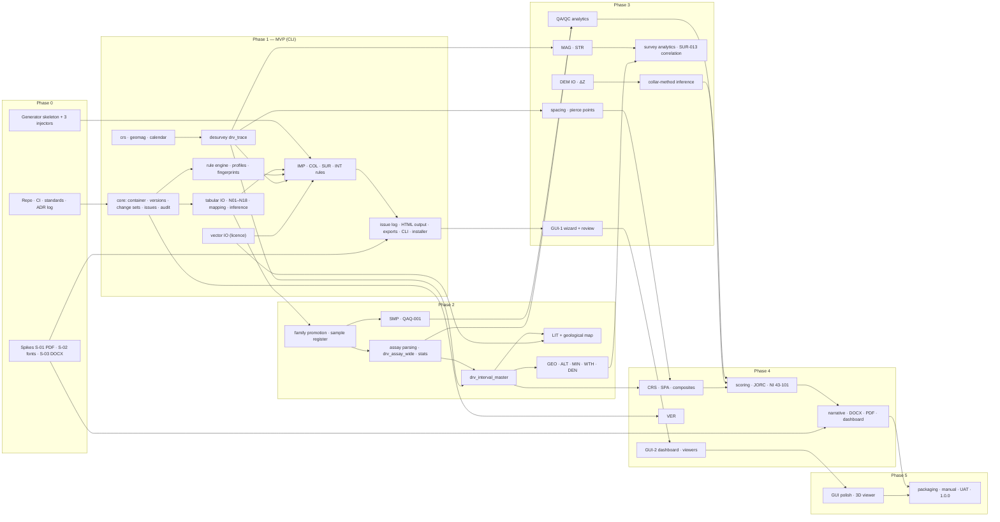

# GEOVALID PRO — 04 · Phase Plan and Quality Assurance
### برنامه فازبندی و تضمین کیفیت (Phase Plan and Quality Assurance)

| | |
|---|---|
| Document | `04_phase_plan.md`, design package item (4) of brief §18 |
| Status | **DRAFT v0.1 for client approval.** No code is written until the design package (01–05) is approved. |
| Date | 2026-10-22 |
| Governs | Phase scope and sequence; work packages (WP); rule, analysis and report delivery per phase; exit criteria (EC); effort; test strategy (synthetic generator, error injector and manifest, oracles, golden files, benchmarks, real-data regression, commercial cross-checks); CI and quality gates; versioning, changelog and decision log; risk register; client decisions; definition of done; per-phase test report |
| Defers to | `01_architecture.md` (modules, stack, spikes S-xx, performance design), `02_data_schema.md` (tables, fingerprint, version workflows), `03_rule_catalogue.md` (rule logic, parameters, numbering of new rules, minimum detectable effect of each statistical rule), `05_traceability.md` (brief clause → design → WP → test → EC) |

Conventions used here:
- Rule IDs are the brief §17 IDs. Rules added by `03_rule_catalogue.md` are referred to by family ("COL additions", "IMP-*") because their numbers are assigned there.
- Module paths are those of 01 §2.1. "01 §x" and "02 §x" refer to the colleague documents; "§x" alone refers to the brief.
- **dw** = developer-week (§1.1). **EC-n.mm** = exit criterion mm of Phase n. **WPn.m** = work package. **D-x** = client decision x (§6).
- Brief chapter numbers of the report (§14.1) are written "ch. 1"–"ch. 13".

---

## 0. Decisions at a glance

| # | Decision | Relation to brief §18 |
|---|---|---|
| P1 | Six phases. A short **Phase 0** (repository, CI, coding standards, synthetic-generator skeleton, sample data, decision log, and the three report-typography spikes S-01–S-03) precedes brief Phases 1–5. | Addition |
| P2 | **Phase 1 is a CLI-only MVP.** It produces the XLSX/CSV issue log, an HTML technical output (en / fa / bilingual, A4 print stylesheet), a cleaned database from a release, and Leapfrog/generic CSV and GIS exports. Field-mapping confirmation and issue review work by **XLSX round trip**, through three command groups added to the CLI of 01 §11.2 (`map`, `review`, `changes`). The GUI starts in Phase 3 (wizard, review panel, map and strip log), grows in Phase 4 (dashboard, section viewer, report dialog) and is polished in Phase 5 with the 3D viewer. Justification in §2.2.1. | Interprets §18 Phases 1 and 5 |
| P3 | **Desurvey (MIN_CURV, BAL_TAN, TAN), magnetic declination and grid convergence move to Phase 1** (brief: Phase 3). Survey *analytics* (lift/drift, magnetic-interference correlation, plots) stay in Phase 3. | Re-sequenced (§1.4 RS1–RS2) |
| P4 | **Vector GIS input (licence/extent polygons) moves to Phase 1** and is reused for the geological map in Phase 2. **DEM input stays with ΔZ in Phase 3.** | Re-sequenced (RS3, RS5) |
| P5 | **The interval master (`drv_interval_master`) moves to Phase 2** (brief §11 work, Phase 4). | Re-sequenced (RS7) |
| P6 | **The sample register, sample-type classification, SMP rules and QAQ-001 move to Phase 2.** QAQ-002…004 and the QA/QC analytics stay in Phase 3. | Re-sequenced (RS8) |
| P7 | **Phase-1 import is family-agnostic** for tables whose family logic arrives later. They are imported as `ext_<name>` (02 §4.19) with their detected family, receive every INT check, and are **promoted** to their canonical family table in Phase 2 by remap + rebase (01 §7.5, 02 §9 step 3). The full canonical schema of 02 is generated in Phase 1, so promotion needs no schema migration. | Addition |
| P8 | **Packaging runs from Phase 1** (01 A15). Every phase ships a Windows installer, a Linux wheel and a test report. | Re-sequenced (brief: Phase 5) |
| P9 | **No Data Confidence Index before Phase 4.** A score computed without the location, QA/QC and recovery components would overstate confidence. Phases 1–3 report findings, not scores. | Decision |
| P10 | **DOCX and PDF arrive in Phase 4**, as in the brief. Their technical risk (Persian shaping, headless rendering) is retired in Phase 0 by spikes S-01 and S-03. | As brief, de-risked |
| P11 | Every rule passes the per-rule gates of 01 §5.12, measured against a **ground-truth manifest** written by the error injector. Deterministic rules: **100 % recall** on injected cases and **zero issues on the clean twin** (an INFO inventory rule must reproduce the generator's by-design baseline exactly). Statistical rules: a fixed **power / false-alarm protocol** at the minimum detectable effect stated in 03 (§3.4.4). | Makes §18 testable |
| P12 | **Projects are forward-migratable from 0.1.0.** No phase build invalidates a client project or a review status. The fingerprint formula (`gv1`, 02 §5.5) is frozen; changing it requires a migration that maps old to new fingerprints. | Addition |
| P13 | **Real client data never enter Git.** Real-data regression runs on a self-hosted runner under client control. | Addition |
| P14 | Development moves to a **dedicated private repository** (D-a). | Decision for the client |
| P15 | Indicative effort **61–80 dw** for one AI-assisted senior developer, about **15–20 calendar months** including gate reviews. Scope levers worth 10–14 dw are listed in §1.7. | Estimate |
| P16 | All twelve spikes of 01 §15 are scheduled **at the start of the work that depends on them** (§1.8), so a failed spike changes a plan, never finished work. Performance acceptance uses the targets and hard limits of 01 §12.3 (§3.8). | Addition |

---

## 1. Planning basis

### 1.1 Estimation basis
- **Unit.** One developer-week (dw) is 5 focused days of one senior Python developer working with an AI coding agent. It includes tests, docstrings, fa/en strings, CI upkeep and the phase test report. It excludes the client's review time and the client's data preparation.
- **Range.** The low figure is the median expectation. The high figure is roughly the 85th percentile and includes one rework cycle after the gate review.
- **What AI assistance changes.** It compresses the writing of code, tests and fixtures. It does not compress geological verification, native-library packaging problems on Windows, Persian typography review or client feedback loops. Those dominate the high end of every range.
- **Size classes.** S ≤ 3 dw · M 3–6 dw · L 6–11 dw · XL > 11 dw.
- **Calendar.** About 4 dw per calendar month after holidays (including Nowruz). Gate reviews (§1.2) overlap the next phase's low-risk work packages and add about 1–2 weeks per gate to the critical path.

### 1.2 Phase gate model
1. **Release candidate.** Tag `0.N.0-rc.k`. The full PR suite and the nightly suites (§4.4) are green on that commit.
2. **Test report.** Generated from CI artefacts in the format of §7.3.
3. **Client review.** At most 10 working days (D-n), using the gate checklist in the test report. The client runs the build on his own data where available.
4. **Outcome.**
   - **Accept:** tag `0.N.0`.
   - **Accept with conditions:** the listed conditions are fixed in `0.N.x` patch releases during the next phase.
   - **Reject:** re-plan; the change is recorded as an ADR (§4.8).
5. **Overlap.** During the review, the next phase's WPs that do not depend on review findings may start (generator extensions, readers, oracles). Rules and report chapters wait for acceptance.

### 1.3 Phase summary

| Phase | Name (en / fa) | Objective | Size | dw | Cumulative dw | Build |
|---|---|---|---|---|---|---|
| **0** | Scaffold / آماده‌سازی زیرساخت | Repository, CI, standards, generator skeleton, spikes S-01–S-03, decision log | M (short) | 3–4 | 3–4 | `0.0.x` |
| **1** | Core engine MVP / هسته، ورود داده و کنترل دهانه، انحراف‌سنجی و بازه‌ها | Import any tabular database, map, validate collar/survey/intervals, review by XLSX, release, export, HTML output | XL | 12–16 | 15–20 | `0.1.0` |
| **2** | Assays and logging / عیار، سنگ‌شناسی، ژئوتکنیک، دگرسانی | Assays (units, DL, stats, correlations), sample register, lithology (+ map), geotech, alteration/mineralisation/weathering, density, style guide | XL | 12–15 | 27–35 | `0.2.0` |
| **3** | Location, survey analytics, QA/QC, GUI core / توپوگرافی، روش برداشت دهانه، فاصله‌داری، QA/QC، رابط گرافیکی | DEM and ΔZ, collar-method inference, spacing/density, survey analytics, QA/QC, magnetic susceptibility, structure, GUI wizard + review | XL | 13–17 | 40–52 | `0.3.0` |
| **4** | Integration and reporting / تحلیل میان‌جدولی و مکانی، امتیاز اطمینان، گزارش کامل | Cross-table and spatial analysis, confidence scoring, JORC/NI 43-101 mapping, full DOCX/PDF/HTML reports, version comparison, dashboard and section viewer | XL | 13–17 | 53–69 | `0.4.0` |
| **5** | Polish and release / تکمیل رابط کاربری، نمایشگر سه‌بعدی، بسته‌بندی، راهنما | GUI polish, 3D viewer, remaining profiles, packaging hardening, user manual fa/en, UAT | L | 8–11 | 61–80 | `1.0.0` |

Spikes scheduled inside Phases 1–5 (§1.8) front-load the risky part of a work package and are included in that phase's estimate; only S-01–S-03 are separate effort (Phase 0).

### 1.4 Re-sequencing against brief §18

| # | Item | Brief phase | Plan phase | Reason |
|---|---|---|---|---|
| RS1 | Desurvey engine `drv_trace` (MIN_CURV / BAL_TAN / TAN, exact arc interpolation, 01 §6.3) | 3 | **1** | Phase-1 rules need traces: SUR-015 (EOH difference between methods), SUR-016 (crossing traces), COL-004 (twins vs wedges vs re-drills are separated by trace divergence at +50 m, 01 §5.5), and the 3D trace export to GIS. The INT rules are depth-domain checks and do **not** need it. Desurvey is small (≈ 1 dw) and has the strongest oracles in the test plan (§3.7.1), so early delivery carries little risk. |
| RS2 | Declination (IGRF-14 / WMM2025), grid convergence, `azimuth_grid`, SUR-014 | 3 | **1** | Desurvey must use `azimuth_grid` (02 §1.8). A trace built from uncorrected magnetic azimuths carries the full δ − γ error, which is several degrees across Iran. A 3° error displaces the EOH of a 400 m hole drilled at −60° by about 10 m (200 m horizontal reach × sin 3°), which is a location error, not a cosmetic one. |
| RS3 | Vector input: SHP, GPKG, GeoJSON, KML/KMZ, DXF polygons, coordinate lists | 2 (map) | **1** | COL-005 (outside licence / project extent) is a Phase-1 collar rule. Doing the GDAL-bearing input first also retires risk R05 (§5) early. LIT-004 reuses it in Phase 2. |
| RS4 | CRS and coordinate-format inference; COL-006 | 1 (implicit) | **1** (explicit) | Swapped X/Y, a wrong UTM zone (38–41 in Iran) and lat/long stored in UTM fields corrupt every spatial product, so they are CRITICAL and come first. |
| RS5 | DEM input (raster, TIN, contours, points, meshes) | 3 | 3 | Its consumers are ΔZ (COL-011/012), collar-method evidence E8 (01 §6.10), the "exits above topography" branch of SUR-016, and slope. They are designed together with DEM quality metrics (resolution, interpolation RMSE, vintage). Until Phase 3 the topography branch of SUR-016 shows as `NOT_APPLICABLE` in the rule-execution matrix (01 §5.1), never as "passed". |
| RS6 | Plot style module (palettes, fonts, Persian shaping, map furniture) | 2 | **1** minimal, 2 full | Phase-1 figures must already follow §15, otherwise they are rewritten in Phase 2. |
| RS7 | Interval master `drv_interval_master` (01 §6.5) | 4 | **2** | Phase-2 analyses need samples split at logged boundaries: grade statistics by lithology, alteration and weathering (§6.3), GEO-004 (recovery–grade bias), ALT-002 (logging vs geochemistry), ASY-008 (missing assays in logged mineralised intervals). |
| RS8 | Sample register, sample-type classification, SMP rules, QAQ-001 | 3 | **2** | Assay statistics must exclude CRM, blank and duplicate samples, which requires sample types. "No QA/QC" is a CRITICAL finding (§6.4) and must appear as soon as assays are validated. |
| RS9 | QAQ-002…004 and QA/QC analytics | 3 | 3 | They need the Phase-2 sample register plus the CRM, blank and batch reference tables (02 §4.7, §4.10). |
| RS10 | Density (DEN) | not phased (§10) | 2 | Plausible ranges are defined per lithology code, so DEN follows the Phase-2 dictionaries. |
| RS11 | Magnetic susceptibility (MAG) | not phased | 3 | Its unit inference (SI ×10⁻³ vs ×10⁻⁵) and values are evidence for the SUR-013 magnetic-interference correlation, which is Phase 3. |
| RS12 | Structure (STR) | not phased | 3 | Alpha/beta → dip/dip direction needs the trace orientation at depth (Phase 1). It is tested with the Phase-3 generator's planar structure sets and feeds JORC T1.10 in Phase 4. |
| RS13 | Sample and chain of custody (SMP) | not phased | 2 | Delivered with the sample register (RS8). |
| RS14 | Packaging | 5 | **1** onward | 01 A15. Packaging defects found in Phase 5 would be found too late. |
| RS15 | GUI | 5 ("polish") | **3** core (wizard, review panel, map, strip log), 4 dashboard and section viewer, 5 polish + 3D | P2 and §2.2.1. |
| RS16 | COL-013 (repeated identical Z), COL-014 (dates, drilling rate) | 1 | 1 | Need no DEM. COL-010 (collar method) waits for Phase 3 because ΔZ is one of its evidence lines. |
| RS17 | Exports: cleaned database, Leapfrog and generic CSV, GIS collars and traces | not phased (§14) | **1** | An MVP must hand a released, cleaned database to modelling software. Datamine, Micromine, Surpac and Vulcan export profiles follow in Phase 4. |
| RS18 | Declarative user rules (01 §5.11) | not phased | 2 | The §6.2 user-defined inequality rules are assay rules. |
| RS19 | Version comparison (VER) | 4 | 4 | Unchanged. Rebasing a new client delivery (02 §9 step 4) already works from Phase 1; only the diff report and VER rules wait. |

### 1.5 Dependency graph



**Critical path:** core container → tabular IO + mapping → rule engine → Phase-1 rules → family promotion → assay parsing → interval master → QA/QC → scoring → narrative report → UAT. The desurvey engine, vector IO and generator run beside it with slack.

### 1.6 Rule delivery map
Counts are brief §17 IDs. All 68 brief rules are delivered by the end of Phase 4. Additions from 03 are delivered in the phase in which their inputs exist, which 03 marks per rule.

| Family | Phase 1 | Phase 2 | Phase 3 | Phase 4 |
|---|---|---|---|---|
| IMP | All import, encoding, mapping, unit/CRS-detection rules for tabular and vector input | Assay-header, analyte-unit and sample-import rules | Spatial-layer import rules (DEM, map, mesh validity) | — |
| COL | 001–009, 013, 014 (11) + additions on IDs, dates, hole type, method fields | — | 010, 011, 012, 015 (4) + topography and spacing additions | — |
| SUR | 001–016 (16). SUR-013 by station pattern; SUR-016 crossing-trace branch | — | SUR-013 magnetic-correlation evidence (rule version bump); SUR-016 topography-exit branch; survey-analytics additions | — |
| INT | 001–009 (9) + additions, on every interval table including `ext_` tables | Re-run on promoted family tables | — | — |
| ASY | — | 001–006, 007 (statistical branch), 008 (8) + additions | — | 007 spatial branch |
| QAQ | — | 001 (1) | 002–004 (3) + additions (umpire, Westgard, mislabelled CRM, batch pass/fail) | — |
| SMP | — | All (new family) | — | — |
| LIT | — | 001–005 (5) + additions | — | Cross-hole consistency additions (pierce points) |
| GEO | — | 001–004 (4) + additions | — | — |
| ALT · MIN · WTH | — | ALT-001–002, WTH-001 (3) + all MIN (new family) + additions | — | WTH neighbour-hole consistency additions |
| DEN | — | 001 (1) + additions | — | — |
| MAG · STR | — | — | All (new families) | — |
| CRS · SPA | — | — | — | CRS-001, CRS-002, SPA-001 (3) + additions |
| VER | — | — | — | All (new family) |
| **Brief IDs delivered** | **36** | **22** | **7** | **3** |

A rule whose inputs are absent in a given project is `NOT_APPLICABLE` with the missing inputs listed (01 §5.1). A rule delivered in a later phase does not exist in earlier builds; the rule-execution matrix of an earlier build lists the brief IDs not yet implemented, so an interim report can never be read as a full audit.

### 1.7 Scope levers
If the schedule must shrink, these are cut in this order. None of them weakens a brief §17 rule.

| # | Lever | Saves (dw) | Consequence |
|---|---|---|---|
| L1 | 3D viewer → v1.1 | 2–3 | 2D map and section viewers remain; ≈ 230 MB smaller unpacked (≈ 80 MB installer) |
| L2 | Datamine `.dm` and Micromine `.DAT` binary readers → CSV exports only (spikes S-05/S-06 not run) | 1.5–2 | Users export CSV from those packages (always supported) |
| L3 | VER diff report and VER rules → v1.1 | 1.5–2 | Rebase of new deliveries still works; no visual diff |
| L4 | GUI settings editors (profile, dictionaries, synonyms) → edit YAML/XLSX | 1.5–2 | Same capability, less convenient |
| L5 | Deposit profiles: ship four in v1 (porphyry Cu, epithermal Au, Fe oxide/skarn, Pb–Zn), five in v1.1 | 1–1.5 | `base.yaml` covers the others |
| L6 | Raster geological-map colour classifier → v1.1 | 1–1.5 | Vector maps only |
| L7 | Interactive HTML dashboard → static HTML report | 1–1.5 | DOCX/PDF unaffected |
| L8 | Variogram preview and Ripley's K/L → v1.1 | ≈ 1 | NN statistics, Clark–Evans and declustering remain |
| | **Total** | **10.5–14.5** | |

### 1.8 Spike schedule (01 §15)
Each spike runs immediately before the work it de-risks. Its outcome is an ADR; a failure triggers the fallback listed in 01 §15 before the dependent WP starts.

| Spike | Question (01 §15) | Days | Scheduled | Unblocks |
|---|---|---|---|---|
| S-01 | Qt WebEngine `printToPdf` for Persian, headless on both OS | 4 | **Phase 0** | PDF engine choice (the stack and package size depend on it); Phase-4 renderers |
| S-02 | Vazirmatn + reshaper + bidi in matplotlib | 2 | **Phase 0** | `plots/text.py`, used by every figure from Phase 1 |
| S-03 | RTL DOCX in Word 2016/2019/365 and LibreOffice | 3 | **Phase 0** (Word check by the client, D-l) | DOCX builder design (Phase 4); reference templates |
| S-10 | Full-stack freeze and installer on clean Windows 10 and 11 | 4 | **Phase 1, weeks 1–2** (with WP1.14) | Packaging from Phase 1 (01 A15) |
| S-12 | Two GDALs side by side; Unicode paths | 2 | **Phase 1, week 1** (inside the S-10 build) | Vector input (WP1.4); DEM input (Phase 3) |
| S-09 | End-to-end performance baseline on L | 4 | **Phase 1, weeks 5–6**, after the engine and first products exist | Writing the remaining ≈ 30 Phase-1 rules against a confirmed performance design |
| S-04 | access-parser (tier 2) vs ACE (tier 1) | 3 | **Phase 1**, when the client's Access corpus arrives (D-e); otherwise Phase 2 | Default Access tier |
| S-11 | Client corpus intake (≥ 3 databases profiled, dictionaries seeded, regression golden set frozen) | 3 + client time | **Phase 1, weeks 4–8** (D-d); repeated when further databases arrive | Real-data regression (EC-1.13 onward) |
| S-05 | Datamine `.dm` reader | 4 | **Phase 2**, only with ≥ 10 files + CSV twins (D-e) | `.dm` reader behind a feature flag |
| S-06 | Micromine `.DAT` reader | 3 | **Phase 2**, same condition | `.DAT` reader behind a feature flag |
| S-07 | Model/view at 1 M rows | 3 | **Phase 3, start** | Review panel (WP3.8) |
| S-08 | pyqtgraph viewers at scale | 3 | **Phase 3, start** | Map and strip log in the review panel (Phase 3); section viewer (Phase 4) |

---

## 2. Phases

Each phase lists: objectives; work packages (module level, paths of 01 §2.1); rules; analyses and figures; report sections; exit criteria; deliverable; effort; dependencies. The definition of done of §7 applies to every WP and every phase in addition to the phase-specific exit criteria.

### 2.0 Report delivery by phase (brief §14.1)

| Chapter | Phase 1 | Phase 2 | Phase 3 | Phase 4 |
|---|---|---|---|---|
| 1 Executive summary | Counts by severity/table/rule; top-10 CRITICAL/ERROR issues table; unconfirmed-inference count | + assay and logging findings | + location and QA/QC findings | **Complete**: narrative, DCI, recommendations |
| 2 Database inventory | **Complete** (tables, holes, metres, campaigns, methods, coverage matrix holes × tables) | + samples, analytes, labs, batches | — | Narrative |
| 3 Collar | Integrity | — | Method inference, ΔZ vs topography, spacing and density | Narrative |
| 4 Downhole survey | Integrity, desurvey method comparison | — | Deviation analytics, declination, magnetic interference | Narrative |
| 5 Interval integrity | **Complete** for all tables | Re-issued on family tables | — | Narrative |
| 6 Assays | — | Units, DL, placeholders, statistics, outliers, correlations, QA/QC inventory and QAQ-001 | QA/QC complete | Narrative |
| 7 Lithology | — | **Complete** incl. geological map | — | + cross-hole consistency |
| 8 Geotechnical | — | **Complete** | — | Narrative |
| 9 Alteration / mineralisation / weathering | — | **Complete** | — | + oxidation-surface consistency |
| 10 Density and other tables | — | Density | Magnetic susceptibility, structure | Narrative |
| 11 Cross-table and spatial | — | — | — | **Complete** |
| 12 Data confidence and JORC Table 1 | — | — | — | **Complete** |
| 13 Recommendations and action plan | — | — | — | **Complete** |
| Appendices | Issue list; rule catalogue with thresholds and their origin (01 §5.9); rule-execution matrix; run metadata | + code dictionaries | + method notes (DEM, collar method, QA/QC) | + glossary fa/en; all method notes |
| **Formats** | HTML (A4 print CSS) + XLSX | same | same | **+ DOCX, PDF, interactive HTML dashboard** |

Until Phase 4, chapters carry **findings tables** (computed facts with numbers) instead of narrative, and the title page reads "Interim technical output — not a database audit report". The phrasebook narrative engine is built once, in Phase 4, on top of the complete set of findings.

---

### 2.1 Phase 0 — Scaffold (آماده‌سازی زیرساخت)

**Objectives.** Make the first line of product code land in a repository whose CI, packaging skeleton, standards and test generator already work, and retire the three typography risks that could change the reporting stack (PDF engine, Persian shaping in figures, DOCX bidi). The packaging and GDAL spikes (S-10, S-12) open Phase 1, where the full stack is first frozen.

| WP | Modules / artefacts | Content |
|---|---|---|
| WP0.1 Repository and governance | repo root, `.github/`, `docs/` | Private repository per D-a; branch protection on `main`; PR template with the §7.1 checklist; CODEOWNERS (developer + client for `resources/profiles`, `i18n`, `report/narrative`); `LICENSE`/EULA placeholder per D-b; `NOTICE`; design documents 00–05 moved to `docs/design/` |
| WP0.2 Toolchain | `pyproject.toml`, `uv.lock`, `ruff.toml`, `mypy.ini`, `.importlinter`, `pytest.ini`, `.pre-commit-config.yaml` | uv lock; ruff (lint + format); mypy strict paths; import-linter contracts of 01 §2.2; pytest markers (`unit rules property regression golden oracle gui bench packaging e2e slow`); hypothesis profiles; per-package coverage thresholds (§4.2); pip-licenses allow-list (01 D9); CycloneDX SBOM |
| WP0.3 CI | `.github/workflows/ci.yml`, `nightly.yml`, `weekly.yml`, `build.yml` | Matrix Windows × Ubuntu on pinned images `windows-2025` / `ubuntu-24.04` (01 §14.6), with a `-latest` canary; no-network job (01 A16); PyInstaller one-dir + Inno Setup skeleton; artefact upload |
| WP0.4 Package skeleton | `geovalid_pro/` tree of 01 §2.1 | Empty modules with interface stubs where contracts need them; `core/offline.py` (network guard), `core/log.py`; `cli/main.py` with `--version` and `gen-synthetic` |
| WP0.5 Generator skeleton | `synth/spec.py`, `synth/terrain.py`, `synth/collars.py`, `synth/trajectory.py`, `synth/geology.py`, `synth/intervals.py`, `synth/render.py`, `synth/inject/` | Porphyry archetype, minimal: stock + 2 host lithologies + oxidation surface; collars on a jittered grid; true trajectories; survey stations; lithology and sample intervals; CSV/XLSX rendering at messiness levels 0–1; three injectors (COL-001, INT-001, INT-002) with manifest writer and JSON Schema (§3.3) |
| WP0.6 Spikes | `spikes/` (not shipped) | **S-01** (4 days) Qt WebEngine `printToPdf` headless on both OS: 40-page fa/en/bi sample, two-pass TOC, header/footer overlay (01 §3.2). **S-02** (2 days) Vazirmatn + reshaper + bidi in matplotlib: every presentation form, multi-line labels, legends, ticks (01 §3.8). **S-03** (3 days) RTL DOCX with bidi paragraphs and tables, `SEQ`/`REF` fields, embedded fonts, Persian page numbers, opened in LibreOffice (CI) and in the client's Word (D-l). Acceptance and fallbacks as 01 §15; each closes with a short report and an ADR. |
| WP0.7 Standards, sample data, decision log | `CONTRIBUTING.md`, `docs/adr/`, `docs/DECISIONS.md`, `tests/fixtures/synth/` | Coding standards (§4.1); rule-module, injector and test templates; ADR template and index seeded with 01 A1–A18, the key 02 decisions and P1–P16 of this document; client decision register (§6) with status; two synthetic S datasets (clean + messy) committed (≤ 10 MB) |

**Rules delivered:** none (the generator's three injectors are verified by an independent brute-force checker inside the test, since no engine exists yet).
**Analyses / report:** none.

| EC | Exit criterion | Measure |
|---|---|---|
| EC-0.01 | Repository set up per D-a and D-b | Branch protection, PR template, CODEOWNERS, licence files present |
| EC-0.02 | CI green on Windows and Ubuntu runners | ruff, mypy strict, import-linter, pytest, licence audit, no-network job all pass; PR pipeline ≤ 10 min |
| EC-0.03 | Packaging skeleton | `build.yml` produces a one-dir Windows build and installer; `geovalid --version` and `geovalid gen-synthetic --size S` run on a clean runner |
| EC-0.04 | Generator determinism | Same seed → identical SHA-256 of every output file, on both OS; manifest validates against its JSON Schema; the 3 injectors' cases are all found by the brute-force checker and none by it on the clean twin |
| EC-0.05 | Spikes S-01, S-02, S-03 decided | Each has a report against its 01 §15 acceptance test and an ADR. A failure triggers its fallback (Typst backend over the RDM; pre-shaped text paths; Latin page numbers / fonts as a requirement) **before Phase-1 planning closes** |
| EC-0.06 | Standards and decision log | CONTRIBUTING.md, templates and seeded ADR index merged; decision register lists D-a…D-r with status |

**Deliverable.** Build `0.0.1` (skeleton installer + `gen-synthetic`), three spike reports, Phase-0 test report.
**Effort.** **M (short), 3–4 dw** (scaffold and generator ≈ 1.5–2 dw; spikes S-01–S-03 ≈ 2 dw).
**Depends on.** D-a (blocking), D-b, D-h; Word check for S-03 (D-l).

---

### 2.2 Phase 1 — Core engine MVP (هسته، ورود داده و کنترل دهانه، انحراف‌سنجی و بازه‌ها)

#### 2.2.1 MVP decision: CLI-only, with XLSX round trips
**Decision.** Phase 1 has no GUI. It ships the `geovalid` CLI, the XLSX/CSV issue log, an HTML technical output, and XLSX round trips for mapping confirmation and issue review.

**Why.**
1. **Testability.** Everything runs headless in CI on Windows and Linux. A GUI would add a second, harder-to-test surface while the `api` layer is still settling.
2. **Effort.** The wizard and review panel cost ≈ 4–5 dw. In Phase 1 they would displace about a third of the rules, or the desurvey and packaging work.
3. **The expert's real review surface is the issue log.** A filtered, pivoted XLSX is where a database geologist works through thousands of issues. The round trip gives full review capability and an audit trail through the same `api.review` service the GUI will call later.
4. **Batch use is a requirement in its own right** (§16 CLI). Building it first guarantees that the GUI never gains behaviour the CLI lacks; the GUI's worker *is* the CLI (01 A1).
5. **The client evaluates what matters first:** the correctness of the checks, from the first build, rather than screens.

**Cost and mitigation.** Mapping confirmation in a spreadsheet is less convenient than a wizard. The mapping workbook therefore carries drop-down lists (Excel data validation) of canonical fields, sample values, confidence and evidence columns, so confirmation is a review, not data entry.

**Round trips.** Three command groups are added to the CLI of 01 §11.2. They stay after the GUI arrives, for batch review and for reviewers who prefer spreadsheets.
- `geovalid map propose --source DIR` imports the sources into the raw snapshot and writes `mapping.xlsx`: one sheet per source table (source column, 5 sample values, proposed canonical field, confidence, alternatives, unit, evidence), plus one sheet of proposed inferences with their evidence. `geovalid map confirm mapping.xlsx` validates the workbook and converts it into the **mapping template and `decisions.yaml` of 01 §11.4**, so the audit trail records the decision file and its hash exactly as 01 designs.
- `geovalid review export` → `review.xlsx` with editable `status`, `reason` and `new_value` columns. `geovalid review import review.xlsx` validates it (reason mandatory for `ignored`; `new_value` type-checked), writes `issue_review` rows and DRAFT change sets.
- `geovalid changes list | apply --reason "…" | revert` manages change sets.
- `geovalid anonymise` (§3.9.2) is the fourth addition, for the client's data preparation.

#### 2.2.2 Objectives
Import any common tabular drillhole database (any naming, units, encodings, Persian content), map it with evidence, validate collar, survey and every interval table, desurvey, let the geologist review and fix with a full audit trail, release, and export a cleaned database to Leapfrog and GIS.

#### 2.2.3 Work packages

| WP | Modules | Content |
|---|---|---|
| WP1.0 Spikes | `spikes/` | S-10 + S-12 in weeks 1–2 (full-stack freeze with both GDALs and Persian paths, clean Windows 10/11 installs); S-09 in weeks 5–6 (performance baseline on L with the first products and representative rules); S-04 and S-11 when the client's data arrive (§1.8) |
| WP1.1 Core domain and container | `core/container/`, `core/schema/`, `core/store.py`, `core/versions.py`, `core/changes.py`, `core/issues.py`, `core/inference.py`, `core/audit.py`, `core/units.py`, `core/hashing.py`, `core/ids.py`, `core/settings.py` | `.gvp` SQLite + Parquet blob store (01 §4); **all canonical tables of 02 generated** (including families whose rules come later); V0/Vb/Vw/Vr; change sets (`SET`, `VOID`, `INSERT`, `RELINK_HOLE`, `REVERT`, `REBASE`); issue model, fingerprints and status carry-over (02 §5.5); hash-chained audit log; migration framework |
| WP1.2 Reference frames | `core/crs.py`, `core/geomag.py`, `core/calendar.py`, `resources/geomag/`, `resources/geoid/` | pyproj wrappers and operation choice; per-collar grid convergence; IGRF-14/WMM2025 synthesis; `azimuth_true`/`azimuth_grid`; Jalali ↔ Gregorian and Excel 1900/1904 serials |
| WP1.3 Tabular input and normalisation | `io/sniff.py`, `io/normalise/`, `io/readers/text.py`, `excel.py`, `dbf.py`, `sql.py`, `access.py`, `presets.py` | Encodings (N01), N01–N18 (02 §6); CSV/TXT/fixed-width, XLSX/XLSM/XLSB/XLS, DBF, SQLite, MDB/ACCDB tiers 1–2 (S-04 if the client corpus exists); Leapfrog CSV preset |
| WP1.4 Vector input | `io/readers/vector.py`, `io/readers/dxf.py` (polylines), coordinate-list parser | Licence and project-extent polygons from SHP, GPKG, GeoJSON, KML/KMZ, DXF, coordinate lists |
| WP1.5 Mapping | `mapping/headers.py`, `matcher.py`, `table_type.py`, `templates.py`, `build.py` | Fuzzy header matching (en/fa synonyms), table-type classifier, mapping templates by source signature, deterministic Vb build; **family-agnostic import** of not-yet-supported families as `ext_<name>` (P7) |
| WP1.6 Inference (Phase-1 kinds) | `analysis/inference/` | Depth unit, coordinate format, CRS and UTM zone, X/Y swap, lat/long in UTM fields, Z datum (header/metadata evidence only), dip convention, azimuth reference, percentage scale, table type, campaign (02 N09–N14, 01 §6.9) |
| WP1.7 Rule engine | `rules/base.py`, `registry.py`, `profile.py`, `engine.py`, `severity.py`, `messages.py`, `expressions.py` (escalation subset), `fixes.py`, `resources/profiles/base.yaml` | 01 §5 complete: registration checks, planning, products just in time, incremental re-run, failure isolation, severity bands/escalation/demotion, en/fa rendering, rule-execution matrix, catalogue generator |
| WP1.8 Phase-1 rules | `rules/imports/`, `rules/collar/`, `rules/survey/`, `rules/interval/` | 36 brief IDs (§1.6) + Phase-1 additions of 03, each with injector(s) and tests (§3.4) |
| WP1.9 Products | `analysis/products.py`, `analysis/desurvey.py`, `analysis/intervals.py`, `analysis/survey_metrics.py`, `analysis/spatial/` (KD-tree, trace proximity, polygon overlay) | `drv_trace`, `drv_trace_compare`, coverage and interval algebra, dogleg/curvature, `drv_collar_spatial` (licence part), `drv_hole_summary` |
| WP1.10 Review and release | `api/review.py`, `api/project.py`, `api/importing.py`, `api/validation.py` | Status changes, bulk actions, XLSX round trips, DRAFT → APPLIED → REVERTED, rebase, release gates (01 §7.6) |
| WP1.11 Outputs | `io/writers/issue_log.py`, `cleaned_db.py`, `software.py` (Leapfrog, generic), `gis.py`; `report/model.py`, `report/sections/`, `report/html_builder.py`, `report/numbering.py`, `report/lint.py`; `plots/style.py`, `text.py`, `furniture.py`, `registry.py`, `render.py` | Issue log with pivots; cleaned DB with `QC_FLAG`/`QC_COMMENT` and change log (02 §9.6); Leapfrog CSV set; GPKG/KML/SHP collars and 3D traces with flags; Report Document Model and HTML chapters 2–5 + appendices; minimal style module |
| WP1.12 CLI | `cli/main.py`, `cli/commands/`, `cli/exit_codes.py`, `cli/output.py` | 01 §11.2 commands (`run`, `validate`, `report`, `export`, `profile`, `gen-synthetic`, `project` incl. `release`, `worker`; `diff` arrives in Phase 4) + the additions `map`, `review`, `changes`, `anonymise` (§2.2.1); `--json`, `--junit`, `--baseline`, exit codes of 01 §11.3, NDJSON progress (the future GUI protocol, 01 §11.5) |
| WP1.13 Generator v1 | `synth/` | All Phase-1 tables; survey realism (lift/drift, instruments, magnetic azimuths, collar stations); campaigns with precision regimes; legitimate-pattern library (§3.4.5); injectors for every Phase-1 rule; sizes S/M/L; render levels 0–3 with Persian headers, cp1256/UTF-16, decimal comma, Persian digits, merged headers, Jalali dates; **anonymisation kit** (`geovalid anonymise`, §3.9.2) released as `0.1.0-alpha` by week 4 so the client can prepare D-d |
| WP1.14 Packaging | `build/` scripts, PyInstaller spec, Inno Setup script | Windows CLI installer (one-dir; PySide6 excluded until the GUI and PDF need it, although S-10 freezes the full stack once to surface integration problems early), Linux wheel + locked requirements, frozen smoke tests and `install-test` on clean VMs (01 §14.6), size monitor |

#### 2.2.4 Rules, analyses, report
- **Rules:** COL-001–009, 013, 014; SUR-001–016 (SUR-013 by station pattern, SUR-016 crossing branch); INT-001–009; all IMP; Phase-1 additions in COL, SUR, INT.
- **Analyses:** desurvey by three methods and EOH comparison; coverage per hole and table; interval-length distributions; station spacing; dogleg severity; dip/azimuth change; trace proximity; collar overlay with licence/extent; inventory statistics.
- **Figures** (style module minimal, both languages): collar plan map with licence, scale bar, north arrow and grid ticks; coverage heat-map holes × tables; interval-length histograms per table; dip and azimuth vs depth for flagged holes; trace plan view; EOH difference between desurvey methods; issue counts by severity × table.
- **Report:** ch. 2 complete; ch. 3 (integrity), ch. 4 (integrity + desurvey comparison), ch. 5 complete; appendices per §2.0. HTML in en, fa and bilingual.
- **Exports:** issue log XLSX/CSV; cleaned DB (CSV set + XLSX + SQLite); Leapfrog CSV set; generic CSV; GIS collars and traces; validation profile YAML; run metadata.

#### 2.2.5 Exit criteria

| EC | Exit criterion | Measure |
|---|---|---|
| EC-1.01 | End-to-end workflow | Scripted `project create → map propose --source … → map confirm → validate → review export/import → changes apply → validate → project release → export → report`, and the one-shot `run --source … --decisions … --release …` path, complete with the expected exit codes (01 §11.3) on synthetic S, M, L and on the messy corpus (`tests/e2e/`); `export` and a final `report` without a release are refused (exit 2 / draft watermark) |
| EC-1.02 | Per-rule gates | Every Phase-1 rule: 100 % recall on its injected cases; 0 issues on the clean twin (INFO inventory rules: exactly the generator baseline, §3.4.2); boundary tests on both sides of every threshold; the legitimate-pattern suite raises no ERROR or CRITICAL (§3.4) |
| EC-1.03 | Import fidelity | Fixture corpus of ≥ 60 files (all Phase-1 formats; UTF-8/UTF-16/cp1256/cp1252; Persian digits; decimal comma; merged and multi-row headers; Excel 1900/1904 serials; Jalali dates; hidden rows; sentinels) → 100 % of the expected cell outcomes in each fixture's expectation file. **Render invariance:** every messy rendering of a synthetic dataset imports to canonical tables equal to the clean twin (§3.2.4) |
| EC-1.04 | Auto-mapping | On a corpus of ≥ 400 headers (≥ 25 % Persian or mixed): top-1 canonical field correct ≥ 95 %, correct field within top-3 ≥ 99 %. Table type correct ≥ 97 % on ≥ 80 table fixtures. A saved template re-applies with 100 % identity |
| EC-1.05 | Inference never silent | On ≥ 200 unambiguous synthetic cases (depth unit, coordinate format, zone, X/Y swap, lat/long in UTM fields, dip convention): 100 % correct top alternative. On ≥ 50 constructed ambiguous cases: 100 % remain `PROPOSED` with ≥ 2 alternatives and raise their warning; a release is blocked until confirmed |
| EC-1.06 | Desurvey and reference frames | Hand-calculated cases HC-01…HC-08 (§3.7.1) to ≤ 1 × 10⁻⁶ m; reference implementation agreement ≤ 1 mm at every station of M; analytic arcs ≤ 1 × 10⁻⁹ m; IGRF/WMM vs ≥ 50 NOAA/BGS reference values ≤ 0.01°; convergence sign test |
| EC-1.07 | Determinism | Two full runs from the same inputs → byte-identical canonical Parquet, identical fingerprint sets, identical Report Document Model JSON. **Fingerprint sets identical between Windows and Linux** |
| EC-1.08 | Review persistence and change safety | Three runs with edits between: all 12 status-transition cases of 02 §5.5 behave as specified; apply → revert restores byte-identical tables; each of the six release gates (01 §7.6) blocks when violated (one negative test each); guarantees G1–G9 (01 §7.8) each have a passing test |
| EC-1.09 | Outputs | Issue log (brief §1.3 fields + `fingerprint` + `run_id` + JORC items; pivots per table/rule/hole) opens in Excel and LibreOffice; HTML chapters 2–5 + appendices in en/fa/bilingual with **0 report-lint violations**; Leapfrog CSV set re-imports through the Leapfrog preset with 0 canonical differences; GIS layers pass schema tests and open in QGIS (manual check recorded) |
| EC-1.10 | Performance (L, reference laptop, §3.8) | Import + normalise + Vb build from CSV ≤ 3 min, from XLSX ≤ 6 min; full validation of the Phase-1 rules, cold caches, ≤ 60 s; incremental re-run after a typical review change set ≤ 45 s; desurvey with all three methods ≤ 3 s; Leapfrog CSV export ≤ 30 s; issue log with 250 k issues ≤ 90 s; peak worker RSS ≤ 3 GB. S-09 has confirmed the full-catalogue design budget (01 §12.3) within 1.3× |
| EC-1.11 | Quality gates | §4 gates green on both OS; coverage targets met; licence audit clean; no-network job green |
| EC-1.12 | Installer | Installs on clean Windows 10 22H2 and Windows 11 VMs; runs the S demo offline from a folder with a Persian name; size reported against the budget |
| EC-1.13 | Real-database regression (if D-d is delivered by week 6) | End-to-end run; ≥ 90 % of the client's known issues within Phase-1 scope detected (each miss explained or turned into a defect); precision on 100 stratified issues labelled by the client ≥ 90 % for ERROR/CRITICAL and ≥ 75 % for WARNING (§3.9) |
| EC-1.14 | Commercial cross-check (if D-m) | 100 % of the integrity errors that Leapfrog Geo / Datamine report on the same dataset (mapped classes, §3.10) are flagged |
| EC-1.15 | Persian text | All Phase-1 rule titles, messages and fixes reviewed by the nominated reviewer (D-l); en/fa placeholder parity 100 % |

**Deliverable.** `GEOVALID-PRO-0.1.0` Windows CLI installer + Linux wheel; demo project built from synthetic M with injected errors and its outputs; Phase-1 test report.
**Effort.** **XL, 12–16 dw.**
**Depends on.** Phase 0; D-a, D-b, D-e (Access priority), D-g, D-h, D-j (IMP/COL/SUR/INT additions), D-o (02 §10 questions 1–4, 7, 8, 10), D-r (01 §16 Q5, Q7, Q10); D-d by week 6 (desirable); D-c placeholder acceptable.

---

### 2.3 Phase 2 — Assays and logging (عیار، سنگ‌شناسی، ژئوتکنیک، دگرسانی)

**Objectives.** Make assays trustworthy (units, detection limits, placeholders, preferred values), give the geologist the exploratory statistics he expects, and validate every logging table, including lithology against the geological map, recovery and RQD, and the logging-vs-geochemistry checks.

| WP | Modules | Content |
|---|---|---|
| WP2.1 Family promotion | `mapping/build.py`, `api/importing.py`, `core/changes.py` (rebase) | Canonical family tables for sample, assay (long), lithology, alteration + obs, mineralisation + obs, weathering, geotech run, density; promotion of Phase-1 `ext_` tables by remap → Vb′ → rebase, with conflicts listed |
| WP2.2 Assay parsing and values | `mapping/assay_headers.py`, `resources/dictionaries/` (analytes, methods, priors), `analysis/inference/` (ANALYTE_UNIT), `analysis/assay_wide.py`, `core/query.py` | Element/oxide/unit/method/digestion/repeat parsing; unit-row detection; N06 value flags; DL per element/lab/batch/period; sentinels; preferred-value algorithm (02 §4.9.3); `drv_assay_wide` via DuckDB |
| WP2.3 Sample register and QC typing | canonical `sample`, `lab`, `lab_batch`, `dispatch`; `analysis/inference/` (sample type) | Sample-type classification (CRM, blank, field/coarse/pulp duplicate, umpire, lab-internal QC per 02 §10 Q5); SMP rules; QAQ-001 insertion inventory |
| WP2.4 Statistics services | `analysis/stats/`, `analysis/geochem.py` | Weighted and unweighted descriptive statistics; log-probability and GMM population breaks; outliers and top-cut (CV, Parrish deciles, metal at risk, cumulative metal); Pearson-log, Spearman, CLR, clustering, PCA; tests; stoichiometry and ratio checks |
| WP2.5 Logging analytics | `mapping/codes.py`, `analysis/logging_stats.py` | Code dictionaries and fa/en synonym proposals; inventories (count, metres); Shannon diversity; Markov transitions; logger-effect χ²; contingency tables and Cramér's V |
| WP2.6 Geotechnical | `rules/geotech/`, `analysis/stats/` | Range checks; CR/RQD recomputation from run measurements; fracture frequency; recovery–grade binned analysis (§8) |
| WP2.7 Interval master | `analysis/intervals.py` → `drv_interval_master` | Common boundaries, elementary intervals, carried (never averaged) values, XYZ from `drv_trace` (01 §6.5) |
| WP2.8 Geological map and LIT-004 | `io/readers/vector.py` (reuse), `map_unit_lith_corr` (XLSX editable), `analysis/spatial/` overlay | Collar → map unit; first logged bedrock unit under logged cover; distance to nearest contact and buffer demotion; confusion matrix, agreement %, Cohen's κ |
| WP2.9 Declarative user rules | `rules/expressions.py` (complete), profile `user_rules` | Kinds `inequality`, `range`, `required_if`, `pattern`, `forbidden_sequence`; IDs 901–999 (01 §5.11) |
| WP2.10 Style guide and figures | `plots/style.py` (complete), `plots/registry.py`, `plots/figures/assay.py`, `lithology.py`, `geotech.py`, `alteration.py` | Shared code-colour registry; size classes; full §15 conformance checks (§3.6.2) |
| WP2.11 Report | `report/sections/` ch. 6–10 | Findings tables and figures; code-dictionary appendix |
| WP2.12 Profiles and presets | `resources/profiles/deposit/porphyry_cu.yaml`, `epithermal_au.yaml`; `io/readers/presets.py` | First deposit profiles (D-i); acQuire and MX Deposit export presets |
| WP2.13 Spikes | `spikes/` | S-04 (if not done in Phase 1), S-05 Datamine `.dm`, S-06 Micromine `.DAT`, each only if D-e supplies ≥ 10 files with CSV twins (01 §3.6) |
| WP2.14 Generator v2 | `synth/grades.py`, `synth/lab.py`, `synth/qc.py`, `synth/logging.py`, `synth/geotech.py` | Long assays with a lab model (DL, upper limits, codes, methods, over-limit re-assays); QC inserts (basic); loggers with vocabularies; geotech runs with raw measurements; density; epithermal-vein archetype; injectors for Phase-2 rules; statistical power harness (§3.4.4) |

**Rules:** ASY-001–006, ASY-007 (statistical branch), ASY-008; QAQ-001; all SMP; LIT-001–005; GEO-001–004; ALT-001–002; all MIN; WTH-001; DEN-001; Phase-2 additions; IMP assay/sample rules; declarative user rules.

**Analyses and figures:** per-element summary table (n, n missing, n < DL, min, P5, P25, median, mean, P75, P95, P99, max, SD, CV, skewness, kurtosis, geometric mean; weighted and unweighted); linear and log histograms; log-probability plots; box plots and ECDF by lithology, alteration, weathering, hole type, campaign and lab; top-cut analysis (suggestion only); correlation heat-map with hierarchical clustering; scatter-plot matrix; PCA biplot; element-ratio plots; downhole grade strip plots; lithology code inventory and proportions; thickness distributions; Markov transition matrix; diversity per hole/logger; strip logs; map-vs-log confusion matrix and mismatch map; CR/RQD histograms and grouped box plots; recovery class vs grade; alteration × lithology contingency and mosaic; alteration box plot (Ishikawa AI vs CCPI); logged sulphide % vs S; density by lithology; regression density = f(grade) suggestion.

**Report:** ch. 6 (without QA/QC charts), ch. 7–9 complete, ch. 10 density; code-dictionary appendix.

| EC | Exit criterion | Measure |
|---|---|---|
| EC-2.01 | Per-rule gates | Deterministic Phase-2 rules as EC-1.02. Statistical rules (LIT-005, GEO-004, ASY-004, ASY-007 statistical branch) pass the §3.4.4 protocol at the MDE stated in 03 |
| EC-2.02 | Assay header parsing | ≥ 98 % exact (analyte, unit, method, digestion, repeat) on ≥ 600 headers from ≥ 6 laboratories' conventions, including the client's laboratories; 100 % of unparsed tokens surfaced as issues, none dropped |
| EC-2.03 | Analyte units | 100 % correct on unambiguous synthetic columns (ppm, ppb, %, g/t, oz/t); ambiguous columns stay `PROPOSED` (100 %); ASY-004 power ≥ 95 % when ≥ 5 % of a column (n ≥ 200) is in a unit three or more decades away |
| EC-2.04 | Value policy | Placeholder/DL classification 100 % against ≥ 50 code variants (Persian included); BDL-policy counts in the report equal the manifest counts |
| EC-2.05 | Statistics oracles | Descriptive statistics, CLR, PCA and tests agree with scipy/statsmodels or hand-calculated weighted cases to ≤ 1 × 10⁻⁹ relative; top-cut methods reproduce the reference workbook cases (§3.7) |
| EC-2.06 | Interval master | Property tests pass (§3.5); elementary lengths sum to each hole's union length within 1 µm; an assertion proves no value is length-scaled or averaged |
| EC-2.07 | LIT-004 | 100 % of injected map/log mismatches detected; near-contact demotion correct for 100 % of cases inside/outside the buffer; confusion matrix and κ equal hand-computed values |
| EC-2.08 | Promotion and upgrade | A `0.1.0` project opens in `0.2.0`; promotion rebases every change set with 0 dropped changes (conflicts listed); review statuses carried over wherever fingerprints are unchanged |
| EC-2.09 | Style guide | 100 % of registered figures pass the structural checks (§3.6.2); fa figures have no missing glyph (font cmap check) |
| EC-2.10 | Performance (L with ≈ 12 M determinations) | Import + Vb build including long assays: CSV ≤ 3 min, XLSX ≤ 6 min; `drv_assay_wide` ≤ 10 s and `drv_interval_master` ≤ 12 s (01 §12.3 budgets, ≤ 1.5× tolerated per step); full validation of Phase 1 + 2 rules, cold, ≤ 100 s; incremental re-run after an assay edit ≤ 45 s; peak worker RSS ≤ 5 GB |
| EC-2.11 | Report | ch. 6–10 (as scoped) in en/fa/bilingual, 0 lint violations |
| EC-2.12 | Profiles | base, porphyry_cu and epithermal_au validate against the profile schema and give 0 issues beyond baseline on their clean synthetic archetypes |
| EC-2.13 | Real database | Known issues within Phase 1 + 2 scope ≥ 90 % detected; precision targets of EC-1.13 on 150 stratified issues |
| EC-2.14 | Spikes | S-04/S-05/S-06 outcomes recorded as ADRs: pass → reader enabled behind a feature flag; fail → CSV route documented in the manual |
| EC-2.15 | General | EC-1.11, EC-1.12 and EC-1.15 repeated for Phase-2 scope |

**Deliverable.** `0.2.0` installer + wheel; demo project upgraded from `0.1.0`; Phase-2 test report.
**Effort.** **XL, 12–15 dw.**
**Depends on.** Phase 1 (engine, interval algebra, `drv_trace`, `ext_` tables); D-i (first profiles); D-j (Phase-2 additions); D-e sample files for spikes; D-o (02 §10 questions 5, 6, 9); client laboratory certificates or exports for the header corpus.

---

### 2.4 Phase 3 — Location, survey analytics, QA/QC, GUI core (توپوگرافی، روش برداشت دهانه، فاصله‌داری، QA/QC، رابط گرافیکی)

**Objectives.** Answer the JORC T1.06, T1.08 and T1.09 questions (quality of assay data, location of data points, data spacing), complete the survey analysis, add magnetic susceptibility and structure, and give the geologist a GUI for mapping and review.

| WP | Modules | Content |
|---|---|---|
| WP3.1 Surfaces input | `io/readers/raster.py`, `points.py`, `dxf.py` (3DFACE, MESH, POLYFACE, contours), `mesh.py`, `surpac.py` (`.str`/`.dtm`), KML/KMZ, SRTM/ALOS/ASTER tiles; `analysis/spatial/` DEM | Delaunay TIN (default) and Sibson grid; bilinear/barycentric sampling (nodata-aware); slope by Horn / triangle normals; surface metadata (source, resolution, vertical CRS, vintage, interpolation RMSE, flat-triangle share) |
| WP3.2 Collar vs topography | `rules/collar/`, `drv_collar_spatial` | COL-011, COL-012, SUR-016 topography-exit branch; ΔZ statistics; proposed fixes (drape, constant datum shift, keep and flag) as DRAFT change sets only |
| WP3.3 Collar survey method | `analysis/inference/collar_method`, `drv_collar_method` | Weights-of-evidence classifier E1–E11 (01 §6.10); COL-010; evidence waterfall data; campaign summary; recommendation text |
| WP3.4 Spacing and distribution | `analysis/spatial/` | 1st–3rd NN; `drv_pierce_point` (levels, DEM-offset surfaces, mineralised-zone midpoints); kernel density; holes/km², metres/km²; Voronoi clipped to licence; quadrats; Clark–Evans; Ripley K/L with envelopes; grid spacing/orientation; fence detection; declustering preview; twin and close-pair inventory; orientation of drilling vs trend; COL-015 + additions; indicative spacing table per deposit type |
| WP3.5 Survey analytics | `analysis/survey_metrics.py`, `rules/survey/` | Lift and drift by hole type, rig, diameter, lithology, depth; SUR-013 magnetic-interference evidence (magnetite logging, Fe, MAG, magnetic grid, EMS total field vs IGRF); SUR-014 gyro/EMS overlap offset vs δ; survey additions |
| WP3.6 QA/QC | `analysis/qaqc.py`, `drv_qaqc_crm`, `_blank`, `_pair`, `_batch`; canonical `crm`, `crm_value`, `blank_value` | Shewhart limits, Westgard rules, bias %, mislabelled CRM; blank threshold and carry-over; HARD, ranked HARD, MPD, RMA (bootstrap CI), Q-Q, Thompson–Howarth by duplicate type; umpire tests; batch pass/fail and re-assay list; QAQ-002–004 + additions |
| WP3.7 MAG and STR | canonical `magsus`, `structure`; `rules/magsus/`, `rules/structure/` | Magnetic susceptibility unit inference and checks; alpha/beta → dip/dip direction using `drv_trace`; oriented-core consistency; stereonets and roses per domain (mplstereonet) |
| WP3.8 GUI-1 | `gui/app.py`, `main_window.py`, `wizard/`, `review/`, `models/`, `workers/`, `gui/viewers/` (map, strip log), `i18n/ts/` | Opens with spikes S-07 (model/view at 1 M rows) and S-08 (pyqtgraph at scale). Wizard: create project → import → map fields and units → set CRS → load topography/map/boundary → choose profile → run. Review panel: filters by severity/rule/hole; record in context (previous/next rows, strip log, location on the map); bulk accept / ignore with mandatory reason / edit value → DRAFT change set → apply/revert. Worker subprocess with NDJSON progress and cancel (01 §11.5). fa UI with RTL layout |
| WP3.9 Report | `report/sections/` | ch. 3 and 4 complete; ch. 6 QA/QC; ch. 10 magnetic susceptibility and structure; method notes |
| WP3.10 Profiles and generator v3 | `resources/profiles/deposit/iocg_skarn_fe.yaml`; `synth/` | Fractal DEM with pads, pits and trenches newer than the DEM; collar-method regimes and datum offsets; magnetite bodies that disturb EMS azimuths; QA/QC with lab bias, drift, contamination, carry-over and mislabels; structure sets; Fe-skarn archetype; injectors for Phase-3 rules |
| WP3.11 Packaging with GUI | build scripts | PySide6 + Qt WebEngine in the one-dir build; size gate active; GUI smoke on the installed build |

**Rules:** COL-010, 011, 012, 015; QAQ-002–004; all MAG; all STR; SUR-013 (correlation evidence, version bump) and SUR-016 (topography branch); Phase-3 additions; IMP spatial-layer rules.

**Analyses and figures:** ΔZ statistics (n, mean, median, SD, MAD, min, max, percentiles), histogram + KDE, box plots by campaign/method/hole type, Q-Q plot, ΔZ map (diverging scale), ΔZ vs Z_topo, ΔZ vs slope; collar map coloured by inferred method with campaign summary; NN histograms and cumulative curves, NN map, spacing at depth, kernel-density map, Voronoi map, Ripley L with envelopes, declustered vs naive mean; dip and azimuth vs depth with flags, deviation drift plot, lift/drift box plots, rose diagram and stereonet of collar orientations, plan and section of planned vs actual traces; CRM control charts, blank time series, duplicate scatter with ±10/20 % lines, ranked HARD, Thompson–Howarth, RMA, umpire Q-Q, batch pass/fail table; magnetic susceptibility vs logged magnetite and Fe; stereonets and roses per domain.

**Report:** ch. 3, 4 complete; ch. 6 QA/QC; ch. 10 MAG/STR; method notes (DEM, collar method, QA/QC).

| EC | Exit criterion | Measure |
|---|---|---|
| EC-3.01 | Per-rule gates | Deterministic rules as EC-1.02; statistical rules (COL-012 datum offset, COL-015 clustering, QAQ-002 bias, QAQ-004 precision) per §3.4.4 at the 03 MDE |
| EC-3.02 | Surfaces | Every surface format reads a fixture of known content; sampling on analytic planes ≤ 1 × 10⁻⁶ m and on analytic quadratic surfaces within the interpolation error bound; TIN-from-contours metrics equal the reference computation; collars on nodata or outside the surface give an explicit "not sampled" result and an issue, never 0 |
| EC-3.03 | Collar method | On ≥ 2 000 synthetic collars of known method (4 classes and mixed campaigns): accuracy ≥ 90 %, macro-F1 ≥ 0.85, PLANNED recall ≥ 95 %, SURVEY_GRADE precision ≥ 95 %; UNKNOWN returned whenever fewer than two evidence groups contribute (100 %); expected calibration error of the posterior ≤ 0.08. Confusion matrix on any client collars of documented method is reported |
| EC-3.04 | Spacing | NN distances equal brute force; Clark–Evans R = 2.00 ± 0.02 on a perfect square grid and 1.00 ± 0.03 as the mean over 200 CSR seeds; grid detection recovers spacing within 2 % and orientation within 1° when jitter ≤ 10 % of spacing; pierce points equal the analytic arc–plane intersection within 1 mm |
| EC-3.05 | QA/QC oracles | Westgard rules flag exactly the expected points on 30 constructed sequences; HARD, MPD, RMA and Thompson–Howarth agree with the reference workbook to ≤ 1 × 10⁻⁹ relative; injected CRM failures, blank contamination above threshold and CRMs mislabelled by ≥ 6 SD separation detected 100 % |
| EC-3.06 | Structure conversion | Alpha/beta → dip/dip direction within 0.01° of generator truth on ≥ 1 000 planes in vertical, inclined and up-holes, for each supported beta reference convention |
| EC-3.07 | Magnetic interference | On generator magnetite bodies: ≥ 90 % of interference spikes classified as instrument (magnetic) error, and ≥ 90 % of genuine doglegs classified as real deviation |
| EC-3.08 | GUI-1 | ≥ 25 pytest-qt scenarios (wizard and review) pass on Windows and Linux; fa and en golden screenshots of the key views within tolerance (01 §10.12). On L (01 §12.3): GUI cold start ≤ 4 s; project open ≤ 5 s with cache / ≤ 20 s first open; filter or sort of 1 M issues ≤ 300 ms; issue click → inspector, strip log and map ≤ 200 ms; map of 5 000 traces + 100 k markers ≥ 30 fps; UI-thread stall p99 ≤ 100 ms during a job; killing the worker mid-run leaves a project that opens and verifies |
| EC-3.09 | Performance (L) | Full validation of Phase 1–3 rules, cold, ≤ 120 s; `drv_collar_spatial` (5 m DEM of 4 M cells or a 1 M-triangle TIN, licence, map) ≤ 3 s; every Phase-3 rule and product within its 01 §12.3 budget (≤ 1.5× per step); peak RSS ≤ 5 GB |
| EC-3.10 | Report | ch. 3, 4, 6, 10 (as scoped) in en/fa/bilingual, 0 lint violations |
| EC-3.11 | Installer | GUI installer within the size budget (§3.8); clean-VM install, offline, Persian path |
| EC-3.12 | Real database (ideally a second one with QA/QC and a DEM) | Known issues within scope ≥ 90 % detected; precision targets of EC-1.13 |

**Deliverable.** `0.3.0` GUI installer + wheel; demo project with DEM, map and QA/QC; Phase-3 test report.
**Effort.** **XL, 13–17 dw.**
**Depends on.** Phase 1 (`drv_trace`, engine, `api`), Phase 2 (sample register, assay long, MIN logging, interval master); D-p (QA/QC protocol targets); D-q (client DEMs, maps, licences in their real formats); CRM certificates.

---

### 2.5 Phase 4 — Integration and reporting (تحلیل میان‌جدولی و مکانی، امتیاز اطمینان، گزارش کامل)

**Objectives.** Integrate the tables in space (domains, contacts, twins, method bias, spatial outliers), score confidence and map it to JORC Table 1 Section 1 and NI 43-101 Items 11–12, compare database versions, and produce the full bilingual technical report in DOCX, PDF and HTML.

| WP | Modules | Content |
|---|---|---|
| WP4.1 Cross-table analytics | `analysis/composite.py`, `analysis/stats/`, `rules/cross/` | High grade in barren units and the inverse (CRS-001); grade by lithology × alteration; ANOVA / Kruskal–Wallis; candidate estimation domains; contact analysis (hard vs soft); twin-hole comparison on paired composites; drilling-method bias (CRS-002); compositing preview and composite-length recommendation; swath plots |
| WP4.2 Spatial statistics | `analysis/spatial/`, `rules/spatial/` | Local Moran's I and Getis–Ord Gi* with BH-FDR (SPA-001 + additions); NN grade difference vs distance; variogram preview (informative only); ASY-007 spatial branch; lithology and weathering cross-hole consistency via pierce points |
| WP4.3 Scoring | `scoring/confidence.py`, `jorc.py`, `fitness.py`, `drv_confidence` | Hole, table and project scores; caps; DCI; T1.01–T1.12 assessment; NI 43-101 Items 11 and 12; indicative fit-for-purpose statement; weight-sensitivity band (01 §8) |
| WP4.4 Version comparison | `analysis/version_diff.py`, `api/diffing.py`, `rules/version/` | VER rules; database vs software export; diff XLSX; change map |
| WP4.5 Narrative | `report/findings.py`, `report/narrative/` (phrasebooks fa/en) | Narrative for every chapter from computed findings; executive summary (key findings, DCI, top-10 critical issues, recommendations); ch. 13 action plan with priorities and effort estimates; CP/QP statement (§19) |
| WP4.6 Renderers | `report/docx_builder.py`, `report/pdf.py`, `report/html_builder.py`, `plots/interactive/` | DOCX on Word reference templates (bidi, SEQ/TOC fields, embedded fonts); PDF by Qt WebEngine with two-pass TOC and header/footer overlay; offline plotly dashboard; branding (D-c) |
| WP4.7 Exports complete | `io/writers/software.py`, `surpac_str.py`, `gis.py` | Datamine, Micromine, Surpac, Vulcan profiles; `.str` writer; GIS interval layers with flags and inferred collar method |
| WP4.8 GUI-2 | `gui/dashboard/`, `gui/viewers/` | Dashboard (counts by severity/table, custom-painted confidence gauges, mini-maps); section viewer along drill fences; map and section with traces coloured by any field or issue flag; chart panels; report dialog with in-app PDF preview |
| WP4.9 Profiles, generator v4 | `pbzn_mvt_sedex.yaml`; `synth/versions.py` | Version pairs with a diff manifest; twin and method-bias scenarios; hard and soft domain contacts; stratabound Pb–Zn archetype |
| WP4.10 Raster map classifier | `analysis/spatial/` | Colour-to-unit classification of georeferenced map rasters from a legend table (GUI picker in Phase 5) |

**Rules:** CRS-001, CRS-002, SPA-001; ASY-007 spatial branch; all VER; Phase-4 additions in CRS, SPA, LIT and WTH.

**Analyses and figures:** two-way grade tables; domain box plots and test tables; contact plots (grade vs signed distance); twin Q-Q and mean-difference plots; method-bias Q-Q with KS results; plan and section grade maps (maximum/average per hole, grade-thickness); local Moran / Gi* maps with FDR-significant points; NN grade difference vs distance; swath plots along X, Y and Z with sample counts; experimental variograms (omnidirectional + main directions); compositing preview; confidence gauges, hole-score map, JORC matrix; VER change map and diff tables.

**Report:** ch. 1–13 complete with narrative; all appendices (full issue list, rule catalogue with thresholds and origins, code dictionaries, method notes, glossary fa/en); DOCX + PDF + HTML dashboard in fa, en and bilingual.

| EC | Exit criterion | Measure |
|---|---|---|
| EC-4.01 | Per-rule gates | Deterministic rules as EC-1.02; statistical rules (CRS-002, SPA-001, ASY-007 spatial, cross-hole consistency) per §3.4.4; SPA-001 false discoveries on clean seeds controlled at the nominal FDR |
| EC-4.02 | Spatial-statistics oracles | Local Moran's I and Gi* statistics equal `esda` to ≤ 1 × 10⁻⁹ with identical weights; permutation p-values within \|Δp\| ≤ 0.01 at 999 permutations |
| EC-4.03 | Scoring | ≥ 10 hand-computed holes reproduce the 01 §8 formulas exactly; property tests: adding an open issue never raises any score, and marking an issue fixed never lowers one; caps applied; sensitivity band reported |
| EC-4.04 | JORC / NI 43-101 | Every rule carries ≥ 1 T1.xx item (except where 03 states otherwise); every item T1.01–T1.12 appears in the matrix with status and evidence; Items 11 and 12 derived per 01 §8.4 |
| EC-4.05 | Full report | All §14.1 chapters + appendices in DOCX, PDF and HTML, fa/en/bilingual; **0 report-lint violations** (no placeholder text, every figure referenced, every number traceable to a finding); goldens stable; PDF fonts 100 % embedded, outline present, "page n / N" correct; DOCX opens without repair in LibreOffice (CI) and in Word 2016/2019/365 (client check); Persian reviewer sign-off on two complete reports (synthetic L and the real database) |
| EC-4.06 | Report performance (L, ≈ 150 figures) | One language, DOCX + PDF + HTML: ≤ 4 min cold, ≤ 90 s with figures cached (01 §12.3); `bi` mode (01 §9.5) ≤ 5 min cold |
| EC-4.07 | VER | On ≥ 20 synthetic version pairs with a diff manifest (added/removed holes, collar moves including a constant datum-type shift, EOH changes, station changes, split/merged/moved intervals, value changes, code renames): recall 100 %; 0 differences between identical versions; diff of two L versions ≤ 60 s |
| EC-4.08 | Exports | Datamine, Micromine, Surpac, Vulcan and generic profiles round-trip through their presets with 0 canonical differences |
| EC-4.09 | GUI-2 | ≥ 20 pytest-qt scenarios pass; golden screenshots of dashboard and section viewer within tolerance; section projection ≤ 200 ms and picking ≤ 50 ms (S-08 acceptance) on the reference laptop |
| EC-4.10 | Real database | Client known issues ≥ 95 % detected across the full catalogue (every miss explained, or turned into a defect or a rule addition); precision targets met; Leapfrog/Datamine cross-check repeated (D-m) |
| EC-4.11 | Performance (L) | **Full validation of all rules, cold caches, ≤ 150 s (hard limit 180 s)**; peak worker RSS ≤ 5 GB (hard limit 6 GB); every 01 §12.3 operation within its hard limit |

**Deliverable.** `0.4.0` installer + wheel; complete sample reports (DOCX, PDF, HTML) on synthetic L and on the client database; Phase-4 test report.
**Effort.** **XL, 13–17 dw.**
**Depends on.** Phase 2 (interval master), Phase 3 (pierce points, QA/QC, collar method: all three feed scoring); S-01 and S-03 outcomes; D-c (final branding, house template), D-g (default language, `bi` design), D-m (cross-check), D-r (01 §16 Q6, Q9, Q11).

---

### 2.6 Phase 5 — Polish and release (تکمیل رابط کاربری، نمایشگر سه‌بعدی، بسته‌بندی، راهنما)

**Objectives.** Turn a complete engine into a product a geologist installs and uses without the developer: GUI polish, optional 3D view, all deposit profiles, hardened installer, bilingual manual, user acceptance.

| WP | Modules | Content |
|---|---|---|
| WP5.1 GUI-3 polish | `gui/settings/`, `gui/review/`, `gui/viewers/` | Profile editor generated from the JSON Schema; dictionary and synonym editors; branding settings; raster-map legend picker; keyboard shortcuts; high-DPI; complete fa UI translation; crash recovery of draft edits |
| WP5.2 3D viewer (D-f) | `gui/viewers/view3d.py` (pyvista/pyvistaqt, lazy import) | Collars, traces coloured by field or issue, DEM, licence, issue markers; view-only; optional installer component |
| WP5.3 Remaining profiles | `resources/profiles/deposit/` | vms, chromite, bauxite_laterite, industrial, coal; laterite and VMS-lens generator archetypes for smoke tests |
| WP5.4 Packaging hardening | build scripts, Inno Setup | Components (core, 3D, sample project, ACE driver pointer); code signing (D-k); upgrade from every 0.x; clean uninstall; SBOM and notices |
| WP5.5 User manual fa/en | `docs/manual/` built by the report pipeline | Task-based chapters following the §16 wizard; generated rule catalogue; method notes; glossary; tutorial on the demo project |
| WP5.6 Robustness | `tests/` | Minimum-hardware runs; reader fuzzing (§3.11); kill/restart recovery; long-path and network-drive behaviour |
| WP5.7 UAT and release | `docs/uat/` | UAT script, two real databases, defect fixing, `1.0.0-rc.k` → `1.0.0` |

**Rules / analyses:** no new rule families; final threshold review of all profiles with the client.

| EC | Exit criterion | Measure |
|---|---|---|
| EC-5.01 | UAT | The client executes the UAT script (≥ 40 steps covering the §16 workflow end to end) on two real databases: 0 Blocker or Critical defects; ≤ 5 Major with documented workarounds |
| EC-5.02 | Installer | Clean install, upgrade and uninstall on Windows 10 22H2 and Windows 11 VMs; fully offline; signed if D-k; within the size budget |
| EC-5.03 | Migration | Projects from every 0.x release open in 1.0.0 with hash-verified data and preserved review statuses |
| EC-5.04 | Profiles | All nine deposit profiles validate and give 0 issues beyond baseline on their clean archetypes (or on the base archetype with profile-specific checks) |
| EC-5.05 | Manual | fa and en manuals reviewed by the client; every GUI screen documented; 0 lint violations |
| EC-5.06 | Minimum hardware | Synthetic L end to end on the minimum machine (8 GB, 4 cores, SSD) within 2× the targets and without a memory-budget stop (01 §12.1–12.2); all 01 §12.3 targets met on the reference laptop |
| EC-5.07 | 3D viewer (if included) | 5 000 traces + DEM render with frame time ≤ 50 ms p95; the application runs normally when the component is not installed |
| EC-5.08 | Traceability | 05 matrix complete: every brief clause → WP → test → status; no clause without a test or a recorded waiver |

**Deliverable.** `GEOVALID-PRO-1.0.0` installer (signed per D-k; core + optional 3D), Linux wheel, manuals fa/en, final test report and UAT record.
**Effort.** **L, 8–11 dw.**
**Depends on.** Phase 4; D-f, D-k, D-n (UAT participants and acceptor).

---

## 3. Test strategy

### 3.1 Test levels and suite layout
This extends the `tests/` tree of 01 §2.1 with `oracle/`, `e2e/`, `crosscheck/`, `fuzz/`, `fixtures/` and `harness/` (the shared rule-test harness, not shipped).

| Suite | Location | Content | Runs | Blocking |
|---|---|---|---|---|
| Unit | `tests/unit/` | Per module, fast, no I/O beyond `tmp_path` | PR | Yes |
| Rules | `tests/rules/<family>/test_<fam>_<nnn>_*.py` | Injector-driven obligations of §3.4 | PR (S, 3 seeds); nightly (S/M, 20 seeds) | Yes |
| Property | `tests/property/` | hypothesis invariants (§3.5) | PR (`ci` profile); nightly (`nightly` profile) | Yes |
| Oracle | `tests/oracle/` | Independent reference results (§3.7) | PR | Yes |
| Golden | `tests/regression/golden/` | Report and figure structure (§3.6) | PR | Yes |
| End-to-end | `tests/e2e/` | Scripted CLI (and later GUI-driven) workflows | PR (S); nightly (L) | Yes |
| Real data | `tests/regression/real/` | Client databases (§3.9); self-hosted runner only | Nightly, gates | At gates |
| Cross-check | `tests/crosscheck/` | Leapfrog / Datamine comparisons (§3.10) | Gates | At gates |
| GUI | `tests/gui/` | pytest-qt scenarios, latency probe | PR (from P3) | Yes |
| Benchmark | `tests/bench/` | pytest-benchmark (§3.8) | PR (M, 2× gate); nightly (L, absolute) | Nightly L at gates |
| Packaging | `tests/packaging/` | Installed-build smoke | `build.yml` | Yes |
| Fuzz | `tests/fuzz/` | Reader robustness (§3.11) | Weekly | No (findings → defects) |
| Mutation | — (mutmut config) | Test strength of core algorithms | Weekly | No |

### 3.2 Synthetic database generator (`geovalid_pro.synth`)

#### 3.2.1 Principles
1. **Truth first.** The generator builds a continuous geological "world" (terrain, lithology volumes, alteration shells, oxidation surface, grade fields, structures) and then drills it. Every table is an *observation* of that world through a modelled measurement process, so every value has a known true value.
2. **Three separate stages.** The *clean twin* (canonical tables that should raise no WARNING-or-worse issue), the *rendering* (representational messiness that the importer must absorb without any issue) and the *injection* (data errors that rules must flag) are distinct. This separation is what makes "0 false positives" and "100 % recall" measurable.
3. **Deterministic.** Each stage draws from its own `numpy.random.Generator` (PCG64) spawned from one `SeedSequence(spec.seed)` by stage name. Adding a stage, or changing one, does not change the output of the others.
4. **Shipped.** `geovalid gen-synthetic` is part of the product (01 §2.1 `synth/`) for demos, training and client-side calibration. It therefore uses no test-only dependency. Where the generator uses a product module (for example `core.geomag` to convert grid azimuths into raw magnetic readings), that module is independently validated by its own oracle (§3.7.2), so a shared bug cannot hide itself.
5. **Parametric.** A YAML `SynthSpec` (hashed into the manifest) selects an archetype and overrides any parameter; calibration to a client's statistics (spacing, CV, DL, precision regimes) is a spec, not code.

#### 3.2.2 Generation pipeline

| Stage | Model | Main parameters | Truth retained |
|---|---|---|---|
| G1 Terrain | Fractal surface by spectral synthesis (Hurst exponent 0.7–0.9) + archetype relief; optional pads, pits and trenches cut **after** the DEM vintage | extent, cell size, relief, earthworks | Exact surface z(x, y) |
| G2 Collars | Campaigns on rotated grids with infill (half spacing over the mineralised core → preferential drilling), fences, twins (≈ 5 %), wedges, re-drills, planned-vs-drilled fields. Method regime per campaign: SURVEY_GRADE (σh 0.02 m, σv 0.03 m, 3 decimals), HANDHELD (σh 3–5 m, σv 8–10 m, integers), PLANNED (exact grid nodes, design orientation, round EOH), DIGITISED (Z draped on DEM, 1 decimal); optional constant datum offset per campaign | spacing, azimuth, jitter, campaigns, method mix, offsets | True collar positions, method, datum offset |
| G3 Trajectories | Continuous path from design azimuth/dip with lift and drift rates per drilling method and rock hardness, plus Ornstein–Uhlenbeck noise on build and turn rates; dogleg capped; integrated in exact arc steps of 0.5 m | lift/drift means, noise, EOH distribution | True path (position and tangent at any depth) |
| G4 Survey measurement | Instrument per campaign (single-shot, EMS multishot, gyro, NS gyro); station spacing (30 m / 3–6 m); measurement noise; **raw magnetic azimuth = grid azimuth + γ − δ(date, location)** for magnetic instruments, true north for north-seeking gyros; magnetic-interference spikes where the path crosses magnetite-rich volumes; collar orientation station | instrument mix, spacing, noise, interference gain | True stations, reference of every reading |
| G5 Geology along hole | Implicit model sampled at 0.1 m along the true path → true contacts; logged contact = true + logger error (σ 0.1–0.3 m) snapped to the logger's resolution; per-logger vocabulary (canonical in the clean twin) | archetype geometry, loggers | True contacts and codes |
| G6 Sampling | Fixed-length (1 m / 2 m) or to-boundary sampling with min/max lengths; RC 1 m; sequential sample IDs with QC inserts; batches, dispatches, labs, dates | policy, rates, batch size | Sample ↔ interval ↔ QC links |
| G7 Grades | Gaussian random field per analyte family (FFT spectral simulation on a 3D grid, exponential/spherical covariance, anisotropy aligned with the archetype) → lognormal with trend (e.g. radial decay from the stock; leaching above the oxidation surface); cross-correlation by Cholesky on Gaussian scores; stoichiometric consistency (S ≥ ≈ 1.0 × Cu in the chalcopyrite zone, Fe_total = 0.6994·Fe2O3 + 0.7773·FeO, oxide totals 98.5–100.5 % with LOI); support averaging over the sample length; lab model per batch (precision CV, bias, DL, upper limit, rounding, reporting codes, over-limit re-assay by the ore-grade method) | analytes, means, variances, ranges, correlations, labs | Point and sample-support true grades |
| G8 QC | Grade-matched CRMs with certified mean and SD; blanks with carry-over fraction from the preceding sample; field/coarse/pulp duplicates with Thompson–Howarth precision per stage; umpire subset with inter-lab bias | insertion rates, CRM list, bias/precision, contamination | True CRM identity, bias, precision |
| G9 Other logs | Alteration (type + 0–4 intensity) from shells; mineralisation (py %, cpy %, mag %) consistent with S, Cu, Fe; weathering by depth below the oxidation surface; geotech runs by barrel length with CR/RQD from rock-mass quality (fault zones, argillic alteration) and raw run measurements; density by lithology + sulphide/magnetite; magnetic susceptibility from magnetite; structure sets of known orientation converted to alpha/beta along the path, with oriented-core flags | archetype tables | True values and orientations |
| G10 Spatial layers | Geological map = model at the surface, polygonised and simplified; licence polygon; planned-holes table; magnetic grid (optional) | map scale, generalisation | True map contacts |
| G11 Rendering | §3.2.4 | messiness level 0–3 | Render log |
| G12 Truth export | `truth/` (clean canonical Parquet, true traces, methods, units, CRS, offsets, contacts) + manifest | — | Everything |

#### 3.2.3 Archetypes

| Archetype | First phase | Geometry and purpose |
|---|---|---|
| `porphyry_cu` | 0 (minimal), 1 (full), 2 (grades) | Cylindrical stock in andesite/diorite; potassic–phyllic–argillic–propylitic shells; leached cap, oxide and supergene zones; Cu–Mo–Au–S; regular grid with infill. Exercises most rules |
| `epithermal_au` | 2 | Steep narrow veins and breccias; strong nugget effect; short intervals; sampling to boundaries; Au–Ag–As–Sb; tests INT-007/008, top-cut, high-CV statistics |
| `iocg_skarn_fe` | 3 | Magnetite bodies at an intrusive contact; high density and magnetic susceptibility; EMS azimuth interference; Fe–Fe2O3–FeO–S–P–Cu; tests SUR-013, MAG, DEN, ASY-006 |
| `pbzn_mvt_sedex` | 4 | Stratabound lenses in carbonates/shales; hard and soft contacts; Pb–Zn–Ag–Fe–S; tests contact analysis and domains |
| `laterite`, `vms_lens` | 5 | Shallow vertical RC/aircore on dense grids with a weathering profile; massive-sulphide lens; profile smoke tests |

#### 3.2.4 Rendering layer and render invariance
| Level | Representational variations (must raise no data issue) |
|---|---|
| 0 | Canonical CSV, UTF-8 |
| 1 | Synonym headers, shuffled columns, units in headers, XLSX; depths in feet in one campaign's separate source files (a per-table depth-unit inference to confirm; a unit mix *within* one table is a data error, 02 N09, and belongs to the injector) |
| 2 | Persian and mixed headers; cp1256 and UTF-16; Persian digits; decimal comma and thousands separators; merged headers and a separate units row; Jalali dates and Excel serials (1900 and 1904); trailing spaces and invisible characters (02 N03); quadrant bearings |
| 3 | Multi-sheet XLSX with hidden sheets; DBF; MDB/ACCDB (built once on a Windows CI job through ACE and committed as fixtures); mixed delimiters between files; BOMs |

**Render-invariance test.** For every level, `import(render(clean, level))`, with inferences confirmed as the render log states, must equal the clean canonical tables: text exactly, numbers exactly or within 1 × 10⁻⁹ m where a unit conversion (ft → m × 0.3048) is involved. This single test proves that the normalisation (02 §6) absorbs representation without inventing issues.

#### 3.2.5 Size presets
The presets are those of 01 §11.6, repeated here because every exit criterion refers to them.

| Size | Holes | Drilled | Interval rows (all interval tables) | Survey stations | Samples | Assay determinations (long) | Use |
|---|---|---|---|---|---|---|---|
| S | 50 | 10 km | 10 k | 1 k | 3 k | 120 k | Unit and rule tests, demo |
| M | 1 000 | 200 km | 210 k | 20 k | 60 k | 2.4 M | Rule budgets; CI on every pull request |
| **L** | **5 000** | **1 000 km** | **1.05 M** | **100 k** | **300 k** | **12 M** | **Brief §16 target; nightly benchmark** |
| XL | 10 000 | 2 500 km | 2.6 M | 200 k | 750 k | 30 M | Stress and memory, weekly; no timing target |

L composition (01 §11.6): lithology 150 k, alteration 150 k (+ 250 k observation rows), mineralisation 100 k, weathering 25 k, geotech runs 330 k and samples 300 k (10 % QC) interval rows, plus 160 k point rows; 40 analytes; with the 01 §12.1 spatial workload (5 m DEM over 10 × 10 km, 1:25 000 map with 2 000 polygons). Generation-time targets: S < 10 s, M < 2 min, L < 10 min. Generated L/XL datasets are cached as CI artefacts keyed by the spec hash.

#### 3.2.6 Interface sketch
```python
# geovalid_pro/synth/spec.py — interface sketch, not an implementation
class SynthSpec(BaseModel):                     # YAML-serialisable; sha256 recorded in the manifest
    seed: int
    archetype: Literal["porphyry_cu", "epithermal_au", "iocg_skarn_fe", "pbzn_mvt_sedex", "laterite", "vms_lens"]
    size: Literal["S", "M", "L", "XL"] = "S"
    crs_epsg: int = 32639                       # WGS 84 / UTM 39N
    terrain: TerrainSpec; grid: GridSpec; campaigns: list[CampaignSpec]
    geology: GeologySpec; grades: GradeSpec; qaqc: QaqcSpec; logging: LoggingSpec
    output: OutputSpec                          # formats, encodings, messiness level 0–3

def generate(spec: SynthSpec) -> "SynthDataset": ...                 # clean twin + truth
def render_sources(ds: "SynthDataset", out: "OutputSpec", dest: Path) -> "RenderLog": ...
def inject(ds: "SynthDataset", plan: "InjectionPlan") -> tuple["SynthDataset", "Manifest"]: ...
```
CLI (options of 01 §11.6, plus `--spec`, `--mode` and `--messiness`, added here): `geovalid gen-synthetic --size M --deposit porphyry_cu --seed 7 --inject all --rate 0.03 --mode combined --messiness 2 --format xlsx --out ./synth`. A full `SynthSpec` YAML can be passed with `--spec`.

### 3.3 Error injector and ground-truth manifest

#### 3.3.1 Injector contract
```python
# geovalid_pro/synth/inject/base.py — interface sketch
@dataclass(frozen=True)
class Injection:
    injection_id: str                  # "INJ-000173"
    rule_id: str                       # target rule
    variant: str                       # "nested_containment"
    table: str
    keys: dict[str, Any]               # hole_id, depth/from/to, sample_id, analyte, batch …
    field: str | None
    original: Any; injected: Any
    detect: bool                       # False = near-miss / negative control
    severity: Severity | None          # expected band when detect is True
    fp_key: str | None                 # expected issue key (02 §5.5 key forms)
    also_expected: tuple[tuple[str, str], ...] = ()   # (rule_id, fp_key) legitimately co-firing

class Injector(Protocol):
    rule_id: ClassVar[str]
    variants: ClassVar[tuple[str, ...]]
    def candidates(self, ds: "SynthDataset", variant: str) -> pd.DataFrame: ...   # where the variant applies
    def apply(self, ds: "SynthDataset", rows: pd.DataFrame, variant: str,
              rng: np.random.Generator) -> tuple["SynthDataset", list[Injection]]: ...  # pure; returns a copy

@injector("INT-002", variants=("partial", "nested_containment", "identical_from", "near_miss_below_eps"))
class OverlapInjector: ...
```
An injector never edits records touched by another injection in the same plan (one injection per record). It computes `fp_key` from the 02 §5.5 key forms with its own small formatter: the `synth → io, core` layering of 01 §2.2 forbids importing `rules`, and an independent formatter means a key-format bug in the engine's `rules.keys` helpers cannot hide itself. A unit test cross-checks the two formatters on the 02 §5.5 examples.

#### 3.3.2 Manifest
The manifest is the `ground_truth.json` of 01 §11.6, validated by a JSON Schema; it is shown here in YAML for readability.
```yaml
manifest_version: 1
generator: {version: 0.1.0, spec_sha256: "9f2c…", seed: 20261022, archetype: porphyry_cu, size: M}
mode: isolation                      # isolation | combined | near_miss | effect_sweep
target_rule: INT-002                 # isolation mode only
clean_twin: synth/M-porphyry-20261022/clean
baseline_expected:                   # issues the clean twin raises by design (INFO only, counted)
  - {rule_id: ASY-002, count: 18412, reason: "BDL codes produced by the lab DL model"}
  - {rule_id: COL-009, count: 3, reason: "water bores without logging"}
injections:
  - injection_id: INJ-000173
    rule_id: INT-002
    variant: nested_containment
    table: lithology
    keys: {hole_id: PC-0412, members: ["PC-0412@36.000-52.000", "PC-0412@40.000-44.500"]}
    field: null
    original: {from_m: 52.000, to_m: 60.000}
    injected: {from_m: 40.000, to_m: 44.500}
    expect: {detect: true, severity: ERROR, fp_key: "PC-0412@36.000-52.000&PC-0412@40.000-44.500"}
    also_expected: [[INT-004, "PC-0412@52.000-60.000"]]     # the vacated 52–60 m is now a gap
  - injection_id: INJ-000174
    rule_id: COL-011
    variant: near_miss_below_warning
    table: collar
    keys: {hole_id: PC-0077}
    field: z
    original: 1873.412
    injected: 1875.402               # SURVEY_GRADE campaign: ΔZ = 1.990 m vs the true surface; WARNING band starts at 2.0 m
    expect: {detect: false}
```

#### 3.3.3 Modes
- **Isolation.** One rule's injector on the clean twin. Measures that rule's recall and its side effects. Every rule test module runs it.
- **Combined.** All injectors at once at a stated density (default: 3 % of holes affected, at most one injection per record). Measures interactions (masking, for example a duplicate HoleID hiding an orphan), issue volumes and performance. Recall must stay 100 % for every injection not listed as masked in the generated **interaction matrix**, which is reviewed when it changes.
- **Near-miss.** Values just inside every threshold; nothing may be detected.
- **Effect sweep** (statistical rules). The effect size is varied over a grid around the MDE across many seeds (§3.4.4).

#### 3.3.4 Matching and metrics
1. An issue **matches** an injection when `rule_id` and the normalised `fp_key` are equal (scope keys such as `campaign:<id>` or `project` for aggregate rules).
2. An issue that matches no injection, no `also_expected` pair and no baseline entry is **unexplained** and counts as a false positive.
3. Metrics per rule: recall = matched detect-injections / detect-injections; unexplained issues; near-miss violations; severity agreement (injections are placed inside a band, never on its edge, so the expected severity is exact).
4. The harness writes a JSON summary per run, which feeds the rule verification matrix of the test report (§7.3).

#### 3.3.5 Coverage gate
`test_every_rule_has_injector` fails the build unless every registered rule has an injector with at least two detecting variants, plus a near-miss variant for every threshold parameter, or a recorded exemption (for example a rule whose only input is a project-level setting). `geovalid dev injectors --list` prints the rule × variant inventory.

#### 3.3.6 Representative variants

| Rule | Variants injected |
|---|---|
| COL-001 | Exact duplicate row; same ID with different coordinates; duplicate across two source files |
| COL-003 | Case change, inner space, missing hyphen, leading zeros (`BH-01` / `BH01` / `bh 1`) |
| COL-004 | True duplicate within 0.5 m; twin at 3 m with a different survey (must classify as twin, not duplicate); wedge sharing the parent trace |
| COL-006 | X/Y swapped for one hole and for one campaign; lat/long in UTM fields; coordinates of the neighbouring UTM zone |
| COL-012 | Constant datum offset on one campaign (effect sweep) |
| SUR-005 | Dip sign flipped for the lower stations of one hole; whole-hole positive-down convention in one campaign |
| SUR-013 | Single-station azimuth spike inside and outside magnetite zones; genuine dogleg (negative control) |
| SUR-016 | Two traces crossing within 0.5 m; trace exiting above topography (Phase 3); wedge pair (negative control) |
| INT-002 | Partial overlap; nested containment; identical From; overlap below `depth_eps_m` (near-miss) |
| INT-004 | Top gap; internal gap; bottom gap; gap equal to tolerance (near-miss) |
| ASY-004 | 5 %, 10 %, 30 % of a column converted ppm → % (effect sweep) |
| QAQ-002 | CRM result +3.5 SD; slow bias drift over 10 batches; CRM labelled as another CRM |
| GEO-002 | RQD > CR; RQD > 100 % |
| LIT-003 | Forbidden transition (overburden below bedrock); rare transition (negative control: INFO only) |
| VER (P4) | Collar moved by a constant vector; station removed; interval split; code renamed |

### 3.4 Per-rule test obligations
Each rule has one test module built on `tests/harness/rule_harness.py`:
```python
# tests/rules/interval/test_int_002_overlap.py — sketch
import pytest
from tests.harness import rule_harness as H

RULE = "INT-002"

@pytest.mark.parametrize("seed", H.seeds("pr"))           # 3 seeds on PR, 20 nightly
def test_detects_every_injected_case(seed):
    r = H.isolation(RULE, size="S", seed=seed)             # clean twin → inject → render → import → validate
    assert r.recall == 1.0, r.missed_report()
    assert r.severity_agreement == 1.0

def test_clean_twin_raises_nothing_unexplained():
    assert H.clean(RULE, size="M").unexplained == []

@pytest.mark.parametrize("case", H.boundary_cases(RULE))  # generated from the Params / Bands schema
def test_threshold_boundaries(case):
    assert H.run_case(case).outcome == case.expected

def test_legitimate_patterns_not_flagged():
    assert H.legit(RULE).violations == []
```

#### 3.4.1 Detection
100 % recall on injected cases for every deterministic rule, on every seed, in isolation and combined modes (except declared masking), with exact expected severity.

#### 3.4.2 Clean-twin false positives
The rule under test raises **zero issues** on the clean twin (S on PR, M nightly, L in the nightly combined run), as 01 §5.12 requires. The only exception is an INFO inventory rule that legitimately reports what the generator put there by design (for example ASY-002 counting BDL text codes): it must reproduce the generator's baseline **exactly**, same count and same keys. Baseline entries are INFO-only by construction; a clean twin that needs a WARNING-or-worse baseline entry is a generator defect.

#### 3.4.3 Parameter boundaries
Generated from each rule's `Params` and `Bands` schema (01 §5.2):
- for each threshold t, cases at t − δ, t and t + δ, with δ = max(10 × `depth_eps_m`, 10⁻⁶ relative);
- the inclusive/exclusive semantics stated in 03 ("above" means strictly greater) decide the expected outcome at t;
- for banded rules, every band edge is tested, so a value moves from no issue to WARNING to ERROR exactly where the profile says;
- parameter range limits (`ge`/`le`) are tested for profile rejection.

#### 3.4.4 Statistical rules: power and false-alarm protocol
Rules whose detection is a statistical decision (for example COL-012 datum offset, COL-015 clustering, SUR-013 spike vs real deviation, ASY-004 mixed units, ASY-007 outliers, LIT-005 logger bias, GEO-004 recovery–grade bias, CRS-002 drilling-method bias, SPA-001 spatial outliers, the bias and precision parts of QAQ-002/004) cannot promise 100 % detection of arbitrarily small effects. For them, "100 % detection" is defined at a documented size:
1. 03 states each rule's test statistic, significance level α and **minimum detectable effect (MDE)** as a function of n. For example, a recovery–grade bias of ≥ 20 % in mean grade between the < 70 % and > 95 % recovery classes with ≥ 100 samples per class.
2. **False-alarm rate** on 200 clean seeded datasets ≤ α + 2·√(α(1 − α)/200), i.e. within binomial tolerance of the nominal α. FDR-controlled rules (SPA-001) are checked against the nominal FDR.
3. **Power** at the MDE ≥ 95 % over 200 seeded datasets with the effect injected. The power curve (effect × n) is published in the test report.
4. The MDE is printed in the report appendix beside the rule, so the CP/QP knows what the check can and cannot see.
5. Deterministic sub-cases of a statistical rule (for example a 10-SD CRM failure) still require 100 % recall.

#### 3.4.5 Legitimate-pattern library
Geologically legitimate situations that must **not** raise ERROR or CRITICAL (some legitimately raise INFO or a classified WARNING):

| Pattern | Rule that must stay silent or classify correctly |
|---|---|
| Twin holes 2–10 m apart with different surveys | COL-004: classified as twin, not as a true duplicate |
| Wedges and daughters sharing the parent trace above the kick-off | SUR-016 (crossing) silent; COL-004 classified as wedge |
| Re-drills of a failed hole | COL-004 classified as re-drill |
| Underground up-holes (`collar_location = UNDERGROUND`) | SUR-005 and dip-convention inference must not flip |
| Near-vertical holes with erratic azimuth (dip < −85°) | SUR-012 suppressed; SUR-010 by true dogleg only |
| Gyro surveys in true north alongside EMS in magnetic north | SUR-014 silent when references are declared |
| RC pre-collar with diamond tail | INT-004 on geotech runs within the pre-collar tolerance; GEO rules not applied to RC |
| Sampling to geological boundaries | INT-007 silent where the profile says so |
| Unsampled barren intervals | INT-004 on samples governed by the profile; ASY-008 silent outside logged mineralisation |
| Genuine high-grade nuggets (epithermal) | ASY-007 at most INFO; never ASY-003 |
| Steep terrain with handheld-GPS collars | COL-011 judged with handheld bands (contextual bands, 01 §5.6) |
| Cover logged over bedrock at the collar | LIT-004 compares the map with the first bedrock unit |
| Supergene enrichment below a leached cap | WTH-001 and CRS-001 silent for the expected profile order |

#### 3.4.6 Messages and i18n
For each rule: en and fa templates render for every injected case; placeholder parity; identifiers inside fa messages wrapped in LRI…PDI; Persian digits in fa numbers and Latin digits in IDs; fixed snapshot of three rendered messages per language.

#### 3.4.7 Runtime budget
Each rule has a budget on M (sum of budgets ≤ the phase's L target scaled by data size); the harness fails a rule that exceeds its budget by > 50 %.

### 3.5 Property-based tests (hypothesis)

| Subject | Property | Oracle / strategy |
|---|---|---|
| Overlap detection (INT-002) | Detected overlap pairs = brute-force O(n²) pairs | Random interval sets per hole: unsorted, nested, touching, zero-length, float noise ±10⁻⁹ m |
| Gaps and coverage (INT-004) | union length + Σ gaps = EOH − 0 (with top and bottom gaps); coverage % ∈ [0, 100] | Same strategy + random EOH |
| Order invariance | Shuffling rows (and source-file order) gives identical issues and fingerprints | Permutations |
| Fingerprint stability | Depth noise < 0.5 mm does not change a fingerprint; any change of offending value does | Perturbations |
| Merge of consecutive identical intervals | Idempotent; preserves total length and codes | Random code runs |
| Interval master | Elementary intervals partition the union; every elementary interval lies in exactly the source intervals that cover it; no value is altered | Random multi-table holes |
| Composites | Total composited length = covered length within domain; no composite crosses a domain boundary in DOMAIN mode | Random domains |
| Desurvey invariants | Straight hole exact; constant-curvature arc exact (10⁻⁹ m); along-hole length preserved; BAL_TAN and TAN converge to MIN_CURV as spacing → 0; positions at station depths equal station positions | Random smooth paths |
| Azimuth arithmetic | Wrapped differences ∈ (−180°, 180°]; mod-360 normalisation idempotent | Random angles incl. 0/360 |
| Units | ft → m → ft round trip; oxide ↔ element factors inverse | Random values |
| Normalisation | N04 digit mapping and N05 numeric parsing equal a reference parser on generated strings (Persian digits, separators, signs) | Generated numeric strings |
| Change sets | apply ∘ revert = identity (byte-identical tables); rebase of a no-op base change is a no-op | Random change sets |
| Scoring (P4) | Monotonicity: adding an open issue never raises a score; fixing never lowers one | Random issue sets |

Profiles: `dev` 50 examples, `ci` 200 (derandomised for reproducibility), `nightly` 5 000. Every shrunk counterexample found becomes a permanent `@example` regression case.

### 3.6 Golden-file regression

#### 3.6.1 Reports (structure and text, never pixels)
- **Report Document Model.** Canonical JSON (sorted keys; numbers at display precision; volatile values masked: `<RUN_ID>`, `<TIMESTAMP>`, `<VERSION>`, hashes) of the section tree, headings, figure and table IDs, captions (fa/en), findings and the numbers they cite.
- **HTML.** Normalised DOM outline (headings, table headers, figure references, `dir`/`lang` attributes) and visible text.
- **DOCX.** From `word/document.xml`: paragraph text and style sequence; `w:bidi` on every fa paragraph; `w:rtl` on fa runs; `w:rFonts w:cs="Vazirmatn"`; `w:bidiVisual` on fa tables; embedded font parts present; SEQ field count = figure count; TOC field present.
- **PDF.** Page count within ±2 % of the golden; every font embedded; outline entries = level-1/2 headings; extracted text contains every heading in order; "page n / N" footer on every page.

#### 3.6.2 Figures
- **Structural sidecar (gate on both OS).** Each registered figure writes `<figure>.json`: data hash, n and n excluded, title, axis labels with units, scale type, legend entries, extent, colour-map name; maps also record scale bar, north arrow and grid ticks. The sidecar is compared with the golden, and §15 conformance rules are asserted on it.
- **Perceptual hash (gate on Linux).** 64-bit pHash of the 300-dpi PNG rendered in the pinned Linux container (pinned matplotlib, FreeType and fonts); Hamming distance ≤ 8 to the golden. Windows runs the structural check only, because font rasterisation differs legitimately.
- **Persian glyphs.** Every shaped string's code points are present in the font's cmap (no missing glyphs); a reference sheet of Persian figure labels is inspected by the Persian reviewer once per phase.

#### 3.6.3 Updating goldens
`pytest --update-goldens` rewrites them locally. A PR that changes goldens must carry the `golden-update` label, the rendered diff (structural diff + before/after PNG for pHash changes) and a one-line reason. CI fails on changed goldens without the label.

### 3.7 Oracle cross-checks

#### 3.7.1 Desurvey
**Hand-calculated cases** (`tests/oracle/desurvey_cases.xlsx`, step-by-step spreadsheet, reviewed by the client). Tolerance ≤ 1 × 10⁻⁶ m. Coordinates are (E, N, Z) relative to the collar; Z positive up.

| Case | Input | Expected |
|---|---|---|
| HC-01 Straight inclined | az 045°, dip −60°, stations at 0 and 100 m identical | All methods: E = 35.3553, N = 35.3553, Z = −86.6025 |
| HC-02 Vertical build arc | MD 0: dip −90°; MD 30: dip −84°; az 090° | β = 6°, R = 286.479 m. **MIN_CURV** (exact arc): E = R(1 − cos β) = 1.5694, Z = −R sin β = −29.9452. **BAL_TAN**: E = 1.5679, Z = −29.9178. **TAN**: E = 0.0000, Z = −30.0000 |
| HC-03 Azimuth wrap | dip −60° at both; az 359° at MD 0, 001° at MD 30 | MIN_CURV: E = 0.0000, N = +14.9981, Z = −25.9814. (Naive averaging of 359° and 1° to 180° would send the hole south: N = −14.998.) |
| HC-04 Near-vertical azimuth flip | dip −89.9° at both; az 000° → 180° over 30 m | Dogleg 0.2° (0.2°/30 m); E = N = 0.0000, Z = −29.99998; SUR-012 suppressed; SUR-010 silent |
| HC-05 Underground up-hole | dip +30°, az 090°, 50 m straight, `UNDERGROUND` | E = 43.3013, Z = +25.0000; no dip-sign inference flip |
| HC-06 Collar station substitution | Collar az 000°/dip −60°; first station at 45 m (az 010°, dip −58°); `first_station_max_m` = 30 | Station 0 inserted from the collar; SUR-007 fires; positions as the spreadsheet |
| HC-07 Declination and convergence | az_mag 100.0°, δ = +4.5° (east), γ = +1.2°; dip −60°, 100 m straight | az_true = 104.5°, az_grid = 103.3°; E = 48.6589, N = −11.5025, Z = −86.6025 |
| HC-08 Degenerate courses | Duplicate station depth; identical consecutive directions (β = 0) | First station by `src_row` kept, SUR-002 fires; RF = 1 exactly; no NaN or division by zero |

**Independent reference implementation.** `tests/oracle/desurvey_ref.py` is a scalar, per-station implementation written from the published angle form of minimum curvature (not the vector form of 01 §6.3). Agreement ≤ 1 mm at every station on M; typically ≤ 10⁻⁶ m.

**Against the generator's true path.** MIN_CURV error at EOH stays within a stated budget at 30 m station spacing and **converges**: halving the station spacing reduces the EOH error at least threefold on smooth paths.

**Against commercial software** (D-m). Leapfrog Geo and/or Datamine desurveyed traces for ≥ 20 holes with identical station sets agree within 0.01 % of hole length at EOH (0.05 m on a 500 m hole), after aligning station-0 and last-direction policies; any larger difference is explained in the cross-check report.

#### 3.7.2 Other oracles

| Subject | Oracle | Tolerance | Phase |
|---|---|---|---|
| Geomagnetic declination | ≥ 50 NOAA/BGS calculator values at Iranian locations 1970–2029; `ppigrf` (test-only) | ≤ 0.01° | 1 |
| Grid convergence | Closed-form UTM expression; sign convention of 02 §4.4 | ≤ 0.001° | 1 |
| CRS transformations | EPSG/PROJ test points; ED50(ED77) ↔ WGS 84 reference pairs | ≤ 0.01 m | 1 |
| Calendar | `jdatetime` (test-only); published Nowruz dates | Exact | 1 |
| Units and oxide factors | Exact factors (ft = 0.3048 m; 02 §4.8 factors) | ≤ 10⁻¹² relative | 1–2 |
| Descriptive and weighted statistics | numpy/scipy; hand-computed weighted cases | ≤ 10⁻⁹ relative | 2 |
| CLR, PCA, correlation | Direct numpy computation | ≤ 10⁻⁹ | 2 |
| Hypothesis tests, Cohen's κ, Cramér's V | scipy.stats, statsmodels, sklearn.metrics (test-only) | ≤ 10⁻⁹ | 2 |
| Top-cut (CV, Parrish deciles, metal at risk, cumulative metal) | Reference workbook; metal at risk with a fixed seed | ≤ 10⁻⁹ relative | 2 |
| QA/QC (Shewhart, Westgard, HARD, MPD, RMA, Thompson–Howarth) | Reference workbook (the client's company QA/QC templates where supplied, D-p) + 30 constructed sequences | ≤ 10⁻⁹; exact flags | 3 |
| DEM sampling | Analytic planes and quadratics | ≤ 10⁻⁶ m / interpolation bound | 3 |
| Point pattern | Lattice and CSR theory (Clark–Evans), CSR envelopes (Ripley) | EC-3.04 | 3 |
| Structure orientation | Generator truth planes | ≤ 0.01° | 3 |
| Local Moran's I, Getis–Ord Gi* | `esda` (test-only) | ≤ 10⁻⁹; \|Δp\| ≤ 0.01 | 4 |
| Scoring and JORC mapping | Hand-computed holes and items | Exact | 4 |

### 3.8 Performance benchmark suite

**Workload and machine.** Synthetic L with the spatial workload of 01 §12.1, on the **reference laptop** of 01 §12.1 (Windows 11 x64; 4 performance cores / 8 threads, Core i5-1240P or Ryzen 5 7530U class; 16 GB RAM; NVMe SSD; no discrete GPU). The **minimum machine** (8 GB, 4 cores, SSD) must run everything within 2× the targets.

**Metrics** per run: wall time per stage (import, normalise, Vb build, each product, each rule, issue sink, issue log, figures, each report format), peak worker RSS, `.gvp` and cache size, issue count. The rule-execution matrix records per-task runtime and peak memory (01 §12.3), so the same numbers appear in every report appendix.

**Acceptance targets.** The final targets and hard limits are exactly those of **01 §12.3**; v1.0 must meet every target, and no phase build may breach a hard limit for an operation it contains. Because rules arrive phase by phase, the full-validation gate per phase is the sum of the 01 §12.3 budget lines for the steps that exist in that build:

| Full validation, all rules in the build, cold caches (L) | Budget lines of 01 §12.3 included | Target |
|---|---|---|
| Phase 1 | Load; IMP/COL/SUR; `drv_trace` + compare; INT; licence overlay; post-processing; sink | ≤ 60 s |
| Phase 2 | + ASY; `drv_assay_wide`; `drv_interval_master`; LIT/GEO/ALT/MIN/WTH/DEN/SMP; QAQ-001 | ≤ 100 s |
| Phase 3 | + DEM sampling; `drv_collar_method`; `drv_qaqc_*`; QAQ; MAG/STR; spacing | ≤ 120 s |
| Phase 4 and 5 | + CRS/SPA; `drv_composite`; scoring with sensitivity | **≤ 150 s (hard limit 180 s)** |

Additional acceptance metrics not covered by 01 §12.3:

| Metric | Target | Enforced from |
|---|---|---|
| Issue sink + fingerprints + messages, 1 M issues | ≤ 30 s | P1 |
| Issue log XLSX, 250 k issues with pivot sheets | ≤ 90 s | P1 |
| Report in `bi` mode (01 §9.5), ≈ 150 figures, cold | ≤ 5 min | P4 |
| GUI: UI-thread stall during a background job (p99) | ≤ 100 ms | P3 |
| Peak worker RSS | P1 ≤ 3 GB; from P2 ≤ 5 GB (hard limit 6 GB, 01 §12.3) | Each phase |
| Size of the core build, unpacked / installer | ≤ 1.3 GB (01 §14.5 budget) / ≤ 450 MB; 3D component ≤ +100 MB installer | Monitored P1; gated from P3 |

**Environments and regression policy** (01 §12.5).
- **Nightly, gate measurement:** L on the self-hosted reference laptop. A regression of more than 20 % against the rolling median of the last 10 nightly runs fails the build; a hard-limit breach blocks a release. py-spy flame graphs and memory high-water marks are archived per run.
- **PR:** M on hosted runners (both OS) against a loose 2× gate, because hosted CPUs vary.
- **Weekly:** XL for scaling trends and the memory budget; no timing target.
- **Without a reference laptop** (D-h unanswered): L nightly on a hosted Windows runner with targets × 1.5 as an early warning; final acceptance at the gate on a machine the client nominates.
- Results are kept as JSON artefacts; the test report shows the trend across phases.
- **Size:** measured on every build; over budget fails from Phase 3; growth > 10 % between phases requires an ADR.

### 3.9 Real anonymised database regression

#### 3.9.1 Data handling
- Real data **never enter Git**: `.gitignore`, pre-commit blockers (§4.1) and secret scanning.
- Data live on the self-hosted runner's encrypted disk (BitLocker), path supplied by an environment variable. The real-data job runs only on runners labelled `real-data`.
- Uploaded CI artefacts contain **aggregates only**: issue counts per rule × severity, fingerprint-set hashes, scores, timings. Rows, coordinates and IDs stay on the runner.
- If the client can grant access under a confidentiality agreement, **non-anonymised data in that controlled environment is preferred**, because anonymisation inevitably weakens some checks.

#### 3.9.2 Anonymisation kit (`geovalid anonymise`)
Designed so that every check stays meaningful. The key file stays with the client, so any finding can be traced back to the original records.

| Element | Transformation | Preserves | Loses |
|---|---|---|---|
| Hole and sample IDs | Keyed letter substitution of prefixes; numeric runs shifted by a secret constant per prefix (zero-padding width kept); case, spaces and punctuation kept, consistently across all tables | COL-003 inconsistencies, near-duplicate IDs, orphans, sample-sequence order and gaps | Real names |
| Coordinates of **every** spatial layer (collars, DEM, map, licence, grids) | One rigid translation: ΔX, ΔY multiples of 100 m, ΔZ a multiple of 10 m; ≤ 50 km and within the same UTM zone; no rotation | Spacing, grid regularity (multiples of 25/50/100 m), decimals and terminal digits, ΔZ, slopes, map and licence relationships, zone checks; declination changes by well under 0.1° | Absolute location |
| Grades | None by default. Optional common factor per analyte group, with CRM certified values and DLs scaled identically | CV, log-variance, correlations, QA/QC behaviour | Absolute grade; stoichiometric checks if groups differ |
| People, contractors, rigs, labs, project | Keyed codes (L01, C01, …) | Logger and campaign effects | Identities |
| Dates | One constant shift ≤ 365 days | Sequences, drilling rates, DL changes over time | Absolute dates |
| Free-text comments | Dropped or replaced by length-preserving tokens | — | Comments |

#### 3.9.3 Known-issue register
The client supplies an XLSX per database: reference, table, hole, depth or from/to, field, description, expected rule family (optional), expected severity, source (previous audit, Leapfrog error list, field knowledge). Target ≥ 20 entries per database, ideally from a previous audit. It measures recall on real data (EC-1.13, EC-2.13, EC-3.12, EC-4.10); each miss is dispositioned as defect, new rule, profile setting or out of scope.

#### 3.9.4 Regression goldens
Per build: issue counts per rule × severity, fingerprint-set hash per rule, DCI and component scores (from P4), runtime. Any change from the previous accepted build must be explained by a "Detection changes" changelog entry or a fixed defect; an unexplained change fails the gate.

#### 3.9.5 False-positive sampling
At each gate, a seeded stratified sample of issues (min(10, n) per rule plus a proportional share) is exported to XLSX. The client labels each as true positive, false positive or debatable, with a comment. Precision = TP / (TP + FP):
- ERROR and CRITICAL ≥ 90 %; WARNING ≥ 75 %; INFO monitored.
- A rule below target is fixed, or demoted / disabled by default (rule version bump, changelog entry) before the gate.
- "Debatable" labels feed the threshold review of the profiles (§19: thresholds are defaults).

### 3.10 Cross-check against Leapfrog Geo and Datamine Studio
1. **Datasets.** Synthetic M with combined injections, exported as the plain CSV set both packages import, and the client's real database.
2. **Client run** (D-m). Import with default validation settings into Leapfrog Geo (drillhole import and its error list) and Datamine Studio RM/EM (drillhole import/validation and desurvey), optionally Micromine; export the error lists and desurveyed traces as CSV.
3. **Mapping.** `tests/crosscheck/` maps each software error class to GEOVALID rule IDs. The mapping table is maintained in 05. Typical classes: duplicate hole ID → COL-001; missing collar → SUR-001/INT-006; From ≥ To → INT-001; overlapping intervals → INT-002; depths beyond collar maximum depth → INT-005/SUR-006/COL-007; duplicate survey depth → SUR-002; dip/azimuth out of range → SUR-003/004; large dip/azimuth change → SUR-011/012; missing/non-numeric values → COL-002 and IMP.
4. **Acceptance.** Every record flagged by the commercial package in a mapped class is flagged by GEOVALID (100 %). GEOVALID-only findings are expected (broader catalogue) and summarised by rule. Disagreements due to tolerance defaults are documented with the parameter setting that reproduces the other package's behaviour. Desurvey agreement per §3.7.1.
5. **When.** Phase-1 exit (integrity classes) and Phase-4 exit (all mapped classes).

### 3.11 Other suites
- **GUI** (pytest-qt, offscreen platform; 01 §10.12). Scenario scripts for wizard, review, dashboard and viewers; review actions asserted on the `issue_review` rows they write; model tests on 1 M synthetic issues counting `data()` calls per repaint; **golden screenshots of the key views in fa and en**, compared with a tolerance in the pinned Linux container, so RTL regressions are caught visually; a 10 ms `QTimer` heartbeat measures UI-thread stalls.
- **Packaging** (01 §14.6 `build-win` and `install-test`). Frozen smoke tests (`geovalid --version`, `gen-synthetic --size S`, `run` end to end incl. fa and en PDF from P4, `geovalid-pro.exe --self-test` from P3); silent per-user install on clean Windows 10 22H2 and Windows 11 VMs; a project under a path with spaces and Persian characters; Microsoft Defender scan; uninstall leaves only user data.
- **Offline.** In-process socket-guard test, plus the full workflow with the process blocked by a Windows firewall rule and in a Linux network namespace (01 A16).
- **i18n and RTL.** Placeholder parity; LRI/PDI isolates; digit policy (02, 01 §3.8); DOCX XML assertions (§3.6.1); PDF font embedding; glyph coverage; Qt layout direction in fa.
- **Determinism.** Two runs with different `PYTHONHASHSEED` (catches set-order dependence); cross-OS fingerprint equality.
- **Migration.** Small `.gvp` fixtures from every released version are committed; each opens, verifies and re-runs in the current build with identical fingerprints, except documented detection changes.
- **Reader fuzzing** (weekly, 1 h). hypothesis-generated CSV/TXT/XLSX with random encodings, delimiters, quoting, BOMs, ragged rows and oversized fields: the importer never crashes, never loses a raw cell (raw cell count = source cell count) and terminates within a time bound.
- **Hostile input.** XLSX/KMZ zip bombs (size-ratio limit), XML entity expansion (defusedxml), KMZ path traversal, malformed DBF/MDB headers, SQLite files that are not projects: each yields an IMP issue, never a crash.
- **Locale independence.** The suite runs once with `LANG=fa_IR.UTF-8` (Linux) and once with `Set-Culture fa-IR` (Windows): identical results.
- **Mutation testing** (weekly, non-blocking). mutmut on `analysis/intervals.py`, `analysis/desurvey.py`, `core/issues.py`, `rules/interval/`, `rules/survey/`; target mutation score ≥ 80 %; surviving mutants reviewed each phase.

### 3.12 Defect classification

| Class | Definition | Allowed open at a gate |
|---|---|---|
| **Blocker** | Any silent data change; loss or corruption of project data or review history; crash on the standard workflow without a workaround; a CRITICAL/ERROR rule wrong for a whole class of records; offline guarantee broken | 0 |
| **Critical** | Wrong number in a rule, analysis or report with a workaround; crash in a secondary path; Persian text unreadable in any output | 0 |
| **Major** | Performance or usability target missed; wrong INFO/WARNING on a subset; a report defect a client would notice | ≤ 5, each with a documented workaround and a fix release |
| **Minor** | Cosmetic, documentation | Tracked |

---

## 4. Quality gates and CI

### 4.1 Tooling and coding standards

| Concern | Tool / rule | Gate |
|---|---|---|
| Formatting | `ruff format` (line length 110) | PR |
| Lint | ruff rule sets E, W, F, I, B, UP, SIM, C4, PIE, PT, PL (subset), NPY, PD (pandas-vet), RUF, S (bandit subset), T20 (no `print`), D (Google docstrings on public API), PLW1514 (explicit `encoding=`); `target-version = "py311"` | PR |
| Banned APIs | ruff `banned-api` + import-linter: GPL-only Qt modules (01 D9); `requests`, `urllib.request`, `http.client`, `socket` outside `core/offline.py`; `eval`/`exec`; `pickle` for project data | PR |
| Types | mypy `--strict` on `core`, `rules`, `analysis`, `scoring`, `mapping`, `io/normalise`, `synth`; standard mode on `io`, `report`, `plots`, `api`, `cli`; `check_untyped_defs` on `gui`; pandas-stubs and NumPy typing | PR |
| Layering | import-linter contracts of 01 §2.2 | PR |
| Rule hygiene (custom tests) | No numeric literal other than 0, 1, −1 inside a rule's `check()` (thresholds live in `Params` and the profile: §18 "no hard-coded thresholds"); no `iterrows`, `itertuples` or `apply(axis=1)` in `rules/` and `analysis/`; registration checks of 01 §5.4.1 | PR |
| Determinism hygiene | No wall-clock reads or unseeded RNG in `core`, `rules`, `analysis`; stable sorts where order matters | PR |
| Tests | pytest, pytest-xdist, hypothesis, pytest-qt, pytest-benchmark | PR / nightly |
| Coverage | coverage.py, branch mode, per-package thresholds (§4.2) | PR |
| Licences | pip-licenses allow-list (01 D9); CycloneDX SBOM | PR + build |
| Vulnerabilities | pip-audit on the lock file | Nightly; blocking at release |
| Secrets and data | gitleaks; pre-commit blocks files > 1 MB outside `tests/fixtures/`, and project/data extensions (`.gvp .mdb .accdb .dm .tif .las .laz`) outside `tests/fixtures/` | Pre-commit + PR |
| i18n | Placeholder parity; glossary coverage; Qt `.ts` completeness (from P3) | PR |
| Documentation drift | Rule catalogue regenerated from the registry must equal the committed catalogue | PR |

**Coding standards** (`CONTRIBUTING.md`, Phase 0):
- Python 3.12 is the build target and 3.11 is supported, so 3.12-only syntax (PEP 695 type-parameter syntax, `type` statements) is not used.
- Type hints everywhere. Google-style docstrings that state units for every physical quantity.
- `logging.getLogger(__name__)`, with structured run-log fields; no `print` in library code.
- Exception hierarchy rooted at `GvError` (`GvInputError`, `GvProfileError`, `GvIntegrityError`, …); no bare `except`.
- User-facing strings only through the i18n catalogues and rule `Messages`.
- `pathlib` only; Unicode paths assumed; explicit encodings.
- pandas Copy-on-Write; no `inplace=True`; depth comparisons through `schema.depth_eps_m`.
- **A new rule is one file + decorator + injector + test module**, from the templates. A rule logic change bumps `RuleMeta.version`.

### 4.2 Coverage targets

| Package | Line | Branch |
|---|---|---|
| `rules` | 95 % | 90 % |
| `scoring` | 95 % | 90 % |
| `core` | 90 % | 85 % |
| `analysis` | 90 % | 85 % |
| `io`, `mapping` | 85 % | 80 % |
| `synth` | 85 % | 75 % |
| `api`, `cli` | 85 % | 75 % |
| `report`, `plots` | 80 % | 70 % |
| `gui` | 60 % | — |
| **Overall** | **85 %** | **80 %** |

Coverage is necessary, not sufficient: the per-rule obligations (§3.4) and weekly mutation scores (§3.11) measure whether tests would actually catch a wrong result.

### 4.3 Merge gate
A PR merges into `main` only when:
1. all blocking checks of §4.1–§4.2 are green on both OS;
2. the DoD checklist (§7.1) in the PR template is complete;
3. rule PRs attach the harness summary (recall, unexplained issues, boundary cases, runtime on M);
4. detection-changing PRs bump the rule version and add a "Detection changes" changelog entry;
5. golden changes carry the `golden-update` label and reviewed diffs (§3.6.3);
6. one approving review; CODEOWNERS adds the client for `resources/profiles/`, `i18n/`, `report/narrative/` and rule `Messages`.

### 4.4 GitHub Actions workflows

| Workflow | Trigger | Runners | Jobs | Budget |
|---|---|---|---|---|
| `ci.yml` | PR, push to `main` | Matrix **Windows × Ubuntu**, pinned images `windows-2025` and `ubuntu-24.04` (01 §14.6) rather than the moving `-latest` labels; Python 3.12 on both, 3.11 on Ubuntu | Lint, types, layering (Ubuntu); unit; rules (S, 3 seeds); property (`ci`); oracle; golden; e2e (S); GUI (offscreen, from P3); benchmark M (2× gate); no-network job | ≤ 20 min wall clock |
| `nightly.yml` | 22:00 UTC (01:30 Tehran) | ubuntu, windows, self-hosted `reference` and `real-data` | Rules on S/M with 20 seeds; combined injection on L; hypothesis `nightly`; benchmark L (absolute); e2e L; real-data regression; pip-audit; Python 3.13 canary (non-blocking) | ≤ 3 h |
| `weekly.yml` | Friday | ubuntu, self-hosted; `windows-latest`/`ubuntu-latest` canary | Statistical-rule power and false-alarm sweeps (200 seeds); XL memory benchmark; mutation testing; reader fuzzing; the PR suite on the `-latest` images, to detect runner-image changes before the pinned images are bumped | ≤ 8 h |
| `build.yml` | Tag `v*`, manual | `windows-2025` (+ self-hosted with the signing token), clean Windows 10/11 VMs, `ubuntu-24.04` | 01 §14.6 jobs `build-win`, `install-test`, `no-network`, `linux-headless`: PyInstaller one-dir; Inno Setup installer; signing (D-k); wheel and optional OCI image; SBOM; SHA256SUMS; third-party notices; packaging tests on the installed build; draft GitHub Release | ≤ 60 min |
| `docs.yml` | PRs touching docs or the catalogue | ubuntu | Catalogue regeneration diff; manual build (P5) | ≤ 10 min |

A failing nightly or weekly job opens an issue automatically with the run link; a gate cannot be passed with an open nightly failure.

### 4.5 Build artefacts per phase

| Artefact | P0 | P1 | P2 | P3 | P4 | P5 |
|---|---|---|---|---|---|---|
| Windows installer (Inno Setup, x64) | Skeleton | CLI | CLI | GUI | GUI + PDF | GUI + optional 3D, signed (D-k) |
| Windows portable one-dir zip | — | ✓ | ✓ | ✓ | ✓ | ✓ |
| Linux wheel + hash-pinned requirements export (optional OCI image, 01 §14.6) | — | ✓ | ✓ | ✓ | ✓ | ✓ |
| SBOM (CycloneDX), third-party notices, SHA256SUMS | ✓ | ✓ | ✓ | ✓ | ✓ | ✓ |
| Demo project `.gvp` (synthetic, with injected errors) + its outputs | — | ✓ | ✓ | ✓ | ✓ | ✓ |
| Generated rule catalogue (XLSX + HTML, en/fa) | — | ✓ | ✓ | ✓ | ✓ | ✓ |
| Test report (HTML; PDF from P4) | ✓ | ✓ | ✓ | ✓ | ✓ | ✓ |
| Changelog excerpt | ✓ | ✓ | ✓ | ✓ | ✓ | ✓ |
| User manual fa/en (HTML + PDF) | — | CLI help | CLI help | GUI quick guide | Draft | ✓ |

Artefacts are attached to a **private** GitHub Release per tag and retained for the life of the project (needed for migration tests and audit reproducibility).

### 4.6 Versioning
- **Product: Semantic Versioning.** `0.N.0` is the Phase-N build, `0.N.x` its fixes, `-rc.k` gate candidates; `1.0.0` follows UAT acceptance. From 1.0: MAJOR for an incompatible `.gvp` without automatic migration, a breaking CLI change or a fingerprint-scheme change; MINOR for new rules, analyses, formats; PATCH for fixes. During 0.x the CLI may change between phases, but `.gvp` forward migration is guaranteed (P12).
- **Version source:** the git tag (hatch-vcs), exposed as `geovalid_pro.__version__` and recorded in run metadata (02 §5.9).
- **Independently versioned contracts**, all recorded per run: `.gvp` schema version (02, forward-only migrations); `RuleMeta.version` per rule; message-template version; profile version (`extends: name@x.y.z`); fingerprint scheme `gv1`; export-profile versions; phrasebook version.

### 4.7 Changelog
`CHANGELOG.md` in Keep-a-Changelog format with sections **Added · Changed · Detection changes · Schema migrations · Fixed · Deprecated · Removed · Security**. "Detection changes" lists each rule whose results change (ID, version old → new, effect on issue counts on synthetic M and on the real database), because a geologist re-running an audit must know why counts moved. Commits follow Conventional Commits (`feat(rules/int): …`, `fix(io/excel): …`); git-cliff drafts the changelog, which is then edited by hand.

### 4.8 Decision log (ADR process)
- **Location and format.** `docs/adr/NNNN-kebab-title.md`, MADR-style: Context · Decision · Alternatives considered (brief) · Consequences · Status (Proposed / Accepted / Rejected / Superseded by NNNN) · Date · Deciders · Links (brief §, 01/02/03 sections, issues).
- **An ADR is mandatory for:** any deviation from the brief or from 01–03; a new runtime dependency; a change to a public contract (CLI, `.gvp` schema, fingerprint, profile schema, rule contract); every spike outcome; a change to a default threshold with geological consequences; the use of a scope lever (§1.7); an EC waiver.
- **Client sign-off.** ADRs that touch scope, licence, data handling, the brief, or defaults with geological meaning stay *Proposed* until the client accepts them at the gate review or on the PR.
- **Registers.** `docs/adr/README.md` (generated index) and `docs/DECISIONS.md` (client decisions D-a…D-r with date and outcome) are both reproduced in every test report.
- **Seed (Phase 0).** ADR-0001 architecture decisions A1–A18 (01 §0); ADR-0002 schema principles (02 §1); ADR-0003 phase plan P1–P16 (this document); ADRs for each spike outcome.

### 4.9 Repository conventions
Trunk-based development with short-lived branches (`feat/…`, `fix/…`, `spike/…`); squash merge; protected `main`; signed release tags; one GitHub issue per WP item, labelled `phase:N`, `family:XXX`, `type:rule|product|io|report|gui`; one milestone per phase; a project board per phase, mirrored in the test report's scope section.

---

## 5. Risk register
Scale: Likelihood (L) and Impact (I) are 1 = low, 2 = medium, 3 = high; score = L × I. Reviewed at every gate; changes are reported in the test report.

| ID | Risk | L | I | Score | Mitigation (preventive) | Trigger → contingency | Phase |
|---|---|---|---|---|---|---|---|
| R01 | **Proprietary binary formats** (Datamine `.dm`, Micromine `.DAT`, binary Surpac `.str`) unreadable or variant-ridden | 3 | 2 | 6 | No schedule dependency on them; spikes S-05/S-06 against ≥ 10 client files with CSV twins, acceptance 100 % cell equality; feature flags; Surpac ASCII implemented; CSV export route documented per package | Spike fails or field variants appear → CSV route only; revisit in v1.1 (lever L2) | 2 |
| R02 | **MS Access drivers**: ACE absent or wrong bitness (32-bit Office blocks x64 ACE), encrypted databases, Jet 3 code pages | 2 | 2 | 4 | Tiered reader with pure-Python tier 2 (01 D4); copy-first; S-04 cell-by-cell on the client corpus; installer points to the ACE redistributable | Tier-2 mismatch → tier-3 guided CSV export; row-count self-check raises an IMP issue | 1 |
| R03 | **Persian shaping and bidi** in PDF, DOCX and figures | 2 | 3 | 6 | S-01, S-02, S-03 in Phase 0; per-line reshaping helper; DOCX XML assertions; font-embedding checks; Persian reviewer sign-off on reference outputs every phase | S-01 fails → Typst backend from the same document model (01 §3.2); matplotlib defect → shaped labels as paths; Word defect → reference-template fix with the client | 0–4 |
| R04 | **Package size** (Qt WebEngine, pyarrow, two GDAL copies, SciPy, VTK): ≈ 1.1 GB unpacked and 380–450 MB installer expected (01 §14.5) | 3 | 2 | 6 | Budget ≤ 1.3 GB unpacked gated from P3 (§3.8); S-10 measures the real figure in Phase 1; WebEngine locales trimmed; unused Qt and Arrow modules excluded; 3D as an optional component; solid LZMA2 compression | Over budget → split installer components (core / 3D / sample data); replacing a heavy dependency only by ADR | 1–5 |
| R05 | **Geospatial wheels on Windows**: two vendored GDALs, PROJ/GDAL data paths in the frozen app, Persian and long paths | 2 | 3 | 6 | S-12 in Phase 1 week 1, *inside the S-10 frozen build*; pinned wheels; bootstrap sets `PROJ_DATA`/`GDAL_DATA`; packaging smoke test with a Persian path on every build | Conflict → build the Windows bundle from a conda-forge environment in which pyogrio and rasterio share one GDAL (01 §15 fallback) | 1 |
| R06 | **Performance** at 5 000 holes / 1 M interval rows / ≈ 12 M assay determinations | 2 | 3 | 6 | Vectorised patterns (01 §5.5); DuckDB for the named operations; mandatory column projection; per-rule budgets; L benchmark nightly from Phase 1; memory monitor | Target missed → profile; batch by hole groups; move hot paths to DuckDB/Arrow compute; worst case a rule runs on demand, shown in the execution matrix | 1–4 |
| R07 | **Ambiguous unit / CRS / convention inference** (ppm vs %, ppb vs ppm, ft vs m, SI ×10⁻³ vs ×10⁻⁵, ED50 vs WGS 84, dip sign, magnetic vs grid azimuth) | 3 | 3 | 9 | Evidence-based inference decided per column or campaign; critical kinds need human confirmation and block release (01 §6.9, §7.6); ambiguous-case corpus must stay PROPOSED (EC-1.05); evidence printed in the report; deposit-type priors | Wrong inference on real data → add an evidence type or adjust weights in the profile; never auto-apply | 1–3 |
| R08 | **False positives erode trust** | 3 | 3 | 9 | Clean-twin zero-FP gate; legitimate-pattern library (§3.4.5); one issue per pattern with aggregate escalation rather than floods; demotion logic (near-vertical, near-contact); FDR control for spatial statistics; precision targets on real data; suppressions stored with reasons | Rule below precision target → fix, or demote/disable by default with version bump and changelog entry before the gate | All |
| R09 | **Scope creep** (§19 additions, new formats, new analyses) | 3 | 2 | 6 | Phase scope frozen at the gate; change requests sized and placed in a phase; MoSCoW tags on 03 additions (D-j); scope levers (§1.7) | Accepted additions > 10 % of a phase's effort → re-plan at the gate by ADR | All |
| R10 | **No real test data** | 2 | 3 | 6 | D-d by Phase-1 week 6; anonymisation kit; generator calibrated to client statistics; self-hosted runner so data need not leave the client | No data by Phase-1 exit → Phase 1 accepted on synthetic data; real-data criterion moves to Phase 2; risk escalated | 1–5 |
| R11 | **Declination-model accuracy**: IGRF/WMM are main-field models without crustal anomalies (local errors of degrees near magnetite bodies); survey dates missing; historical surveys with unknown corrections | 2 | 2 | 4 | Own synthesis tested to 0.01° against NOAA/BGS; date fallback chain recorded as evidence; project and campaign overrides; SUR-014 compares EMS with gyro overlaps against the model δ; the report states the model and its limits | Systematic EMS–gyro offset > 1° → recommend a project declination from overlaps (recorded override) | 1, 3 |
| R12 | **Public exposure** of code, design and data (the current repository is the public website) | 3 | 3 | 9 | D-a private repository before Phase 0; real data never in Git; pre-commit data blockers; secret scanning | Already-pushed brief and drafts treated as public; nothing confidential added until the move | 0 |
| R13 | **Single-developer continuity** | 2 | 3 | 6 | ADRs; generated catalogue; tests as executable specification; CONTRIBUTING; traceable builds (build ID + lock hash, 01 §14.6); the client owns repository, runner and releases | Developer unavailable → another developer resumes from the repository (onboarding ≈ 1–2 dw) | All |
| R14 | **Client review latency** at gates | 2 | 2 | 4 | 10-working-day SLA (D-n); gate checklist in the test report; next-phase low-risk WPs overlap | > 15 working days → proceed on documented assumptions (ADR *Proposed*), acceptance stays open | All |
| R15 | **Upstream dependency changes** (pandas 3, NumPy 2.x, PySide6 LTS cadence, GDAL wheels) | 2 | 2 | 4 | Hash-pinned lock; monthly dependency PR running the full suite; Qt 6.8 LTS; Python 3.13 canary | Breakage → stay pinned; forced upgrade by ADR | All |
| R16 | **Windows distribution friction**: SmartScreen on unsigned executables; antivirus false positives on PyInstaller bootloaders; certificate eligibility of the publishing entity; LGPL compliance | 2 | 2 | 4 | OV code signing of executables, DLLs and installer (D-k, 01 §14.4); bootloader built from source in CI; Defender scan in `install-test`; submit builds to major AV vendors before release; licence audit and notices | No public certificate obtainable → internal code-signing certificate deployed by client IT as a trusted publisher, plus published SHA-256 checksums (01 §14.4) | 1, 5 |
| R17 | **Geological defaults misfit client practice** (thresholds, priors, phrasebook wording, profile expectations) | 2 | 3 | 6 | All thresholds in versioned profiles with provenance; client signs profiles and phrasebooks at gates; "debatable" FP labels feed threshold review; narrative lint | Misfit found → profile or phrasebook change (versioned), no code change | 2–5 |
| R18 | **Qt WebEngine headless printing** in CI containers (sandbox, GPU, fonts) | 2 | 2 | 4 | S-01 on both OS; documented system packages; sandbox disabled only inside CI containers | Persistent failure → Typst backend (as R03) | 0, 4 |

**Top risks (score 9): R07, R08, R12.** R12 is resolved by a decision (D-a) before any code; R07 and R08 are controlled by the "never silent" inference policy and the false-positive gates, measured at every phase.

---

## 6. Decisions required from the client
Decisions D-a to D-j are the minimum set for this plan; D-k to D-r are added because the schedule depends on them. Where a decision answers one of the architecture's open questions (01 §16 Q1–Q13), the question is cited. Each has a recommendation, the latest point it is needed, and the default the plan applies if it is not answered, so work is never blocked except by D-a.

### 6.1 D-a — Repository location (blocking)
The current repository `alialinaghi72/alialinaghi72.github.io` is the client's **public GitHub Pages website**. A folder whose name starts with an underscore, such as `_geovalid/`, is not published on the website (the default Jekyll build of GitHub Pages skips underscore folders), but it **is publicly visible on GitHub**, in every branch and in the history. The brief and the 01/02 drafts are already pushed on branch `ccr-78119761-njo55d` of that public repository.

**Recommendation.**
1. Create a dedicated **private** repository `geovalid-pro`, owned by the client (personal account or a client-owned organisation); the developer receives access.
2. Move the design package there (`git subtree split` keeps its history if wanted).
3. After the move, delete the design branch from the website repository. Content already published cannot be recalled, so treat the brief and the two drafts as disclosed, and add nothing confidential (client data, real project names, commercial terms) until the move is done.
4. Hosted CI minutes for private repositories are limited per month on GitHub's free plan, and Windows minutes count at a multiple of Linux minutes; nightly Windows benchmarks alone would exceed the free allowance. Add **one self-hosted Windows runner on the reference machine** (D-h). It also runs the real-data regression, so confidential data stay on client-controlled hardware. Take a paid plan only if hosted minutes still run short (check current GitHub pricing when deciding).

**Needed by:** before Phase 0. **Default:** none; Phase 0 cannot start without it.

### 6.2 D-b — Software licence
**Recommendation: proprietary** (EULA, all rights reserved by A.A / Arad). This is compatible with LGPL-3 PySide6 (and LGPL GEOS and python-bidi) under the conditions already designed in 01 D9:
- one-dir build, so each LGPL library is a separate, replaceable file;
- nothing statically linked; licence texts and source pointers shipped;
- the EULA permits modification of the LGPL parts and reverse engineering for debugging such modifications (LGPL-3 §4);
- no GPL or AGPL dependency (enforced in CI).

If the client prefers open source, choose **Apache-2.0** (permissive, patent grant, compatible with the LGPL dependencies) rather than GPL, so that a commercial edition remains possible.
**Needed by:** Phase 0 (licence headers, NOTICE; installer EULA from 0.1.0). **Default:** proprietary.

### 6.3 Decision table

| ID | Decision | Recommendation | Needed by | Default if unanswered |
|---|---|---|---|---|
| **D-a** | Repository location | Dedicated private repository + self-hosted Windows runner (§6.1) | Before P0 | — (blocking) |
| **D-b** | Software licence | Proprietary EULA; Apache-2.0 if open source is wanted (§6.2) | P0 | Proprietary |
| **D-c** | Branding assets (Arad / A.A) | Logo as SVG + PNG (≥ 2000 px wide), colour palette (2–3 hex values), company and product names in fa/en, header/footer text, cover-page layout, disclaimer wording; ideally a Word house template to become the DOCX reference templates (01 §16 Q12) | Placeholder from P1; final at P4 start | Neutral placeholder "GEOVALID PRO — A.A" |
| **D-d** | Real anonymised database(s) + known issues | **≥ 3 databases** for S-11 (01 §16 Q13), the first of ≥ 100 holes (collar, survey, assay, lithology, plus any of geotech, QA/QC, DEM, map) by P1 week 6, and at least one other deposit type with QA/QC and a DEM by P3; each with a known-issue register of ≥ 20 entries (§3.9.3). Prefer non-anonymised data kept on the self-hosted runner | Database 1 by P1 week 6; the others by P3 start | P1 accepted on synthetic data; real-data criterion moves to P2 (R10) |
| **D-e** | Priority of proprietary formats | 1 MS Access MDB/ACCDB (P1), with the fleet's Office bitness and whether ACE may be bundled (01 §16 Q4); 2 acQuire / MX Deposit export presets (P2); 3 Surpac ASCII `.str`/`.dtm` (P3, with DEM); 4 Datamine `.dm` and 5 Micromine `.DAT` as P2 spikes, only with ≥ 10 sample files + CSV twins each (01 §16 Q13) | P1 start (Access); P2 start (others) | As recommended; spikes skipped without files |
| **D-f** | 3D viewer in v1 | Include a view-only 3D viewer as an optional installer component in P5 (≈ 2–3 dw; ≈ +230 MB unpacked, ≈ +80 MB installer); it is the first scope lever if the schedule tightens | P4 gate | Included |
| **D-g** | Default report language | **fa** (as in the brief's §16 CLI example `--report fa`), with en and `bi` selectable; `bi` as designed in 01 §9.5 (primary-language body, bilingual headings, captions, executive summary and action plan; 01 §16 Q1); phrasebooks authored in en and fa together; Jalali dates in fa outputs (02 §10 Q2) | P1 start; `bi` design confirmed before P4 | fa; `bi` as 01 §9.5 |
| **D-h** | Target hardware | Reference laptop of 01 §12.1 (Windows 11 x64, 4 performance cores / 8 threads, 16 GB RAM, NVMe SSD; display 1920 × 1080 at 125 %); minimum machine 8 GB / 4 cores / SSD with 2× run times (01 §16 Q2). Client confirms and, ideally, provides the reference laptop as the self-hosted runner | P0 | As stated; hosted-runner benchmarks with targets × 1.5 |
| **D-i** | First deposit-type profiles | Porphyry Cu(-Mo-Au) and epithermal Au(-Ag) in P2: the main exploration targets of the Urumieh–Dokhtar magmatic arc (e.g. Sarcheshmeh, Sungun). Fe oxide / skarn in P3, with magnetic susceptibility and magnetic-interference checks (e.g. Sangan, Bafq district). Pb–Zn MVT/SEDEX in P4 (e.g. Mehdiabad, Angouran). VMS, chromite, bauxite/laterite, industrial minerals and coal in P5 | P1 gate | As recommended |
| **D-j** | Approval of proposed rule additions (03) | Rolling approval per gate, each addition tagged Must / Should / Could: IMP, COL, SUR, INT at the P0 gate; ASY, QAQ-001, SMP, LIT, GEO, ALT, MIN, WTH, DEN at the P1 gate; MAG, STR and remaining QAQ at the P2 gate; CRS, SPA, VER at the P3 gate | Each gate | Must included; Should included within the phase effort; Could → v1.1 |
| **D-k** | Code signing | Name the publishing legal entity and obtain an OV Authenticode certificate (private key on a hardware token or cloud HSM) for executables, DLLs and installers from the first GUI build (01 §14.4, §16 Q3) | P3 | Internal certificate deployed by client IT as a trusted publisher + SHA-256 checksums (R16) |
| **D-l** | Persian-language reviewer | A Persian-speaking geologist reviews fa rule titles, messages, glossary, phrasebooks and reference outputs (01 §5.12 gate 6), ≈ 1–2 days per phase, and opens the S-03 DOCX in the client's Word | P0 | The client (A.A) |
| **D-m** | Commercial-software cross-check | Client runs the agreed datasets through Leapfrog Geo and/or Datamine Studio at P1 and P4 exits and exports error lists and desurveyed traces (§3.10) | P1 exit | Skipped; recorded as residual risk |
| **D-n** | Gate review SLA and acceptor | 10 working days per gate; one named acceptor; acceptance by signing the test report | P0 | A.A; 10 days; after 15 days work continues on documented assumptions |
| **D-o** | Open questions of 02 §10 | Answer Q1–Q4, Q7, Q8, Q10 before P1; Q5, Q6, Q9 before P2 | P1 / P2 start | The 02 recommendation for each |
| **D-p** | Company QA/QC protocol | Insertion-rate targets per QC type, CRM failure rules, blank thresholds, duplicate precision limits by stage, CRM certificates, and any company QA/QC workbook (used as an oracle) | P3 start | Defaults of 03 |
| **D-q** | Real spatial inputs | DEMs in the formats actually used (GeoTIFF, Surpac DTM, DXF contours, …), geological maps, licence polygons, magnetic grid if any | Map/licence P2 start; DEM P3 start | Synthetic layers only |
| **D-r** | Remaining architecture questions (01 §16) | Q5 deployment (per-user install vs MSI/Intune), Q7 encryption, Q10 licence protection: before P1 (they shape packaging). Q6 report authenticity, Q9 PDF/A, Q11 hole atlas: before P4 (they shape the report). Q8 concurrent review: after v1 unless required, because it adds a review-package merge workflow | P1 / P4 start | The 01 recommendation for each; Q8 deferred to after Phase 5 |

---

## 7. Definition of done and per-phase test report

### 7.1 Definition of done: work item (PR level)
1. Code meets §4.1; type-checked at the package's level; docstrings state units.
2. Tests: unit tests; for rules the full §3.4 obligation set; for products the property and oracle tests; coverage thresholds hold.
3. Rules: registered with complete metadata (titles and messages en/fa, reference, JORC items, parameters with ranges); injector(s) with detecting and near-miss variants; legitimate patterns extended where relevant; catalogue regenerated.
4. Runtime within budget on M (and on L nightly).
5. No new lint or type suppression without a justification comment.
6. Changelog entry; ADR where §4.8 requires one; 05 traceability rows updated (brief clause → WP → test IDs).
7. No TODO/FIXME without an issue link.
8. User-visible behaviour documented (CLI help; manual stub from P3).
9. fa strings queued for, or passed, the phase's Persian review.

### 7.2 Definition of done: phase
1. Every EC of the phase met, or waived in writing by the client (waiver recorded as an ADR with its reason).
2. Defects: 0 Blocker, 0 Critical; ≤ 5 Major, each with a workaround (§3.12).
3. Artefacts of §4.5 published as a private release with checksums and SBOM.
4. Demo project and sample outputs regenerated with the release build.
5. Test report (§7.3) generated from the CI artefacts of the release-candidate commit.
6. Risk register (§5) and decision register (D-a…D-r) updated.
7. 05 traceability matrix updated for every brief clause in the phase's scope.
8. Gate review held and its outcome recorded (§1.2).

### 7.3 Per-phase test report: template
Generated by a developer-only command, `geovalid dev test-report --phase N` (not shipped), from the CI artefacts: JUnit XML, coverage XML, harness JSON, benchmark JSON, golden diffs, packaging logs. Output: HTML, plus PDF from Phase 4 through the product's own report pipeline. Target length ≤ 12 pages plus appendices. Language: English, with the gate summary also in Persian.

1. **Identification.** Product version, commit SHA, build date, CI run links, artefact SHA-256 values, dependency-lock hash, SBOM link, reference-machine specification.
2. **Gate summary** (one page, en + fa). EC table with status Met / Not met / Waived; defect counts by class; recommendation (accept / accept with conditions / reject) and the conditions.
3. **Scope delivered vs planned.** WPs, rules (brief IDs and additions), analyses, figures, report chapters, formats; deviations with ADR links.
4. **Test execution summary.** Suites × OS → passed / failed / skipped / xfail; quarantined flaky tests (target 0).
5. **Rule verification matrix** (one row per rule). Injected cases and variants; recall; unexplained issues on the clean twin; near-miss violations; boundary tests; legitimate-pattern violations; severity agreement; runtime on M; fa reviewed (Y/N); status.
6. **Statistical rules.** MDE; false-alarm rate with its 95 % CI; power at the MDE; power-curve thumbnails.
7. **Oracle cross-checks.** Desurvey HC cases, reference implementation, geomagnetic, CRS, statistics, QA/QC and spatial-statistics oracles: maximum deviation vs tolerance.
8. **Property-based testing.** Properties, examples run, new counterexamples added as permanent examples.
9. **Golden files.** Changed goldens with reason and approver.
10. **Coverage and test strength.** Per package vs targets; mutation score where run.
11. **Performance.** S/M/L(/XL) benchmark table vs targets; trend vs the previous phase; peak RSS; installer and installed size.
12. **Real-database regression.** Issue counts per rule × severity; known-issue recall with every miss and its disposition; false-positive sampling precision by severity and rule; changes vs the previous build and their explanation.
13. **Commercial-software cross-check** (when run). Mapped classes, matches, differences and their explanation.
14. **Packaging and environment.** Clean-VM installs, offline test, Persian path, upgrade and migration results.
15. **Known issues and limitations**, in user-facing wording (en/fa).
16. **Risk-register changes and decisions required** from the client for the next phase.
17. **Sign-off.** Developer; client acceptor; date; outcome.

Appendices: full test list, harness summaries, raw benchmark data, environment details.

---

## Appendix A. Glossary of planning and QA terms (en / fa)

| English | فارسی | English | فارسی |
|---|---|---|---|
| Phase plan | برنامه فازبندی | Quality assurance | تضمین کیفیت |
| Work package | بسته کاری | Developer-week | نفر-هفته توسعه |
| Exit criterion | معیار خروج (پذیرش فاز) | Definition of done | تعریف «انجام‌شده» |
| Gate review | بازبینی دروازه فاز | Release candidate | نسخه نامزد انتشار |
| User acceptance test (UAT) | آزمون پذیرش کاربر | Scope lever | اهرم کاهش دامنه کار |
| Synthetic database | پایگاه داده مصنوعی | Ground truth | حقیقت مبنا |
| Clean twin | نسخه سالمِ همتا | Error injector | تزریق‌کننده خطا |
| Injection manifest | فهرست مرجع خطاهای تزریقی | Near-miss case | مورد مرزیِ نزدیک به آستانه |
| Legitimate pattern | الگوی زمین‌شناختیِ مجاز | Render invariance | ناوردایی نسبت به قالب فایل |
| Recall (detection rate) | نرخ کشف | Precision | دقت تشخیص |
| False positive | هشدار کاذب (مثبت کاذب) | False-alarm rate | نرخ هشدار کاذب |
| Statistical power | توان آماری | Minimum detectable effect | کمینه اثر قابل‌کشف |
| Property-based test | آزمون مبتنی بر ویژگی | Test oracle | مرجع صحت‌سنجی |
| Golden file | فایل مرجع (طلایی) | Regression test | آزمون بازگشت (رگرسیون) |
| Benchmark | محک‌زنی عملکرد | Peak memory (RSS) | بیشینه حافظه مصرفی |
| Mutation testing | آزمون جهش | Fuzzing | آزمون با ورودی تصادفی (فازینگ) |
| Continuous integration | یکپارچه‌سازی مداوم | Code coverage | پوشش کد |
| Spike | آزمایش امکان‌سنجی کوتاه | Architecture decision record | سند تصمیم معماری |
| Decision log | دفتر تصمیمات | Risk register | ثبت ریسک‌ها |
| Semantic versioning | نسخه‌گذاری معنایی | Changelog | فهرست تغییرات |
| Software bill of materials | فهرست اجزای نرم‌افزار | Code signing | امضای دیجیتال کد |
| Anonymisation | ناشناس‌سازی داده | Known-issue register | فهرست خطاهای شناخته‌شده |
| Desurvey | محاسبه مسیر گمانه | Hand-calculated case | نمونه محاسبه دستی |
| Defect (Blocker / Critical / Major / Minor) | نقص (مسدودکننده / بحرانی / عمده / جزئی) | Self-hosted runner | اجراکننده CI در محل کارفرما |
